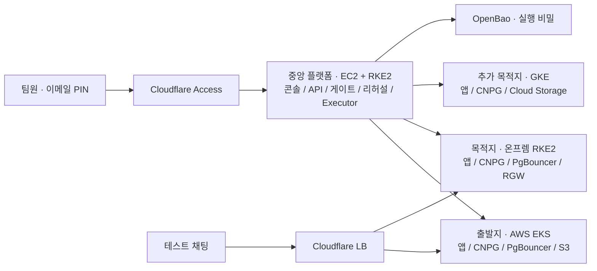

# B-free · 클라우드 이전 미니 플랫폼

류지환이 Team Bravo의 클라우드 출구전략을 구현·측정한 **개인 실험 저장소**입니다. 코드, 실제 클라우드 데모, 부하 측정, 실패 기록을 팀 리뷰와 재사용을 위해 공개합니다. 팀 정본과 공식 진행 상태는 [팀 platform](https://github.com/Softbank-Hackathon-Finals/platform)에서 관리합니다. 이 저장소의 구현을 팀 작업 완료로 계산하지 않습니다.

**현재(2026-11-03).** AWS EKS·온프렘 RKE2·GKE와 중앙 EC2/RKE2 플랫폼이 연결돼 있습니다. 11:18 KST에 콘솔 로그인·세 환경 수집·플랫폼 서비스 응답을 다시 확인했습니다. S2 리허설, 실제 쓰기를 사용한 트래픽 SHIFT, 50쓰기+150읽기/초 부하의 개별 실측이 있습니다. **콘솔에서 사람 승인부터 실제 DB 컷오버·복구까지 잇는 전체 E2E는 아직 미완료입니다.**

## 목차

1. [클라우드 데모 사용하기](#클라우드-데모-사용하기)
2. [로드맵 대비 구현 현황](#로드맵-대비-구현-현황)
3. [측정 결과와 결함](#측정-결과와-결함)
4. [환경 넷](#환경-넷)
5. [읽는 순서](#읽는-순서)
6. [폴더와 명령](#폴더)

## 클라우드 데모 사용하기

- **운영 콘솔:** [b-free.mangowhois.ai](https://b-free.mangowhois.ai/) — 팀 Slack에 등록된 이메일로 One-time PIN 로그인. 팀 리뷰 계정은 `viewer`입니다.
- **이전 대상 채팅 앱:** [b-free-chat.mangowhois.ai](https://b-free-chat.mangowhois.ai/) — 테스트 방에서 메시지를 보내고 환경 응답을 확인합니다. 실제 데이터 대신 시험 문구를 사용합니다.
- **추천 순서:** 홈 → 클러스터 → 데모 앱 → 관측 → 비용 영수증 → 기록 재생. 상세 화면별 안내는 [팀 데모 가이드](docs/demo/TEAM-DEMO.md)에 있습니다.
- 승인·컷오버·되돌리기는 지정 운영자와 승인자가 함께 진행합니다. 키 파일이나 클라우드 계정을 팀원에게 전달할 필요가 없습니다.



## 로드맵 대비 구현 현황

표의 날짜는 기존 개인 계획의 목표이며 완료일을 뜻하지 않습니다. **코드·시험 / 실제 환경의 부분 실측 / 콘솔 전체 E2E**를 구분합니다. 기준 코드는 공유 시점 main이며, 원본 기록은 [증거 색인](docs/evidence/README.md)에서 실행 ID로 확인할 수 있습니다.

| 목표 구간 | 작업 | 현재 구현·검증 | 다음 완료 기준 |
|---|---|---|---|
| 11/3–4 기반 | T1·T2·T6·T7·T9 | EKS·RKE2·GKE, CNPG·PgBouncer, OpenBao, Tunnel, 이미지 digest 고정, CI/OIDC 구현·가동 | 팀 정본과 다른 저장소·연결 방식을 검토하고 필요한 부분만 이전 |
| 11/3–4 계약·콘솔 | T10·T21·T24 | API·상태 머신·SSE·직무 분리·콘솔 구현. 실서비스 화면·관측 조회 확인 | 실제 운영자 계획 생성→승인 기록→실행의 콘솔 E2E |
| 11/5 보안·S2 | T5·T11·T14·T15·T16·T19·T31 | 통제 시험·의존성 수집·역할별 리허설·검증 Job·반영 도구. S2 두 역할 PASS, 검증 환경 반영 측정 | 남은 FAIL/예외 정리, 사람 승인 후 실제 목적지 반영·재대조 |
| 11/5 전환 | T8·T12·T13·T17 | 복제·첨부 복사·펜싱·영수증·컷오버 코드. 도구 경로 SHIFT 왕복 측정 | 콘솔 승인→SHIFT→실제 DB CUTOVER→영수증 |
| 11/6 복구·품질 | T18·T20·T25 | 50쓰기+150읽기/s 부하 실측, 복구·장애 처리 코드 | 부하 컷오버 5회와 실제 failback, 유실·중복·정지 시간 대조 |
| 11/6–7 데모 인수 | T22·T23·T26·T27·T28·T29 | 관측·비용 화면, 사전 점검·예열·reset·각본·통합 점검표 | Exit Drill, 270초/5분 전체 리허설 3회 연속, 발표 시간 확정 |

## 측정 결과와 결함

| 항목 | 기록된 결과 | 해석·근거 |
|---|---|---|
| 출발지 부하 | 50쓰기 + HTTP 읽기 150건/s × 300초. 쓰기 p95 138.1ms, 읽기 p95 123.2ms. 쓰기 15,000건 유실·중복 0 | [부하 원본](docs/evidence/load/README.md). 부하 중 컷오버 시험은 아직 없음 |
| S2 리허설 | governance 150–210초, app_migration 180–187초 PASS | [S2 시간](docs/evidence/s2-timing/README.md). API Pod·미리 보기 Pod 경로, 콘솔 승인 전 |
| 실제 쓰기 SHIFT | 정방향 43.9초, 역방향 46.8초, 단계별 오류 0 | [왕복 증거](docs/evidence/shift/lb-roundtrip-after-gw-fix-20261103T044632/README.md). 도구 경로, 계획·승인 없음 |
| 차가운 DB 연결 풀 | 예열 51초 뒤 정방향 48.3초 통과 | [예열 시험](docs/evidence/shift/pgbouncer-warm-pool-20261103/README.md). 역방향은 표본 90/100으로 실패 |

**열린 문제:** 가중치 변경 직후 표본 부족, 콘솔 전체 E2E 미실행, 컷오버·복구 실측 부재, 일부 비용 출처와 콘솔 로그·트레이스 목록 미연결. 고친 결함과 남은 결함, 재개 지점은 [리뷰·결함 목록](docs/demo/REVIEW-STATUS.md)에 정리했습니다. 표본 속도 120/s 변경(`dd85cef`)은 `pending/shift-probe-rate-120` 브랜치의 **미배포·재시험 대기 코드**입니다.

**지금 리뷰할 지점:** [개발 경과와 결정](docs/demo/IMPLEMENTATION-CONTEXT.md)에 Gateway 503의 원인, S2의 전후 시간, SHIFT 성공·실패, 예열과 표본 부족을 커밋별로 연결했습니다. 특히 **검증기 규칙 6개와 검증 Job 변경은 사람 검토가 필요**합니다. S2를 미리 시작하면 같은 계획의 게이트를 무대에서 다시 돌릴 수 없어 **온프렘 결과 사전 기록 + GKE 게이트 실연**을 제안한 상태입니다. **S3 80초 구간은 콘솔 컷오버를 재기 전까지 성립한다고 할 수 없습니다.**

실행 키는 플랫폼 OpenBao와 Kubernetes Secret에 있습니다. CI는 GitHub OIDC·`GITHUB_TOKEN`을 사용합니다. 저장소 복제로 운영 키를 얻을 수 없으며, 팀원은 본인 이메일로 데모를 이용합니다. [접근·비밀 관리](deploy/platform/access/README.md)

## 깊이 하나

가동 중인 서비스를 멈추지 않고 옮기고, 옮긴 뒤에도 같다는 것을 증명하고, 문제가 생기면 데이터째 되돌립니다. 나머지 기능은 이 문장을 증명하는 수단입니다.

## 정본

개인 구현의 원천 스펙·사본·편차는 [docs/spec/README.md](docs/spec/README.md), [SOURCES](docs/spec/SOURCES.md), [DEVIATIONS](docs/spec/DEVIATIONS.md)에 있습니다. 과거 문서는 당시 기록으로 보존합니다. 현재 배포 환경은 [클라우드 실행 계약](deploy/CLOUD-E2E-CONTRACT.md), 팀에서 앞으로 합칠 계약은 [팀 설계 정본](https://github.com/Softbank-Hackathon-Finals/platform/blob/main/docs/design.html)을 확인합니다.

## 환경 넷

플랫폼 클러스터 하나와 고객 앱 환경 셋입니다.

| 환경 | 역할 | 위치 | 구성 | 근거 |
|---|---|---|---|---|
| `platform-aws` | 중앙 제어(본부) | AWS 서울, VPC ② | EC2 + RKE2 단일 노드, 플랫폼 DB·OpenBao·관측·제어 서비스 | 현재 환경: 실행 계약 0절, ADR 0010 |
| `source-aws` | 고객 앱 출발지 | AWS 서울, VPC ① | EKS, CNPG, PgBouncer, ESO. 앱이 S3 · Secrets Manager · KMS를 직접 씀 | §7.2, T6 |
| `target-onprem` | 고객 앱 목적지 | 온프렘 장비의 Lima VM 2대(Ubuntu) | RKE2(CIS), CNPG, PgBouncer, ESO, Rook-Ceph RGW | 개인 스택. 팀 정본 SeaweedFS와 비교 필요 |
| `target-gcp` | 두 번째 목적지 | GCP, 프로젝트 `b-free-target-20261102` | GKE(Dataplane V2). 온프렘과 같은 계약의 랜딩 존, 객체 저장은 Cloud Storage(D-22). 팀장 지시로 데모 목적지에 넣음(2026-11-02, 원래 제안 D-01은 "컷오버 1회 뒤") | D-01, 결정 D-21, D-23 |

이전 경로는 넷입니다. AWS에서 온프렘(P0, 데모), 온프렘에서 AWS로 되돌리기(P0), AWS에서 GCP(P2), 리전 이전(설계 문서에만, 제안 D-07)입니다. 자세한 것은 [docs/architecture/03-migration.md](docs/architecture/03-migration.md)에 있습니다.

## 읽는 순서

1. [docs/spec/README.md](docs/spec/README.md): 스펙과 저장소의 관계
2. [docs/architecture/00-overview.md](docs/architecture/00-overview.md): 전체 구조 한 장
3. [docs/spec/SPEC-TRACE.md](docs/spec/SPEC-TRACE.md): 요구와 작업이 어느 폴더로 가나
4. [docs/spec/TECH-STACK-SPEC.md](docs/spec/TECH-STACK-SPEC.md): 기술 스택 정본. 영역별 판과 세부는 [docs/architecture/06-tech-stack.md](docs/architecture/06-tech-stack.md)
5. [docs/plans/2026-11-03-to-07.md](docs/plans/2026-11-03-to-07.md): 일정
6. 자기 영역 폴더의 README

## 폴더

```text
bravo-platform/
├── AGENTS.md              # 사람과 코딩 에이전트 공통 작업 규칙
├── docs/
│   ├── spec/              # 스펙 사본, 추적표, 편차 제안
│   ├── architecture/      # 구조, 환경, 네트워크, 이전, 거버넌스, 리허설, 기술 스택
│   ├── adr/               # 회의에서 정한 결정
│   ├── plans/             # 일정과 영역별 계획
│   ├── runbooks/          # 컷오버, 되돌리기, 초기화, 삭제 절차
│   └── evidence/          # 실행 ID와 시각이 붙은 측정 기록
├── infra/
│   ├── modules/           # 기능 계약 + 환경별 구현(스펙 §8.8)
│   ├── envs/              # platform-aws, source-aws, target-onprem, target-gcp
│   └── cloud-init/        # 스펙 §8.8의 공통 설치 자리. RKE2 노드 준비는 modules/cluster가 맡음
├── platform/              # 플랫폼(본부) 서비스
│   ├── api/               # 플랫폼 API, 상태 머신, 이벤트 스트림, 감사 로그
│   ├── collector/         # 읽기 전용 수집기
│   ├── agent/             # 에이전트 워커, 도구 계층, 의존성 인벤토리
│   ├── rehearsal/         # 리허설 러너와 Harbor(에이전트 샌드박스 · 평가 프레임워크, CNCF 레지스트리 Harbor와 다름) 어댑터. 프로토타입 있음
│   ├── gate/              # 통제 시험기, 원본 대조 게이트
│   ├── governance/        # 규제 매핑표, 거버넌스 팩
│   ├── executor/          # Cutover Executor, 무결성 영수증, 되돌리기
│   └── console/           # 운영 콘솔
├── apps/demo/             # 이전 대상 데모 앱(개인 실험 채팅 앱)
├── tools/loadgen/         # 부하 생성기와 관측
├── policies/              # NetworkPolicy, Kyverno, 정책 린트 규칙
├── deploy/                # 클러스터 안 배포 매니페스트
├── tests/e2e/             # 시나리오 S1–S4 인수 시험
├── scripts/               # 저장소 검사 스크립트
└── .github/workflows/     # ci.yaml, images.yaml, platform-images.yml(빌드, 이미지, 검사)
```

## 명령

| 목적 | 명령 |
|---|---|
| 문서 검사 | `make check` |
| 리허설 프로토타입 시험 | `make -C platform/rehearsal check` |
| 데모 시작 상태로 되돌리기(계획만) | `deploy/scripts/reset-demo.sh --dry-run` |
| 데모 각본과 통합 점검 | `docs/demo/SCRIPT.md`, `docs/demo/INTEGRATION-CHECK.md` |

클라우드 자원은 `infra/envs/<환경>/`의 Terraform으로 관리합니다. 공유 데모의 자원 변경·초기화·실제 전환은 운영자와 실행 시간을 맞춥니다.
