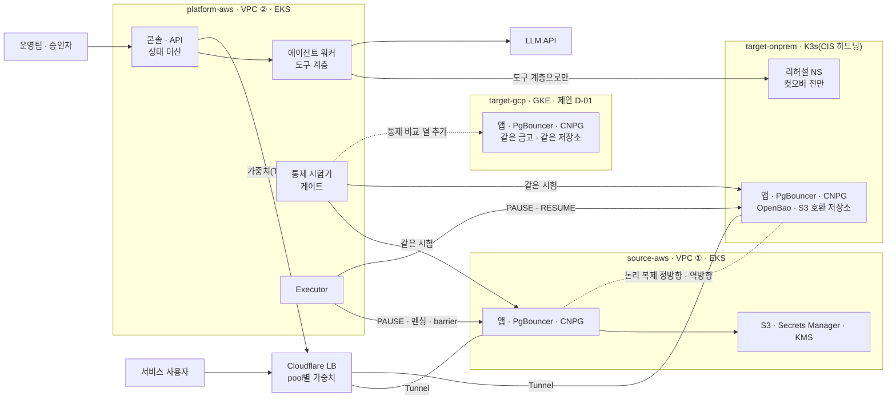

# 전체 구조

이 문서는 스펙 §7.1, §7.2, §7.4, §8.1을 저장소 폴더 기준으로 다시 묶습니다. 스펙과 다르면 스펙을 따릅니다.

## 1. 한 문장

플랫폼(본부)이 고객 클러스터 사이의 이전을 지휘합니다. 평상시 사용자 요청과 DB 복제는 플랫폼을 거치지 않습니다. 플랫폼은 환경을 세우고, 검증하고, 옮기는 일만 합니다(§7.2).

## 2. 구성도

그림 1. 실선은 요청과 제어, 점선은 계속되는 데이터 흐름이나 제안 범위입니다. 환경 사이 제어와 복제는 Cloudflare 관리 Tunnel과 링크로 갑니다(제안 D-16, `02-network.md`). 어느 환경에도 들어오는 포트가 없고, 출발지 EKS API와 온프렘 K3s API도 같은 링크로 닿습니다. 클러스터 종류는 결정 D-21입니다. 목적지 S3 호환 저장소는 후보 Rook-Ceph RGW(제안 D-22, 검증 중)입니다. 모든 고객 클러스터에 같은 묶음(랜딩 존)을 설치합니다(D-23, `11-landing-zone.md`). 클러스터별 지도는 `10-cluster-overview.md`입니다.

## 3. 흐름 여덟 단계

스펙 §7.1의 번호 단계입니다. 상태 머신의 상태 이름(§8.2)과 담당 폴더를 붙였습니다.

| 단계 | 상태 | 하는 일 | 성격 | 폴더 |
|---|---|---|---|---|
| 1 수집 | COLLECT | 출발지와 목적지 설정을 읽기 전용으로 모음 | 결정적 | `platform/collector/` |
| 2 분석 | ANALYZE | 의존성 3등급, 통제 차이, 소재 표시(GOV-01) | 정적 탐지 + 애매한 것만 AI | `platform/agent/`, `platform/gate/`, `platform/governance/` |
| 3 AI 제안 | PROPOSE | 번역안과 수정안을 스키마 제안서로 | 비결정적 | `platform/agent/` |
| 4 리허설 | REHEARSE | 격리 네임스페이스에서 적용하고 별도 Job으로 검증 | 결정적 틀 안에서 AI가 시도 | `platform/rehearsal/` |
| 5 게이트 | GATE | 원본과 대상에 같은 질문, 하나라도 다르면 차단 | 결정적 | `platform/gate/` |
| 6 승인 | AWAIT_APPROVAL | plan, diff, digest, 대상, 만료에 묶인 승인 | 사람 | `platform/api/` |
| 7 전환 · 컷오버 | SHIFT, CUTOVER | 가중치 10, 50, 100%, 짧은 쓰기 정지 | 결정적 | `platform/executor/`, `platform/api/edge/` |
| 8 감시 · 되돌리기 | WATCH, FAILBACK | 통제 재시험, 장애 시 데이터째 되돌리기 | 결정적 | `platform/executor/`, `platform/gate/` |

1–4단계는 AI가 제안하고 코드가 합격선을 지킵니다. 5–8단계에는 AI가 들어가지 않습니다.

## 4. 결정 · 비결정 기준

스펙 §8.1의 네 칸입니다. 11/1 회의에서 정한 축 이름은 "입력이 결정적인가 × 출력이 결정적인가"이고, 스펙은 이를 "과정이 정해져 있는가 × 결과가 항상 같아야 하는가"로 적었습니다. 이 저장소는 스펙의 표현을 씁니다.

| | 결과가 항상 같아야 함 | 결과가 달라도 됨 |
|---|---|---|
| **과정이 정해짐** | 코드만: 게이트, 통제 시험, 컷오버, 되돌리기 | AI 작성 + 사람 확인: 리포트, 승인 요약 |
| **과정이 정해지지 않음** | AI가 시도, 코드가 합격선 고정: S2 수정 루프 | AI 제안 + 사람 판단: 애매한 의존성, 장애 원인 추정 |

비결정이 하나라도 끼는 칸에만 AI를 씁니다. 코드에서는 이 경계를 모듈 경계로 지킵니다. 게이트, Executor, 상태 머신 전이 코드는 LLM 클라이언트를 import하지 않습니다(NFR-5).

## 5. 깊이 하나

킥오프는 "하나를 골라 프로덕션 수준까지 깊게"를 강조했습니다. 이 플랫폼의 깊이는 한 문장입니다. **가동 중인 서비스를 멈추지 않고 옮기고, 옮긴 뒤에도 같다는 것을 증명하고, 문제가 생기면 데이터째 되돌린다.** 아래 중점 셋은 이 문장을 증명하는 수단입니다. GCP 환경(D-01), Harbor(에이전트 샌드박스 · 평가 프레임워크, CNCF 레지스트리 Harbor와 다름) 실행 계층(D-02), 소재 차단(D-03b)은 이 문장을 해치지 않을 때만 더합니다.

## 6. 중점 셋과 시나리오

| 중점 | 무엇을 증명하나 | 시나리오 | 주요 폴더 |
|---|---|---|---|
| ① 보안 유지 | 6개 통제가 이전 뒤에도 퇴행하지 않음 | S1, S3 | `platform/gate/` |
| ② 데이터 무결성 | 실패 · 유실 · 중복 0건, 쓰기 정지 5초 이하, 데이터째 되돌리기 | S3, S4 | `platform/executor/`, `tools/loadgen/` |
| ③ 에이전트 샌드박스 | AI는 격리 리허설에서만 고치고, 별도 검증과 승인 뒤에만 반영 | S2 | `platform/agent/`, `platform/rehearsal/` |

## 7. 이 문서에 없는 것

- 환경별 크기와 비용: `01-environments.md`
- 포트, 환경 사이 링크와 Access 토큰, 테넌트 격리, DB 역할: `02-network.md`
- 상태 전이 조건과 이전 완수 기준: `03-migration.md`
- 통제 시험 방법과 거버넌스 팩: `04-governance.md`
- 에이전트 도구와 리허설 격리: `05-agent-rehearsal.md`
- 클러스터별 구성과 연결: `10-cluster-overview.md`
- 모든 고객 클러스터에 같은 묶음(랜딩 존)과 환경 만들기: `11-landing-zone.md`
