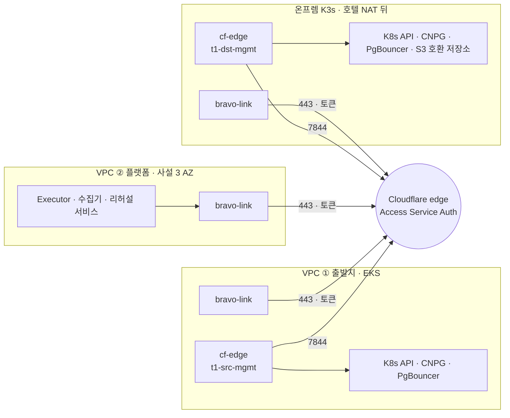
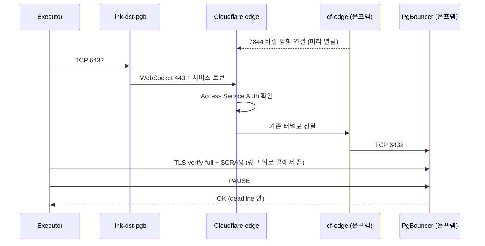

# 네트워크

스펙 §7.5의 경로 규칙을 흐름, 포트, 신원 단위로 풉니다. 환경 사이 연결은 제안 D-16을 따릅니다. 스펙의 연결 수단 대신 Cloudflare Tunnel과 Access 서비스 토큰을 씁니다. 설계 근거는 `research/platform-research/network-design-2026-11-02.md`입니다. 그 문서의 공식 문서와 가격표는 모두 2026-11-02에 조회했습니다.

"제안 D-16"이 붙은 것은 회의에서 정하기 전에는 구현하지 않습니다(`docs/spec/DEVIATIONS.md`).

원칙은 넷입니다.

1. 어느 환경에도 인터넷에서 들어오는 포트를 열지 않습니다. 모든 연결은 안에서 밖으로 나갑니다. 사용자는 사용자 진입 Tunnel로, 환경 사이 연결은 관리 Tunnel과 링크로 들어옵니다(제안 D-16).
2. 평상시 사용자 요청과 DB 복제는 플랫폼을 거치지 않습니다(§7.2). 복제는 두 고객 클러스터 사이의 링크로 바로 갑니다.
3. 네트워크 위치를 믿지 않습니다. 같은 VPC나 같은 클러스터 안이라는 이유로 허용하지 않습니다. 계층마다 기본 거부입니다(9절).
4. 누가 무엇을 할 수 있는지는 신원이 정합니다. 신원은 Access 서비스 토큰, 메시 SPIFFE 신원, K8s 서비스 계정, DB 역할로 나눕니다.

**용어.**

| 용어 | 뜻 |
|---|---|
| 관리 Tunnel | 노출하는 고객 클러스터가 Cloudflare로 먼저 열어 두는 바깥 방향 연결. 사용자 진입 Tunnel과 따로 둠. `cf-edge` 네임스페이스의 `cloudflared` 복제본 2개 |
| 링크(link) | 상대 환경의 서비스 하나를 로컬 Service 이름으로 받는 클라이언트. 소비하는 클러스터의 `bravo-link` 네임스페이스에 `cloudflared access tcp` Deployment 1개(복제본 2)와 Service 1개 |
| 서비스 토큰 | 링크가 Cloudflare Access에 내는 기계용 자격(Client ID와 Client Secret). 링크마다 따로 |
| 제어면 | K8s API, PgBouncer 관리, DB 제어처럼 짧은 요청과 응답 |
| 데이터면 | 논리 복제(5432)와 첨부 복사(목적지 저장소의 S3 API, 443)처럼 오래 유지되는 대량 연결 |

## 1. 흐름 열네 개

| 흐름 | 경로 | 포트 | 신원 · 인증 · 암호화 | 집행 | 끊기면 |
|---|---|---|---|---|---|
| F1 사용자 요청 | 브라우저, Cloudflare LB, 사용자 진입 Tunnel, 앱, PgBouncer, CNPG. SHIFT 구간의 목적지 PgBouncer는 링크 `src-db`로 출발지 CNPG에 씀. 컷오버 7단계 뒤 출발지 PgBouncer는 출발지의 링크 `dst-db`로 목적지 CNPG에 씀 | 443(HTTPS, WebSocket). Tunnel은 밖으로 7844 | 데모는 사용자 인증 없음(운영은 Access). TLS는 edge에서 끝남. 출발지 DB 쓰기는 토큰 `dst-src-db` + `chat_app`. 7단계 뒤 목적지 DB 쓰기는 토큰 `src-dst-db` + `chat_app` | SG 인바운드 0. NetworkPolicy는 사용자 진입 커넥터(`cf-web`)에서 앱으로만 | LB monitor가 다른 pool로 넘김 |
| F2 콘솔 · MCP | 운영자의 브라우저나 MCP 클라이언트, Cloudflare Access, 플랫폼 `cf-edge`의 cloudflared, 콘솔 · API 또는 운영자 MCP 서버(`operator-mcp`) | 443 | Access 사용자 정책(콘솔은 브라우저 로그인, MCP는 Managed OAuth). API와 `operator-mcp`가 각자 자기 앱의 `Cf-Access-Jwt-Assertion`을 검사하고 `auth_lookup(iss, sub)`로 역할과 테넌트를 정함(8.2절, `08` 5절) | Access, NetworkPolicy, Istio(API는 cloudflared와 콘솔에서만, `operator-mcp`는 cloudflared에서만 받음) | 로그인할 수 없으면 사전 실행 기록 |
| F3 플랫폼 안 | API, 상태 머신, 게이트, 수집기, 리허설 서비스 사이 | 서비스 포트, HBONE 15008 | SPIFFE 신원, ztunnel mTLS. 메시 밖 Pod(Executor, 플랫폼 DB, 링크)는 앱 TLS, 앱 토큰, SCRAM | AuthorizationPolicy, NetworkPolicy(`07` 4절) | 호출 실패. 상태는 DB에 남음 |
| F4 플랫폼에서 출발지 EKS API | 수집기 · 통제 시험기 · Executor, 링크 `src-k8s`, edge, `t1-src-mgmt`, 출발지 EKS 비공개 엔드포인트 | 443 | 토큰 `plat-src-k8s` + IAM 역할 단기 토큰(Pod Identity로 받은 역할을 EKS access entry에 매핑). TLS는 API 서버까지 끝에서 끝 | Access, NetworkPolicy, EKS RBAC | COLLECT 재시도 |
| F5 플랫폼에서 온프렘 K3s API | 수집기 · 통제 시험기 · 리허설 서비스 · Executor, 링크 `dst-k8s`, edge, `t1-dst-mgmt`, `kubernetes.default.svc`, K3s server의 API(6443) | 링크 443, API 서버 6443 | 토큰 `plat-dst-k8s` + 호출 주체별 서비스 계정(O12). TLS 끝에서 끝(`tls-server-name`) | Access, NetworkPolicy, RBAC, 이름 접두어 admission | 리허설 실패로 기록 |
| F6 PgBouncer · DB 제어 | Executor, 링크 `*-pgb` · `*-db`, edge, 관리 Tunnel, PgBouncer · CNPG. 수집기의 DB 읽기도 `*-db` 링크 | 6432, 5432 | 토큰 `plat-*-pgb`, `plat-*-db` + `pgb_admin`, `executor_ctl`, `collector_ro`(SCRAM). DB TLS `verify-full` | Access, NetworkPolicy(링크는 허용한 호출자만), PgBouncer `admin_users`, `pg_hba` | ABORT_PRE_WRITE 또는 SAFE_HOLD(10.1절) |
| F7 논리 복제 | 정방향은 목적지 CNPG(구독자), 링크 `src-db`, edge, `t1-src-mgmt`, 출발지 CNPG. 역방향은 출발지 CNPG가 링크 `dst-db`로 | 5432 | 토큰 `dst-src-db` 또는 `src-dst-db` + `replicator`(SCRAM). `verify-full` | Access, NetworkPolicy, `pg_hba` | 지연이 늘고 슬롯이 WAL을 붙잡음. `max_slot_wal_keep_size`를 넘으면 슬롯이 `lost`가 되어 재동기화(`03` 4.1) |
| F8 첨부 복사 · 역복사 | 출발지 복사 Job, 링크 `dst-s3`, edge, `t1-dst-mgmt`, 목적지 S3 호환 저장소(후보 Ceph RGW, 제안 D-22, 검증 중). S3는 게이트웨이 엔드포인트로 접근 | 443(후보 RGW의 TLS 포트 기준, 확인 필요) | 토큰 `src-dst-s3` + 첨부 버킷 하나에 묶인 자격. 저장소 종단 TLS는 O10 | Access, NetworkPolicy | 대조가 어긋나면 컷오버를 시작하지 않음(D-04) |
| F9 배포 | 빌드는 GitHub 호스팅 runner에서 GHCR로. 각 클러스터의 Argo CD가 `github.com`의 배포 저장소를 당겨 옴. 첫 설치만 VPC 안 CodeBuild(14절)(제안 D-16) | 443 | 빌드는 OIDC. 배포 저장소는 읽기 전용 자격(공개 저장소면 없음, 확인 필요). 이미지는 digest | SG 아웃바운드, Kyverno digest 검사(P1) | 배포가 늦어짐 |
| F10 에이전트 Pod | 에이전트 Pod에서 도구 계층, LLM 게이트웨이, 관측 백엔드 | MCP 포트, 15008, 4317 | Trial 토큰 + 메시 신원 `agent-worker`. OTLP는 메시 밖 평문 gRPC | NetworkPolicy, AuthorizationPolicy | 모두 fail-closed. Trial은 INFRA_ERROR |
| F11 LLM API | LLM 게이트웨이, Regional NAT, `api.anthropic.com` | 443 | 모델 키(게이트웨이에만). TLS | SG, NetworkPolicy | Trial 중단 |
| F12 관측 | 서비스에서 OTLP 백엔드. Prometheus가 ztunnel 메트릭을 수집 | 4317, 15020(확인 필요) | 메시 밖, 클러스터 안 평문 | NetworkPolicy | 판정 근거가 아님(`07` 6절) |
| F13 DNS | Pod, CoreDNS, VPC 리졸버 | 53 | 없음 | NetworkPolicy(kube-dns만), SG | 이름 해석 실패 |
| F14 Edge 제어 | Edge 제어 Pod, Regional NAT, `api.cloudflare.com` | 443 | LB 범위로 제한한 API 토큰 | SG, NetworkPolicy(Edge 제어 Pod만) | 가중치가 그대로 남음 |

**제어면과 데이터면.** 폴백은 이 구분으로 고릅니다(`DEVIATIONS.md` D-16).

| 면 | 흐름 | 끊기면 |
|---|---|---|
| 제어면, 동기 | F4, F5, F6 | 쓰기 전이면 ABORT_PRE_WRITE, 쓰기 뒤면 SAFE_HOLD |
| 제어면, 비동기 | F9 | 배포가 늦어질 뿐. 멱등 |
| 데이터면 | F7, F8 | 복제 지연이 늘고 슬롯이 WAL을 붙잡음. 한도를 넘으면 재동기화 |

**관리형 의존성.** 출발지 앱은 S3, Secrets Manager, KMS를 직접 부릅니다. 목적지 앱은 클러스터 안 S3 호환 저장소(D-22)와 OpenBao를 씁니다. 목적지가 GKE나 EKS여도 같은 랜딩 존이라 같습니다(D-23, `11-landing-zone.md`). 이 경로는 S2의 재료이므로 바꾸지 않습니다(§8.10). 바깥 경로는 7절에 있습니다.

**배포 경로(F9) 제안.** 어느 클러스터에도 들어오는 포트가 없습니다. 그래서 배포를 밀어 넣지 않고, 각 클러스터의 Argo CD가 Git 저장소를 당겨 옵니다(제안 D-16, O5).
- 예선 수상작 Crystal이 같은 방식을 썼습니다.
- 첫 설치(`cf-edge`, Argo CD)만 VPC 안 CodeBuild가 한 번 합니다. 그 뒤 배포는 Argo CD pull뿐입니다. 플랫폼 클러스터도 같습니다(14절).
- 플랫폼은 승인 해시와 digest가 맞을 때만 배포 저장소에 커밋합니다.
- 커밋 왕복은 초 단위 이상입니다. 그래서 컷오버 명령에는 쓰지 않습니다.
- 폴백은 플랫폼 안 일회용 runner가 링크 `*-k8s`로 push하는 방식입니다.
- **배포 잠금.** CUTOVER부터 DONE까지, 그리고 보안 보류가 걸린 동안 플랫폼은 두 가지를 합니다. 링크 `*-k8s`로 그 앱의 Argo CD AppProject에 deny sync window를 겁니다. 배포 저장소 커밋도 거부합니다. 시험은 N18입니다.
- 링크가 끊겨 window를 풀지 못하면 잠금이 남습니다. 안전한 쪽입니다.
- Helm 차트는 PgBouncer 대상 설정 두 벌과 기본 선택만 갖습니다. 실행 중 대상은 Executor만 바꿉니다(`03` 4.1).

## 2. 토폴로지와 VPC



그림 1. 모든 선이 안에서 밖으로 나갑니다. `cf-edge`는 서비스를 내놓는 커넥터이고, `bravo-link`는 상대 서비스를 로컬 이름으로 받는 클라이언트입니다. 가운데 Cloudflare edge가 서비스 토큰으로 호출자를 가립니다. 사용자 진입 Tunnel, 콘솔 Tunnel, GCP 환경(D-01)은 그림에서 뺐습니다.

### 2.1 서브넷과 VPC 사이 경로

| VPC | 서브넷 | AZ | CIDR | 내용 |
|---|---|---|---|---|
| ② 플랫폼 `10.20.0.0/16` | `plat-a`, `plat-b`, `plat-c` | 2a, 2b, 2c | `10.20.11.0/24`, `10.20.12.0/24`, `10.20.13.0/24` | EKS 관리형 노드 그룹(core, agents)의 노드와 Pod(VPC CNI), EKS 제어면 ENI. 공인 IP 없음 |
| ① 출발지 `10.10.0.0/16` | `src-a`, `src-c` | 2a, 2c | `10.10.11.0/24`, `10.10.13.0/24` | `src-a`에 노드 1대. `src-c`는 EKS의 서브넷 2개 요건용(확인 필요) |

- 공개 서브넷은 없습니다. 아웃바운드는 VPC마다 Regional NAT Gateway 하나로 나갑니다(7절). Regional NAT는 공개 서브넷 없이 동작합니다(AWS 문서).
- 두 VPC 사이에는 경로가 없습니다. 출발지 EKS도 목적지와 똑같이 링크로 닿습니다.
- 고객 환경은 다른 계정이나 다른 클라우드일 수 있습니다. 그때는 피어링이 없으므로, 데모도 같은 방식을 씁니다.
- VPC 피어링은 링크가 막힐 때 쓸 비상 토글로만 남깁니다. 기본은 꺼짐입니다(O3).
- 출발지 VPC는 노드가 AZ 하나에만 있습니다. 그래서 출발지의 AZ 장애 내성은 주장하지 않습니다.
- 온프렘 VM은 호텔 NAT 뒤에 있습니다. 밖으로 나가는 7844와 443만 씁니다. 새로 여는 포트는 없습니다.
- Pod와 Service 대역은 `01-environments.md` 4절 그대로입니다.

### 2.2 보안 그룹과 NACL

| SG | 붙는 곳 | 인바운드 | 아웃바운드 |
|---|---|---|---|
| `sg-plat-node` | 플랫폼 EKS 노드(core, agents) | EKS 클러스터 SG와 서로(EKS가 관리), 자기 SG 전체(노드 사이 Pod 통신, HBONE 15008 포함) | TCP 443, TCP · UDP 7844, TCP · UDP 53, 자기 SG 전체 |
| `sg-src-node` | 출발지 EKS 노드 | EKS 클러스터 SG와 서로(EKS가 관리) | TCP 443, TCP · UDP 7844, TCP · UDP 53 |
| EKS 클러스터 SG | 두 클러스터의 제어면 ENI | 노드 SG의 443 | EKS가 관리 |

온프렘 K3s는 AWS SG가 없습니다. Lima VM 사이 네트워크에서 아래만 엽니다. 호스트 밖으로는 내놓지 않습니다.

| 포트 | 방향 | 용도 |
|---|---|---|
| TCP 6443 | agent에서 server로 | K3s supervisor와 API 서버 |
| TCP 10250 | 노드 사이 | kubelet |
| UDP 8472 | 노드 사이 | flannel VXLAN |

- 모든 EKS 노드는 IMDSv2 필수, hop limit 1입니다(노드 그룹 시작 템플릿).
- 보안 그룹은 FQDN을 거르지 못합니다. 그래서 443 아웃바운드는 `0.0.0.0/0`입니다.
- NetworkPolicy도 FQDN을 거르지 못합니다. 목적지는 IP · CIDR, Pod, 네임스페이스, 포트로만 가립니다. 그래서 Cloudflare로 가는 송신은 Cloudflare가 공개한 IP 대역으로 제한합니다(7절).
- 이름(FQDN) 단위 허용 목록은 LLM 게이트웨이 앱에만 있습니다. 노드의 이미지 pull은 Pod 정책 밖입니다.
- NACL에는 사용자 규칙을 두지 않습니다. NACL은 상태를 저장하지 않아 응답용 임시 포트를 모두 열어야 합니다. 그래서 규칙이 거칠어집니다. 보안 그룹이 이미 인바운드 0입니다.
- 예외는 Multi-AZ 파티션 시험 때 잠깐 거는 NACL입니다(`01-environments.md` 2절). 규정이 두 겹을 요구하는 고객에서만 상시 규칙을 더합니다.

## 3. 클러스터 API 경로와 호출 주체

| 클러스터 | API 경로 | 포트 | 이유 |
|---|---|---|---|
| `platform-aws` (EKS) | 비공개 전용 엔드포인트. 플랫폼 서비스는 클러스터 안에서 `kubernetes.default.svc`로 씀. 첫 설치는 VPC 안 CodeBuild, 비상 접근은 SSM 포트 포워딩(14절) | 443 | 인터넷에 API를 내놓지 않음 |
| `source-aws` (EKS) | 비공개 전용 엔드포인트. 플랫폼은 링크 `src-k8s`로 닿음. 원본은 EKS 안의 `kubernetes.default.svc:443` | 443 | VPC 사이 경로가 없어도 됨. 고객이 다른 계정이어도 같은 방식 |
| `target-onprem` (K3s) | 링크 `dst-k8s`. 원본은 클러스터 안의 `kubernetes.default.svc:443`이고, 이 Service가 K3s server의 API 서버(6443)로 보냄 | 링크 443, API 서버 6443 | API 서버를 VM 밖으로 내놓지 않음 |
| `target-gcp` (GKE, D-01) | 같은 링크 구성(O13). GKE 제어면은 비공개 엔드포인트 | 443 | 같음 |

- kubeconfig의 서버 주소는 링크 Service 이름입니다. 인증서 검증 이름은 `tls-server-name: kubernetes.default.svc`로 둡니다.
- Cloudflare kubectl 튜토리얼의 `proxyType: socks`는 쓰지 않습니다. 커넥터가 닿는 모든 주소를 내놓기 때문입니다. 원본은 서비스 하나당 `tcp://` 라우트 하나입니다.
- 링크와 Access 토큰은 "어느 클러스터에서 왔나"까지만 가립니다. 같은 링크를 쓰는 호출 주체는 아래 표의 K8s 자격으로 나눕니다.
- EKS 자격은 IAM 역할을 EKS access entry에 매핑한 단기 토큰입니다. 플랫폼 Pod는 EKS Pod Identity로 호출 주체별 IAM 역할을 받습니다(`platform/README.md`의 플랫폼 비밀 표).
- K3s 자격은 호출 주체별 서비스 계정 토큰을 168시간으로 발급합니다(제안, O12). 운영 권장은 K3s API 서버가 플랫폼 발급자의 JWT를 믿게 하는 방식(JWT 인증기)입니다. K3s에서 그 구성은 확인하지 못했습니다.

플랫폼 안 호출 주체마다 클러스터 자격을 따로 둡니다.

| 호출 주체 | 권한 | 대상 | 쓰는 링크 |
|---|---|---|---|
| 수집기 | 읽기 전용 ClusterRole. DB는 `collector_ro` | 모든 고객 클러스터 | `*-k8s`, `*-db` |
| 통제 시험기 | 읽기 + 거부 시험용 최소 권한 | 모든 고객 클러스터 | `*-k8s` |
| 리허설 프로비저너 | `rehearsal-*`, `verify-*` 네임스페이스 생성 · 삭제만. ValidatingAdmissionPolicy로 이름 접두어를 강제 | 목적지 클러스터 | `dst-k8s` |
| 리허설 exec | 리허설 네임스페이스 한정 Role | 목적지 클러스터의 해당 네임스페이스 | `dst-k8s` |
| Executor | DB 제어 역할과 PgBouncer 관리 사용자. K8s 권한은 PgBouncer Pod 이름 하나에 묶은 `pods/exec`만(RBAC `resourceNames`). ConfigMap 쓰기 권한은 없음(`03` 4.1) | 양쪽 클러스터 | `*-db`, `*-pgb`, `*-k8s` |
| 배포 잠금(상태 머신) | `argocd` 네임스페이스에서 그 앱의 AppProject `get`, `patch`만. deny sync window를 걸고 풂(1절) | 모든 고객 클러스터 | `*-k8s` |
| 배포 runner | 앱 네임스페이스 배포 권한. 계획이 잠겨 있으면 배포 거부. 제안 D-16에서는 폴백이고, 기본은 각 클러스터의 Argo CD(1절 F9) | 모든 고객 클러스터 | `*-k8s`(폴백일 때만) |

에이전트 워커에는 이 중 어떤 자격도 주지 않습니다(NFR-4). 에이전트 Pod에서 `bravo-link`로 가는 송신도 없습니다.

**클러스터 안.** 플랫폼 클러스터 안의 서비스 사이 호출은 Istio ambient의 mTLS로 암호화하고, 서비스 계정 신원으로 인가합니다. 인가 표와 NetworkPolicy 공존 규칙(15008, 프로브 주소)은 `07-runtime-mesh-observability.md` 4절에 있습니다. 고객 클러스터에는 P0에서 메시를 넣지 않습니다.
- `bravo-link`의 링크 Pod는 Executor, 플랫폼 DB와 같이 메시 밖입니다.
- 메시 안 수집기가 링크를 부르면 ztunnel은 평문 TCP로 넘깁니다. 그 위의 K8s API TLS와 DB TLS는 끝에서 끝으로 이어집니다.

## 4. 신원, Access 앱, 서비스 토큰 (제안 D-16)

### 4.1 이름 규칙

| 객체 | 이름 | 비고 |
|---|---|---|
| 사용자 진입 Tunnel | `t1-src-web`, `t1-dst-web` | §8.7. 관리 Tunnel과 따로 둠 |
| 관리 Tunnel | `t1-src-mgmt`, `t1-dst-mgmt` | 노출하는 클러스터의 `cf-edge` 네임스페이스, 복제본 2개 |
| 링크 | Deployment `link-<remote>-<svc>`, Service `<remote>-<svc>` | 소비하는 클러스터의 `bravo-link` 네임스페이스 |
| 서비스 토큰 | `<from>-<to>-<svc>` | 예: `dst-src-db` |
| 링크 호스트 | `t1-<env>-<svc>.<도메인>` | 한 단계 이름만 씀. 범용 인증서가 두 단계 이름을 덮는지는 확인 필요. 도메인은 미정(O11) |
| 콘솔 · MCP 호스트 | `console.<도메인>`, `mcp.<도메인>` | 테넌트가 공유. `08-operator-mcp.md` 9절 |

### 4.2 Access 앱과 토큰

테넌트 하나에 Access 앱 7개, 서비스 토큰 9개입니다.

| 앱 호스트 | 원본(`tcp://`, 그 클러스터 안) | 허용 토큰 |
|---|---|---|
| `t1-src-k8s` | `kubernetes.default.svc:443` | `plat-src-k8s` |
| `t1-src-db` | `chat-src-rw.chat.svc:5432` | `plat-src-db`, `dst-src-db` |
| `t1-src-pgb` | `pgbouncer.chat.svc:6432` | `plat-src-pgb` |
| `t1-dst-k8s` | `kubernetes.default.svc:443` | `plat-dst-k8s` |
| `t1-dst-db` | `chat-dst-rw.chat.svc:5432` | `plat-dst-db`, `src-dst-db` |
| `t1-dst-pgb` | `pgbouncer.chat.svc:6432` | `plat-dst-pgb` |
| `t1-dst-s3` | 목적지 저장소의 S3 Service. 후보 RGW면 `rook-ceph-rgw-bravo.rook-ceph.svc:443`(확인 필요, D-22) | `src-dst-s3` |

- 토큰을 호출 클러스터와 서비스마다 나눕니다. 링크 Pod 하나가 털려도 그 토큰은 앱 하나에만 닿습니다.
- 토큰 `src-dst-db`는 출발지 역방향 구독과, 컷오버 7단계 뒤의 출발지 PgBouncer가 같이 씁니다. 둘 다 출발지의 링크 `dst-db`를 지납니다.
- Access 정책의 동작은 Service Auth여야 합니다. Allow 정책은 서비스 토큰을 인증하지 않습니다(Cloudflare 서비스 토큰 문서).
- Tunnel 구성은 Cloudflare 원격 구성이 아니라 클러스터 안 설정 파일입니다(`config_src = "local"`, Git으로 배포). 그래서 Cloudflare 쪽 권한만으로 라우트를 더해 새 서비스를 내놓을 수 없습니다.
- Tunnel 설정의 마지막 규칙은 `http_status:404`입니다. 라우트가 없는 이름에는 닿지 않습니다.
- **순서.** Terraform은 Access 앱과 정책을 먼저 만들고, 그 뒤에 호스트 이름의 DNS 레코드(라우트)를 만듭니다(`depends_on`). 지울 때는 반대 순서입니다. 그래서 앱 없는 라우트가 생기지 않습니다.
- 앱 없는 라우트에 닿을 수 없는지는 N3 (e)로 시험합니다. 실패하면 커넥터의 `originRequest.access` 검사나 계정의 Access 보호 강제를 켭니다. 둘 다 `tcp://` 원본에 걸리는지는 확인 필요입니다.
- 정책이 없는 앱에 닿을 수 없는지는 확인하지 못했습니다. N3으로 시험합니다.
- 콘솔과 MCP의 Access 앱은 테넌트가 공유합니다. 테넌트는 `memberships`로 가립니다(`08` 5절).

### 4.3 링크와 토큰 다루기

```bash
# 링크 한 개(제안). 토큰은 마운트한 파일에서 읽음. 읽는 방법은 판마다 확인 필요(N12)
cloudflared access tcp --hostname t1-src-db.<도메인> --url 0.0.0.0:5432
#   토큰 파일: /etc/bravo-link/token/client-id, /etc/bravo-link/token/client-secret
```

**배치.**
- 링크는 소비하는 쪽의 Deployment 1개와 Service 1개입니다. Deployment는 복제본 2, zone anti-affinity, PDB(`minAvailable: 1`)를 둡니다.
- 플랫폼(3 AZ)에서는 두 복제본이 반드시 다른 AZ에 뜹니다. AZ가 하나뿐인 출발지와 온프렘에서는 anti-affinity를 선호 조건으로 둡니다. 그곳의 AZ 장애 내성은 주장하지 않습니다.
- 연결마다 WebSocket이 따로라서 복제본이 여럿이어도 문제가 없습니다. 다만 Pod 하나가 죽으면 그 Pod를 지나던 세션은 끊깁니다. 새 연결만 남은 Pod로 갑니다.
- NetworkPolicy는 허용한 호출자 Pod 라벨에서만 받습니다.
- 링크와 `cf-edge` Pod는 Pod Security `restricted`로 돕니다. `runAsNonRoot`, 읽기 전용 루트, `drop: [ALL]`, 서비스 계정 토큰 마운트 끔입니다.

**판.**
- `access tcp`의 서비스 토큰 플래그는 공식 문서가 아니라 제3자 매뉴얼과 이슈(#260)로만 확인했습니다. N12로 확인합니다.
- `cloudflared`는 11/3에 N12를 통과한 가장 새 판으로 고정하고 이미지 digest도 고정합니다(O9). 판과 digest는 `06-tech-stack.md` 3절에 적습니다.
- 보안 수정이 옛 고정 판(2026.5.1)보다 우선입니다. Cloudflare 보안 공지(eMudhra 인증서 문제)는 2026.10.2 이상으로 올리라고 안내한다고 리뷰가 인용했습니다(확인 필요).
- 2026.6.0에는 서비스 토큰 회귀 이슈(#1673)가 열려 있었습니다(2026-11-02 조회). 옛 이슈를 새 판 실패의 근거로 쓰지 않고 N12 결과로만 고릅니다.

**토큰.**
- 서비스 토큰은 수명 7일(11/3부터 11/9까지)입니다. 비밀 저장소의 `tenants/<tenant_id>/…` 경로에 두고 ESO로 Secret에 넣습니다.
- 링크는 토큰을 Secret 볼륨의 파일로 읽습니다. 환경 변수와 명령행 인자로 넘기지 않습니다. 인자는 `ps`에 보이고, 환경 변수는 Secret이 바뀌어도 실행 중 프로세스에 반영되지 않기 때문입니다.
- 회전하면 링크 Pod를 다시 띄웁니다(Pod 템플릿의 Secret 해시 주석). 이어서 N4로 옛 비밀이 거부되는지 봅니다.
- 회전 연습은 11/6에 한 번 합니다(N4). 11/7과 11/8에는 회전하지 않습니다. 11/9에 폐기합니다(O8).
- 회전할 때 옛 비밀의 유예는 1시간에서 30일 사이로 고릅니다.
- 서비스 토큰은 이 설계에 남는 장기 비밀입니다. 운영 권장은 짧은 수명과 자동 회전입니다.

**누가 만드나.**
- Terraform `edge_link` 모듈은 비밀이 아닌 것만 만듭니다. Tunnel, DNS 레코드, Access 앱, Service Auth 정책입니다. 리소스 이름은 provider 판에서 확인해야 합니다.
- 서비스 토큰과 Tunnel 토큰은 부트스트랩 스크립트가 Cloudflare API로 만듭니다. 스크립트는 값을 AWS Secrets Manager에 바로 씁니다. Terraform 상태 파일에는 들어가지 않습니다.
- 온프렘 쪽 토큰(관리 Tunnel, 사용자 진입 Tunnel, `dst-src-db`)은 운영자가 같은 LAN에서 온프렘 OpenBao에 한 번 넣습니다(런북). 파일이나 채팅에 남기지 않고, 넣은 사람과 시각을 기록합니다.
- Terraform은 토큰 ID(비밀 아님)만 입력으로 받아 정책에 넣습니다. provider가 Tunnel을 만들 때 비밀을 상태에 남기는지는 T1에서 `terraform state show`로 확인합니다(확인 필요).
- Cloudflare API 토큰은 이 파이프라인과 스크립트에만 둡니다. 고객 클러스터에는 자기 Tunnel 토큰과 자기 링크 토큰만 둡니다. 그래서 한 클러스터가 털려도 새 Tunnel이나 Access 앱을 만들 수 없습니다.
- 모듈 주인은 인프라 · CI(T1)입니다. Access 정책 내용은 T17이 검토합니다.

### 4.4 끊김과 노출에 대비한 설정

| 위험 | 영향 | 설정과 시험 |
|---|---|---|
| 커넥터가 다시 붙을 때 5432 세션이 끊김(Cloudflare 연결 방식 비교 문서) | 복제 지연이 잠시 늘고 구독이 다시 붙음. 슬롯이 한도 안에서 WAL을 지키면 이어서 받음. 한도를 넘으면 슬롯이 `lost`가 되어 이어 받지 못함 | `max_slot_wal_keep_size` 한도, `pg_replication_slots.wal_status` 감시, `cf-edge` 복제본 2개. `lost`면 컷오버 차단과 재동기화(`03` 4.1). N5, N5c |
| 미리 연 세션이 유휴 중에 끊김 | 컷오버 3단계 PAUSE가 보내지지 않음 | 아래 "링크 생존 확인". N5b |
| 컷오버 중 관리 세션이 끊김 | 펜싱 전이면 ABORT_PRE_WRITE, 뒤면 SAFE_HOLD. "PAUSE 보냄, 응답 없음"은 따로 다룸(아래) | 세션을 PAUSE 전에 열어 둠. 명령마다 deadline. 끊긴 뒤 상태는 DB와 효과 원장에서 다시 읽음(§8.6, D-19). N13, N13b |
| SHIFT 구간 목적지 PgBouncer의 출발지 DB 쓰기에 edge 왕복이 붙음 | p95가 늘어남. 값은 확인 필요 | N11로 `SELECT 1`과 쓰기의 p50, p95를 재고 가중치 단계 기준에 반영 |
| edge가 평문을 볼 수 있음(추정) | 끝에서 끝 TLS가 없으면 내용이 드러남 | 링크 위 프로토콜은 DB `verify-full`, K8s API TLS가 필수. N6 |

**링크 생존 확인.** 링크는 TCP를 받아 WebSocket으로 다시 여는 프록시입니다. 그래서 TCP keepalive만으로는 edge 구간이 살아 있는지 알 수 없습니다.
- 끊기는 이유는 둘입니다. AWS NAT Gateway는 350초 동안 유휴인 연결을 끊습니다(AWS NAT 문제 해결 문서). Cloudflare는 양방향 데이터가 없는 WebSocket을 닫습니다(Cloudflare WebSockets 문서).
- 링크 구간의 정확한 유휴 한도는 확인 필요입니다. N5b로 잽니다.
- 관리 · 제어 세션에는 앱 계층 heartbeat를 보냅니다. PgBouncer 관리 세션은 `SHOW VERSION`, DB 제어 세션은 `SELECT 1`입니다. 5초마다 보내고, 컷오버 준비부터 끝날 때까지 보냅니다.
- DB 클라이언트는 libpq `keepalives=1`과 `tcp_user_timeout`(제안 10000 ms)을 씁니다. 이것은 로컬 구간(링크 Pod까지)의 끊김 감지용입니다.
- 두 PgBouncer는 `query_wait_timeout = 8`(초)입니다. 정지 중 앱 요청은 최대 8초 기다립니다(스펙 §5.3).

**PAUSE 보냄, 응답 없음.** PAUSE를 보낸 뒤 응답 전에 링크가 끊기면 PgBouncer가 멈췄는지 모릅니다.
- 효과 원장의 그 행은 `UNKNOWN`입니다.
- 6a 전이라도 ABORT_PRE_WRITE는 원장이 "PAUSE가 적용되지 않음"을 증명할 때만 합니다(`CONFIRMED_NOT_APPLIED`, `platform/executor/README.md`).
- 증명하지 못하면 SAFE_HOLD입니다. 시험은 N13b입니다.

- 링크는 TCP를 받아 다시 여는 프록시입니다. 그래서 터널 MTU와 MSS 조정이 필요 없다고 봅니다(추정). N10으로 확인합니다.
- 7844 TCP만 열린 망이면 `cloudflared`를 `--protocol http2`로 고정합니다.
- 7844가 TCP와 UDP 모두 닫힌 망이면 F1(사용자 진입)도 같이 막힙니다. 이때는 구성을 바꾸지 않고 업링크를 바꿉니다. LTE 또는 5G 공유기 하나를 미리 준비합니다.
- 443만 열린 망에서 동작할 후보는 Cloudflare Mesh의 HTTP/2 폴백뿐입니다. 노드에서의 동작은 확인하지 못했습니다. F1이 어차피 7844를 쓰므로 P0에 넣지 않습니다.
- 폴백 순서와 판정 시점은 `DEVIATIONS.md` D-16에 있습니다.

## 5. DB 역할

모든 역할은 TLS(hostssl)와 SCRAM으로만 접속합니다. 역할은 마이그레이션 SQL로 만들고 CNPG 선언형 역할 관리로 만들지 않습니다(`03-migration.md` 4.1).

DB는 `hostssl`만 받습니다. CNPG는 사용자 `pg_hba` 규칙 뒤에 자기 기본 `host` 규칙을 붙입니다(CNPG 1.30 문서). 그래서 사용자 규칙의 첫 줄을 `hostnossl all all all reject`로 둡니다. 평문 접속은 이 줄에서 거부됩니다. N6 (b)로 시험합니다.

| 역할 | 쓰는 쪽 | 접속 이름(제안 D-16) | 허용하는 일 | 시험 |
|---|---|---|---|---|
| `replicator` | 정방향 · 역방향 구독 | 목적지에서 `src-db.bravo-link.svc.cluster.local`, 출발지에서 `dst-db.bravo-link.svc.cluster.local` | 복제 연결과 발행 테이블 읽기 | 이 역할의 INSERT가 거부됨 |
| `chat_app` | 양쪽 앱(PgBouncer 경유) | 평소에는 자기 클러스터 안. SHIFT 구간의 목적지 PgBouncer는 `src-db.bravo-link.svc.cluster.local`. 컷오버 7단계 뒤 출발지 PgBouncer는 `dst-db.bravo-link.svc.cluster.local`(토큰 `src-dst-db`). 그래서 목적지 `pg_hba`에도 `chat_app`의 `hostssl` 행이 있음 | 업무 읽기와 쓰기 | 펜싱 뒤 로그인과 쓰기 거부 |
| `executor_ctl` | Executor | 플랫폼에서 `src-db`, `dst-db`(`.bravo-link.svc.cluster.local`) | 펜싱, barrier, 최종 비교, 시퀀스 올림, 구독 켜고 끄기 | 앱 역할로는 같은 작업이 거부됨 |
| `pgb_admin` | Executor | 플랫폼에서 `src-pgb`, `dst-pgb` | PgBouncer PAUSE, RELOAD, RESUME. PostgreSQL 역할이 아니라 PgBouncer `admin_users`의 사용자 | 앱 역할의 관리 콘솔 접속 거부 |
| `collector_ro` | 수집기 | 플랫폼에서 `src-db`, `dst-db` | 카탈로그와 설정 읽기 | 쓰기 거부 |

역할 이름 `chat_app`은 스펙의 잠정 데모 앱 기준입니다. 앱이 정해지면 바꿉니다.

Access 토큰은 DB 역할을 구분하지 못합니다. 예를 들어 토큰 `dst-src-db`는 목적지 구독과 목적지 PgBouncer가 같이 씁니다. "5432는 복제 역할만"(T8)은 DB 인증으로 지킵니다. 링크로 온 연결은 모두 `cf-edge` Pod에서 옵니다. 그래서 `pg_hba`의 주소 조건으로 호출자를 가리기는 어렵다고 봅니다(추정).

## 6. 서비스 노출

노출하는 클러스터는 관리 Tunnel에 서비스마다 `tcp://` 라우트를 둡니다. 접속하는 클러스터는 `bravo-link`에 링크를 두고 그 Service 이름으로 접속합니다.

| 노출 서비스 | 포트 | 원본 | 접속하는 쪽 | TLS 서버 이름 | 신뢰하는 CA |
|---|---|---|---|---|---|
| 출발지 CNPG | 5432 | `chat-src-rw.chat.svc` | 목적지 구독, 목적지 PgBouncer, Executor, 수집기 | `src-db.bravo-link.svc.cluster.local`. CNPG `serverAltDNSNames`에 넣음 | 출발지 CNPG CA |
| 목적지 CNPG | 5432 | `chat-dst-rw.chat.svc` | 출발지 역방향 구독, 컷오버 7단계 뒤 출발지 PgBouncer, Executor, 수집기 | `dst-db.bravo-link.svc.cluster.local` | 목적지 CNPG CA |
| 양쪽 PgBouncer | 6432 | `pgbouncer.chat.svc` | Executor | `src-pgb`, `dst-pgb`(`.bravo-link.svc.cluster.local`) | 그 쪽 CNPG CA. SAN은 11.2절 |
| 목적지 S3 호환 저장소(D-22) | 443(확인 필요) | 후보 RGW면 `rook-ceph-rgw-bravo.rook-ceph.svc` | 출발지 복사 Job | `dst-s3.bravo-link.svc.cluster.local` | 저장소 인증서의 CA(O10) |
| 양쪽 K8s API | 443 | `kubernetes.default.svc`(EKS는 제어면, K3s는 server의 6443으로 감) | 플랫폼의 수집기, 시험기, 리허설 서비스, Executor | `kubernetes.default.svc`(`tls-server-name`) | 클러스터 CA |

**Pod Security.** `cf-edge`와 `bravo-link`의 Pod는 `restricted`를 지킵니다. `cloudflared` 이미지는 distroless `nonroot`(UID 65532)입니다. 그래서 환경 사이 연결 때문에 생기는 Pod Security 예외는 없습니다. 남는 예외는 `istio-system`(D-15)입니다.

**리허설과 링크.** 목적지 클러스터의 리허설 · 검증 네임스페이스에서 `cf-edge`와 `bravo-link`로 가는 송신은 없습니다. 그래서 샌드박스가 터널을 타고 플랫폼 쪽으로 나갈 수 없다고 봅니다(추정). 원본 서비스가 클러스터 밖에서 오는 연결을 받는 길은 `cf-edge`를 거친 것뿐입니다. 클러스터 안 호출자(CNPG 운영자, 다른 인스턴스, PgBouncer, 앱)는 원본마다 따로 허용합니다.

**`cf-edge`의 송신.** `cf-edge`에는 송신 NetworkPolicy를 둡니다. Cloudflare 쪽 라우트가 늘어도 `cf-edge`가 닿는 곳이 늘지 않게 하기 위해서입니다.
- Cloudflare edge: Cloudflare가 공개한 IP 대역(CIDR)의 7844 TCP · UDP와 443만
- 원본: 그 클러스터가 선언한 원본 Service와 포트만(위 표)
- kube-dns 53
- API 서버는 DNAT 뒤 주소라 그 클러스터 제어면의 주소를 `ipBlock`으로 엽니다. EKS는 제어면 ENI 주소의 443, 온프렘 K3s는 server VM 주소의 6443입니다. 정확한 주소는 클러스터를 세울 때 확인합니다.

## 7. 바깥으로 나가는 연결

| 출발 | 도착 | 포트 | 규칙 |
|---|---|---|---|
| 모든 클러스터 노드 | `ghcr.io` | 443 | 이미지 pull. 데모 이미지는 공개 패키지로 둬 pull 토큰을 두지 않음(제안 D-14). 비밀은 이미지에 넣지 않음 |
| 각 클러스터의 Argo CD | `github.com` | 443 | 배포 저장소 pull(F9, 제안 D-16) |
| 첫 설치 CodeBuild(VPC 안, 한 번만) | 출발지 · 플랫폼 클러스터 API(VPC 안), `ghcr.io`, `github.com` | 443 | `cf-edge`와 Argo CD 설치. 끝나면 권한과 SG 규칙을 지움(14절) |
| `cf-edge`(고객 클러스터의 관리 Tunnel, 플랫폼의 콘솔 · MCP Tunnel), 사용자 진입 커넥터 | Cloudflare edge(`region1.v2.argotunnel.com`, `region2.v2.argotunnel.com`) | 7844 TCP · UDP, 443 | NetworkPolicy는 이름이 아니라 Cloudflare가 공개한 IP 대역으로 제한(6절) |
| 링크 | `t1-*.<도메인>`, Access 팀 도메인 | 443 | 서비스 토큰을 붙인 WebSocket. NetworkPolicy는 Cloudflare가 공개한 IP 대역의 443과 kube-dns만 |
| Executor | AWS API | 없음 | Executor는 AWS API를 부르지 않음. 첨부 동결은 DB 트랜잭션이라 S3 버킷 정책을 쓰지 않음(D-04). `StopInstances`도 P0에 없음(D-19) |
| Edge 제어 Pod | `api.cloudflare.com` | 443 | LB 가중치 변경만, LB 범위 토큰 |
| 에이전트 Pod | 도구 계층, LLM 게이트웨이, 관측 백엔드(OTLP), kube-dns | 클러스터 안 | 이 넷만. 도구 계층과 게이트웨이는 메시 인가와 NetworkPolicy로 이중 제한(`07` 4절) |
| LLM 게이트웨이 | `api.anthropic.com` | 443 | 키는 게이트웨이에만 |
| 노드, 출발지 앱 | AWS API(S3, STS, SSM, Secrets Manager, KMS) | 443 | S3는 게이트웨이 엔드포인트. 출발지 앱의 직접 호출은 S2의 재료 |
| 리허설 네임스페이스 | 어디든 | 모두 | 차단과 기록. 예외는 `05-agent-rehearsal.md` 3절 |
| 검증 네임스페이스 | 검증 대상 Pod와 API 서버 말고는 어디든 | 모두 | 차단 |

- 이 표의 "도착" 이름은 설명용입니다. NetworkPolicy는 IP · CIDR와 포트로만 집행합니다. 이름 단위 허용 목록은 LLM 게이트웨이 앱에만 있습니다.
- GHCR는 비공개 패키지 pull에 classic PAT만 받습니다. 비공개로 두면 장기 토큰이 각 클러스터에 들어가 NFR-6과 부딪힙니다.
- `ghcr.io`와 `github.com`에는 AAAA 레코드가 없습니다(2026-11-02 dig). 그래서 IPv6 전용 이그레스는 쓸 수 없습니다.

**NAT 방식(제안 D-16, O4).** 서울 리전, 하루 24시간 기준입니다.

| 방식 | 하루 비용 | 평가 |
|---|---|---|
| A. 공개 서브넷 + 노드 공인 IP | 5대 × $0.12 = $0.60 | 보안 그룹 실수 한 번으로 노출됨 |
| B. AZ마다 NAT 인스턴스(t4g.nano + EIP) | 4 × ($0.125 + $0.12) = $0.98 | 가장 쌈. 패치와 장애 복구가 우리 몫 |
| C. AZ마다 NAT Gateway(플랫폼 3개 + 출발지 1개) | 4 × ($1.416 + $0.12) = $6.14 | 표준 구성. AZ 장애에 독립 |
| D. VPC마다 Regional NAT Gateway | 활성 AZ마다 과금. 활성 AZ 4–5개 × ($1.416 + $0.12) = 약 $6.1–7.7(추정) | C와 같거나 조금 비쌈. 공개 서브넷이 없음. AZ 확장을 자동으로 함 |
| 인터페이스 엔드포인트로 대체 | 엔드포인트당 시간 $0.013 + GB당 $0.01 | GHCR, Cloudflare, LLM 때문에 NAT가 어차피 필요 |

Regional NAT는 활성 AZ마다 시간 단위로 과금됩니다(AWS VPC 요금 페이지, 2026-11-02 조회). 플랫폼은 AZ 셋을 씁니다. 출발지는 노드가 AZ 하나지만, EKS 제어면 ENI가 `src-c`에 놓이면 활성 AZ가 하나 늘 수 있습니다(추정). 그래서 활성 AZ를 4–5개로 잡습니다.

D를 제안합니다. 비용은 C와 같거나 조금 많습니다. 고르는 이유는 둘입니다.
1. 공개 서브넷이 없습니다. C는 AZ마다 공개 서브넷에 NAT를 둬야 합니다.
2. AZ 확장을 자동으로 합니다. NAT 서브넷과 AZ별 라우트 표가 줄어듭니다. 새 AZ로 넓어지는 데 최대 60분이 걸릴 수 있습니다(AWS Regional NAT 문서).

NAT가 한 AZ에만 있으면 나머지 AZ의 송신이 같이 끊깁니다. 그래서 A나 AZ 하나짜리 NAT는 쓰지 않습니다(T7, D-21).

NAT 데이터 처리는 GB당 $0.059, 인터넷 송신은 GB당 $0.126입니다. 합성 데이터 200 MB가 모두 지나가도 $0.04 미만입니다(추정).

T1에서 Terraform provider의 Regional NAT 지원, 실제 활성 AZ 수, 서울의 AZ시간 단가를 확인합니다. provider가 지원하지 않으면 C로 갑니다. 하루 비용은 `01-environments.md` 6절에 넣었습니다.

## 8. 테넌트 모델 (제안 D-16)

테넌트(tenant)는 고객 조직 하나입니다. 테넌트는 환경(출발지, 목적지), 이전 계획, 승인, 통제 결과를 가집니다. 데모의 테넌트는 `t1` 하나뿐입니다. 그래도 이름, 자격, 연결을 처음부터 테넌트 단위로 만듭니다.

### 8.1 공유와 분리

| 구성요소 | 모델 | 이유 |
|---|---|---|
| API, 상태 머신, 게이트, 수집기, 콘솔 | 공유(pool) | 한 벌만 운영. 격리는 `tenant_id`와 RLS |
| 플랫폼 DB(CNPG 1개) | 공유, RLS `FORCE` | 테넌트마다 DB를 두면 운영 부담이 N배 |
| Executor | 공유(P0). 운영 권장은 테넌트별 Deployment | 컷오버 경로라 P0는 한 벌로 단순하게 |
| LLM 게이트웨이, 관측 백엔드 | 공유. 비용과 지표에 `tenant_id`를 붙임 | 모델 키는 게이트웨이 한 곳에만 둠 |
| 감사 로그(S3 Object Lock) | 공유 버킷, 키 접두어 `tenant=<id>/` | IAM 조건으로 접두어를 제한 |
| 에이전트 Pod, 리허설 · 검증 네임스페이스 | Trial마다 분리(silo) | `07` 3절의 설계 그대로 |
| 관리 Tunnel, 링크 Access 앱, 서비스 토큰 | 테넌트와 환경마다 분리 | 한 테넌트의 자격 유출이 다른 테넌트로 번지지 않게 |
| 콘솔 · MCP Access 앱 | 공유 | 테넌트는 `memberships`로 가림(`08` 5절) |
| 링크 네임스페이스, K8s 자격, DB 역할, 비밀 경로 | 테넌트마다 분리 | 비밀 경로는 `tenants/<tenant_id>/…` |

### 8.2 데이터와 토큰 규칙

1. 플랫폼 DB의 모든 테이블에 `tenant_id uuid NOT NULL`을 둡니다.
2. 모든 테이블에 `ENABLE ROW LEVEL SECURITY`와 `FORCE ROW LEVEL SECURITY`를 겁니다. 정책은 `USING (tenant_id = NULLIF(current_setting('app.tenant_id', true), '')::uuid)`입니다. 값이 없으면 NULL이라 0행입니다. 오류가 나지 않습니다(PostgreSQL 16 `current_setting` 문서).
3. `FORCE`가 없으면 테이블 소유자는 RLS를 우회합니다. 정책이 없으면 행이 보이지 않습니다(PostgreSQL 16 문서).
4. 서비스 DB 역할에는 `BYPASSRLS`를 주지 않습니다. 소유자 역할은 마이그레이션에만 쓰고, 서비스는 쓰지 않습니다.
5. 주체는 Access JWT의 `(iss, sub)`로 정합니다. `principals`는 `(iss, sub)`가 UNIQUE이고, `memberships`는 그 주체(`principal_id`)에 묶습니다. 이메일은 키가 아니고 표시용입니다.
6. 신원 조회는 `SECURITY DEFINER` 함수 `auth_lookup(iss, sub)` 하나로만 합니다. 이 함수는 좁은 전용 역할이 소유하고, (주체, 테넌트, 역할)을 돌려줍니다. 서비스 역할은 두 표를 직접 읽지 않습니다. 테넌트를 모르는 상태에서 RLS 걸린 표를 읽어야 하는 순환을 이것으로 끊습니다.
7. API 미들웨어는 요청마다 트랜잭션을 열고 `auth_lookup` 결과 안의 테넌트로 `SET LOCAL app.tenant_id`를 합니다. 소속이 둘 이상이면 요청이 테넌트를 고르고, 서버가 그 값이 결과에 있는지 다시 확인합니다. JWT 클레임만 믿지 않습니다.
8. 상태 머신과 Executor는 plan의 `tenant_id`로 같은 설정을 합니다.
9. RLS가 보장하는 것은 플랫폼 DB의 행 가시성뿐입니다. 바깥 자원(클러스터, DB, 비밀 경로, 링크)이 그 테넌트 것인지는 서버가 따로 확인합니다(`08` 5절). 또 같은 DB 역할이 `app.tenant_id`를 정하므로, 침해된 서비스 역할에 대한 독립 경계는 아닙니다.
10. Trial 토큰에 `tenant_id`를 더합니다. 도구 계층은 토큰, plan, 대상 환경의 `tenant_id`가 모두 같을 때만 실행합니다.
11. 콘솔과 MCP 로그인은 Cloudflare Access입니다. API와 `operator-mcp`는 `Cf-Access-Jwt-Assertion`의 서명, `iss`, 앱별 `aud`, 만료를 검사합니다(`08` 5절). 승인자와 계획 생성자는 달라야 합니다.

### 8.3 테넌트를 늘릴 때 남는 한계

- Cloudflare 무료 계정의 서비스 토큰 한도는 50개입니다. 테넌트마다 9개이므로 5개 테넌트까지입니다(추정). 사람 없이 쓰는 MCP 자동화 토큰(`08` 5절)도 같은 한도를 씁니다. 넘으면 유료 한도나 테넌트별 계정이 필요합니다.
- Executor가 공유라서, 침해되면 모든 테넌트의 링크에 닿습니다. 완화는 plan의 테넌트 밖 링크 이름을 코드가 해석하지 않는 것입니다. 근본 해결은 테넌트별 Executor입니다.

## 9. 제로 트러스트 계층

| 원칙 | 이 설계에서 |
|---|---|
| 워크로드마다 신원 | Pod는 메시 SPIFFE 신원(`agent-worker` 등), K8s 서비스 계정, DB 역할로 구분. 연결은 링크마다 다른 Access 서비스 토큰으로 구분 |
| 기본 거부 | 인바운드 0, NetworkPolicy 기본 거부, Istio 거부 우선, 정책 없는 Access 앱은 접근 불가, RLS 정책 없으면 행 없음 |
| 짧은 수명 자격 | EKS는 IAM 역할의 단기 토큰, 서비스 토큰은 7일, Trial 토큰은 Trial 마감까지, GitHub는 OIDC |
| 요청마다 검증 | 도구 계층과 LLM 게이트웨이가 요청마다 토큰과 DB 상태를 확인. DB는 연결마다 SCRAM과 TLS 인증서를 확인 |
| 네트워크 위치를 믿지 않음 | 같은 VPC나 같은 클러스터 안이라는 이유로 허용하지 않음. 링크 뒤에서도 K8s RBAC와 DB 역할을 다시 확인 |

| 계층 | 무엇을 정하나 | 기본값 | 담당 |
|---|---|---|---|
| Cloudflare Tunnel | 어떤 내부 서비스를 바깥 이름으로 내놓는가 | 라우트 없음. 마지막 규칙은 `http_status:404`. 구성은 클러스터 안 파일(`config_src = "local"`) | 인프라 · CI(T1) |
| Cloudflare Access | 어떤 신원이 어떤 호스트 이름에 닿는가 | 정책에 없으면 접근 불가(확인 필요, N3). Access 앱을 DNS 레코드보다 먼저 만듦 | 인프라 · CI(T1). 정책 내용은 T17이 검토 |
| AWS 보안 그룹 | ENI 사이 L3, L4 허용 | 인바운드 없음. 아웃바운드 443과 7844 | 인프라(T1) |
| AWS NACL | 서브넷 경계의 거친 차단 | 기본 NACL 그대로(사용자 규칙 없음) | 인프라 |
| K8s NetworkPolicy | 같은 클러스터 안 Pod 사이 L3, L4. 바깥 목적지는 IP · CIDR와 포트로만 가림. 이름(FQDN)은 가리지 못함. 정책은 합집합이고 양쪽 끝이 모두 허용해야 통과 | 모든 앱 네임스페이스에 수신 · 송신 기본 거부. 리허설 · 검증 네임스페이스의 기본 거부와 DNS 허용은 모든 클러스터에서 Kyverno 생성 정책이 만듦(`09-cni-csi.md` 2절) | 인프라, 리허설(T3) |
| Istio AuthorizationPolicy | 플랫폼 클러스터 안 SPIFFE 신원별 호출 허용 | 거부 정책 위에 호출 주체별 ALLOW(L4만) | 인프라(T7), 에이전트(T11) |
| K8s RBAC와 서비스 계정 | 인증된 호출자가 클러스터에서 할 수 있는 일 | 클러스터 범위 바인딩 없음, 토큰 자동 마운트 끔 | 에이전트, 리허설 |
| DB 접속(`pg_hba`, SCRAM, TLS, 역할) | 어떤 역할이 어디서 무엇을 하는가 | `hostssl`과 SCRAM만. 역할별 최소 권한 | 데이터(T8, T12) |
| 플랫폼 DB RLS | 테넌트별 행 가시성 | 정책이 없으면 행 없음 | 데이터, 콘솔 |
| 도구 계층, LLM 게이트웨이 | Trial 토큰, 구조화 작업, 비용 상한. 바깥 이름(FQDN) 허용 목록은 게이트웨이 앱에만 있음 | 목록에 없는 작업과 이름은 거부 | 에이전트(T11) |
| OIDC 연합 | 장기 키 없는 워크로드와 사용자 신원 | 장기 액세스 키 없음(NFR-6) | 인프라(T7) |

Istio 정책은 L4 필드(`principals`, `namespaces`, `ipBlocks`, `ports`)만 씁니다. ztunnel은 L7 필드가 든 ALLOW 규칙을 건너뛰어 결과적으로 거부합니다. L7 필드만 있는 DENY 규칙은 건너뛰어 결과적으로 허용합니다(Istio 문서). 그래서 L7 필드가 든 정책은 CI 린트로 막습니다(N8).

## 10. 패킷 워크

### 10.1 컷오버 제어: Executor에서 목적지 PgBouncer로

세션은 컷오버 시작 전에 열어 둡니다. 열어 둔 동안 5초마다 `SHOW VERSION`으로 heartbeat를 보냅니다(4.4절). 명령 하나의 왕복은 N11로 잽니다.

| # | 구간 | 일어나는 일 | 허용하거나 막는 것 | 실패하면 |
|---|---|---|---|---|
| 1 | Executor Pod(`bravo-control`, 메시 밖) | `dst-pgb.bravo-link.svc.cluster.local`을 CoreDNS로 풀어 ClusterIP를 얻음 | NetworkPolicy 송신: kube-dns, 플랫폼 DB, `bravo-link`의 6432 · 5432 · 443만 | 거부. 쓰기 전이므로 ABORT_PRE_WRITE |
| 2 | `link-dst-pgb` Pod | `cloudflared access tcp`가 `0.0.0.0:6432`에서 받음 | NetworkPolicy 수신: Executor 라벨만 | 다른 Pod는 거부 |
| 3 | 노드, Regional NAT, 인터넷 | 443으로 `t1-dst-pgb.<도메인>`에 WebSocket 연결 | SG 아웃바운드 443 | NAT 장애면 연결 실패 |
| 4 | Cloudflare edge | `CF-Access-Client-Id`와 `CF-Access-Client-Secret` 확인 | Access 정책: `plat-dst-pgb`만 | 403. 로그에 토큰 이름이 남음 |
| 5 | edge에서 `t1-dst-mgmt`로 | 호텔 NAT 뒤 VM이 먼저 열어 둔 7844 연결로 요청을 보냄 | Tunnel 라우트 `t1-dst-pgb`에서 `tcp://pgbouncer.chat.svc:6432`로 | 커넥터가 없으면 오류 |
| 6 | `cf-edge` Pod에서 PgBouncer Pod로 | 클러스터 안 TCP 연결 | NetworkPolicy 수신: `cf-edge` 라벨의 6432만 | 거부 |
| 7 | PgBouncer | TLS(`verify-full`, SAN `dst-pgb.bravo-link.svc.cluster.local`) 뒤 SCRAM으로 `pgb_admin` 인증 | `admin_users`에 `pgb_admin`만 | 인증 실패면 바로 중단 |
| 8 | PgBouncer | `PAUSE;`를 실행하고 응답이 같은 길로 돌아옴 | deadline 타이머 | PAUSE 전 끊김은 ABORT_PRE_WRITE. "PAUSE 보냄, 응답 없음"은 효과 `UNKNOWN`이고, 원장이 미적용을 증명할 때만 ABORT_PRE_WRITE, 아니면 SAFE_HOLD(4.4절). 확정 뒤 끊김은 SAFE_HOLD |



그림 2. 가운데 링크와 edge는 바이트만 나릅니다. TLS와 SCRAM은 Executor와 PgBouncer 사이에서 끝납니다(추정).

### 10.2 정방향 복제: 출발지 CNPG에서 목적지 CNPG로

복제는 구독자가 연결을 엽니다. 정방향의 구독자는 목적지입니다. 그래서 연결은 온프렘에서 시작해 AWS의 `t1-src-mgmt`로 들어갑니다.

| # | 구간 | 일어나는 일 | 허용하거나 막는 것 | 실패하면 |
|---|---|---|---|---|
| 1 | 목적지 CNPG primary의 apply worker | `host=src-db.bravo-link.svc.cluster.local sslmode=verify-full sslrootcert=/projected/peer-ca/ca.crt user=replicator`로 접속(경로는 11.2절) | NetworkPolicy 송신: `link-src-db`의 5432만 | 구독이 다시 시도 |
| 2 | `link-src-db` Pod | `access tcp`가 받아 `t1-src-db.<도메인>`으로 WebSocket 연결(토큰 `dst-src-db`) | NetworkPolicy 수신: 목적지 CNPG(`cnpg.io/cluster=chat-dst`)와 목적지 PgBouncer 라벨만 | 거부 |
| 3 | 호텔 NAT, 인터넷, Cloudflare edge | 아웃바운드 443. NAT가 응답을 같은 매핑으로 돌려줌 | 호텔 방화벽(443) | 구독이 다시 시도 |
| 4 | edge에서 `t1-src-mgmt`(AWS)로 | Access가 `dst-src-db` 토큰을 확인하고 AWS 쪽 7844 연결로 넘김 | Access 정책 | 403 |
| 5 | `cf-edge`(출발지)에서 CNPG 출발지 Pod로 | `tcp://chat-src-rw.chat.svc:5432` | NetworkPolicy 수신: `cf-edge`만 | 거부 |
| 6 | 출발지 CNPG | 서버 인증서 SAN에 `src-db.bravo-link.svc.cluster.local`이 있어야 `verify-full`이 통과. `pg_hba`는 `hostssl … replicator … scram-sha-256` | `replicator`에는 INSERT 권한 없음(시험) | 인증 실패 |
| 7 | walsender | 논리 디코딩 결과를 같은 TCP로 보냄 | 없음 | 끊기면 슬롯이 WAL을 보존. `max_slot_wal_keep_size` 안이면 다시 붙은 뒤 이어서 받음. 넘으면 `wal_status = lost`, 재동기화(`03` 4.1) |

역방향 복제는 출발지 CNPG가 구독자이고 링크 `dst-db`(토큰 `src-dst-db`)를 씁니다. 시퀀스는 논리 복제가 옮기지 않으므로 컷오버에서 올립니다(CNPG 문서).

**컷오버 7단계 뒤 출발지 앱의 쓰기.** 출발지 앱은 여전히 출발지 PgBouncer에 붙습니다. 7단계에서 출발지 PgBouncer의 대상이 목적지로 바뀝니다. 그래서 경로는 출발지 앱, 출발지 PgBouncer, 출발지의 링크 `dst-db`(토큰 `src-dst-db`), edge, `t1-dst-mgmt`, 목적지 CNPG입니다.
- 출발지 `link-dst-db`의 수신 허용은 출발지 CNPG(역방향 구독)와 출발지 PgBouncer 라벨입니다.
- 목적지 `pg_hba`에 `chat_app`의 `hostssl` 행이 있어야 합니다(5절).
- 출발지 PgBouncer의 서버 쪽 TLS는 `verify-full`이고 목적지 CNPG CA를 씁니다(11.2절).
- 두 PgBouncer 경로가 모두 실제 업무 쓰기 ACK를 받아야 8단계를 끝냅니다(`03` 4.2).

### 10.3 에이전트 Pod에서 목적지 리허설 exec까지(요약)

1. 에이전트 Pod(`bravo-agents`)가 도구 계층에 MCP 요청을 보냅니다. 송신은 DNS, 15008, MCP 포트만 열려 있습니다.
2. ztunnel이 HBONE mTLS로 넘깁니다. 도구 계층의 인가 정책은 `agent-worker` 신원과 MCP 포트만 받습니다. 거부되면 Trial은 INFRA_ERROR입니다.
3. 도구 계층이 Trial 토큰을 검사합니다. 서명, 만료, DB 상태 `running`, `tenant_id` 일치를 봅니다. 구조화 작업 목록 밖의 작업은 거부하고 기록합니다.
4. 리허설 서비스가 `rehearsal-exec` 서비스 계정으로 링크 `dst-k8s`를 부릅니다. 링크부터 API 서버까지는 10.1절의 3–6과 같고, 토큰은 `plat-dst-k8s`입니다.
5. 목적지 API 서버의 RBAC는 `rehearsal-<plan>-<n>` 안의 Role만 허용합니다. 리허설 Pod의 송신은 DNS와 시험용 OpenBao 경로 · 목적지 저장소의 시험 버킷뿐입니다(D-12).

## 11. DNS와 인증서

### 11.1 이름

| 이름 | 푸는 곳 | 용도 |
|---|---|---|
| `<remote>-<svc>.bravo-link.svc.cluster.local` | CoreDNS(링크 Service) | 상대 환경 서비스. 소비하는 클러스터마다 같은 규칙 |
| `t1-<env>-<svc>.<도메인>` | Cloudflare DNS(Terraform이 Access 앱 다음에 만드는 Tunnel CNAME) | 링크에서 edge까지. 공개 DNS에 보이지만 Access가 막는다고 봄(추정, N3) |
| `kubernetes.default.svc` | kubeconfig의 `tls-server-name` | API 서버 인증서 검증용 이름 |
| 노드에서 AWS API, GHCR | VPC 리졸버 | 기본 |

상대 환경의 이름은 링크 Service 이름이 맡습니다. 별도 사설 DNS나 오버레이 DNS는 두지 않습니다.

### 11.2 인증서

**링크마다 SAN.** 서버 인증서에는 그 서버로 오는 링크 이름을 모두 넣습니다. 링크 Service 이름은 소비하는 클러스터마다 같으므로(11.1절) 서버 하나에 이름 하나면 됩니다.

| 서버 | SAN 목록 | 이 이름으로 오는 클라이언트 | 발급 |
|---|---|---|---|
| 출발지 CNPG | `src-db.bravo-link.svc.cluster.local`, `src-pgb.bravo-link.svc.cluster.local`, `pgbouncer.chat.svc`(CNPG 기본 이름에 더함) | 목적지 구독, 목적지 PgBouncer, 플랫폼 Executor · 수집기 | CNPG 운영자 CA. `serverAltDNSNames`. 유효 90일, 만료 7일 전 자동 갱신 |
| 목적지 CNPG | `dst-db.bravo-link.svc.cluster.local`, `dst-pgb.bravo-link.svc.cluster.local`, `pgbouncer.chat.svc` | 출발지 역방향 구독, 컷오버 뒤 출발지 PgBouncer, 플랫폼 Executor · 수집기 | 같음 |
| 출발지 · 목적지 PgBouncer | 같은 클러스터 CNPG 인증서의 `*-pgb`, `pgbouncer.chat.svc` | 플랫폼 Executor(`*-pgb` 링크), 같은 클러스터의 앱 | CNPG 서버 인증서 Secret 재사용(제안). 재사용이 안 되면 cert-manager(확인 필요) |
| 목적지 S3 호환 저장소 | `dst-s3.bravo-link.svc.cluster.local` | 출발지 복사 Job | 저장소의 TLS 인증서 Secret(후보 RGW면 `securePort`). 발급 주체는 확인 필요(O10) |
| K8s API | `kubernetes.default.svc`(`tls-server-name`) | 플랫폼 호출 주체 | 클러스터 CA |
| 콘솔, 사용자 진입 | 공개 호스트 이름 | 브라우저 | Cloudflare |
| 플랫폼 메시 | SPIFFE | ztunnel | istiod |

**클라이언트가 CA를 읽는 곳.** CA는 공개 인증서이므로 GitOps나 ESO로 Secret에 넣고 파일로 마운트합니다. 개인 키는 클러스터 밖으로 나가지 않습니다.

| 클라이언트 | 설정 | CA 파일 경로 |
|---|---|---|
| CNPG 구독자(정방향은 목적지, 역방향은 출발지) | `sslmode=verify-full sslrootcert=/projected/peer-ca/ca.crt` | Secret `peer-db-ca`(상대 CNPG의 `ca.crt`)를 CNPG `projectedVolumeTemplate`으로 인스턴스 컨테이너의 `/projected/peer-ca/ca.crt`에 마운트. CNPG 1.30 필드 이름은 확인 필요 |
| PgBouncer 서버 쪽 연결 | `server_tls_sslmode = verify-full`, `server_tls_ca_file = /etc/pgbouncer/tls/db-ca.crt` | 두 CNPG CA를 한 파일로 묶음. 대상이 전환 전후로 바뀌기 때문 |
| PgBouncer 클라이언트 쪽 | `client_tls_sslmode = require`. 인증서는 `/etc/pgbouncer/tls/server.crt` | PgBouncer는 client TLS가 기본으로 꺼져 있음(PgBouncer 설정 문서) |
| Executor, 수집기(플랫폼) | `sslmode=verify-full sslrootcert=/etc/bravo/peer-ca/<env>.crt` | 대상 환경마다 파일 하나 |

- CNPG 운영자와 인스턴스는 서버 인증서를 CA로만 검증하고 DNS 이름은 보지 않습니다(CNPG 1.30 문서). 클러스터 밖 `verify-full` 클라이언트는 이름을 봅니다. 그래서 SAN이 필요합니다.
- `sslmode=require`는 이름을 검증하지 않습니다(libpq 문서). 링크 위 DB 클라이언트는 모두 `verify-full`입니다.
- DB는 `hostssl`만 받습니다(5절). 시험은 N6입니다.
- cert-manager는 넣지 않고 CNPG 운영자 인증서로 시작합니다. PgBouncer 인증서 재사용이 막히거나 목적지 저장소의 인증서 발급에 필요할 때만 더합니다.

**PgBouncer 확인 사항.** CNPG `Pooler`는 관리 DB를 로컬 연결의 peer 인증으로만 엽니다. 여러 클러스터에 걸치는 풀러를 만들 수 없고, TLS와 인증 설정을 바깥에서 바꾸지 못합니다(CNPG 1.30 문서). 전환 전 목적지 PgBouncer가 출발지 DB를 가리켜야 하므로(§8.6) 단독 배포 PgBouncer가 전제입니다(`03-migration.md` 4.1). 관리 콘솔을 링크로 노출하는 것은 데이터 · 컷오버 담당이 확인합니다(O6).

## 12. 넣지 않는 것

| 넣지 않는 것 | 이유 |
|---|---|
| Transit Gateway, PrivateLink, 상시 VPC 피어링 | 두 VPC 사이에 경로가 필요 없음(2.1절). TGW는 하루 $3.36 + GB당 $0.02 |
| 멀티 클러스터 메시, 고객 클러스터 메시 | 범위가 좁고 컷오버 경로에 변수가 늘어남(`07` 4절). 환경 사이는 링크, 고객 쪽은 NetworkPolicy와 DB 인증 |
| 이그레스 게이트웨이, Network Firewall | 밖으로 나가는 앱 경로는 LLM 게이트웨이 하나. 이름(FQDN) 허용 목록은 게이트웨이 앱이 맡음. NetworkPolicy는 IP · CIDR와 포트만 가림. 그래서 노드와 다른 Pod의 바깥 이름은 제한하지 못함(남는 위험) |
| Cloudflare를 대신하는 상시 경로(두 번째 터널 공급자, 상시 VPN, 독립 Edge) | 독립 Edge는 스펙 §4 비목표. Cloudflare가 멈출 때의 대안과 남는 공백은 14절 "Cloudflare가 멈추면" |
| 인터페이스 VPC 엔드포인트, Route 53 Resolver 엔드포인트, DNS Firewall | NAT가 어차피 필요하고 이름 해석에도 필요 없음. 엔드포인트는 시간당 $0.013부터 |
| Cloudflare Mesh(구 WARP Connector) | 노드에 설치하고 권한을 올려야 하며 최소 3 vCPU. 링크가 끊김 시험에 실패할 때만 승격 후보 |
| cert-manager | CNPG 운영자 인증서로 시작. PgBouncer나 목적지 저장소 인증서가 막을 때만 |
| 메시 VPN(Tailscale, Headscale, NetBird 등) | 팀장 판단으로 제외(D-16). 같은 범주는 제어 서버 의존을 하나 더한다고 봄(추정). 이번 설계에서 평가하지 않음 |
| WireGuard 직접 연결 | 모든 패킷이 UDP. AWS 쪽에 UDP 수신 지점이 필요해 인바운드 0 원칙과 부딪힘 |

## 13. 네트워크 계약 시험

대조군을 먼저 통과해야 차단으로 셉니다. 규칙은 저장소 밖 연구 폴더의 `deliverables/2026-11-02-e2e-platform-build.md` 3.4절과 같습니다.

| ID | 시험 | 기대 | 담당 작업 |
|---|---|---|---|
| N1 | VPC Reachability Analyzer로 인터넷에서 노드 ENI까지. 보안 그룹 규칙 조회 | 도달 불가, 인바운드 규칙 0 | T1 |
| N2 | 노드에서 443과 7844 접속, 그리고 22 · 25 · 3389와 임의 포트 접속 | 앞은 성공, 뒤는 실패 | T1, T7 |
| N3 | 링크 호스트에 (a) 토큰 없음 (b) 틀린 토큰 (c) 다른 앱의 토큰 (d) 다른 테넌트 토큰 (e) Access 앱 없이 라우트(DNS 레코드)만 있는 호스트 | 모두 거부. (e)는 도달 불가. 올바른 토큰만 성공 | T1(검토 T17) |
| N4 | 토큰 회전(유예 1시간), 링크 Pod 재시작, 옛 비밀 사용. 11/6에 연습으로 실행 | 새 비밀로 새 연결 성공. 유예가 지나면 옛 비밀 거부 | T7 |
| N5 | 복제 중 `cf-edge` 복제본 하나 강제 종료, 이어서 둘 다 종료 뒤 재기동. 11/3 밤에는 축소판(임시 PostgreSQL 16 두 개와 링크 하나, T8과 무관) | 구독이 30초 안에 다시 따라옴. 행 수 · 해시 일치. 슬롯 WAL 한도 안(D-16 합격선) | T8 |
| N5b | 미리 연 관리 세션을 1분, 3분, 10분 유휴로 둔 뒤 명령. heartbeat를 켠 쪽과 끈 대조군 | 켠 쪽은 명령 성공. 끈 쪽이 끊긴 시각을 링크 유휴 한도로 기록 | T8 |
| N5c | 링크를 끊은 채 출발지에 `max_slot_wal_keep_size`를 넘는 쓰기 | `wal_status = lost`를 감지하고 컷오버 시작 거부. 재동기화(`03` 4.1) 뒤 행 수 · 해시 일치 | T8 |
| N6 | 링크 위 5432 · 6432에서 네 경우: (a) 올바른 CA와 이름으로 `verify-full` (b) 평문(`sslmode=disable`) (c) `verify-full` + 틀린 CA (d) `verify-full` + SAN에 없는 이름. 443은 kubectl로 (a), (c), (d) | (a)만 성공. (b)는 서버가 거부(`hostnossl … reject`). (c) · (d)는 클라이언트가 거부(ENC-01). 목적지 저장소(443)는 O10이 풀리기 전에는 ENC-01 PASS로 세지 않음 | T8, T14 |
| N7 | NetworkPolicy 허용 경로와 거부 경로(리허설에서 `bravo-link`, 에이전트에서 제어면, 임의 Pod에서 링크) | 대조군 성공, 나머지 실패(NET-01) | T3, T7 |
| N8 | Istio 허용 · 거부 호출. L7 필드가 든 AuthorizationPolicy를 CI가 거부 | `07` 4절 표대로 | T7 |
| N9 | 테넌트 B 계정으로 테넌트 A의 행 조회, Trial 토큰 교차 사용, A의 Access 앱 접근 | 0행, 거부, 거부 | T10, T11 |
| N10 | 초기 동기화 10만 행과 첨부 200 MB를 링크로 전송 | 처리량 기록, MSS 문제 없음 | T8 |
| N11 | TCP 7844, UDP 7844, UDP 500 · 4500 도달. 링크 경유 `SELECT 1`과 쓰기의 p50 · p95(1000회), PgBouncer PAUSE 왕복의 p50 · p95 | 합격선: `SELECT 1` p95 ≤ 50 ms, PAUSE 왕복 p95 ≤ 300 ms(D-16). 11/3 밤 값은 개발 장소 값이고, 회장 값은 11/7에 따로 잼 | T8, T25 |
| N12 | 11/3 시점의 가장 새 `cloudflared` 판에서 `access tcp` 서비스 토큰 스모크. 토큰은 파일에서 읽음 | 브라우저 인증 시도 없음. 통과한 판과 digest를 `06` 3절에 기록 | T8 |
| N13 | 컷오버 목업 중 `link-*-pgb` 삭제 | 시점에 따라 ABORT_PRE_WRITE 또는 SAFE_HOLD | T25 |
| N13b | 컷오버 목업 3단계에서 PAUSE를 보낸 직후 `link-*-pgb` Pod 삭제 | 효과 `UNKNOWN`. 원장이 미적용을 증명하지 못하면 SAFE_HOLD. 앱 요청은 최대 8초 뒤 오류(`query_wait_timeout`). 남은 정지 시간을 기록 | T25 |
| N14 | 노드와 Pod에서 `169.254.169.254` 접속 | 거부(hop limit 1) | T1, T3 |
| N15 | RLS: 서비스 역할이 `app.tenant_id` 없이 조회 | 0행(오류 아님) | T10 |
| N16 | S2S VPN 폴백 예행: CGW 구성, 터널 2개 수립, 한쪽 종료. 호텔 NAT 뒤 CGW 주소 조건은 확인 필요 | 다른 터널로 유지. 11/4 18:00까지 통과해야 VPN을 폴백으로 셈(D-16) | T8 |
| N17 | Cloudflare 없이 비상 경로: 비상용 IAM 역할로 SSM 포트 포워딩을 열어 플랫폼 클러스터 API에 닿음. 같은 경로로 승인 시도 | 상태 조회 성공, SSM 세션 기록이 남음. 승인과 실행 시작은 Access JWT가 없어 거부 | T7 |
| N18 | CUTOVER부터 DONE까지와 보안 보류 중에 Argo CD 자동 sync, 수동 sync, 배포 저장소 커밋 시도 | sync는 deny window로 거부. 커밋은 플랫폼이 거부. 잠금을 푼 뒤 sync 성공(대조군) | T7, T10 |

## 14. 열린 결정과 확인하지 못한 것

**열린 결정.** 권고 기본값은 설계안의 것입니다. 회의에서 정합니다.

| ID | 결정 | 권고 기본값 | 정할 사람 | 기한 |
|---|---|---|---|---|
| O1 | D-16 채택 | 채택. 11/4 18:00 판정은 `DEVIATIONS.md` D-16 "결정 시점과 선택 규칙"을 따름 | 전원 | 11/3 |
| O2 | 폴백 순서 | D-16 "결정 시점과 선택 규칙"을 따름(규칙은 그곳에만 둠) | 인프라 · CI, 데이터 · 컷오버 | 11/4 |
| O3 | EKS API 경로 | 링크로 통일. 피어링은 비상 토글 | 인프라 · CI | 11/3 |
| O4 | NAT 방식 | Regional NAT. 비용은 AZ마다 NAT와 같거나 조금 많음(7절). provider가 지원하지 않으면 AZ마다 NAT Gateway | 인프라 · CI | 11/3 |
| O5 | 배포 | 모든 클러스터가 Argo CD pull. 첫 설치만 VPC 안 CodeBuild(Actions OIDC로 시작). 온프렘 첫 설치는 운영자가 로컬에서 | 인프라 · CI | 11/4 |
| O6 | PgBouncer | 단독 배포. 관리 콘솔은 링크로 노출 | 데이터 · 컷오버 | 11/3 |
| O7 | Cloudflare 계정 구조 | 계정 1개 + 테넌트별 앱과 토큰(5개 테넌트까지) | 인프라 · CI | 11/3 |
| O8 | 서비스 토큰 수명 | 7일. 11/6 회전 연습(N4). 11/7–11/8에는 회전하지 않음. 11/9 폐기 | 보안 통제 · 게이트 | 11/4 |
| O9 | `cloudflared` 판 | 11/3에 N12를 통과한 가장 새 판. 보안 수정이 옛 고정 판(2026.5.1)보다 우선. 판과 digest는 `06` 3절 | 인프라 · CI | 11/3 |
| O10 | 목적지 저장소의 종단 TLS와 포트(D-22) | 후보 RGW면 `securePort`(443)와 인증서 Secret으로 엶. 후보를 정한 뒤 인증서 발급 주체와 실제 포트를 확인. 종단 TLS 전에는 실데이터 이전 금지 | 보안 통제 · 게이트 | 11/4 |
| O11 | 도메인 | 팀이 가진 도메인 한 개. 한 단계 이름만 | 콘솔 · 관측 · Edge | 11/3 |
| O12 | K3s · EKS API 자격 | EKS는 Pod Identity로 받은 IAM 역할을 access entry에 매핑(단기 토큰). K3s는 서비스 계정 토큰 168시간. 운영 권장은 K3s의 JWT 인증기(확인 필요) | 에이전트 · 리허설 | 11/4 |
| O13 | GCP 연결 | 같은 링크. HA VPN은 P2 | 전원 | D-01 결정 뒤 |

**확인하지 못한 것.**
- 정책이 없는 Access 앱이 접근 불가인지, 앱 없는 라우트가 막히는지(N3)
- `access tcp` 서비스 토큰 플래그의 정확한 이름과 토큰을 파일에서 읽는 방법(N12)
- Cloudflare 범용 인증서가 두 단계 이름을 덮는지
- Regional NAT의 Terraform provider 지원과 실제 활성 AZ 수(T1). AZ마다 과금되는 것은 AWS 요금 페이지로 확인함
- EKS가 서브넷 2개를 요구하는지(`src-c`)
- SHIFT 구간 출발지 DB 쓰기의 p95 증가 값(N11)
- 링크 구간의 정확한 유휴 한도(N5b)와, 관리 세션이 끊겨도 PAUSE가 남는지(N13b)
- PgBouncer의 CNPG 인증서 재사용 가능 여부, 목적지 저장소의 종단 TLS와 포트(O10, D-22)
- CNPG 1.30 `projectedVolumeTemplate`의 필드와 마운트 경로
- provider가 Tunnel을 만들 때 비밀을 상태 파일에 남기는지(T1)
- ztunnel 메트릭 포트(15020)
- 배포 저장소 pull 자격. 공개 저장소면 자격이 없음

**첫 설치와 배포 경로.** 비공개 출발지 클러스터와 플랫폼 클러스터에는 밖에서 닿는 길이 없습니다. 그래서 첫 설치만 VPC 안에서 한 번 합니다(O5).
- GitHub Actions가 OIDC로 받은 역할로 AWS CodeBuild 프로젝트를 시작합니다. 프로젝트는 각 VPC의 사설 서브넷에서 돌고 Regional NAT로 나갑니다.
- CodeBuild는 두 클러스터에 `cf-edge`와 Argo CD를 설치합니다. 클러스터 API에는 VPC 안에서 닿습니다.
- 그동안만 클러스터 API 쪽 SG에 CodeBuild SG의 수신 규칙을 둡니다. 인터넷에서 오는 수신은 여전히 0입니다.
- 끝나면 CodeBuild 역할의 클러스터 접근 권한(EKS access entry)과 SG 규칙을 지웁니다. T6 · T7 완료 기준에 넣습니다.
- 그 뒤 배포는 Argo CD pull뿐입니다. 플랫폼 클러스터도 같습니다.
- 온프렘은 운영자가 같은 LAN에서 직접 설치합니다.

**Cloudflare가 멈추면.** 사용자, 운영자, 환경 사이 연결이 모두 Cloudflare를 지납니다. 멈출 때 무엇이 남는지 정직하게 적습니다.

| 멈추는 것 | 대안 | 시험 |
|---|---|---|
| 사용자 진입(F1) | 데모 중에는 대안이 없습니다. 독립 Edge는 스펙 §4 비목표입니다 | 없음. 발표에서 대안이 없다고 밝힘 |
| 운영자 접근(F2 콘솔 · MCP) | AWS SSM 포트 포워딩으로 플랫폼 클러스터 API에 닿습니다. 비상용(break-glass) IAM 역할로만 열고 세션 기록이 남습니다 | N17 |
| 사람 승인 | 할 수 없습니다. SSM 경로에는 Access JWT가 없어 API가 거부합니다. 계획은 SAFE_HOLD나 AWAIT_APPROVAL에 머뭅니다 | N17 |
| 환경 사이 링크(F4–F8) | 새 컷오버를 시작하지 않습니다 | N5, N13 |
| 진행 중 컷오버 | SAFE_HOLD. 사람이 런북으로 해소합니다(`03` 4.3) | N13b |

Cloudflare 쪽 권한이 클러스터 안으로 들어오는 길은 막습니다. Tunnel 구성은 클러스터 안 파일이고(`config_src = "local"`), `cf-edge`의 송신은 Cloudflare IP 대역과 선언한 원본으로 제한합니다(4.2절, 6절).

**"Cloudflare에 묶이지 않는가"라는 질문.** 답의 요지는 셋입니다.
- 링크 위 프로토콜은 모두 표준 TCP, TLS, OIDC입니다. 앱과 Executor는 클러스터 안 Service 이름만 압니다.
- 출구는 `edge_link` 구현을 S2S VPN이나 다른 터널로 바꾸는 것입니다. 이름, CA, 자격 참조는 그대로입니다.
- 위 표처럼 Cloudflare가 멈출 때의 공백을 숨기지 않습니다.

일본어 답의 뼈대는 연구 폴더의 `research/reviews/persona-judges-23-network.md` J1 Q&A 1번에 있습니다. 그 뼈대의 마지막 문장(대체 수단 시험)은 N16을 실제로 돌렸을 때만 씁니다.

근거: 스펙 §7.2, §7.5, §8.6–§8.8. 설계안 `research/platform-research/network-design-2026-11-02.md`(출처 S1–S42, 조회일 2026-11-02). 공식 문서: Cloudflare Tunnel 방화벽 요건, 임의 TCP(`access tcp`), 서비스 토큰, Access JWT 검증, AWS Regional NAT, EKS 클러스터 엔드포인트와 access entry, Istio ambient L4 정책, CNPG 1.30 문서, PostgreSQL 16 행 수준 보안.
