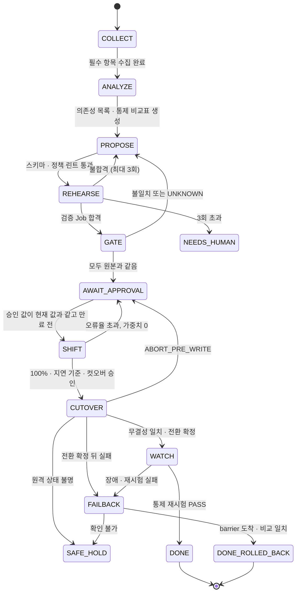

# 이전: 환경 사이 이동과 완수 기준

이 문서는 "고객 클러스터 사이 이동"을 처음부터 끝까지 따라갑니다. 상태 머신과 컷오버 순서는 스펙 §8.2와 §8.6을 따릅니다. 스펙과 다른 것은 표시한 제안(D-04, D-08, D-09, D-19, D-20, D-22)과 결정(D-21, D-23)뿐입니다.

## 1. 이전 경로

| 경로 | 출발 | 목적 | 우선 | 비고 |
|---|---|---|---|---|
| R1 컷오버 | `source-aws` | `target-onprem` | P0 | 데모 본선(S3) |
| R2 되돌리기 | `target-onprem` | `source-aws` | P0 | 데이터째 되돌리기(S4) |
| R3 클라우드 사이 | `source-aws` | `target-gcp` | P2 | 스펙 §4 비목표. D-01은 환경과 통제 비교만 |
| R4 리전 이전 | 서울 | 도쿄 | 설계 문서에만 | D-07. 복제, epoch 발급, Executor를 부르지 않음 |

R1–R3은 같은 상태 머신과 같은 Executor를 씁니다. 바뀌는 것은 등록한 환경뿐입니다. 이것이 "설계는 목적지 무관"(§4)의 구현 방법입니다. 목적지는 모두 같은 랜딩 존이므로(D-23), 랜딩 존끼리는 방향과 상관없이 같은 엔진으로 옮깁니다. 출발지 관리형 서비스(S3, Secrets Manager)의 번역은 첫 이전 때 한 번뿐입니다(`11-landing-zone.md` 5절).

## 2. 이전 한 건의 단위

- **환경(environment).** 클러스터 접속 정보 참조와 종류(EKS, K3s, GKE. D-21)를 가집니다. `POST /v1/environments`로 등록합니다. 플랫폼이 새로 만드는 환경은 제안 `env_create`로 받습니다(`08-operator-mcp.md` 4절).
- **계획(plan).** 워크로드, 출발 환경, 목적 환경을 묶습니다. 계획 하나가 상태 머신 하나를 가집니다.
- **epoch.** 컷오버와 되돌리기마다 하나씩 올라가는 번호입니다. Executor는 낮은 epoch의 명령을 거부합니다.
- **시도 카운터.** 계획과 단계별로 플랫폼 DB에 저장합니다. 리허설 Trial이나 프로세스가 새로 떠도 이어서 셉니다. 검증 불합격은 3회, 인프라 오류(INFRA_ERROR)는 따로 2회가 상한이고, 넘으면 NEEDS_HUMAN입니다.

## 3. 상태 머신

그림 1. 스펙 §8.2의 상태와 전이에, §8.6 실패 처리의 "6단계 이후 실패는 FAILBACK"을 CUTOVER → FAILBACK 화살표로 더했습니다. SHIFT 실패와 ABORT_PRE_WRITE는 스펙 그림대로 AWAIT_APPROVAL로 돌아갑니다. SAFE_HOLD와 NEEDS_HUMAN은 사람이 판단합니다.

**목업과 기록.** `mode=mock`인 게이트, 리허설, Executor 결과는 승인과 실제 실행의 근거가 될 수 없습니다. 상태 머신은 mock 증거로 AWAIT_APPROVAL 이후로 넘어가지 않습니다. 사전 실행 기록(`recorded`)은 원 실행 ID, 환경, 산출물 digest, 시험 판, 유효기간을 확인한 뒤에만 씁니다.

상태 머신은 워크플로 엔진 없이 직접 만듭니다. 상태는 플랫폼 DB에 저장하고, 재기동하면 마지막 상태와 실제 원격 효과를 다시 읽고 이어 갑니다(§8.2). 리허설은 컷오버 확정 뒤에는 시작을 거부합니다(S2-AC5).

**승인은 단계마다 따로 받습니다(§8.9).** 승인에는 단계(`change`, `cutover`, `failback`), 승인자, 결속 값(plan, diff, digest, 대상, 만료)이 들어갑니다. 각 실행은 자기 단계의 유효한 승인이 있어야 시작합니다.
- 승인 요청은 불변 revision을 가집니다. 승인자는 콘솔 세션의 주체이고 요청 본문에서 받지 않습니다.
- 트래픽 전환, 컷오버, 되돌리기는 승인 뒤 사람 운영자가 콘솔에서 시작합니다. MCP로는 시작하지 않습니다(D-18, `08-operator-mcp.md` 4절). §8.2가 이 구간을 AI가 관여하지 않는 실행 구간으로 두기 때문입니다.
- 실행 시작은 계획 행을 잠근 한 트랜잭션에서 revision, 승인, 보류, 진행 중 실행을 확인하고, 승인을 소비하고, 실행을 만듭니다(`platform/api/README.md`).

## 4. 컷오버와 되돌리기

### 4.1 컷오버 전 준비

1. 목적지에 같은 스키마를 마이그레이션 Job으로 만듭니다. 논리 복제는 DDL을 옮기지 않습니다.
2. 앱 쓰기 역할은 마이그레이션 SQL로 만듭니다. CNPG의 선언형 역할 관리(`managed.roles`)로 만들지 않습니다. operator가 펜싱한 `NOLOGIN`을 선언 상태로 되돌릴 수 있기 때문입니다.
3. 정방향 구독을 시작하고 초기 복사가 끝나기를 기다립니다. 양쪽 DB에 `max_slot_wal_keep_size`를 겁니다. 상대가 꺼져 있는 동안 WAL이 쌓이는지 `pg_replication_slots.wal_status`로 계속 봅니다. `lost`면 슬롯이 무효라 이어 받을 수 없습니다. 이때는 컷오버를 시작하지 않고 아래 재동기화를 합니다.
4. 역방향 구독을 목적지에서 출발지 방향으로 미리 만듭니다. 설정은 `enabled = false`, `copy_data = false`, `origin = none`입니다. 초기 재복사와 복제 루프를 막기 위해서입니다.
5. 첨부를 S3에서 목적지 S3 호환 저장소(후보 Ceph RGW, 제안 D-22, 검증 중)로 사전 복사하고 대조합니다(D-04). 목적지 DB의 `attachment_store`는 동결된 상태(`frozen = true`)로 만들어 둡니다.
6. 트래픽 전환(SHIFT)의 단계 판정(오류율, p95)에는 부하 생성기의 합성 트래픽을 반드시 넣습니다. 단계마다 최소 표본 수를 정하고, 못 채우면 다음 단계로 넘어가지 않습니다. 트래픽이 적을 때 오류가 많은 버전이 통과하는 일을 막기 위해서입니다(2026 예선 수상작 사례, `07-runtime-mesh-observability.md` 9절).
7. 트래픽 전환(SHIFT) 동안 목적지 앱은 목적지 PgBouncer를 거쳐 출발지 DB에 씁니다. 쓰기 DB는 하나뿐입니다. D-04가 채택되면 SHIFT 시작 때 첨부를 동결합니다. SHIFT가 실패해 가중치 0으로 돌아가면 동결을 풉니다(효과).
8. (D-04) 컷오버 1단계 전, 쓰기 정지 밖에서 첨부를 대조합니다. 동결 뒤 차이분을 복사하고, 모든 확정 참조가 목적지 저장소에 있고 SHA-256이 같고 앱 역할로 읽히는지 확인합니다. 하나라도 어긋나면 컷오버를 시작하지 않습니다.

**슬롯을 잃었을 때 재동기화.** 슬롯이 `lost`면 컷오버는 막힌 채로 아래를 차례로 합니다. 시험은 N5c(`02-network.md` 13절)입니다.
1. 구독을 지웁니다(`DROP SUBSCRIPTION`).
2. 목적지의 발행 대상 테이블을 비웁니다(`TRUNCATE`). 발행에서 뺀 표(`bravo_fence`, `attachment_store`)는 건드리지 않습니다.
3. `copy_data = true`로 구독을 다시 만듭니다.
4. 초기 복사가 끝나면 행 수, PK 해시, 내용 해시로 다시 대조합니다. 맞기 전에는 컷오버를 시작하지 않습니다.

**PgBouncer.** 양쪽 모두 단독 PgBouncer를 replica 1로 둡니다. CNPG Pooler는 같은 네임스페이스의 클러스터 하나에만 붙어 다른 환경의 DB를 가리킬 수 없습니다. replica가 여럿이면 Pod마다 PAUSE를 보내야 합니다. Executor의 `pods/exec` 권한을 Pod 이름으로 묶으려면 이름이 바뀌지 않아야 합니다. 그래서 Deployment가 아니라 StatefulSet(`pgbouncer-0`)으로 둡니다. 두 PgBouncer는 `query_wait_timeout = 8`(초)입니다. 정지 중 앱 요청은 최대 8초 기다립니다(스펙 §5.3). 관리 세션의 heartbeat와 끊김 처리는 `02-network.md` 4.4절에 있습니다.

**PgBouncer 대상 전환.** 실행 중 대상은 Executor만 바꿉니다. 컷오버 중에 ConfigMap을 고치지 않습니다. 마운트한 ConfigMap은 늦게 반영되고, `subPath` 마운트는 아예 반영되지 않기 때문입니다(Kubernetes ConfigMap 문서).

| 무엇 | 어디 | 누가 바꾸나 |
|---|---|---|
| 대상 설정 두 벌 `target-src.ini`, `target-dst.ini` | PgBouncer 설정 ConfigMap. 디렉터리로 마운트. `subPath` 금지 | 배포 저장소(Argo CD) |
| 주 설정 `pgbouncer.ini` | 같은 ConfigMap. 끝에 `%include /run/pgbouncer/active.ini` | 배포 저장소 |
| 활성 파일 `active.ini`(`[databases]` 절만) | emptyDir `/run/pgbouncer/` | Pod가 뜰 때 init 컨테이너가 기본 선택을 복사. 컷오버 7단계에서 Executor가 교체 |
| 기본 선택 | 배포 저장소 값. 처음은 `src` | DONE 뒤 플랫폼이 `dst`로 커밋 |

- **1단계 전, 타이머 밖.** Executor가 `pods/exec`로 Pod 안에 두 대상 파일이 모두 있는지 확인합니다. 없으면 컷오버를 시작하지 않습니다.
- **7단계.** Executor가 `pods/exec`로 활성 파일을 원자적으로 바꿉니다. 같은 디렉터리의 임시 파일에 복사한 뒤 rename합니다. 이어서 관리 콘솔에 `RELOAD`를 보내고, `SHOW DATABASES`의 host가 새 대상인지 확인합니다. 다르면 효과는 `UNKNOWN`이고 SAFE_HOLD입니다.
- **권한.** Executor의 K8s 권한은 PgBouncer Pod 이름 하나에 묶은 `pods/exec`뿐입니다(RBAC `resourceNames`). ConfigMap 쓰기 권한은 없습니다.
- **GitOps와 충돌 없음.** Argo CD self-heal은 이 변경을 되돌리지 못합니다. emptyDir는 Argo CD가 관리하는 자원이 아니기 때문입니다.
- **Pod가 새로 뜨면.** emptyDir가 비므로 init 컨테이너가 기본 선택(출발지)을 다시 씁니다. 컨테이너만 재시작하면 활성 파일이 남습니다.
- 4단계 뒤에는 출발지 앱 쓰기 역할이 `NOLOGIN`입니다. 그래서 컷오버 뒤 PgBouncer Pod가 새로 떠 출발지를 가리키면 쓰기가 거부됩니다. 안전한 쪽으로 실패하고 경보를 냅니다.
- DONE 뒤 플랫폼이 새 기본 선택(`dst`)을 배포 저장소에 커밋합니다.
- 파일 교체에는 PgBouncer 이미지 안에 `cp`와 `mv`가 있어야 합니다(확인 필요).
- 되돌리기(4.3절)는 같은 방식을 반대 방향으로 씁니다.

**배포 잠금.** CUTOVER에 들어가서 DONE이나 DONE_ROLLED_BACK이 될 때까지, 그리고 보안 보류가 걸린 동안 앱 배포를 막습니다(`04-governance.md` 5절).
- 플랫폼은 링크 `*-k8s`로 그 앱의 Argo CD AppProject에 deny sync window를 겁니다. 수동 sync도 막습니다(`manualSync`를 허용하지 않음). 필드 값은 Argo CD 판에서 확인 필요입니다.
- CUTOVER에 들어가기 전에 window가 적용되고 진행 중인 sync가 없음을 확인합니다. 확인하지 못하면 CUTOVER에 들어가지 않습니다.
- 그동안 플랫폼은 배포 저장소 커밋도 거부합니다. 배포 runner(폴백)도 계획 상태를 확인하고 잠겨 있으면 거부합니다.
- 시험은 N18(`02-network.md` 13절)입니다.

### 4.2 컷오버 순서

스펙 §8.6의 여덟 단계입니다. 6단계를 6a와 6b로 나눈 것만 제안(D-09)입니다.

| 단계 | 하는 일 | 확인 | 실패하면 |
|---|---|---|---|
| 1 | 복제 지연 확인, lease와 epoch 획득. 첫 쓰기 제한 직전에 타이머 시작 | 지연이 기준 이하 | ABORT_PRE_WRITE |
| 2 | 모든 진입점에서 새 업무 쓰기 차단 | 차단이 실제로 적용됨 | ABORT_PRE_WRITE |
| 3 | 두 PgBouncer에 PAUSE. 직전에 긴 트랜잭션이 없는지 확인 | deadline 안에 PAUSE 완료 | ABORT_PRE_WRITE. 단 "PAUSE 보냄, 응답 없음"이면 효과 `UNKNOWN`이고, 원장이 미적용을 증명할 때만 ABORT_PRE_WRITE, 아니면 SAFE_HOLD(`02-network.md` 4.4절) |
| 4 | 출발지 펜싱: 앱 쓰기 역할 `NOLOGIN`과 쓰기 권한 회수(REVOKE) | 기존 세션 종료, 우회 쓰기(worker, CronJob, 직접 연결) 없음, 업무 쓰기 거부 시험 | ABORT_PRE_WRITE |
| 5 | 제어 역할로 barrier commit, 목적지 도착 확인, 최종 비교(행 수, PK 해시, 내용 해시, 시퀀스), 시퀀스 올림. D-04면 동결 watermark를 넘는 확정 첨부 행이 없는지만 확인(객체 대조는 1단계 전에 끝남) | 영수증 `MATCH`. 비교 결과를 목적지 쓰기 전에 저장 | ABORT_PRE_WRITE |
| 6a | 정방향 apply 정지 확인, 미리 만든 역방향 구독 켬 | 역방향 구독 상태 정상 | ABORT_PRE_WRITE |
| 6b | 전환 확정 기록(되돌릴 수 없는 지점). 정방향 슬롯 삭제 | 기록이 플랫폼 DB에 commit됨 | FAILBACK |
| 7 | 목적지 쓰기 역할 켬. 두 PgBouncer의 활성 파일을 목적지 설정으로 바꾸고 RELOAD, RESUME(4.1절). 출발지 PgBouncer는 이제 출발지의 링크 `dst-db`로 목적지 DB에 씀. 출발지의 열린 WebSocket을 1012로 닫음 | 두 PgBouncer의 `SHOW DATABASES` host가 모두 새 대상 | FAILBACK. host가 다르면 효과 `UNKNOWN`, SAFE_HOLD |
| 8 | 두 PgBouncer의 실제 pool 경로로 목적지 접속 확인, 진입점 쓰기 차단 해제. D-04면 한 트랜잭션에서 `active_store`를 목적지로 바꾸고 첨부 동결을 풂 | 두 경로 모두 업무 쓰기 ACK. 마지막 ACK에서 타이머 정지 | FAILBACK |

**쓰기 정지 시간**은 1단계의 첫 쓰기 제한 직전부터 8단계의 마지막 필수 경로 ACK까지입니다(NFR-1). 단계별 ms도 함께 남깁니다. D-04면 DB 쓰기 정지와 첨부 업로드 정지를 따로 보고합니다. "전체 쓰기 정지 5초"라고 말하지 않습니다.

**DB 쓰기 정지 예산(제안).** 부하 생성기 기본값(메시지 쓰기 초당 20건)에서 단계별 예산의 합이 5,000 ms 이하가 되게 둡니다. 값은 추정이고, N11 합격선(링크 `SELECT 1` p95 ≤ 50 ms, PAUSE 왕복 p95 ≤ 300 ms)을 전제로 합니다. 단계가 예산을 넘으면 단계별 ms로 원인을 보입니다.

| 단계 | 예산(ms) | 들어가는 것 |
|---|---|---|
| 1 | 0 | 지연 확인, lease, epoch는 타이머 시작 전 |
| 2 | 200 | 진입점 쓰기 차단 적용과 확인 |
| 3 | 500 | 두 PgBouncer PAUSE(병렬). 진행 중 트랜잭션(최대 200 ms, 스펙 §5.3)을 기다림 |
| 4 | 400 | `NOLOGIN`, REVOKE, 세션 종료, 업무 쓰기 거부 확인 |
| 5 | 2,000 | barrier commit과 도착 확인, 최종 비교(10만 행, 양쪽 병렬), 시퀀스 올림, 영수증 저장 |
| 6a | 300 | 정방향 apply 정지 확인, 역방향 구독 켬 |
| 6b | 200 | 전환 확정 commit(동기 복제), 정방향 슬롯 삭제 |
| 7 | 700 | 목적지 writer 켬, 두 PgBouncer의 `pods/exec` 파일 교체, RELOAD, `SHOW DATABASES` 확인, RESUME |
| 8 | 500 | 링크 경유 새 서버 연결(TLS, SCRAM), 두 경로의 첫 업무 쓰기 ACK |
| 여유 | 200 | |
| 합 | 5,000 | |

- **합격선.** 부하 상태에서 5회 잽니다. 중앙값이 5,000 ms 이하이면 합격입니다. 5회 원값과 최댓값을 함께 공개합니다(NFR-1).
- 스펙 S3-AC1의 부하는 쓰기 50 req/s입니다. 기본값과 다르므로 측정 리포트에 부하 값을 같이 적습니다.
- **첨부 업로드 정지는 따로 보고합니다(D-04).** 동결 commit부터 해제까지이고 1–2분으로 추정합니다. 스펙의 쓰기 정지 정의(첫 업무 쓰기 제한부터 마지막 ACK까지)를 그대로 쓰면 이 구간도 들어갑니다. 그래서 NFR-1을 DB 쓰기 정지에만 적용할지는 회의 안건입니다.

**ABORT_PRE_WRITE 절차.** 목적지 쓰기 차단을 확인합니다. 역방향 구독을 끄고 정방향 apply를 다시 켭니다. 출발지 역할과 권한, 연결을 복원하고 두 PgBouncer를 RESUME합니다. 진입점 쓰기 차단을 풉니다. D-04면 첨부 동결을 풉니다(`active_store`는 그대로). 복원은 이 실행이 만든 제한만 합니다. 소유는 효과 원장으로 판단합니다. 복원이 보안 보류의 회수를 되돌리게 되거나 상태가 불명확하면 SAFE_HOLD입니다(`04-governance.md` 5절).

**플랫폼 AZ 상실.** 컷오버 중 플랫폼의 AZ 하나를 잃으면, Executor는 다른 AZ에서 다시 뜹니다. P0에는 자동 인계가 없으므로 진행 중이던 실행을 이어 가지 않습니다(제안 D-19). 미해결 효과가 있으면 읽기 전용 자격의 관찰 전용 모드로 뜨고, 계획은 SAFE_HOLD입니다. 사람이 런북 `docs/runbooks/safe-hold.md`로 해소합니다.

**원격 상태 불명.** 목적지에 썼는지 모르면 쓴 것으로 보고 SAFE_HOLD입니다. 어느 쪽도 자동으로 열지 않습니다.

**응답을 잃었을 때 다시 읽는 것.** 같은 호출을 반복하지 않고 아래를 읽어 실제 단계를 정합니다. 무엇을 읽을지는 효과 원장(제안 D-19, `platform/executor/README.md`)에 먼저 적혀 있습니다. 미해결 효과가 남은 채 다시 뜨면 Executor는 관찰 전용 모드로만 뜹니다.

| 읽는 것 | 어디서 |
|---|---|
| epoch와 lease, 전환 확정 기록 | 플랫폼 DB |
| PgBouncer 상태와 대상(`SHOW STATE`, `SHOW DATABASES`) | 양쪽 PgBouncer 관리 콘솔 |
| 앱 쓰기 역할의 LOGIN 여부와 권한 | 양쪽 DB 카탈로그 |
| 구독 상태와 슬롯 | `pg_subscription`, `pg_stat_subscription`, `pg_replication_slots` |
| barrier 행 도착 여부 | 목적지 DB |
| DB 펜스 epoch | 양쪽 DB의 `bravo_fence` |
| (D-04) 동결, 활성 저장소, watermark | 양쪽 DB의 `attachment_store` |

### 4.3 되돌리기(S4)

| 단계 | 하는 일 |
|---|---|
| 1 | 되돌리기 승인(`stage=failback`) 확인, 운영자가 콘솔에서 시작, epoch 올림 |
| 2 | 목적지 진입점 쓰기 차단, (D-04) 목적지 첨부 동결, 두 PgBouncer PAUSE, 목적지 펜싱(`NOLOGIN`, REVOKE) |
| 3 | 역방향 barrier commit과 출발지 도착 확인, 역방향 apply 정지 확인, 최종 비교 |
| 4 | 출발지 시퀀스 올림. 빠뜨리면 되돌린 직후 INSERT가 PK 충돌로 실패합니다 |
| 5 | (D-04) 남은 차이분 복사 뒤, 모든 활성 참조를 S3와 전체 대조(존재, SHA-256, 앱 읽기 권한). 하나라도 읽지 못하면 SAFE_HOLD |
| 6 | 출발지 쓰기 역할 복원, 두 PgBouncer 대상을 출발지로 바꿔 RELOAD, RESUME. 역방향 구독은 끄고 목적지 슬롯은 정리 |
| 7 | 가중치를 출발지로, 진입점 쓰기 차단 해제. (D-04) 한 트랜잭션에서 출발지 `active_store`를 S3로 두고 첨부 동결을 풂 |

목적지에서 쓴 메시지가 출발지에 모두 있어야 합니다(S4-AC1). D-04가 채택되면 첨부도 같은 기준을 둡니다. 되돌린 뒤 다시 옮기는 일은 비목표입니다(§4).

**보장 범위.** 되돌리기는 목적지 DB가 살아 있어 역방향 barrier가 도착할 수 있을 때만 데이터째 됩니다. 목적지 DB를 잃으면 마지막 역방향 복제 시점까지만 출발지에 있습니다. 이때는 SAFE_HOLD에서 사람이 판단하고, 잃은 범위를 영수증의 watermark로 보입니다. D-04면 첨부도 같습니다. S3에 아직 없는 객체를 목적지 저장소에서 읽지 못하면 DB가 살아 있어도 SAFE_HOLD입니다.

**플랫폼이 죽으면.** Executor는 플랫폼 안에서 돌므로 플랫폼과 함께 죽으면 스스로 되돌리지 못합니다. 그러면 PAUSE와 펜싱이 남습니다. P0에서는 사람이 플랫폼을 거치지 않는 관리 경로로 런북을 따라 상태를 확인하고 되돌립니다. 비공개 API인 AWS 쪽 클러스터는 비상용 IAM 역할의 SSM 포트 포워딩으로 VPC 안에서 닿습니다(확인 필요). 온프렘은 운영자가 같은 LAN에서 직접 닿습니다. 런북 `docs/runbooks/safe-hold.md`는 첫 실제 컷오버(11/5) 전에 씁니다. 클러스터별 컷오버 에이전트는 스펙대로 P1입니다(§8.6).

**Cloudflare가 멈추면.** 진행 중 컷오버는 SAFE_HOLD입니다. 시간 초과만으로 쓰기를 다시 열지 않습니다(NFR-3).
- 운영자는 SSM 포트 포워딩(비상용, 세션 기록)으로 플랫폼 클러스터 API에 닿아 상태를 봅니다.
- 이 경로에는 Access JWT가 없어 콘솔 승인과 실행 시작이 거부됩니다. 계획은 SAFE_HOLD나 AWAIT_APPROVAL에 머뭅니다.
- 새 컷오버는 시작하지 않습니다. 멈추는 것과 대안의 전체 표는 `02-network.md` 14절 "Cloudflare가 멈추면"입니다.

## 5. 이전 완수 증거표

스펙의 DONE 조건은 "WATCH에서 통제 재시험 PASS"입니다(§8.2). 아래 표는 DONE 보고서에 채울 증거입니다(D-08). 빠진 증거는 "미완"으로 표시하고 사람에게 알립니다. 전이 조건을 바꾸지는 않습니다.

| 증거 | 기준 | 스펙 | 우선 |
|---|---|---|---|
| 무결성 영수증 | `verdict=MATCH`(테이블, 시퀀스. D-04면 객체 포함) | FR-10, S3-AC2 | P0 |
| 부하 대조 | 실패 · 유실 · 중복 0건 | NFR-2, S3-AC1 | P0 |
| 쓰기 정지 | 단계별 ms와 합계. 목표 5,000ms 이하. D-04면 첨부 업로드 정지를 따로 적음 | NFR-1 | P0 |
| 통제 재시험 | 예외 승인 외 FAIL과 UNKNOWN 0개 | FR-12, S3-AC3 | P0 |
| 채팅 연속성 | 심사위원 메시지 기록 유지, 새 메시지 ID 충돌 없음 | S3-AC4 | P0 |
| 트래픽 | 목적지 pool 100%, 출발지 0%, 관측 비율 | FR-8 | P0 |
| 되돌릴 길 | 역방향 복제 지연 값 | FR-11 | P0 |
| 리허설 흔적 | 리허설 네임스페이스와 비밀 잔존 0 | S2-AC4 | P0 |
| 감사 기록 | 상태 전이, 판정, 승인, 에이전트 입출력 | FR-14 | P1 |
| 남은 의존성 | 잔존 의존성 지도(Cloudflare 등) | §10 3:50 | P1 |
| 소재 판정 | GOV-01 표시와 근거 상태 | §2.1, D-03 | P1 |

역방향 복제를 언제 끄는지는 스펙에 없습니다. DONE 뒤 사람이 정하는 것으로 제안합니다.

## 6. API 대응

| 단계 | API (§8.9) |
|---|---|
| 환경 등록 | `POST /v1/environments` |
| 계획 생성, 수집, 분석 | `POST /v1/plans` |
| 리허설 | `POST /v1/plans/{id}/rehearsals` |
| 게이트 | `POST /v1/plans/{id}/gate` |
| 승인(`change`, `cutover`, `failback`) | `POST /v1/plans/{id}/approvals` |
| 가중치 단계 전환 | `POST /v1/plans/{id}/weights` (제안 D-10) |
| 컷오버, 되돌리기 | `POST /v1/plans/{id}/shift` |
| 통제 결과 | `GET /v1/environments/{id}/controls` |
| 진행 이벤트 | `GET /v1/plans/{id}/events` (SSE) |
