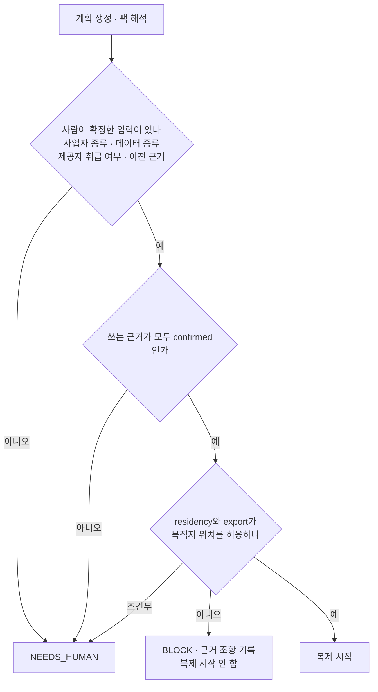

# 거버넌스: 6개 통제, 게이트, 소재 표시

1–3절은 스펙 §8.5를 구현 기준으로 정리합니다. 4절은 스펙 §2.1의 GOV-01 표시와, 그보다 넓은 제안 D-03b를 나눠 적습니다.

## 1. 통제와 시험

"보안 유지"는 아래 여섯 통제의 비퇴행만 뜻합니다(§8.5). 같은 시험을 이전 전후, 출발지와 목적지에서 같은 방법으로 돌립니다. 출발지 EKS와 목적지 K3s(D-21)의 차이는 통제 ID 단위로 흡수합니다.

| 통제 | ID | 시험 | 도구 | 구현 |
|---|---|---|---|---|
| 비밀 저장 | SEC-01 · ENC-02 | Git 평문 비밀 0건, 저장 암호화, 다른 서비스 계정의 Secret 읽기 거부, 회전 1회, 로그 마스킹 | gitleaks, kubectl | `platform/gate/controls/secrets` |
| 전송 암호화 | ENC-01 | 구간마다 CA와 hostname 검증, TLS 다운그레이드 거부 | openssl, psql verify-full | `.../transport` |
| 감사 로그 | AUD-01 | 로그인, DDL, 권한 변경 이벤트를 실제로 검색 | pgaudit, K3s API 감사 로그, EKS 제어면 감사 로그(CloudWatch Logs), CloudTrail | `.../audit` |
| 네트워크 노출 | NET-01 | 외부 스캔에 공개 진입점만 보임, 허용하지 않은 경로 거부 | nmap, NetworkPolicy 시험 | `.../network` |
| 최소 권한 | IAM-01 · ISO-01 | 다른 앱과 다른 역할의 자원 접근 거부 | kube-bench, Prowler, 거부 시험 | `.../least_privilege` |
| 백업 · 복구 | DR-01 | 새 환경으로 실제 복원 성공 | CNPG 백업과 복원 | `.../recovery` |

**시험 조건.**

- AUD-01: K3s는 감사 정책 파일과 감사 로그 경로를 API 서버 인자로 줘야 요청을 기록합니다. CIS 하드닝 설정에 넣습니다(`infra/README.md`의 K3s 노드 준비). EKS는 제어면 로그 종류 `audit`를 켜야 CloudWatch Logs에서 검색됩니다. 기본은 꺼져 있습니다. CloudTrail은 AWS API 호출만 기록하고 K8s API 요청은 기록하지 않습니다. 어느 쪽이든 감사 설정이 없으면 시험이 뜻을 갖지 않습니다.
- 컨테이너 실행(스펙 §7.3의 "kube-bench, 앱 기동"): D-21로 출발지와 목적지의 배포판이 달라 kube-bench 벤치마크도 다릅니다. 아래 표와 같습니다.

| 환경 | kube-bench 벤치마크 | 자동 점검 범위 |
|---|---|---|
| 출발지 · 플랫폼 EKS | EKS 벤치마크 | 워커 노드(kubelet 설정)와 정책 항목. 제어면은 AWS가 운영해 노드에서 점검할 수 없음 |
| 온프렘 K3s | K3s 벤치마크(K3s CIS 하드닝 가이드 기준) | 제어면(API 서버, controller-manager, scheduler), 내장 etcd, 노드, 정책 항목 |
| GKE(D-01) | GKE 벤치마크 | EKS와 같이 노드와 정책 항목 |

- 점검 개수나 점수로 비교하지 않습니다. 양쪽에 같은 뜻이 있는 항목만 비교합니다. kubelet 설정(익명 인증 끔, 인가 모드 Webhook, 읽기 전용 포트 끔 등)과 정책 항목(Pod Security, 서비스 계정 토큰 자동 마운트, 기본 네임스페이스 사용)입니다.
- 목적지 K3s에만 있는 제어면 · etcd 항목은 추가 증거로 따로 보입니다. 출발지 EKS의 같은 칸은 "AWS 관리"로 적습니다. 이 칸을 판정에서 어떻게 셀지(UNKNOWN으로 BLOCK할지, 비교에서 뺄지)는 판정 기준이라 T5 담당이 정하고 사람이 승인합니다.
- K8s 1.36이면 kube-bench가 판을 자동으로 고르지 못합니다(`09-cni-csi.md` 3절). 그래서 `--benchmark`로 벤치마크 이름을 명시합니다.
- 앱 기동은 양쪽에서 같은 digest를 같은 매니페스트로 띄워 봅니다(§8.8).
- 첨부 저장소 시험(스펙 §7.3의 무인증 접근 거부, 버킷 권한)은 IAM-01 · ISO-01과 게이트 보안 질문에 씁니다. 목적지에서는 S3 호환 저장소(후보 Ceph RGW, 제안 D-22, 검증 중)의 버킷 정책에 돌립니다. 후보가 버킷 정책을 지원하지 않으면 이 시험이 UNKNOWN이 되어 BLOCK입니다. 그래서 버킷 정책 지원은 D-22 후보 비교의 요구입니다.
- NET-01: 외부 스캔은 플랫폼 VPC 밖의 일회용 스캐너에서 합니다. 제안 D-16에서는 노드에 공인 주소가 없습니다. 그래서 대상은 각 환경의 NAT 공인 주소와 공개 호스트 이름이고, Reachability Analyzer 결과(`02-network.md` 13절 N1)를 함께 봅니다.
- NET-01의 허용하지 않은 경로 시험은 `02-network.md` 13절의 N3, N7을 씁니다. Pod Security 예외(`istio-system`, D-15)는 예외 승인으로 표시합니다(D-11). D-16을 채택하면 환경 사이 연결 때문에 생기는 예외는 없습니다.
- 회전과 복원 같은 능동 시험은 출발지의 운영 자원을 건드리지 않습니다. 시험용 Secret과 복원 대상 네임스페이스를 따로 만듭니다. 수집(FR-1)의 "읽기 전용" 원칙과 섞지 않기 위해서입니다.
- 시험기의 자격은 `02-network.md` 3절의 "통제 시험기" 행입니다.

시험기의 출력은 통제 ID별 하위 시험 결과, 증거, 수집 시각, 유효기간, 시험 코드 판입니다(`GET /v1/environments/{id}/controls`). 만료된 증거로는 승인하지 않습니다.

## 2. 판정 규칙

| 원본 | 목적지 | 판정 |
|---|---|---|
| PASS | PASS | 통과 |
| PASS | FAIL | BLOCK(퇴행) |
| FAIL | FAIL | BLOCK. 동등이 아니라 실패로 셈 |
| 어느 쪽이든 UNKNOWN | | BLOCK |
| 대체 불가 예외 | | "예외 승인"으로 따로 표시. 승인자, 기간, 대체 통제 필수. 동등 판정에 넣지 않음 |

점검 개수나 점수 하나로 요약하지 않습니다. Prowler 점검 수는 공급자마다 달라서 통제 ID 단위로만 비교합니다. 같은 입력이면 같은 판정이 나와야 합니다(NFR-5). 게이트 시험은 같은 입력으로 두 번 돌려 판정이 같은지 확인합니다.

## 3. 원본 대조 게이트

게이트는 원본과 대상에 같은 질문을 던지고 답이 같은지 봅니다. 질문은 두 종류입니다.

- **보안 질문.** 원본에서 거부되던 접근이 대상에서도 거부되는가. 예: 인증 없이 첨부 저장소를 읽을 수 있는가.
- **데이터 경로 준비 질문.** 지금 전환해도 되는가. 예: 스키마 해시가 같은가, 복제 지연이 기준 이하인가, 시퀀스 보정이 리허설에서 통과했는가. 이 값은 Executor와 수집기가 내고, 형식은 11/3 계약에서 정합니다.

행 수와 내용 해시 같은 데이터 동일성은 게이트에서 보지 않습니다. 컷오버 전에는 쓰기가 계속 들어와 항상 다르기 때문입니다. 데이터 동일성은 쓰기를 막은 뒤 최종 비교(컷오버 5단계)에서 봅니다.

게이트 코드는 `platform/gate/`에 있고 LLM 클라이언트를 import하지 않습니다(NFR-5).

## 4. 데이터 소재

### 4.1 스펙 범위: GOV-01 표시(P1)

스펙은 데이터 소재를 "얕게: 통제 GOV-01로만 표시"합니다(§2.1). 그래서 기본 구현은 표시입니다. 이전 계획 화면에 출발지와 목적지의 위치, 데이터 종류, 적용 근거와 그 확인 상태를 보이고, 판정이나 차단은 하지 않습니다.

### 4.2 매핑표 파일(D-03a)

§8.5의 규제 매핑표를 파일로 둡니다. 6개 통제의 시험과 합격선은 바꾸지 않습니다. 팩은 "어느 통제가 어느 조항의 근거인가"와 GOV-01 표시에 쓸 값만 가집니다.

```text
platform/governance/packs/
├── baseline-cis.yaml      # 국제 기준선(CIS K8s 항목)
├── kr/finance.yaml        # 한국 금융
└── jp/finance.yaml        # 일본 금융
```

위치에는 뜻이 셋입니다. 하나로 섞으면 적법한 이전이 막히거나, 막아야 할 이전이 통과합니다.

| 필드 | 뜻 | 예 |
|---|---|---|
| `placement` | 데이터가 지금 있는 곳(지리). 제공자와 따로 둠 | `kr-seoul`, 제공자 `aws` 또는 `onprem` |
| `residency` | 데이터 종류별로 머물러야 하는 범위 | 개인신용정보는 `kr` 안 |
| `export` | 조건을 갖추면 내보낼 수 있는 범위와 필요한 근거 | 근거와 증적이 있을 때만 |

값마다 근거 상태(`confirmed`, `unverified`)를 둡니다. 조항 원문 확인은 T23입니다.

### 4.3 소재 사전 심사로 차단(D-03b, 제안)

D-03b가 채택되면, 이전 계획을 만들 때 GOV-01을 판정하고 BLOCK이면 복제를 시작하지 않습니다. 상태 머신의 ANALYZE 전이가 바뀌므로 P0에는 넣지 않습니다.



그림 1. 판정 입력은 사람이 확정한 값만 씁니다. 근거가 하나라도 `unverified`이면 결과는 NEEDS_HUMAN입니다.

**데모에서 보이는 것(D-03b 채택 시).**

| 장면 | 입력 | 기대 판정 |
|---|---|---|
| AWS 서울에서 온프렘 서울, 근거 confirmed | 한국 금융 팩, 합성 개인신용정보 | PASS. 같은 `kr` 안 |
| 같은 경로, 근거 unverified | 같은 팩 | NEEDS_HUMAN. 화면에 확인 전 조항을 보임 |

리전 이전 장면은 넣지 않습니다(D-07).

### 4.4 조항을 다루는 방식

| 조항 | 판정에 쓰는 조건 | 상태 |
|---|---|---|
| 전자금융감독규정 제14조의2 제7항 | 적용 사업자가 고유식별정보나 개인신용정보를 클라우드로 처리하면 국내 시스템 요건 | 연구 인용. 원문 확인은 T23 |
| 개인정보 보호법 제28조의8 | 국외 보관도 이전에 들어감. 허용 근거마다 요건이 다름 | 연구 인용. 원문 확인은 T23 |
| 일본 개인정보보호법 제28조, 개인정보보호위원회 Q&A 12-3, 12-4 | 외국 사업자가 저장 데이터를 취급하지 않으면 "제공"이 아님. 안전관리 조치와 공표는 남음 | Q&A는 리뷰에서 직접 확인. 해당 여부 판단은 사람 |

데모 앱 운영 주체가 적용 사업자인지, 채팅 메시지가 개인신용정보인지는 정하지 않았습니다. 데모는 "규칙 장치 시연"이며 합성 데이터만 씁니다.

### 4.5 한계

- 법률 판단이 아닙니다. 정해진 규칙이 정해진 입력에 같은 답을 내는 장치입니다. 적법성 판단은 사람이 합니다.
- 운영자 승인을 정보주체 동의의 대체물로 쓰지 않습니다.
- 데이터 흐름에는 Cloudflare edge와 LLM 입력도 들어갑니다. 그래서 데모는 합성 데이터만 씁니다.

근거: 스펙 §2.1, §8.5. 저장소 밖 연구 폴더의 `deliverables/2026-11-02-governance-pack-region-migration.md` 2–5절, `governance-research/01–03`(각 파일 첫머리의 정정 포함), `reviews/persona-experts-b-14-platform-plan.md` E6.

## 5. 독립 보안 보류(제안 D-20)

게이트는 이전 한 건을 막습니다. 보류는 이전 건과 따로 살아, 계획을 취소하고 새로 만들거나 새 승인을 받아도 남습니다. 출처는 2026-11-02 팀원 메모("설계 추가 제안" 3절, https://app.notion.com/p/40c8bee9ada48029a376dea2d411db1a)입니다.

**보류 기록(`holds`).**

| 필드 | 내용 |
|---|---|
| `hold_id`, `revision` | 식별자와 변경 판. 내용이 바뀔 때마다 올림 |
| 범위 | P0는 앱 전체(테넌트 + 앱). 환경 · 자원 단위 범위는 P1 |
| 사유와 근거 | 사고, 정책 위반, 통제 시험 결과 참조 |
| 막는 동작 | `deploy`, `shift`, `writer_change` 중 선택 |
| 허용 대응 | 미리 정한 대응(격리, 권한 회수)과 그 정확한 범위 |
| 해제 조건 | 다시 시험할 통제 ID, 필요한 수정 참조 |
| 검토 기한과 담당 | 기한이 지나면 알림만 보냄 |
| 상태 | `ACTIVE`, `RELEASE_REQUESTED`, `RELEASED` |

**거는 쪽.** 보안 승인자가 콘솔에서 겁니다. 보류를 거는 것은 안전한 방향이므로 operator도 콘솔에서 걸 수 있습니다. P1에서는 WATCH 중 통제 재시험이 퇴행(원본 PASS, 대상 FAIL)을 내면 자동으로 겁니다.

**guard 행으로 직렬화합니다.** 한 트랜잭션에서 보류를 조회해도, 다른 트랜잭션의 보류 INSERT와 저절로 직렬화되지는 않습니다. 그래서 (테넌트, 앱)마다 guard 행 하나(`hold_guards`)를 두고, 아래 동작이 모두 이 행을 `FOR UPDATE`로 잠급니다.
- 보류 생성, 수정, 해제
- 통제 실패 등록
- 효과의 `IN_FLIGHT` 전이(D-19)

`IN_FLIGHT`의 commit이 효과의 발행 시점입니다. 그 뒤에 만든 보류는 그 효과를 이미 발행된 것으로 봅니다. 그 효과는 효과 원장의 해소 대상으로 남고, 다음 효과부터 막힙니다.

**집행 지점.** 아래 다섯 곳이 같은 검사 함수와 같은 guard 잠금을 씁니다. 그 앱에 `ACTIVE` 또는 `RELEASE_REQUESTED` 보류가 있고 동작이 "막는 동작"에 있으면 `security_hold`로 거부합니다. 이 검사는 승인 검사보다 먼저 돕니다. 그래서 새 배포 승인이나 리허설 성공으로 보류를 지나갈 수 없습니다.

| 집행 지점 | 막는 동작 |
|---|---|
| 상태 머신의 전이 | `shift`, `writer_change` |
| Executor의 효과(`IN_FLIGHT` 전이) | `shift`, `writer_change` |
| 배포 커밋, 배포 runner, 고객 클러스터의 Argo CD sync window | `deploy` |
| Edge 가중치 변경 | `shift` |
| 런북의 관리 동작 | 그 동작에 해당하는 것 |

**GitOps 배포.** 배포 저장소 커밋 거부만으로는 이미 큐에 있던 sync, 이전 커밋 재적용, 수동 sync를 막지 못합니다. 그래서 `deploy`를 막는 보류가 `ACTIVE`가 되면, 플랫폼이 링크 `*-k8s`로 그 앱의 Argo CD AppProject에 deny sync window를 겁니다. 수동 sync도 막습니다. CUTOVER부터 DONE까지의 배포 잠금도 같은 방법입니다(`03-migration.md` 4.1). 링크가 끊겨 window를 풀지 못하면 잠금이 남습니다. 시험은 H10과 `02-network.md`의 N18입니다.

**보류로 막지 않는 동작.**

| 동작 | 조건 |
|---|---|
| 관측, 감사 | 없음 |
| 효과 조정(관찰 전용 모드, D-19) | 읽기 전용 자격으로만 |
| ABORT_PRE_WRITE 복원 | 같은 실행이 만든 제한만 복원. 소유는 효과 원장의 기록으로 판단. 복원이 보류의 보안 회수(예: writer 자격 회수)를 되돌리게 되거나 상태가 불명확하면 복원하지 않고 SAFE_HOLD |
| FAILBACK | 허용. 다만 출발지를 덮는 활성 보류에 `writer_change`가 있으면 SAFE_HOLD로 가고 사람이 판단 |

**해제.**
1. 해제 요청을 받으면 상태를 `RELEASE_REQUESTED`로 바꾸고 그때의 `revision`을 적습니다.
2. 해제 조건의 통제를 통제 시험기로 다시 시험합니다. 리허설 결과는 인정하지 않습니다.
3. `security_approver` 역할을 가진, 요청자와 다른 사람이 콘솔에서 해제를 승인합니다. 주체와 역할은 요청 본문이 아니라 콘솔 세션과 서버의 `memberships(principal_id, tenant_id, role)`로 판단합니다.
4. 한 트랜잭션에서 guard 행을 잠그고, `revision`이 요청 때와 같고 새 보류나 새 통제 실패가 없음을 확인한 뒤 `RELEASED`로 바꿉니다. 다르면 거부하고 처음부터 다시 합니다.

검토 기한이 지나도 보류는 풀리지 않습니다. 기한이 지나면 담당자에게 알리고 콘솔에 표시합니다. MCP에는 해제 도구가 없습니다(`08-operator-mcp.md` 6절).

**실행 중에 걸리면.**
- 다음 효과부터 거부합니다. 이미 발행한 효과는 효과 원장의 해소 대상으로 남습니다.
- 쓰기 전 구간(컷오버 1–6a)이면 ABORT_PRE_WRITE로 갑니다. 복원은 위 "보류로 막지 않는 동작" 표의 조건을 따릅니다.
- 확정(6b) 뒤라면 SAFE_HOLD로 가고 사람이 판단합니다.
- 제어면 장애만으로 운영 중인 writer를 바꾸거나 끄지 않습니다(NFR-3).

**인수 시험.**

| ID | 시험 | 통과 기준 |
|---|---|---|
| H1 | 보류 중 새 계획을 만들고 승인까지 받음 | `shift`가 `security_hold`로 거부 |
| H2 | 보류 중 리허설 성공 | 보류 유지 |
| H3 | 해제 승인 뒤, 확정 전에 `revision`이 바뀜 | 해제 거부 |
| H4 | 검토 기한 지남 | 보류 유지, 알림 기록 |
| H5 | 보류 중 조회 · 복구 동작과 금지 동작 | 앞은 통과, 뒤는 거부 |
| H6 | 해제 요청자와 같은 사람이 해제 승인 | 거부 |
| H7 | 쓰기 전 구간(컷오버 1–6a)에서 보류를 검 | ABORT_PRE_WRITE가 그 실행이 만든 제한만 복원. 보류의 회수 대상은 그대로 |
| H8 | 출발지를 덮는 `writer_change` 보류가 걸린 채 FAILBACK | SAFE_HOLD, 사람 판단 대기 |
| H9 | 효과의 `IN_FLIGHT` 전이와 보류 생성을 동시에 보냄(보류 경쟁) | guard 잠금으로 순서가 하나로 정해짐. 보류가 뒤면 그 효과는 발행된 것으로 기록되고 다음 효과는 거부 |
| H10 | `deploy` 보류 중 Argo CD 자동 sync와 수동 sync를 시도 | deny sync window로 둘 다 거부. 보류를 풀면 sync 성공(대조군) |

**범위.** P0에는 `holds`와 `hold_guards` 표, 집행 지점 다섯 곳의 검사, 콘솔 표시, `security_approver`의 최소 해제 양식을 넣습니다. 해제 양식은 한 화면이고 위 해제 순서의 검사를 그대로 씁니다. 자동 보류와 알림은 P1입니다.
