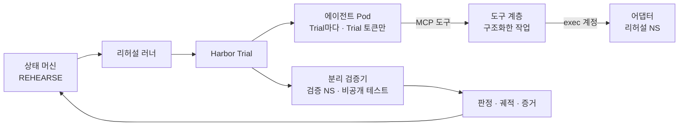

# 에이전트와 리허설

스펙 §8.3, §8.4, S2를 구현 기준으로 정리합니다. 담당은 에이전트 · 리허설 영역(T3, T11, T15, T16, T26)입니다. Harbor(에이전트 샌드박스 · 평가 프레임워크, CNCF 레지스트리 Harbor와 다름) 실행 계층(D-02)은 류지환 결정(2026-11-02)이고, 구조화한 도구(D-06)는 프로토타입에 반영했습니다. Pod 격리, 메시, 관측성, 상태 주입은 `07-runtime-mesh-observability.md`에 있습니다.

## 1. 에이전트가 하는 일과 못 하는 일

| 구분 | 내용 | 스펙 |
|---|---|---|
| 하는 일 | 애매한 의존성 분류, 번역 · 수정 제안서, 실패 원인 추정, 승인 요약, 사후 리포트 초안 | §8.3 |
| 못 하는 일 | 실행, merge, 배포 동기화, 운영 자격증명 사용. 도구 목록에 아예 없음 | §8.3 |
| 어디서 도나 | Trial마다 뜨는 플랫폼의 에이전트 Pod(`bravo-agents`). 클러스터 · 클라우드 · DB 자격은 없고, 그 Trial 범위의 토큰 하나만 가짐. 모델 키는 LLM 게이트웨이에만 | §8.3, §7.5 |
| SDK | Claude Agent SDK | §8.3 |

**P0 AI 작업 셋.** 스펙 S2 기본 흐름 3과 §10 데모는 두 가지 제안서를 예로 듭니다.

| 작업 | 내용 | 이미지 빌드 | 데모 |
|---|---|---|---|
| 의존성 분류 | 정적 탐지로 등급을 못 정한 항목만 근거와 함께 분류 | 없음 | S1 |
| 버킷 정책 번역 | 게이트 1차 BLOCK(열린 첨부 저장소)을 고치는 목적지 저장소의 버킷 정책 제안서. 대상은 S3 호환 저장소(후보 Ceph RGW, 제안 D-22, 검증 중) | 없음 | S2 라이브 |
| 코드 수정 | Secrets Manager 직접 호출을 OpenBao · ESO 주입으로(§8.4 P0 작업). 에이전트는 diff만 내고, 리허설 서비스가 빌드한 digest를 고정 템플릿으로 띄움(3절) | 있음 | S2. 시간 안에 못 끝나면 사전 실행 기록(`recorded`) |

버킷 정책 번역은 설정 제안서라 이미지를 다시 빌드하지 않습니다. 그래서 §10의 0:40–1:30 안에 라이브로 끝날 수 있습니다. 코드 수정을 사전 실행 기록으로 보이는 것은 데모 계약 변경이라 회의에서 정합니다. 승인 요약과 사후 리포트는 P0에서 코드 템플릿으로 만듭니다(제안 D-13).

**승인된 변경의 적용.** 에이전트와 러너는 목적지 운영 네임스페이스에 권한이 없습니다. 승인된 설정은 `deploy/`의 매니페스트로 들어가고, 승인된 이미지는 그 digest로만 배포됩니다. 적용은 배포 경로가 합니다. 스펙대로면 배포 runner이고, 제안 D-16에서는 각 클러스터의 Argo CD가 배포 저장소를 당겨 오며 runner는 폴백입니다(`02-network.md` 3절, F9). 어느 경로든 플랫폼이 승인 해시와 배포 대상이 같은지 확인한 뒤에만 배포 저장소에 커밋하거나 runner를 부르고, 다르면 거부합니다(S2-AC3).

## 2. 도구 계층

| 도구 | 하는 일 | 권한 |
|---|---|---|
| `inventory.describe` | 수집된 설정과 의존성 조회 | 읽기 |
| `repo.read` | 앱 저장소 읽기 | 읽기 |
| `rehearsal.exec` | 리허설 네임스페이스 안 작업 실행 | 리허설 exec 계정 |
| `rehearsal.run`, `rehearsal.result` | 검증 Job 실행 요청과 결과 조회 | 플랫폼이 대신 실행 |
| `policy.evaluate` | 제안서를 정책 린트로 미리 확인 | 읽기 |
| `plan.propose` | 스키마에 맞춘 제안서 제출 | 쓰기(제안서만) |

**`rehearsal.exec`가 받는 것(D-06).** 자유 명령 문자열을 받지 않습니다. 정해진 작업만 받습니다: `kubectl`(동사 get, describe, logs, apply, diff), `read_file`, `list_dir`, `write_file`(경로 문자열 기준 `/app` 안만), `run_check`(정해진 검사 이름만). P0에서 apply와 diff는 정확한 (apiVersion, kind) 하나(`v1`, ConfigMap)만 받고, 위장 목록과 다른 API group을 거부합니다. 에이전트는 워크로드를 만들지 않습니다. Pod, Deployment, Job은 리허설 프로비저너가 고정 템플릿으로 적용합니다(3절). 프로토타입 `tool_layer.py`는 아직 다섯 종류(ConfigMap, Service, Pod, Deployment, Job)를 받고 Pod 정의의 권한 필드를 검사합니다. T11에서 ConfigMap 하나로 줄입니다. 각 작업은 (동사, 자원 종류, 네임스페이스)로 검사하고, 목록에 없으면 거부하고 기록합니다. delete, exec 같은 파괴적 동사는 `destructive_verb`로 거부해 콘솔에 차단 기록을 남깁니다(§8.3의 "파괴적 명령은 도구 계층에서 차단"). 구현은 `platform/rehearsal/src/bravo_rehearsal/tool_layer.py`입니다.

**막는 층.**

| 층 | 막는 것 | 못 막는 것 |
|---|---|---|
| 구조화한 작업 목록 | 자유 명령, 목록 밖 작업, 파괴적 동사, 다른 네임스페이스 · 다른 API group · 클러스터 범위 대상, 권한을 넓히는 Pod 필드, 경로 문자열의 `/app` 탈출 | `write_file`로 쓴 코드를 `run_check`가 실행하므로, 리허설 Pod 안의 임의 코드 실행은 막지 못함. 심볼릭 링크를 거친 `/app` 밖 읽기 · 쓰기도 같음 |
| 리허설 Pod 격리(토큰 없음, PSA restricted, NetworkPolicy) | Pod 안에서 돈 코드가 API 서버 · 운영 자원 · 바깥에 닿는 것 | Pod 안의 파일 손상(지워도 되는 대상) |
| 리허설 exec 계정 RBAC | 네임스페이스 밖 K8s API 호출 | exec로 들어간 컨테이너 안의 파일 삭제, SQL |
| 데이터 자격 | 리허설용 OpenBao 경로 · 목적지 저장소의 시험 버킷 자격 · DB 역할에 삭제 권한 없음 | 리허설 네임스페이스 안 앱 복사본 손상(지워도 되는 대상) |
| NetworkPolicy | 3절의 허용 목록 밖 송신 | 허용한 DNS를 통한 정보 유출(남는 위험) |

**SDK 설정.** `allowed_tools`는 자동 승인 목록일 뿐 제한이 아닙니다. 그래서 `tools=[]`로 내장 도구를 빼고, `disallowed_tools`에 남을 수 있는 기본 도구를 적고, `setting_sources=[]`로 CLAUDE.md와 파일 설정을 끕니다. 모든 도구 호출은 `PreToolUse` hook을 먼저 지나며, hook은 입력을 증거로 보내기만 하고 항상 허용합니다. 허용 · 거부는 서버 쪽 도구 계층 한 곳에서만 합니다. Pod 안의 hook은 건너뛸 수 있어 보안 경계가 아니기 때문입니다. 설정 전문과 상태 주입은 `07-runtime-mesh-observability.md` 7절에 있습니다.

**프롬프트 주입.** 앱 저장소 내용과 로그는 에이전트 입력입니다. 그 안의 지시문이 에이전트를 움직일 수 있다고 보고, 위 층이 그 경우에도 막도록 설계합니다.

**제안서 처리 순서.** ① Pydantic 스키마 검증, ② 정책 린트(와일드카드 권한 등), ③ 리허설 적용과 검증 Job, ④ 원본 대조 게이트(§8.3). 시도 카운터는 플랫폼 DB에 있습니다(`03-migration.md` 2절).

## 3. 리허설 네임스페이스

| 위험 | 막는 방법(§8.4) | 확인하는 시험(T3) |
|---|---|---|
| 같은 클러스터라 밖으로 닿음 | NetworkPolicy 기본 거부와 아래 허용 목록 | 대조군 성공, 허용 목록 밖 송신 거부, 메타데이터 · 인터넷 거부, 다른 네임스페이스 수신 거부 |
| 에이전트가 자격증명을 가짐 | 발급하지 않음. 작업 Pod 토큰 자동 마운트 끔 | 다른 네임스페이스 Secret 읽기 거부 |
| 컨테이너 탈출 · 권한 상승 | Pod Security restricted, privileged · hostPath 금지 | privileged Pod, hostPath Pod, 권한 상승 거부 |
| 자원 고갈 | ResourceQuota, LimitRange | 적용 여부 확인 |
| 채점 조작 | 테스트는 플랫폼이 보관, 별도 검증 네임스페이스에서 실행 | 보상 조작 시험, no-op 에이전트 실패(T26a) |
| 컷오버 뒤 운영 안의 샌드박스 | 컷오버 전에만 허용, 끝나면 삭제 | S2-AC4, S2-AC5 |

**NetworkPolicy 허용 목록(제안 D-12).** "네임스페이스 안 통신만"으로 두면 DNS와 시험용 OpenBao · 목적지 저장소의 시험 버킷에 닿지 못해 리허설이 돌지 않습니다. 그래서 아래만 엽니다. 스펙의 격리 규칙을 넓히는 것이므로 편차로 올렸습니다.

| 방향 | 허용 대상 | 이유 |
|---|---|---|
| 송신 | 같은 네임스페이스 | 앱과 합성 DB |
| 송신 | kube-dns(53) | Service 이름 해석. DNS 유출 위험은 남는 위험으로 기록 |
| 송신 | 시험용 OpenBao 경로와 목적지 저장소의 Service 포트(시험 버킷). 후보 Ceph RGW면 `rook-ceph` 네임스페이스의 RGW Service 443(확인 필요, D-22) | 목적지 프로필(§8.4) |
| 수신 | 같은 네임스페이스, 검증 네임스페이스의 앱 포트 | 검증 Job이 재배포한 앱을 요청으로 잼 |

검증 네임스페이스만 API 서버 송신을 엽니다. "다른 서비스 계정으로 Secret을 읽지 못한다" 시험에 필요하기 때문입니다. 격리 시험은 네임스페이스를 만든 직후 자동으로 돌리고, 하나라도 실패하면 BLOCK합니다. 대조군이 성공해야 차단으로 셉니다.

**검증 규칙.** 검증기는 에이전트가 고친 코드를 채점 프로세스 안에 로드하지 않습니다. 같은 digest를 검증 네임스페이스에 재배포하고, 네트워크 요청으로 결과를 잽니다. 프로토타입 task는 아직 이 규칙을 어깁니다(6절).

**보장 범위.** 논리적 격리이며 탈출 방어 경계가 아닙니다. 데모는 "작업 Pod에 자격이 없고, privileged와 hostPath가 거부되고, 허용 목록 밖 송신이 막힌다"까지만 주장합니다.

**검증 경계.** 실행과 채점을 권한으로 나눕니다. 출처는 2026-11-02 팀원 메모("설계 추가 제안" 5절, https://app.notion.com/p/40c8bee9ada48029a376dea2d411db1a)입니다.

| 주체 | 할 수 있는 것 | 못 하는 것 |
|---|---|---|
| 에이전트 Pod | Trial 토큰으로 MCP 도구 호출 | K8s 자격, 검증 네임스페이스 |
| 도구 계층 + exec 계정(작업 broker) | 그 Trial의 샌드박스 Pod 하나, 정해진 컨테이너에 정해진 작업 | 검증 네임스페이스의 모든 권한(RoleBinding 없음), exec 대상 선택 |
| 리허설 프로비저너 | 두 네임스페이스와 샌드박스 Pod 생성 · 삭제, 고정 템플릿 워크로드(Pod, Deployment, Job) 적용 | 에이전트 입력으로 움직이는 일, 이미 쓴 샌드박스 이름의 재생성 |
| 검증 controller(Harbor 분리 검증기) | 고정 템플릿으로 검증 Pod 생성, 결과 수집 | 에이전트가 정한 명령 실행 |
| 검증 Pod | 결속된 산출물, 비공개 테스트, 시험 대상 앱 | 운영 비밀, 서명 키 |
| 결과 수용(상태 머신) | 결과의 Trial · 시도 · 산출물 digest · 검증기 판 대조 | 성공 문자열만으로 합격 |

**exec 대상 결속.** `rehearsal.exec` 허가는 (테넌트, 계획, Trial ID, 시도 번호, 클러스터, 네임스페이스, Pod 이름, Pod UID, 컨테이너, 허용 작업, 작업 디렉터리, 입력 크기 상한, 정책 판, 만료, 호출 횟수 상한)에 묶습니다.
- 도구 입력에 exec 대상 Pod가 없습니다. 대상은 리허설 서비스가 Trial을 만들 때 정합니다.
- 샌드박스 Pod 이름은 다시 만들지 않습니다. Pod를 바꿔야 하면 새 시도, 새 이름, 새 허가로 바꿉니다. 이름에는 Trial ID와 시도 번호를 넣습니다.
- 샌드박스 이름은 예약 접두어를 씁니다. 에이전트의 apply는 이 접두어의 객체를 만들거나 바꾸지 못합니다. 프로비저너는 이미 쓴 이름의 재생성을 거부합니다.
- 호출 직전에 Pod UID를 다시 읽어 허가의 UID와 비교합니다. Pod가 교체되면 허가는 무효입니다. RBAC의 `resourceNames`는 이름만 보고 UID를 모르므로, UID 검사는 도구 계층의 책임입니다. RBAC는 그 아래 층으로 `pods/exec`를 샌드박스 Pod 이름 하나로 묶습니다.

**에이전트는 워크로드를 만들지 않습니다(P0).** 메모의 "에이전트에 Pod · Job 임의 생성 권한 없음"을 그대로 따릅니다. 워크로드를 만드는 권한은 서비스 계정, Secret, 마운트에 닿는 길이 되고, 최종 객체를 검사할 admission(T3)은 아직 없기 때문입니다.
- 에이전트의 apply는 ConfigMap만 받습니다(2절). 에이전트는 코드 수정을 `plan.propose`의 diff로만 냅니다.
- Pod, Deployment, Job은 리허설 프로비저너가 고정 템플릿으로 적용합니다. 서비스 계정은 토큰 없는 `rehearsal-app`, 비밀은 `rehearsal-test-` 접두어만 씁니다.
- 코드 수정의 이미지는 아래 "분리와 전달"의 신뢰된 빌드가 만든 digest입니다. 템플릿은 이 digest만 받습니다.
- 프로토타입 `tool_layer.py`는 아직 Pod, Deployment, Job을 받습니다. T11에서 줄입니다.

**분리와 전달.**
- 검증 네임스페이스는 Trial마다 따로 둡니다(`verify-<plan>-<n>`). 샌드박스와 테스트 볼륨, 검증기 설정, 결과 경로를 공유하지 않습니다. 테스트는 digest를 고정한 검증 이미지 안에만 있습니다.
- 산출물의 정본은 `plan.propose`의 내용입니다. 제출 때 고정하고 digest를 남기며, 그 뒤로 바뀌지 않습니다. 샌드박스에서 검증 쪽으로 파일을 복사하지 않습니다.
- 코드 작업은 리허설 서비스가 그 내용으로 신뢰된 빌드를 돌려 이미지 digest를 만듭니다. 검증기는 그 digest만 배포합니다. 설정 작업은 제안된 매니페스트의 digest를 씁니다.
- 제안 내용은 빌드 전에 검사합니다. 허용 경로, 파일 종류, 개수, 총 크기, `..`과 심볼릭 링크와 특수 파일 거부입니다.
- 판정은 에이전트 stdout이 아니라 검증 controller가 검증 Pod에서 거둡니다. 결과 기록에는 Trial ID, 시도 번호, 산출물 digest, task와 테스트 판, 검증 이미지 digest, reward, 수집 시각이 들어갑니다.
- 결과는 controller 신원, 검증 실행 ID, 검증 Pod UID, 시도 번호에 묶습니다. 상태 머신은 이 값이 현재 시도와 맞을 때만 받습니다. 그래서 다른 Trial이나 이전 시도의 결과를 다시 쓸 수 없습니다.
- 종료 상태는 CAS로 한 번만 정합니다. 그 뒤에 온 결과는 거부하고 기록만 합니다.
- 네임스페이스 분리만으로 적대적 코드를 격리했다고 주장하지 않습니다(위 보장 범위). 위협 모델이 강해지면 별도 노드 풀이나 gVisor를 검토합니다(P2).

**인수 시험(T26a에 더함).**

| ID | 시험 | 통과 기준 |
|---|---|---|
| V1 | 작업 도구로 검증 Pod에 exec | 거부 |
| V2 | 샌드박스에서 테스트, 검증기 설정, 결과 경로 읽기 · 쓰기 | 거부 |
| V3 | 같은 이름의 샌드박스 Pod를 다시 만든 뒤 옛 허가로 호출 | 재생성 거부. 만들어졌더라도 UID 불일치로 거부 |
| V3b | Pod UID를 읽은 직후, exec 직전에 샌드박스 Pod를 교체 | 교체는 새 이름 · 새 허가라 옛 허가의 호출은 거부 |
| V4 | ConfigMap 밖 종류(Pod, Deployment, Job, ServiceAccount 등)의 `apply`, 예약 접두어 이름의 `apply` | 거부 |
| V5 | 변조된 산출물, 다른 Trial의 결과, 종료 상태가 정해진 뒤 온 결과를 제출 | 거부 |
| V6 | Trial 종료 · 시간 초과 · 정리 실패 | 남은 자원과 비밀이 기록되고 추적됨 |

## 4. Harbor 실행 계층(D-02)

그림 1. 리허설 1회가 Harbor Trial 1회입니다. 에이전트는 플랫폼의 자격 없는 Pod에서 돌고, 작업만 도구 계층을 거쳐 네임스페이스에 닿습니다.

| 스펙 요소 | Harbor에서 | 비고 |
|---|---|---|
| 리허설 네임스페이스 | 커스텀 환경 어댑터 1개(`harbor_env.RehearsalNamespaceEnvironment`). 환경 하나가 네임스페이스 하나 | 내장 K8s backend는 NetworkPolicy를 만들지 않아 직접 만듦 |
| 에이전트 워커 | 우리 `BaseAgent`(`harbor_agent.RehearsalAgent`)가 Trial마다 워커를 띄우고 끝날 때까지 기다림. 지금은 리허설 서비스 안의 별도 프로세스이고, 에이전트 Pod(Job)로 옮기는 일은 남음 | 샌드박스에는 모델 키 없음. 워커는 Trial 토큰과 모델 자격만 받고 kubeconfig는 받지 않음 |
| 검증 Job | 분리 검증기. 같은 어댑터가 검증 역할일 때 `verify-<plan>-<n>`과 검증 Pod를 만듦 | task에 `environment_mode="separate"`를 명시하고 task 검사(`harbor_task`)로 강제 |
| 감사 기록 | 궤적(ATIF)과 판정 | 커스텀 에이전트는 궤적을 직접 씀 |

**연결 조건.**

- Harbor는 정책 선언만 검사하고 실제 집행은 검사하지 않습니다. 어댑터는 `disable_internet`을 선언하고, 환경을 띄울 때마다(`start()`) 에이전트보다 먼저 T3 격리 시험(대조군, 인터넷 · 메타데이터 송신 canary, privileged Pod 거부)을 돌립니다. 하나라도 실패하면 `isolation_check_failed`로 멈추고 에이전트를 띄우지 않습니다. 그래서 선언은 시험을 통과한 환경에만 남습니다.
- 어댑터는 Harbor 0.25.0 `BaseEnvironment`의 추상 메서드 9개(`type`, `_validate_definition`, `start`, `stop`, `exec`, `upload_file`, `upload_dir`, `download_file`, `download_dir`)를 모두 구현합니다. Harbor `Trial`이 이 클래스를 import 경로로 만들어 씁니다(2026-11-02, 시험 `tests/test_harbor.py`).
- 네임스페이스 생성 · 삭제는 리허설 프로비저너 계정이 하고, 작업 실행은 exec 계정이 합니다. 어댑터는 두 계정을 섞지 않습니다. exec 계정은 네임스페이스마다 따로 있습니다(`rehearsal-exec`, `verify-exec`). 그래서 도구 계층의 계정은 검증 네임스페이스에 닿지 않습니다(V1).

**Trial 1회의 흐름(2026-11-02 구현).**

1. `harbor_task`가 템플릿(`platform/agent/harbor/<task>`, 없으면 `tasks/templates/<task>`)과 고객 저장소 스냅숏(수집기 인벤토리 digest에 묶여 올라온 것만, 없으면 `/src`는 비어 있음)으로 Trial용 task 폴더를 만듭니다. 정답 해(`solution/`)는 넣지 않습니다. 분리 검증기와 no-network를 강제하고, `artifacts`를 비웁니다. `tests/test.sh`가 없으면 플랫폼 검증 진입점을 넣습니다.
2. Harbor가 에이전트 환경을 띄웁니다. 어댑터가 `rehearsal-<plan>-<n>`, 기본선, exec RBAC, 샌드박스 Pod를 만들고, 격리 시험 뒤 앱 작업 사본(`environment/app`)을 exec 계정으로 `/app`에 넣습니다.
3. Harbor가 `RehearsalAgent.run`을 부릅니다. 모델 자격, 역할 허용 목록, Trial 결속 중 하나라도 없으면 워커를 띄우지 않고 이유(`llm_unconfigured`, `role_allowlist_missing` 등)로 실패합니다. 워커는 `/mcp` 도구 계층으로만 일하고, `plan_propose`가 산출물을 고정합니다. 워커가 끝나면 플랫폼이 고정된 매니페스트를 리허설 네임스페이스에 적용하고, 서버 쪽 도구 호출 기록으로 궤적(ATIF)을 씁니다.
4. Harbor가 분리 검증기를 돌립니다. 같은 어댑터가 `verify-<plan>-<n>`과 검증 Pod(digest 고정 검증 이미지)를 만들고, 고정된 산출물을 플랫폼에서 `/input/artifact.json`으로 넣습니다. 샌드박스에서 오는 업로드는 `/tests` 밖이면 거부하고 기록합니다. 검증 진입점이 비공개 정적 규칙(`tests/verify.py`: 스키마, Trial 결속, 정책 규칙)으로 고정된 제안서 JSON을 판정해 reward와 산출물 digest(`binding.json`)를 씁니다. 이 단계만 돌면 판정 기록은 `verifier_kind: static_rules`입니다.
4b. 제안서에 `rgw_bucket_policy`가 있으면 플랫폼이 별도 검증 Job을 돌립니다(stub-audit B7, `behavioral.py`). `verify-<plan>-<n>-job`에 같은 기본선과 "RGW Pod 443만" 송신 정책을 두고, 비공개 시험(`verify_job_s3.py`)을 검증 이미지로 실행합니다. Job은 시험 버킷(`bravo-rehearsal-verify`)에서 대조(열린 정책이면 서명 없는 GET 200) → 제안 정책 적용 → 서명 없는 GET `AccessDenied` · 소유자 키 GET 200 → 정책 · canary 삭제 순으로 확인합니다. 정책은 버킷 이름을 시험 버킷으로, 목적지 앱 주체(첨부 버킷 소유자)를 시험 버킷 소유자로만 바꿔 적용합니다. 키는 OpenBao `secret/envs/<target_env>/rehearsal-s3`에서 Trial마다 읽어 그 네임스페이스 Secret으로만 넘기고 Job 뒤 지웁니다. Job이 실제로 돌았을 때만 `verifier_kind: behavioral+static_rules`입니다. 필요한데 돌지 못하면 PASS 대신 INFRA_ERROR입니다.
5. 판정(`harbor_run.accept`)은 분리 모드의 reward, 어댑터가 K8s API에서 본 검증 Pod UID와 이미지 digest, 산출물 digest(4b가 돌았으면 Job Pod의 이미지 digest, 대조 성공, 송신 차단, 확인 항목 전부)가 모두 맞을 때만 받습니다. 에이전트가 샌드박스에 미리 써 둔 reward 파일(Harbor issue #2551)은 읽지 않습니다. Harbor가 두 환경을 멈추면 어댑터가 네임스페이스를 지우고, 남은 것은 Trial에 기록합니다(V6).

파일 전송은 exec 채널 위 tar 스트림입니다. stdin으로 base64 줄과 `EOF` 표시를 보내고, Pod 안 `python3`가 tar의 `data` 필터로 풉니다. 받기는 반대 방향입니다. 실제 K3s에서의 실행은 아직 확인하지 못했습니다(클러스터 시험은 `BRAVO_REHEARSAL_KUBECONFIG`가 있을 때만 돕니다).

**되돌림.** D-02의 기준(11/4 18:00)을 넘기면 러너 뒤의 구현만 방안 1로 바꿉니다.

## 5. 의존성 인벤토리(T16)

| 단계 | 방법 | 결과 |
|---|---|---|
| 정적 탐지 | 코드와 IaC에서 DB 주소, AWS SDK 호출(S3, Secrets Manager, KMS), 환경 변수를 찾음 | 후보 목록 |
| 3등급 분류 | FR-2의 규칙표: 설정 교체, 어댑터 추가, 코드 수정 | 대부분은 여기서 끝남 |
| 바꿀 것 없음 | §7.3에서 "그대로"인 항목(DB, Kyverno) | 등급과 따로 "이전 불필요"로 표시 |
| 미분류 | 근거와 함께 분류 Trial로 보냄 | AI 제안 + 사람 판단(§8.1) |

데이터 종류(개인신용정보 여부 등)는 AI가 분류하지 않습니다. 소재 판정의 입력이 되므로 사람이 확정합니다(D-03).

## 6. 프로토타입 결함과 수정 기록

리뷰가 재현한 치명 결함 2건은 영역 담당 승인을 받아 2026-11-02에 고쳤습니다.

| 결함 | 재현 | 수정 | 확인 |
|---|---|---|---|
| 정규식 차단 목록 우회 | `rm -r -f`, `kubectl -n x delete ns x`, `find -delete`, `curl -X DELETE`, base64 실행이 통과 | 차단 목록을 지우고 `tool_layer.py`로 바꿈. 구조화한 작업만 받고, 파괴적 동사는 이름을 붙여 거부, 네임스페이스는 러너가 고정 | `tests/test_tool_layer.py`: 재현 문자열 9개와 구조화 우회 10개가 거부됨 |
| 검증기가 산출물 코드를 import | `test.sh`가 `config.py`를 import. `sys.exit(0)` 한 줄로 PASS | `verify.py`로 바꿈. 산출물은 별도 세션의 프로세스로 돌림. 검증 때마다 만든 난수 비밀을 돌려준 뒤, 비밀을 회전하고 새 값까지 돌려줘야 PASS. reward는 마지막에 검증기만 씀 | `tests/test_verifier.py`(위조 6종, 앱 로그가 있는 정답, 시간 초과, 심볼릭 링크). Docker에서 root로 돌리면 산출물이 `nobody`로 돌아, 분리된 자식의 reward 덮어쓰기가 막힘 |

**남는 위험.**

- 검증기는 "두 번 물었을 때 회전한 비밀을 따라 답했다"까지만 확인합니다. 같은 프로세스 안이라, import 때 돈 코드가 `db_password()` 대신 답을 흉내 내는 것은 가려내지 못합니다. 앱의 실제 기능은 검증 네임스페이스에 재배포하고 API를 불러 재는 T15에서 확인합니다.
- 검증기가 root가 아니면 산출물이 같은 UID로 돕니다(`isolation=same_uid`로 출력). 이때는 세션을 벗어난 자식 프로세스가 reward를 덮을 여지가 남습니다. 그래서 지원하지 않는 격리 모드(`same_uid` 등)는 검증 실패로 끝냅니다. 컨테이너나 cgroup 단위로 회수하는 것도 T15의 몫입니다.
- 파일을 한 번 열어 두고 다시 읽는 구현은 원자적 파일 교체(Secret 볼륨의 링크 전환)에서 옛 값을 읽을 수 있습니다. 지금 시험은 같은 파일 덮어쓰기만 합니다.

**프로토타입 reward의 지위.** 실제 목적지에서 V1–V6(V3b 포함)을 통과하기 전에는 프로토타입의 reward를 승인 근거로 받지 않습니다. 이 시험은 별도 검증 환경, 고정 이미지, 분리된 결과 경로로 돌립니다. 시험 35개 통과는 검증 경계 완료의 증거가 아닙니다.

**아직 고치지 않은 것(높음).**

| 결함 | 고칠 방향 |
|---|---|
| 재시도 카운터 주인 없음. `verdict.next_action`은 시도 수를 받기만 하고, INFRA_ERROR 상한이 없음 | 플랫폼 DB 카운터와 INFRA_ERROR 상한(`03-migration.md` 2절) |
| Harbor 어댑터 골격이 0.25.0의 추상 메서드를 다 구현하지 않음 | 4절의 계약 기준으로 T15a에서 구현 |

## 7. AGENTIC STAR와 다른 점

소프트뱅크의 AGENTIC STAR는 채팅 단위 독립 가상 환경에서 에이전트를 돌립니다. MCP 연계와 관리자 권한 · 로그 관리도 제공합니다(2025-12-11 제공 개시, 연구 폴더 `japan-research/README.md` F4-8). 범용 업무 에이전트의 실행 환경입니다.

| 관점 | AGENTIC STAR(공개 정보 기준) | 이 플랫폼 |
|---|---|---|
| 격리 단위 | 채팅마다 가상 환경 | 이전 계획의 작업마다 목적지 클러스터 안 네임스페이스 |
| 실행 대상 | 범용 업무 | 실제 목적지와 같은 K3s · OpenBao · 목적지 저장소에서 이전 수정안 시험 |
| 결과 판정 | 확인하지 못함 | 에이전트가 보지 못하는 비공개 테스트, 분리 검증, 원본 대조 게이트 |
| 운영 반영 | 확인하지 못함 | 사람 승인이 diff와 digest에 묶이고, 반영은 배포 경로만 |

"확인하지 못함"은 공개 자료에서 찾지 못했다는 뜻입니다. 비교는 경쟁이 아니라 "같은 회사의 범용 샌드박스 위에 이전 전용 판정을 얹을 수 있다"는 설명에 씁니다.

## 8. 코드 위치

| 폴더 | 내용 | 상태 |
|---|---|---|
| `platform/agent/` | 에이전트 워커, 도구 계층, 제안서 스키마, 인벤토리 | 계획 |
| `platform/rehearsal/` | 리허설 러너, Harbor 어댑터, 도구 계층, task 템플릿과 검증기, 4사분면 분류, 판정 | 프로토타입. 시험 35개 통과. 6절의 남은 결함 있음 |
| `policies/rehearsal/` | 리허설 네임스페이스 템플릿(NetworkPolicy, Quota, LimitRange, PSA) | 계획(T3) |

근거: 스펙 §6 S2, §8.1, §8.3, §8.4, §10. 저장소 밖 연구 폴더의 `deliverables/2026-11-02-harbor-approach.md`, `reviews/persona-experts-b-14-platform-plan.md`.
