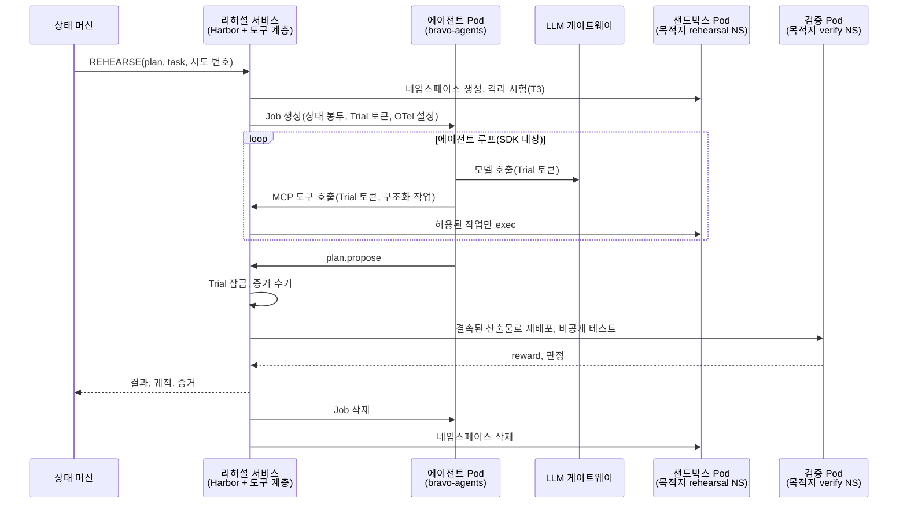

# 런타임: Pod 격리, 서비스 메시, 관측성, 에이전트 상태

에이전트 실행을 Pod 단위로 격리하고, 제어면과 실행면을 네임스페이스로 나누고, 서비스 메시와 OpenTelemetry로 관측성을 확보하는 설계입니다.

- 샌드박스는 Harbor(에이전트 샌드박스 · 평가 프레임워크, CNCF 레지스트리 Harbor와 다름)로 씁니다(D-02, 류지환 결정, 회의 공유).
- 플랫폼 클러스터는 Amazon EKS입니다(D-21). 목적지 클러스터는 온프렘 K3s입니다.
- 메시와 관측 스택은 인프라 · CI(T7)와 콘솔 · 관측(T18) 영역에 걸치므로 제안 D-15로 올립니다.
- SDK 사실의 근거는 `research/.claude/skills/agent-sdk-reference`(Claude Agent SDK Python 0.2.176, 2026-11-02 확인)입니다.

## 1. 원칙과 기준 규격

새 계층을 만들지 않고, 클라우드 사업자와 CNCF가 표준으로 쓰는 요소만 조합합니다.

| 원칙 | 기준 규격 | 이 설계에서 |
|---|---|---|
| 실행마다 격리 단위를 하나씩 붙임 | `kubernetes-sigs/agent-sandbox`의 Pod 단위 격리(2026-11-01 조회), Bedrock AgentCore의 세션 격리 | Trial마다 에이전트 Pod 1개, 샌드박스 Pod 1개, 검증 Pod 1개 |
| Pod 보안 기본값 | Kubernetes Pod Security Standards `restricted` | 실행면과 리허설 네임스페이스에 강제 |
| 네트워크 기본 거부 | Kubernetes NetworkPolicy | 모든 실행면 네임스페이스 |
| 서비스 사이 신원과 암호화 | Istio(CNCF 졸업)의 mTLS, 서비스 계정 기반 SPIFFE 신원 | ambient 모드, L4만 |
| 신원 기반 인가 | Istio AuthorizationPolicy. 제로 트러스트 원칙(NIST SP 800-207) | 네임스페이스 기본 거부 + 호출 주체별 허용 |
| 관측 표준 | OpenTelemetry OTLP, GenAI semantic conventions(상태: Development) | 수집 경로 하나, 백엔드 교체 가능 |

OTLP로 모으면 백엔드를 바꿔도 계측 코드가 그대로입니다. 출구전략 플랫폼이 특정 클라우드의 관측 서비스에 묶이지 않는다는 점도 보여 줍니다.

**메시를 넣는 안과 빼는 안.** 결정은 D-15에서 합니다.

| | 메시 없음(NetworkPolicy + 앱 토큰) | Istio ambient L4(이 설계) |
|---|---|---|
| 서비스 사이 암호화 | 서비스마다 TLS를 직접 설정 | ztunnel이 자동 mTLS |
| 호출 주체 확인 | 앱 토큰만 | 서비스 계정 신원 + 앱 토큰 |
| 관측 | 앱 계측만 | 앱 계측 + 모든 연결의 L4 메트릭 |
| 더해지는 구성요소 | 없음 | istiod, istio-cni, ztunnel |
| 위험 | 적음 | EKS VPC CNI 네트워크 정책과의 공존 실측 전(T7), Pod Security 예외 필요 |

## 2. 면 분리

플랫폼 클러스터의 네임스페이스는 다섯입니다. 계층을 늘리지 않으려고 제어면은 한 네임스페이스로 둡니다. 제안 D-16을 채택하면 링크용 `bravo-link`가 하나 더해집니다.

| 네임스페이스 | 면 | 무엇이 도나 | 메시 |
|---|---|---|---|
| `bravo-control` | 제어면 | API, 운영자 MCP 서버(`operator-mcp`, D-18), 상태 머신, 게이트, 수집기, 콘솔, 플랫폼 DB, 리허설 서비스(Harbor 오케스트레이터 + 환경 어댑터 + 도구 계층), LLM 게이트웨이, Executor | 등록. **Executor와 플랫폼 DB Pod는 제외**(`istio.io/dataplane-mode: none`) |
| `bravo-agents` | 실행면 | Trial마다 에이전트 Pod(Agent SDK) | 등록 |
| `bravo-observe` | 관측 | 관측 백엔드(Collector 포함 올인원 1개) | 제외 |
| `istio-system` | 메시 | istiod, istio-cni, ztunnel | - |
| `cf-edge` | 바깥 연결 | 콘솔 · MCP 호스트를 내놓는 cloudflared(복제본 2). 바깥 방향 연결만 엶 | 등록. 받는 쪽 인가 정책이 이 신원을 호출 주체로 씀 |
| `bravo-link`(제안 D-16) | 연결 | 상대 환경 서비스를 로컬 이름으로 받는 링크 Pod(`cloudflared access tcp`). `02-network.md` 4절 | 제외 |

**컷오버 실행은 메시 밖입니다.** 컷오버를 실제로 수행하는 Executor와, 단계마다 기록이 남는 플랫폼 DB를 메시에서 뺍니다. 상태 머신은 메시 안에 둡니다. 그래도 컷오버가 끊기지 않는 이유는 셋입니다.
- Executor는 한 번 호출을 받으면 여덟 단계를 스스로 끝까지 수행하고, 단계마다 결과를 플랫폼 DB에 직접 씁니다. 이 경로(메시 밖에서 메시 밖으로)는 ztunnel을 지나지 않습니다.
- 상태 머신이 Executor를 부르는 연결은 ztunnel을 지나므로, ztunnel이 재시작하면 응답을 잃을 수 있습니다. 이때 상태 머신은 같은 호출을 반복하지 않고 DB의 기록을 다시 읽습니다(§8.6 Executor 계약).
- 콘솔은 그동안 상태를 못 받을 뿐입니다.

| 메시 밖 Pod | 지키는 방법 |
|---|---|
| Executor | NetworkPolicy(상태 머신 Pod 라벨에서만 수신), 앱 토큰 |
| 플랫폼 DB(CNPG) | NetworkPolicy(허용한 Pod 라벨에서만 5432), TLS + SCRAM, 서비스별 DB 역할 |
| 링크(`bravo-link`, 제안 D-16) | NetworkPolicy(허용한 호출자 Pod 라벨에서만 수신), 링크마다 다른 Access 서비스 토큰, 링크 위 TLS(K8s API, DB `verify-full`) |

메시 안 서비스가 이 둘을 부르면 ztunnel이 평문으로 넘기므로, 암호화와 인증은 앱 쪽(TLS, 앱 토큰, SCRAM)이 맡습니다. T7에서 ztunnel을 재시작해 컷오버 목업이 끝까지 가고 DB 기록이 남는지 시험합니다.

**플랫폼 DB의 내구성.** CNPG 인스턴스 3개를 AZ마다 하나씩 두고, standby 둘 중 하나에는 반드시 닿아야 commit되는 동기 복제(any 1, 필수)로 묶습니다. 그래서 "전환 확정"(컷오버 6b) 같은 기록은 두 AZ 이상에 남습니다. 비동기 복제였다면 primary AZ를 잃는 순간 확정 기록이 사라지고, 복구 때 출발지 쓰기를 다시 여는 오판이 날 수 있습니다. 복구할 때는 DB 기록과 실제 원격 상태(PgBouncer 대상, 역할의 LOGIN 여부)를 함께 보고, 둘이 다르면 원격 상태를 따르며 SAFE_HOLD로 갑니다. CNPG 1.30의 정확한 필드 이름은 T7에서 확인합니다.

**서비스별 레플리카와 소유권.**

| 서비스 | 레플리카 | 소유권 |
|---|---|---|
| API, 운영자 MCP 서버, 콘솔, LLM 게이트웨이 | 2(AZ마다 1) | 상태 없음 |
| 상태 머신 | 2(활성 1) | K8s Lease로 활성 하나만. 넘겨받으면 DB에서 마지막 상태를 다시 읽음. 상태 전이는 DB에서 버전 조건부 갱신 |
| Executor | 1 | epoch와 lease(§8.6)로 하나만 실행. 단계마다 DB에서 epoch를 조건부 갱신(CAS)하고, 실패하면 그 자리에서 멈춤. 그래서 분할 상황에서 옛 Executor와 새 Executor가 같은 epoch로 동시에 진행하지 못함. 노드를 잃으면 다른 AZ에서 다시 뜸. P0에는 자동 인계가 없어 진행 중이던 실행을 이어 가지 않음. 미해결 효과가 있으면 관찰 전용 모드로 뜨고 계획은 SAFE_HOLD, 사람이 런북으로 해소(제안 D-19, `platform/executor/README.md`) |
| 리허설 서비스(도구 계층 포함), 게이트, 수집기 | 1 | Trial과 시험 단위로 DB에 소유권 기록 |
| 플랫폼 DB | 3(AZ마다 1) | CNPG가 primary 선출. 동기 복제 any 1 필수 |
| 링크(`bravo-link`, 제안 D-16) | 링크마다 2(AZ가 다르게, zone anti-affinity), PDB `minAvailable: 1` | 상태 없음. Pod 하나가 죽으면 그 Pod를 지나던 세션은 끊기고, 새 연결만 남은 Pod로 감(`02-network.md` 4.3절) |

플랫폼은 EKS 관리형 노드 그룹 core(t4g.large 3대, AZ마다 1)와 agents(1대, taint)에 놓입니다(`01-environments.md` 2절). 제어면 노드는 없습니다. core 노드 하나를 잃으면 남은 두 대에 위 Pod가 모두 올라가야 합니다. 그래서 둘을 함께 묶습니다.
- 메모리: core 풀 Deployment · StatefulSet의 메모리 요청 합을 12 GiB 이하로 둡니다. 두 대의 명목 메모리는 16 GiB지만, EKS AMI의 kubelet 예약과 노드마다 도는 DaemonSet(aws-node, kube-proxy, EBS CSI node, Pod Identity Agent, ztunnel, istio-cni)이 먼저 씁니다. 남는 몫이 12 GiB를 넘는지 T7에서 `kubectl describe node`로 확인합니다.
- Pod 수: VPC CNI는 t4g.large에 Pod 35개까지입니다(prefix delegation을 끈 기본값). DaemonSet, CoreDNS, EBS CSI controller, 운영자, 링크 Pod까지 세어 두 대에 들어가는지 봅니다. 모자라면 prefix delegation을 켭니다.
- T7에서 core 노드 하나를 멈춰 두 가지를 함께 확인합니다.

목적지 클러스터에는 Trial마다 `rehearsal-<plan>-<n>`(Harbor 샌드박스)과 `verify-<plan>-<n>`(Harbor 검증기)이 생겼다가 지워집니다. 고객 클러스터에는 P0에서 메시를 넣지 않습니다(5절).

## 3. Trial 한 번에 뜨는 Pod



그림 1. 에이전트 Pod는 Trial 토큰 하나만 가지고, 목적지 클러스터에 닿는 것은 리허설 서비스뿐입니다.

**Harbor의 자리.** Trial 오케스트레이터와 환경 어댑터는 리허설 서비스 안에 있습니다. 우리 `BaseAgent` 구현은 에이전트 루프를 직접 돌리지 않습니다. 에이전트 Pod를 Job으로 띄우고 끝나기를 기다립니다. 도구 계층은 에이전트의 MCP 요청을 받아 그 Trial의 `environment.exec()`로 넘깁니다. Harbor는 이 Job의 수명주기를 관리하지 않으므로, 리허설 서비스가 직접 관리합니다.

**Job 수명주기.** 에이전트 Job은 `pool=agents` toleration과 nodeSelector로 agents 풀에만 뜹니다.

- `backoffLimit: 0`으로 둡니다. 재시도는 Job이 아니라 상태 머신의 시도 카운터가 셉니다.
- `activeDeadlineSeconds`는 Trial 마감 시각에 맞춥니다(최대 수명).
- 유휴 상한도 둡니다. 증거 수신 API에 마지막 메시지가 온 뒤 60초가 지나면 리허설 서비스가 Trial을 INFRA_ERROR로 끝냅니다. AgentCore가 세션에 유휴 상한과 최대 수명을 따로 두는 것과 같은 방식입니다.
- agents 노드는 자동 교체 그룹(최소 1대)에 둡니다. 노드가 죽으면 진행 중 Trial은 INFRA_ERROR로 끝나고, 노드가 다시 뜨면 상태 머신이 다시 시도합니다(인프라 오류 상한 2회).
- 증거를 수거한 뒤 리허설 서비스가 Job을 지웁니다. 취소나 시간 초과 때도 지웁니다.
- 리허설 서비스의 권한은 `bravo-agents`의 Job 생성 · 조회 · 삭제와 Pod 로그 조회뿐입니다.
- 워커 안에서도 `asyncio.timeout`, `max_turns`, `max_budget_usd`를 겁니다. SDK에는 세션 전체 타임아웃이 없기 때문입니다.

**에이전트 Pod가 가진 것과 못 가진 것.**

| 가진 것 | 못 가진 것 |
|---|---|
| Trial 토큰 1개. 그 Trial의 승인 범위, 짧은 수명, 비용 상한이 걸려 있음 | 클러스터 · 클라우드 · DB 자격, 다른 Trial의 토큰 |
| 메시 신원 `agent-worker`(모든 Trial이 같음). 서비스 계정과 Pod 템플릿 모두 `automountServiceAccountToken: false`라 K8s API 토큰은 없음 | 모델 키(게이트웨이에만 있음) |

**Pod가 뚫렸을 때의 피해 범위.** 공격자는 자기 Trial의 승인 범위 안에서 토큰이 만료될 때까지만 MCP 작업을 부를 수 있습니다. LLM 호출도 비용 상한까지만 됩니다. Pod 안의 hook은 건너뛸 수 있으므로 보안 경계가 아닙니다. 실제 차단은 서버 쪽 도구 계층이 합니다(§8.3의 "도구 계층에서 차단"). 메시 신원은 모든 Trial이 같으므로, Trial을 가르는 것은 토큰입니다.

**Trial 토큰.** 리허설 서비스가 Trial마다 발급하고, 도구 계층과 LLM 게이트웨이가 요청마다 검사합니다.

| 항목 | 계약 |
|---|---|
| 형식 | 서명한 토큰. 수신자는 도구 계층과 LLM 게이트웨이 둘 |
| 담는 것 | `trial_id`, 승인 범위(네임스페이스, 작업 목록), 비용 상한, 만료(= Trial 마감). 제안 D-16은 `tenant_id`를 더하고, 도구 계층은 토큰 · plan · 대상 환경의 `tenant_id`가 같을 때만 실행 |
| 검사 | 서명, 만료, 그리고 플랫폼 DB의 Trial 상태가 `running`인지. 잠금, 종료, 취소된 Trial의 토큰은 거부 |
| 교차 사용 | 도구 계층은 토큰의 `trial_id`가 요청 대상 샌드박스의 Trial과 같을 때만 실행 |
| 비용 | LLM 게이트웨이가 요청마다 최대 비용(모델 단가 × `max_tokens`)을 먼저 예약하고, 응답 뒤 실제 비용으로 정산. 예약이 남은 예산을 넘으면 거부. Trial당 동시 요청은 1개. SDK의 `max_budget_usd`는 보조 |

**Trial 종료.** `plan.propose`를 받거나, 마감이 지나거나, 취소되면 다음 순서로 끝냅니다.
1. 도구 계층이 Trial을 잠그고 새 호출을 거부합니다. 진행 중인 원격 exec는 끝날 때까지 기다리고, 마감을 넘기면 샌드박스 쪽 프로세스를 종료합니다.
2. 산출물(매니페스트나 diff)을 동결하고 해시를 남깁니다.
3. 증거를 수거합니다(아래).
4. Job을 지우고 Pod가 사라진 것을 확인합니다. Job은 `restartPolicy: Never`입니다.

리허설 서비스가 재기동하면, `trial_id` 라벨이 붙은 Job과 리허설 네임스페이스 가운데 DB에서 `running`이 아닌 것을 찾아 증거를 거두고 지웁니다.

**격리 자원을 설치하는 주체.** 리허설 네임스페이스의 NetworkPolicy, ResourceQuota, LimitRange, 서비스 계정, RoleBinding은 리허설 프로비저너 계정이 만듭니다. 이 계정은 `rehearsal-*`, `verify-*` 네임스페이스 안에서만 이 자원을 만들 수 있습니다. RoleBinding은 미리 정한 ClusterRole(리허설 exec)에만 묶을 수 있게 ValidatingAdmissionPolicy로 제한합니다(`bind`, `escalate` 남용 방지).

**산출물 결속.** 산출물의 정본은 `plan.propose`에 담긴 내용 자체입니다. 제출 때 고정하고 digest를 남기며, 샌드박스에 남은 상태가 아닙니다. 그래서 Trial을 잠근 뒤 샌드박스 안에서 무엇이 계속 돌아도 검증 대상은 바뀌지 않습니다. 샌드박스에서 검증 쪽으로 파일을 복사하지 않습니다. 검증과 승인은 이 산출물에 묶입니다.
- 설정 작업(버킷 정책 등): 제안된 매니페스트의 digest
- 코드 작업: 리허설 서비스가 제안된 diff로 신뢰된 빌드를 돌려 만든 이미지 digest

검증 Pod는 이 digest로만 배포합니다. `environment_mode="separate"`는 별도 환경을 줄 뿐이고, 이 결속은 리허설 서비스가 만듭니다.

**결과 결속.** 결과는 검증 controller 신원, 검증 실행 ID, 검증 Pod UID, 시도 번호에 묶습니다. 종료 상태는 CAS로 한 번만 정하고, 그 뒤에 온 결과는 거부합니다(`05-agent-rehearsal.md` 3절).

**증거.** 두 가지를 모읍니다. 끝날 때 한 번에 보내지 않고, 생길 때마다 보냅니다. Pod가 메모리 부족이나 시간 초과로 죽어도 그 전까지의 기록이 남게 하기 위해서입니다.
1. 서버 쪽 도구 계층의 호출 기록: 허용 · 거부, 규칙, 실행 결과. 도구 계층이 바로 플랫폼 DB에 씁니다. 이것이 권위 있는 기록입니다.
2. 에이전트 쪽 SDK 메시지 흐름: 모델 응답, 도구 호출 요청, `PreToolUse` hook이 본 입력. 워커가 메시지마다 리허설 서비스의 증거 수신 API로 보냅니다(Trial 토큰으로 인증). 권위 없는 기록으로 표시합니다.

**증거 전송 계약.**
- 사건마다 `(trial_id, seq)`와 도구 호출 ID를 붙입니다.
- 받는 쪽은 DB에 쓴 뒤 ACK합니다. 보내는 쪽은 ACK가 없으면 같은 `seq`로 다시 보내고, 받는 쪽은 중복을 버립니다.
- `seq`에 빈 곳이 있으면 "누락"으로 표시합니다.
- Trial이 잠긴 뒤에는 마지막 전송만 30초 동안 받습니다.
- T15에서 메모리 부족, 시간 초과, 전송 장애를 일으켜 기록이 어디까지 남는지 시험합니다.

두 기록은 도구 호출 ID와 순번으로 맞춥니다. 리허설 서비스는 둘을 합쳐 Harbor 궤적(ATIF)을 만들고 증거 저장소에 남깁니다. 차단은 도구 계층 한 곳에서만 합니다. 그래서 Pod 쪽 hook이 막아 서버에 기록이 없는 경우가 생기지 않습니다.

**격리의 보장 범위.**
- 에이전트 Pod 안의 코드가 뚫려도, 가진 것은 위 표의 둘(Trial 토큰, `agent-worker` 신원)뿐입니다.
- 노드가 뚫리면 이야기가 다릅니다. 같은 노드의 Pod는 커널을 공유하고, ztunnel은 그 노드에 있는 모든 Pod의 메시 신원을 대신 들고 있습니다. 그래서 에이전트 Pod와 관측 백엔드만 agents 풀에 두고, 제어 서비스는 core 풀에 둡니다(`01-environments.md` 2절). agents 노드가 뚫려도 제어 서비스의 신원은 그 노드에 없습니다.
- 데모의 주장은 "Pod 격리와 노드 분리"까지입니다. 운영 권장은 에이전트 Pod에 gVisor RuntimeClass를 쓰거나, 별도 클러스터에서 실행하는 것입니다.

## 4. Istio ambient 구성

**ambient L4만 씁니다.**
- 사이드카가 없어서 Trial Pod가 뜨는 시간과 자원이 늘지 않습니다.
- 네임스페이스 라벨(`istio.io/dataplane-mode=ambient`) 하나로 등록됩니다.
- waypoint(L7 프록시)는 쓰지 않습니다. waypoint를 거친 요청은 받는 쪽에서 waypoint 신원으로 보여 호출 주체 확인이 흐려집니다. 또 Pod IP로 직접 부르면 waypoint를 우회할 수 있습니다. L7 검사(MCP 메서드, Trial 토큰)는 도구 계층과 게이트웨이 앱이 직접 합니다.
- ambient는 Istio 1.24에서 GA가 됐고, 이 설계는 1.31(2026-11-02 공식 문서 기준)을 가정합니다.

**인가 정책.** 두 네임스페이스에 "아무것도 허용하지 않음" 정책을 깔고, 아래만 ALLOW로 엽니다. 정책은 받는 쪽 워크로드에 `selector`로 붙고, ztunnel이 L4(신원, 포트)로 집행합니다.

| 받는 쪽 | 허용하는 호출 주체 | 포트 |
|---|---|---|
| 도구 계층 | `agent-worker` | MCP 포트 |
| LLM 게이트웨이 | `agent-worker` | 게이트웨이 포트 |
| 게이트, 수집기, 리허설 서비스 | 상태 머신 | 각 실행 API 포트 |
| 상태 머신 | API, `operator-mcp` | 실행 API 포트 |
| API | `cf-edge`의 cloudflared, 콘솔 | API 포트 |
| 콘솔 | `cf-edge`의 cloudflared | 콘솔 포트 |
| `operator-mcp` | `cf-edge`의 cloudflared | MCP 포트 |

메시 밖 Pod(Executor, 플랫폼 DB, `bravo-link` 링크)는 이 표가 아니라 2절의 NetworkPolicy와 앱 · DB 인증으로 지킵니다. 메시 안 서비스가 메시 밖 Pod를 부를 때는 ztunnel이 평문으로 넘기므로, 이 연결의 암호화는 앱 쪽 TLS(DB는 TLS + SCRAM)가 맡습니다.

**`bravo-agents`의 NetworkPolicy.** 수신은 없습니다. 송신은 넷만 엽니다.

| 목적지 | 포트 | 이유 |
|---|---|---|
| kube-dns | 53 TCP · UDP | Service 이름 해석 |
| 도구 계층 Pod | 15008(메시 터널), MCP 포트 | 메시 안 트래픽은 15008로 나감. 실측 전이라 둘 다 엶 |
| LLM 게이트웨이 Pod | 15008, 게이트웨이 포트 | 같음 |
| 관측 백엔드(`bravo-observe`) | 4317 | OTLP. 메시 밖이라 평문 gRPC |

**`bravo-control`의 NetworkPolicy(공식 문서).** 메시 안 Pod 수신에 15008을 더합니다. kubelet 프로브는 `169.254.7.127`로 바뀌어 들어오므로 이 주소를 허용합니다. ambient는 NetworkPolicy를 우회하지 않고, 집행은 CNI가 그대로 합니다.

**설치 조건.**
- EKS는 클러스터 기본 Pod Security 집행이 없습니다. 그래서 모든 네임스페이스에 `pod-security.kubernetes.io/enforce: restricted` 라벨을 겁니다. istio-cni와 ztunnel은 `privileged`가 필요하므로 `istio-system`만 예외로 두고 통제 비교표에 예외 승인으로 기록합니다(D-11).
- VPC CNI의 Pod 보안 그룹을 쓰면 `POD_SECURITY_GROUP_ENFORCING_MODE=standard`가 필요합니다. P0 노드(t4g)는 Pod 보안 그룹을 지원하지 않아 켜지 않습니다(D-15).
- waypoint를 쓰지 않으므로 Gateway API CRD는 필요 없습니다(설치 때 확인).
- istiod의 기본 요청값(CPU 500m, 메모리 2 GiB)을 데모 규모로 낮춥니다.

**네트워크 계약 시험(T7, T3).** 아래가 모두 기대대로 나와야 메시를 유지합니다.

| 시험 | 기대 |
|---|---|
| 에이전트 Pod → 도구 계층, LLM 게이트웨이, 관측 백엔드, DNS | 성공 |
| 에이전트 Pod → 상태 머신, Executor, 플랫폼 DB, API, 인터넷, 메타데이터(169.254.169.254), 노드 kubelet(10250) | 거부 |
| 허용 목록에 없는 메시 안 서비스 → 도구 계층 | 거부(인가 정책) |
| 허용한 Pod가 아닌 메시 밖 Pod → 플랫폼 DB, Executor | 거부(NetworkPolicy) |
| kubelet 프로브(`169.254.7.127`) | 성공 |
| 에이전트 Pod를 지우고 다시 만든 직후 같은 시험 | 같은 결과 |
| ztunnel 재시작 중 컷오버 목업 | 끊기지 않음 |

**되돌림 기준.** 11/4(수) 12:00까지 다음 두 가지가 확인되지 않으면 메시를 빼고 "메시 없음" 안으로 갑니다.
1. 플랫폼 EKS(VPC CNI, 네트워크 정책 켬)에 ambient 설치
2. 위 시험 전체 통과

관측(6절)과 상태 주입(7절)은 메시와 무관하게 그대로입니다.

**넣지 않는 것.**

| 넣지 않는 것 | 이유 |
|---|---|
| waypoint(L7) | 신원 가림과 우회 경로. L7 검사는 앱이 함 |
| 사이드카 모드 | Trial마다 프록시가 붙어 시작 시간과 메모리가 늘어남 |
| 멀티 클러스터 메시 | ambient의 멀티 클러스터 지원 범위가 좁고 계층이 늘어남. 환경 사이는 Cloudflare 링크(제안 D-16, `02-network.md`) |
| 고객 클러스터 메시(P0) | 컷오버 경로에 변수가 늘어남. 고객 앱 관측은 P1에서 검토 |
| 이그레스 게이트웨이 | 밖으로 나가는 것은 LLM 게이트웨이 하나. NetworkPolicy로 충분 |

## 5. 고객 클러스터의 리허설 격리

목적지 클러스터의 리허설과 검증 네임스페이스는 `05-agent-rehearsal.md` 3절을 따릅니다. NetworkPolicy 허용 목록(D-12), Pod Security `restricted`, ResourceQuota, 토큰 없는 Pod입니다. 메시가 없으므로 15008과 프로브 주소 예외는 필요 없습니다. 리허설 · 검증 네임스페이스에서 `cf-edge`와 `bravo-link`로 가는 송신은 없습니다(제안 D-16, `02-network.md` 6절).

## 6. 관측성

**경로는 하나입니다.** 모든 신호를 OTLP로 `bravo-observe`의 관측 백엔드에 보냅니다. 데모 백엔드는 Grafana의 올인원 이미지 하나이고, 이 이미지 안에 OTel Collector가 들어 있습니다. 그래서 Collector를 따로 두지 않습니다. 운영 권장은 별도 Collector와 각 클라우드 사업자의 OTLP 수용 백엔드이고, 보내는 쪽 설정은 그대로입니다.

| 신호 | 출처 | 보내는 방법 |
|---|---|---|
| 에이전트 메트릭 · 이벤트 | Agent SDK(아래에서 도는 Claude Code CLI) | Pod 환경 변수 `CLAUDE_CODE_ENABLE_TELEMETRY=1`, `OTEL_METRICS_EXPORTER=otlp`, `OTEL_LOGS_EXPORTER=otlp`, `OTEL_EXPORTER_OTLP_PROTOCOL=grpc`(기본값이 없으므로 켠 신호 전체에 공통으로 지정), `OTEL_EXPORTER_OTLP_ENDPOINT` |
| 에이전트 트레이스(beta) | 같음 | `OTEL_TRACES_EXPORTER=otlp`, `CLAUDE_CODE_ENHANCED_TELEMETRY_BETA=1`. 게이트웨이를 거치므로 `CLAUDE_CODE_PROPAGATE_TRACEPARENT=1` |
| 도구 호출 span | 도구 계층 | GenAI 규약의 `execute_tool {도구 이름}` span. 허용 · 거부와 규칙 이름을 속성으로 |
| 플랫폼 서비스 트레이스 | API, 상태 머신, 게이트, 리허설 서비스 | OpenTelemetry Python 자동 계측. W3C `traceparent` 전파 |
| 메시 L4 메트릭 | ztunnel | 백엔드의 Prometheus 수집 |
| 컷오버 지표 사본 | Executor, 부하 생성기 | 대시보드용 사본. 판정 근거는 아님(아래) |

**GenAI span 트리는 서버 쪽에서 완성합니다.** Claude Code 트레이스는 beta라 구조가 바뀔 수 있습니다. 그래서 Trial 하나의 트리는 우리 서비스가 GenAI 규약 이름으로 직접 만듭니다. 규약은 아직 Development 상태이므로, 이름이 바뀌면 이 표만 고칩니다.

| span | 만드는 곳 | 주요 속성 |
|---|---|---|
| `invoke_agent bravo-rehearsal` | 리허설 서비스(Trial 시작부터 끝까지) | `bravo.trial_id`, `bravo.plan_id`, `bravo.attempt`, 판정 |
| `chat {모델}` | LLM 게이트웨이(모델 호출마다) | 모델, 입력 · 출력 토큰, 비용(USD), `bravo.trial_id` |
| `execute_tool {도구}` | 도구 계층(MCP 호출마다) | 도구 이름, 허용 · 거부, 규칙 이름, `bravo.trial_id` |
| 검증 | 리허설 서비스(검증 Pod 실행) | reward, 판정, 산출물 해시 |

에이전트 Pod가 내는 Claude Code span은 같은 트레이스에 붙는 보조 정보입니다.

**비용은 게이트웨이가 셉니다.** LLM 게이트웨이가 `trial_id`별 누적 토큰과 비용을 메트릭으로 냅니다. AGENTIC STAR가 게이트웨이 로그에 비용을 남기는 것과 같은 방식입니다. 같은 값으로 Trial 토큰의 비용 상한(3절)을 판단하므로, 화면의 비용과 차단 기준이 어긋나지 않습니다.

**상관 키는 두 곳에 붙입니다.** `bravo.trial_id`, `bravo.plan_id`, `bravo.attempt`를 resource 속성(`OTEL_RESOURCE_ATTRIBUTES`)과 baggage 양쪽에 넣습니다. resource 속성은 에이전트 Pod가 내는 모든 신호에 붙고, baggage는 서비스를 건너는 호출에 따라갑니다. AgentCore가 `session.id`를 baggage와 span 속성에 함께 쓰는 것과 같은 방식입니다. 값의 쉼표, 공백, 등호는 퍼센트 인코딩합니다.

**조용한 실패를 잡습니다.** CLI는 export 실패를 오류 없이 버립니다. `CLAUDE_CODE_OTEL_DIAG_STDERR=1`과 SDK의 `stderr` 콜백으로 실패를 리허설 서비스 로그에 남깁니다.

**민감 정보.** Claude Code는 프롬프트 본문, 도구 입력 상세, 도구 출력을 기본으로 내보내지 않습니다. 이 기본값을 유지하고, `OTEL_LOG_USER_PROMPTS`, `OTEL_LOG_TOOL_DETAILS`, `OTEL_LOG_TOOL_CONTENT`는 켜지 않습니다.

**관측은 판정 근거가 아닙니다.** 텔레메트리는 표본을 뽑거나 버려질 수 있습니다. 그래서 다음 판단의 근거는 플랫폼 DB와 증거 저장소의 기록만 씁니다.
- 게이트 판정, 승인, 무결성 영수증, 감사 기록(FR-14)
- 쓰기 정지 ms(Executor 기록)
- SHIFT의 오류율과 p95(부하 생성기 기록)

**콘솔과 Grafana.** FR-13의 "콘솔 한 화면"은 API의 SSE 이벤트로 그립니다. Trial 이벤트 종류(`trial.started`, `tool.denied`, `trial.verdict`)를 SSE 계약에 더합니다. Grafana 트레이스는 엔지니어와 Q&A용이고, 콘솔에서 `trial_id`로 바로 열 수 있게 링크만 둡니다.

## 7. Agent SDK 상태 주입

**원칙.** 상태의 주인은 상태 머신(플랫폼 DB)입니다. 에이전트는 상태를 읽기만 하고, 쓰는 것은 제안서뿐입니다. 루프는 SDK 내장을 쓰고 우리가 따로 만들지 않습니다(11/1 회의: 상태 전달이 되면 루프를 만들 필요가 없음).

**상태 봉투.** Trial을 시작할 때 상태 머신이 만듭니다. 크기 상한을 둡니다.

```json
{
  "plan_id": "p-0012",
  "trial_id": "t-0012-2",
  "attempt": 2,
  "max_attempts": 3,
  "state": "REHEARSE",
  "task": "fix-bucket-policy",
  "approved_scope": { "namespace": "rehearsal-p-0012-2", "ops": ["kubectl", "read_file", "write_file", "run_check"] },
  "deadline": "2026-11-05T10:20:00Z",
  "budget_usd": 2.0,
  "prior_failures": [{ "attempt": 1, "verdict": "FAIL", "reason": "anonymous_read_allowed", "summary": "익명 GetObject가 여전히 허용됨" }]
}
```

**넣는 경로.**

| 경로 | 무엇을 | 언제 | 근거(참조 스킬) |
|---|---|---|---|
| `system_prompt`(문자열) | 역할, 규칙, 상태 봉투 | Trial 시작 | 미설정이면 빈 문자열이라 반드시 명시. preset은 코딩 지침이 섞여 쓰지 않음(Claude §4) |
| 첫 user 메시지 | 작업 지시(task의 `instruction.md`) | Trial 시작 | Claude §2 |
| `PostToolUse` hook의 `additionalContext` | 도구 결과 뒤 상태 변화. 예: 남은 시도, 남은 예산 | 도구 호출마다 | Python 지원(Claude §4) |
| `PreToolUse` hook | 기록만. 도구 호출 입력을 증거 수신 API로 보내고 항상 허용. 차단은 서버 쪽 도구 계층 한 곳에서만 | 모든 도구 호출 | 평가 순서 맨 앞(Claude §5). 훅 예외의 처리 방식이 확인 못 함이라 차단을 맡기지 않음 |
| MCP 도구 `plan.propose` | 제안서 제출(유일한 채널). 도구 계층이 Pydantic 스키마로 검사 | 끝 | `output_format`은 쓰지 않음(아래) |

**제안서 채널은 하나입니다.** `output_format`을 켜면 SDK가 `StructuredOutput` 도구를 더하고, 결과 채널이 `plan.propose`와 둘로 갈립니다. 그래서 스펙의 `plan.propose`(§8.3) 하나로 모읍니다.

**세션을 이어 쓰지 않습니다.** 재시도마다 새 세션을 열고, 이전 실패는 요약으로만 넣습니다. 앞 시도의 맥락이 오염됐을 수 있기 때문입니다. Python SDK는 `SessionStart` 콜백 hook을 지원하지 않으므로, 시작 시점의 상태는 system prompt로 넣습니다.

**SDK 설정.** 참조 스킬의 권장 조합입니다. 실행 검증은 T11에서 합니다.

```python
mcp = {"platform": {"type": "http", "url": TOOL_LAYER_URL,
                    "headers": {"Authorization": f"Bearer {trial_token}"}}}
options = ClaudeAgentOptions(
    system_prompt=render_state_prompt(envelope),
    tools=[],                                   # 내장 도구 제거(--tools ""), MCP는 유지
    disallowed_tools=["Agent", "TaskStop"],     # 남을 수 있는 기본 도구를 명시적으로 뺌
    allowed_tools=["mcp__platform__*"],         # 자동 승인일 뿐 제한이 아님
    permission_mode="dontAsk",                  # 미설정 시 시작 모드 서술이 상충하므로 명시
    setting_sources=[],                         # CLAUDE.md와 파일 설정을 읽지 않음
    strict_mcp_config=True,
    mcp_servers=mcp,
    hooks={"PreToolUse": [HookMatcher(hooks=[record_tool_input])],  # 기록만, 항상 허용
           "PostToolUse": [HookMatcher(hooks=[state_delta])]},
    max_turns=40,
    max_budget_usd=envelope["budget_usd"],      # 마지막 응답 1개만큼 넘을 수 있음
    env=agent_env(envelope, trial_token),       # 아래 환경 변수
    stderr=forward_to_log,
)
```

**에이전트 Pod 환경 변수.**

| 변수 | 값 | 이유 |
|---|---|---|
| `ANTHROPIC_BASE_URL` | LLM 게이트웨이 주소 | 모델 키는 게이트웨이에만 둠 |
| `ANTHROPIC_AUTH_TOKEN` | Trial 토큰 | 게이트웨이가 검증하고 실제 키로 바꿔 보냄 |
| `CLAUDE_CONFIG_DIR` | `emptyDir` 경로 | 읽기 전용 루트 파일 시스템에서 쓰기 위치를 한정 |
| `CLAUDE_CODE_SKIP_PROMPT_HISTORY` | `1` | transcript를 디스크에 남기지 않음. 재개를 쓰지 않으므로 |
| `CLAUDE_CODE_DISABLE_AUTO_MEMORY` | `1` | 자동 메모리 파일을 만들지 않음 |
| `ENABLE_CLAUDEAI_MCP_SERVERS` | `false` | 계정에 연결된 MCP를 불러오지 않음 |
| OTel 변수 | 6절 | |

**시작 검사.** init 메시지의 `tools` 배열이 `mcp__platform__*`뿐인지 확인합니다. 다른 도구가 보이면 Trial을 INFRA_ERROR로 끝내고 그 도구를 `disallowed_tools`에 더합니다. `tools=[]`일 때 `ToolSearch`나 MCP 리소스 도구가 남는지는 문서와 소스로 확인하지 못했기 때문입니다.

**도구 결과 크기.** MCP 도구 결과가 50,000자를 넘으면 CLI가 파일로 빼는데, Read 도구가 없는 우리 구성에서는 모델이 그 파일을 읽지 못합니다. 그래서 도구 계층은 결과를 50,000자 아래로 줄이고, 잘랐다는 사실을 함께 돌려줍니다.

**이미지.** glibc 계열(Debian 또는 Ubuntu)과 Python 3.10 이상입니다. Alpine에는 번들 CLI 바이너리가 없습니다.

## 8. 복잡도 예산과 자원

플랫폼 클러스터에 더해지는 것은 넷입니다: istiod, istio-cni, ztunnel, 관측 백엔드 1개. 보안 격리 단위는 Pod입니다. 노드는 안정성을 위해 나눕니다(`01-environments.md` 2절): 제어면은 AWS가 운영하고, 관리형 노드 그룹 core 3대(AZ마다 1)와 agents 1대가 세 AZ에 놓입니다.

| 무엇 | 놓이는 곳 |
|---|---|
| istiod | core 풀 |
| istio-cni, ztunnel | core와 agents의 모든 노드(DaemonSet). 제어면 노드가 없으므로 nodeSelector를 두지 않음. agents의 taint는 기본 toleration으로 견딤(설치 때 확인) |
| 운영자 · 컨트롤러(istiod, CNPG operator, ESO, `cf-edge`의 cloudflared), `bravo-link` 링크 Pod(제안 D-16), EKS 관리형 add-on(CoreDNS, EBS CSI controller) | core 풀에 nodeSelector로 고정. agents 노드에 놓이지 않게 함. 관리형 add-on은 agents의 taint를 견디지 않아 core에 놓임 |
| 관측 백엔드, Trial 에이전트 Pod | agents 풀 |
| 제어 서비스, 플랫폼 DB | core 풀 |

istiod의 기본 요청값(CPU 500m, 메모리 2 GiB)은 데모 규모로 낮춥니다. 동시 Trial은 1개를 기준으로 합니다. 노드별 CPU와 메모리는 T7에서 재고, 결과를 `docs/evidence/`에 남깁니다.

**S2 시간 예산.** 스펙 §10은 S2를 0:00에 시작해 1:30 전에 승인까지 끝냅니다. 라이브로 보이는 버킷 정책 Trial의 예산은 아래와 같습니다. 11/4–11/5에 단계별로 잽니다. 합계가 넘으면 비상 대체 장면(사전 실행 기록)으로 갑니다.

| 단계 | 예산 |
|---|---|
| 리허설 네임스페이스 생성과 격리 시험 | 15초 |
| 에이전트 Pod 기동(이미지는 agents 노드에 미리 받아 둠) | 10초 |
| 에이전트 루프(제안까지) | 30초 |
| Trial 종료, 산출물 동결, 증거 수거 | 5초 |
| 검증 Pod 재배포와 비공개 테스트 | 15초 |
| 게이트 재대조와 승인 화면 | 10초 |
| 여유 | 5초 |
| 합계 | 90초 |

## 9. 엔터프라이즈 · 수상작과 대조해 정한 것

2026-11-02 조사(`research/platform-research/rea-2026-11-02-*.md`)에서 가져온 결정입니다. 모두 관찰한 사실에 근거하고, 추론은 표시했습니다.

| 출처 | 관찰 | 우리 결정 |
|---|---|---|
| AGENTIC STAR 3.2.0 Helm 차트 | 플랫폼은 System Pool, 에이전트 Pod는 User Pool. 하지만 출구 게이트웨이, webhook, sandbox controller에는 노드 지정이 없어 에이전트 노드에 놓일 수 있음 | 모든 운영자 · 컨트롤러를 core 풀에 고정(8절 표). 렌더링한 매니페스트로 확인 |
| AGENTIC STAR | Marketplace 기본값(Level 1)은 레플리카 1, PDB 없음, 플랫폼 NetworkPolicy 없음. strict 모드에서도 사설 대역과 DB 5432가 열림 | 처음부터 기본 거부 NetworkPolicy, 제어 서비스 PDB. 에이전트 Pod의 송신은 4절의 넷뿐(사설 대역 전체를 열지 않음) |
| AGENTIC STAR | 3.2.0에서 사이드카를 없애고 중앙 출구 게이트웨이로 바꿈. 판정 서비스가 멈추면 외부 통신 차단(fail-closed) | 에이전트의 바깥 연결은 도구 계층과 LLM 게이트웨이 둘. 둘 중 하나가 멈추면 Trial은 진행하지 못하고 INFRA_ERROR(fail-closed) |
| Bedrock AgentCore SDK · 문서 | 제어면과 데이터면을 호스트, 클라이언트, 허용 메서드로 나눔. 세션에 유휴 상한과 최대 수명 | 에이전트가 닿는 것은 데이터면 셋(도구 계층 MCP, LLM 게이트웨이, 증거 수신)뿐. 제어면 API는 NetworkPolicy로 막음. Trial에 유휴 상한과 최대 수명(3절) |
| Bedrock AgentCore | microVM 안의 어떤 코드든 실행 역할 자격을 읽을 수 있다고 문서가 밝힘 | 에이전트 Pod에 클라우드 자격 0. IMDS hop 제한 1 |
| 2025 최우수(Blue) | 제어면 1대, 노드 대부분 한 AZ, README의 Multi-AZ와 설정 불일치. 함수 매니페스트 생성기가 toleration을 버려 Spot 고정이 실패했는데 시험이 못 잡음 | AZ 배치를 Terraform 변수로 고정하고 노드 라벨로 시험. taint와 toleration은 쌍으로 두고, 렌더링한 Pod 스펙을 시험(아래) |
| 2025 2위(Green) | gVisor를 함수 런타임 기본값으로 둠 | gVisor RuntimeClass를 agents 풀에 설치할 수 있으면 에이전트 Pod 기본값으로 올림. 안 되면 runc와 Pod 격리로 유지(P1 판단) |
| 2026 예선 부산 최우수(Crystal) | 허브의 Argo CD가 다른 클러스터를 키 없이(Workload Identity) 배포. 시험 트래픽이 없을 때 오류 30% 버전이 승격된 기록 | SHIFT 단계 판정에는 부하 생성기의 합성 트래픽을 반드시 넣고, 단계마다 최소 표본 수를 못 채우면 넘어가지 않음(`03-migration.md`). 배포 방식(Argo CD pull)은 §12대로 인프라 · CI가 정하되 근거로 남김 |
| 2026 예선 서울 우수(Peony) | AI가 만든 Terraform을 실행하기 전에 정적 검사와 plan 정책 검사. 배포는 digest 고정, 60분 뒤 자동 삭제 | 제안서 → 정책 린트 → 리허설 → 검증 → 게이트의 결정적 관문(05 2절)과 Trial 자원 TTL 정리가 같은 원칙 |

**렌더링 시험.** Helm 차트와 매니페스트를 렌더링한 결과에 대해 CI에서 다음을 검사합니다(AGENTS.md 강제 수단 표에 추가).
- taint가 있는 풀로 가는 Pod는 toleration과 nodeSelector를 함께 가짐
- 제어 구성요소는 core 풀 nodeSelector를 가짐
- 이미지는 digest로 고정(`latest` 금지)
- 에이전트 Pod와 서비스 계정은 `automountServiceAccountToken: false`
- 플랫폼 DB 인스턴스에는 AZ를 나누는 `topologySpreadConstraints`(2a, 2b)

## 10. 배규태 님의 Harbor 우려와 대응

| 우려(배규태 「Harbor 도입 관련」) | 이 설계에서 | 남은 것 |
|---|---|---|
| 1. Trial마다 환경을 띄우는 시간 | Pod 셋과 네임스페이스 둘이 붙어 오히려 늘 수 있음. 이미지는 노드에 미리 받아 둠 | 11/4 실측. 길면 버킷 정책 Trial만 라이브 |
| 2. 정적 task 폴더 | 고정 task 2개. 값은 상태 봉투와 지시문으로 넣음 | 범용 생성기는 P1 |
| 3. 운영 기능(승인, 컷오버, 롤백) 없음 | 상태 머신과 Executor가 맡음. Harbor는 리허설만 | 없음 |
| 4. 검증기는 산출물만 봄 | 매니페스트 해시나 신뢰 빌드 digest로 재배포해 검증 | 신뢰 빌드 경로 구현(T15) |
| 5. 시연 장비 nftables | K8s 경로라 해당 없음. NetworkPolicy는 CNI가 집행 | T3 격리 시험 |
| 6. "리플레이" 용어 | Harbor의 궤적은 기록과 재채점이며 실행 재생이 아님. 발표에서 "리플레이"라고 하지 않음 | 없음 |

## 11. 확인할 것

- EKS VPC CNI(네트워크 정책 켬)와 Istio ambient의 공존, 프로브 주소 `169.254.7.127`, 메시 안 송신에 15008만으로 충분한지(T7, 되돌림 기준 11/4 12:00)
- `tools=[]`일 때 남는 도구(init 메시지로 확인)
- Python 훅 콜백이 예외를 던질 때 CLI가 도구 호출을 막는지(참조 스킬 Claude "확인 못 함" 5)
- Claude Code 트레이스(beta)의 span 구조가 GenAI 규약과 얼마나 맞는지
- 관측 백엔드와 istiod의 실제 메모리
- gVisor RuntimeClass를 EKS 관리형 노드 그룹(AL2023)과 K3s에 붙이는 방법(P1)

근거:
- Istio 공식 문서(ambient 플랫폼 요건, NetworkPolicy, 보안 모델, waypoint 사용법). 2026-11-02 조회, 1.31.3.
- `research/.claude/skills/agent-sdk-reference`: Claude Agent SDK Python 0.2.176 소스와 공식 문서.
- OpenTelemetry GenAI agent spans(Development).
- 리뷰: `research/reviews/astra-18-runtime-mesh-*.md`, `persona-experts-18-runtime-mesh.md`, `persona-team-judges-18-runtime-mesh.md`.
- 배규태 「결정적 워크플로우 × 비결정적 판단 구현안」, 「Harbor 도입 관련」(Notion, 2026-11-01), 11/1 회의록 2절.
