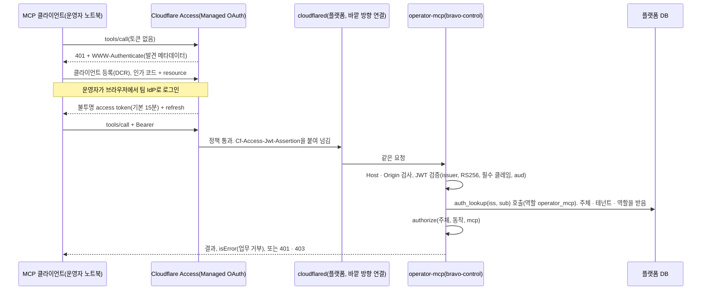

# 운영자 MCP 서버

운영자가 자기 MCP 클라이언트(Claude Code 등)로 플랫폼을 쓰게 하는 MCP 서버입니다. 운영자는 클라이언트에서 계획을 만들고, 리허설과 게이트를 돌리고, 진행을 봅니다. 트래픽 전환, 컷오버, 되돌리기는 승인 뒤 사람 운영자가 콘솔에서 시작합니다(4절).

- 팀장(류지환)이 11/2에 "앞단은 MCP"로 정했고, 회의에서 공유합니다. 스펙에 없는 진입점이므로 D-18로 올립니다.
- **이름.** 이 서버는 화면도, 첫 관문도, 유일한 입구도 아닙니다. 화면은 운영자의 MCP 클라이언트와 콘솔이고, 첫 관문은 Cloudflare(TLS 종료, Access 인증, Tunnel)입니다. 승인과 실행 시작은 콘솔로만 들어옵니다. 그래서 위치("앞단")가 아니라 부르는 쪽으로 이름을 붙입니다. 플랫폼의 MCP 서버는 둘입니다. 사람 운영자가 부르는 **운영자 MCP 서버**(이 문서)와 리허설 에이전트가 부르는 **도구 계층 MCP 서버**(`05` 2절)입니다.
- 스펙 §8.9 REST API와 콘솔(FR-13)은 그대로 둡니다. 운영자 MCP 서버는 REST와 같은 처리기를 MCP 도구로 내놓는 얇은 어댑터이고, 상태를 새로 만들지 않습니다. 배치는 API와 같은 이미지의 별도 Deployment입니다(9절).
- 근거 문서의 접근일은 모두 2026-11-02입니다(12절).

## 1. 기준으로 삼은 것

| 사례 | 들어오는 MCP 구성 | 우리가 가져온 것 |
|---|---|---|
| AGENTIC STAR(SoftBank) | 들어오는 MCP 서버 `POST /api/v1/mcp`, Streamable HTTP, stateless, 대화 연속성은 `conversationId`. 사용자 토큰은 Keycloak Authorization Code, 쓰기 scope를 나누고 결정 권한(`project:decide`)을 따로 둠 | stateless 서버, 연속성은 우리 ID(`plan_id`)로, 결정 권한 분리 |
| Bedrock AgentCore Gateway | 기존 API를 MCP 도구로 바꿔 내보내고, 들어오는 인증과 나가는 인증을 나눔 | 새 로직 없이 REST 처리기를 도구로 감쌈. 들어오는 토큰을 안쪽으로 넘기지 않음 |
| 예선 Railshot | UI, CLI, MCP가 같은 API 하나로 들어감 | REST와 MCP가 같은 처리기를 씀 |

근거: `research/platform-research/rea-2026-11-02-agenticstar-runtime.md` 3절, `research/sandbox-research/04-reference-platforms.md` 1절.

## 2. MCP 면은 둘이고, 섞지 않습니다

| | 운영자 MCP 서버(이 문서) | 도구 계층 MCP 서버(`07` 3절, `05` 2절) |
|---|---|---|
| 부르는 쪽 | 사람 운영자의 MCP 클라이언트 | Trial마다 뜨는 에이전트 Pod |
| Pod | `operator-mcp` Deployment(`bravo-control`) | 리허설 서비스 Pod(`bravo-control`) |
| 메시 신원 | 서비스 계정 `operator-mcp` | 리허설 서비스의 서비스 계정 |
| 받는 호출 주체 | `cf-edge`의 cloudflared만 | `agent-worker`만 |
| 주소 | `https://mcp.<도메인>/mcp`(Cloudflare Tunnel) | 클러스터 안 도구 계층 Service만. 바깥에 내보내지 않음 |
| 신원 | Cloudflare Access가 확인한 사람(5절) | Trial token(서명, DB 상태와 대조) |
| 도구 | 계획, 리허설 시작, 게이트, 조회(4절). 실행 시작 없음 | `rehearsal_exec` 등 리허설 네임스페이스 작업 |
| 승인 | 없음(6절) | 없음 |

한쪽 토큰은 다른 쪽에서 받지 않습니다. 두 서버는 다른 Pod이고 다른 메시 신원을 가집니다. 실행면(`bravo-agents`)에서 `operator-mcp`로 가는 연결은 메시 인가 정책이 막습니다(9절, `07` 4절). 그래서 리허설 에이전트는 운영자 도구를 부를 수 없습니다.

## 3. 프로토콜과 구현

| 항목 | 정한 것 | 이유 |
|---|---|---|
| 판 | MCP 2026-07-28. 2025년 판 클라이언트도 받음 | 공식 Python SDK `mcp` 2.3.0(2026-10-02)이 두 판을 함께 처리 |
| 전송 | Streamable HTTP. 세션을 쓰지 않음. 마운트하는 앱에 `stateless_http=True`를 명시 | 2026 경로는 세션이 없지만, 2025 경로는 SDK 기본값이 프로세스 안 세션임. 그대로 두면 다른 레플리카에 간 요청이 `404 Session not found`를 받음. 연속성은 `plan_id` |
| 배치 | API와 같은 이미지(FastAPI)를 별도 Deployment `operator-mcp`로 띄우고, 시작 설정으로 `/mcp`만 켬 | 처리기 코드는 하나로 두고, 메시 신원 · DB 역할 · 장애 범위를 콘솔 API와 나눔(9절) |
| 마운트 | MCP 세션 관리자를 상위 FastAPI 앱의 lifespan에서 실행. 공개 경로는 `/mcp` 하나로 고정 | 마운트한 하위 앱의 lifespan은 상위 앱이 대신 돌리지 않음. SDK의 경로 설정과 마운트 경로가 겹치면 `/mcp/mcp`가 생김(설정 이름은 SDK 판에서 확인 필요) |
| 레플리카 시험 | 두 레플리카에 요청을 번갈아 보내 2025 판 클라이언트와 2026 판 클라이언트를 각각 시험 | 레플리카 사이에 상태가 없음을 확인 |
| 오래 걸리는 일 | 리허설은 `rehearsal_id`를 바로 돌려줌. 리허설, 트래픽 전환, 컷오버, 되돌리기의 진행은 `plan_get`, `plan_events`로 조회 | Tasks 확장을 지원하는 클라이언트가 아직 없음(MCP 확장 지원표). 지원이 생기면 같은 ID를 task로 감쌈 |
| 서버가 먼저 거는 요청 | 쓰지 않음 | 2026 판에는 서버에서 클라이언트로 가는 통로가 없음. SDK의 `ctx.elicit()`도 2026 경로에서 실패 |
| 도구 이름 | 소문자와 밑줄만(`plan_get`) | Claude API 도구 이름은 점을 받지 않음. 클라이언트가 `mcp__bravo__plan_get`처럼 붙임 |
| 리소스, 프롬프트, MCP Apps | P0에서 쓰지 않음 | 도구 결과의 구조화 출력과 콘솔 링크로 충분. 필요해지면 더함 |

## 4. 도구 일곱 개

| 도구 | 하는 일 | 같은 처리기(REST) | 필요한 역할 | 주석 |
|---|---|---|---|---|
| `env_register` | 출발지 · 목적지 등록. 접속 정보는 비밀 저장소 참조 이름만 받고, 참조는 `tenants/<tenant_id>/…` 아래만 받음 | `POST /v1/environments` | operator | 쓰기, 멱등 |
| `env_controls` | 통제별 시험 결과, 증거 링크, 수집 시각 | `GET /v1/environments/{id}/controls` | viewer | 읽기 전용 |
| `plan_create` | 이전 계획 생성. 의존성 3등급의 개수와 통제 차이를 돌려줌 | `POST /v1/plans` | operator | 쓰기, 멱등 |
| `plan_get` | 상태, 마지막 게이트 판정, 승인 대기 여부와 콘솔 승인 주소, 걸린 보안 보류, 진행 중 실행, 마지막 영수증 요약 | `GET /v1/plans/{id}`(제안, 11/3 계약에 더함) | viewer | 읽기 전용 |
| `plan_events` | `after` 이후 이벤트 최대 N개. SSE와 같은 이벤트 | `GET /v1/plans/{id}/events`의 비스트림 조회 | viewer | 읽기 전용 |
| `rehearsal_start` | 리허설 Trial 시작. `rehearsal_id`를 바로 돌려줌 | `POST /v1/plans/{id}/rehearsals` | operator | 쓰기, 멱등. 격리 네임스페이스만 건드림 |
| `gate_run` | 원본 대조 게이트 실행 | `POST /v1/plans/{id}/gate` | operator | 쓰기(판정 기록), 멱등 |

**제안: 환경 만들기 도구 `env_create`.** 회의 전이라 위 일곱 개에 넣지 않습니다. 근거는 제품 원칙입니다. 고객은 쿠버네티스를 몰라도 되고, 플랫폼의 첫 가치는 클러스터를 만들어 주는 것입니다(D-21). 만드는 클러스터는 어디서나 같은 랜딩 존입니다(D-23, [11-landing-zone.md](11-landing-zone.md) 4절).

| 항목 | 내용 |
|---|---|
| 입력 | `destination`(`aws`, `gcp`, `onprem`), `name`, `region`(온프렘은 비움), `size`(`small`, `medium`), `idempotency_key`. CNI, StorageClass, 노드 그룹 같은 쿠버네티스 값은 받지 않음 |
| 같은 처리기(REST) | `POST /v1/environments/provisions`(제안). 진행은 `GET /v1/environments/{id}`(제안)로 조회 |
| 하는 일 | 플랫폼이 IaC를 돌려 클러스터를 만들고 랜딩 존을 설치함. 상태는 REQUESTED, PROVISIONING, BOOTSTRAPPING, VERIFYING, READY 또는 FAILED. READY가 되면 `env_register`로 등록한 것과 같은 환경 행이 생김 |
| 대상별 실행 | AWS · GCP: 고객이 위임한 역할(AWS 교차 계정 역할, GCP Workload Identity 연동)로 IaC를 실행. 온프렘: 플랫폼이 고객 VM을 만들 수 없으므로 등록 명령 한 줄을 준비하고, 고객 VM의 바깥 방향 에이전트가 K3s를 설치 |
| 필요한 역할 | operator |
| 주석 | `destructiveHint: false`, `idempotentHint: true`, `openWorldHint: true`(고객 계정에 자원을 만듦) |
| 출력 | `environment_id`, `provision_id`, 상태, 예상 비용 요약, 콘솔 링크. 비밀 값과 온프렘 등록 명령 문자열은 넣지 않음(콘솔에서만 보임) |

열린 것은 넷입니다. 정하기 전에는 구현하지 않습니다.
- **IaC 실행기와 자격 경로.** 테넌트별 상태 파일, 실행기가 도는 곳, 고객 계정 위임을 받는 방법입니다. [TECH-STACK-SPEC.md](../spec/TECH-STACK-SPEC.md) 3절 #1입니다.
- 비용이 드는 apply를 MCP 호출만으로 시작할지, 콘솔에서 사람이 비용을 확인한 뒤 시작할지입니다. 권고는 승인과 같은 원칙(MCP는 계획까지, 시작은 콘솔)입니다.
- Terraform과 OpenTofu 중 무엇을 쓸지입니다(TECH-STACK-SPEC 3절 #4).
- 환경 삭제를 어디에 둘지입니다. P0에는 MCP 삭제 도구를 두지 않습니다.

**실행 시작 도구는 없습니다.** 트래픽 전환(`weights`), 컷오버와 되돌리기(`shift`)는 MCP로 시작하지 않습니다.
- 스펙은 이 구간을 AI가 관여하지 않는 실행 구간으로 둡니다. §8.2 그림의 범례는 "실행 · 코드만 (AI 관여 없음)"입니다. §8.1은 "AI가 실행(컷오버 · 롤백)에 들어가는 칸은 없다"고 씁니다. 스펙 텍스트 사본 `research/spec/2026-11-02-spec-v0.1.txt`의 499행, 554행, 491행입니다.
- 승인은 무엇을 할지에 묶이고, 언제 할지에는 묶이지 않습니다. 시작을 MCP 도구로 두면 운영자의 모델이 시작 시점을 정하게 됩니다.
- 그래서 승인 뒤에도 실행은 사람 운영자가 콘솔에서 시작합니다(6절). MCP 클라이언트는 `plan_get`과 `plan_events`로 진행을 봅니다.

**주석 값.** 읽기 도구 셋은 `readOnlyHint: true`입니다. 파괴적 도구는 남지 않았으므로 `destructiveHint: true`인 도구가 없습니다. 쓰기 도구 넷은 `destructiveHint: false`, `idempotentHint: true`입니다. 모든 도구는 `openWorldHint: false`입니다. 스펙상 주석은 클라이언트가 믿지 않아도 되는 힌트입니다. 그래서 안전은 주석이 아니라 서버의 인가와 상태 검사로 지킵니다.

**입력 규칙.**
- 쓰기 도구는 `idempotency_key`가 필수입니다. 키의 범위는 (테넌트, 동작, 입력 digest)입니다.
- 같은 키에 같은 입력이 다시 오면 처음 만든 handle(`rehearsal_id` 등)을 그대로 돌려줍니다. 같은 키에 다른 입력이 오면 거부합니다(§8.9).
- 입력은 ID와 선택값만 받습니다. 승인에 묶이는 값을 받는 도구는 없습니다.
- 비밀 값을 받는 입력은 없습니다. `env_register`의 접속 정보는 OpenBao · Secrets Manager의 참조 이름입니다. 서버는 참조 경로, 환경, 실제 자원이 호출자 테넌트의 것인지 확인합니다(5절).

**출력 규칙.**
- `outputSchema`를 두고 `structuredContent`로 돌려줍니다. 같은 JSON을 텍스트로도 넣습니다(스펙 권고).
- **고객 저장소 원문은 돌려주지 않습니다.** MCP 결과에는 서버가 만든 값만 넣습니다. 상태, ID, 이유 코드, 개수, 콘솔 증거 링크입니다. 의존성 근거, 파일 경로, 제안서 본문은 넣지 않습니다. 원문은 사람이 콘솔에서 링크로 엽니다.
- **남는 위험.** 운영자의 클라이언트는 이 서버 밖에서도 주입 문자열을 받을 수 있습니다. 운영자가 붙인 다른 MCP 서버, 웹 도구, 운영자가 붙여 넣은 원문이 그 경로입니다. 이 서버는 그 경로를 막지 못합니다. 이 서버로 할 수 있는 일은 계획, 리허설, 게이트까지입니다. 승인과 실행 시작은 할 수 없습니다.

**오류는 층을 나눕니다.**

| 경우 | 응답 |
|---|---|
| JWT가 없거나, 무효이거나, 만료됨 | HTTP 401 |
| 역할이 모자람 | HTTP 403과 `WWW-Authenticate`(MCP 인가 규격의 `insufficient_scope`) |
| `Origin`이 있고 허용 목록에 없음 | HTTP 403 |
| 업무상 거부(상태 불일치, 보안 보류, 컷오버 확정 뒤 리허설 시작 등) | 도구 결과 `isError: true`와 이유 코드 |
| 형식이 틀린 요청 | JSON-RPC 오류 |

업무상 거부만 도구 결과로 돌려줍니다. 모델이 읽고 다음 행동을 고칠 수 있게 하기 위해서입니다.

**목록은 역할에 따라 다릅니다.** `tools/list`는 호출자의 역할이 쓸 수 있는 도구만 보여 줍니다. 스펙이 허용하는 방식입니다(목록은 요청의 인가에 따라 달라질 수 있음). viewer에게는 읽기 도구 셋만 보입니다. 목록만으로 막지 않습니다. `tools/call`마다 다시 인가합니다(5절).

## 5. 인증과 인가

**인가 서버는 Cloudflare Access입니다.** `mcp.<도메인>`을 Access 자체 호스팅 앱으로 만들고 Managed OAuth를 켭니다. Access가 OAuth 2.0 인가 서버가 되어 RFC 8414 · RFC 9728 발견 메타데이터, 동적 클라이언트 등록(DCR), 리소스 지시자(RFC 8707)를 처리합니다. access token은 불투명 값이고 기본 15분입니다. refresh 때마다 Access 정책을 다시 평가합니다. MCP와 콘솔은 서로 다른 Access 앱입니다. 콘솔 로그인(`platform/README.md`)과 네트워크 연결(D-16 설계안)도 같은 Cloudflare Access를 쓰므로 새 구성요소가 늘지 않습니다.

**서버가 믿는 것은 Access가 서명한 JWT 하나입니다.** Access는 토큰을 사용자 신원으로 바꿔 `Cf-Access-Jwt-Assertion` 헤더로 넘깁니다. `operator-mcp`와 API는 같은 검증 모듈로 아래를 모두 검사합니다.

| 항목 | 규칙 |
|---|---|
| issuer | `https://<team>.cloudflareaccess.com` 하나로 고정. `iss`가 다르면 거부 |
| 공개 키 | 같은 issuer의 `/cdn-cgi/access/certs`에서 받음. 캐시하되 키 교체를 따라감 |
| 알고리즘 | RS256만 받음. 다른 `alg`는 거부 |
| 필수 클레임 | `iss`, `aud`, `exp`, `iat`, `sub`. `nbf`는 있으면 검사 |
| 헤더 개수 | `Cf-Access-Jwt-Assertion`이 둘 이상 오면 거부 |
| `aud` | 아래 호스트 표에서 그 호스트에 허용한 값과 같아야 함 |

| 요청 호스트 | 받는 Deployment | 허용 AUD |
|---|---|---|
| `mcp.<도메인>` | `operator-mcp` | MCP Access 앱의 AUD |
| `console.<도메인>` | 콘솔 · API | 콘솔 Access 앱의 AUD |

- 두 앱의 AUD가 달라서 콘솔 세션으로 MCP를 부르거나 그 반대가 되지 않습니다.
- 이 헤더는 클러스터 안에서 위조할 수 있으므로, 서명 검사를 빼지 않습니다. 추가로 `operator-mcp`는 cloudflared의 연결만 받습니다(9절).
- Managed OAuth로 들어온 요청의 실제 `aud` 값은 첫 실제 연결에서 기록합니다(12절, 확인 필요).

**Host와 Origin.** 요청의 Host가 위 표에 없으면 거부합니다. Streamable HTTP 규격대로 `Origin` 헤더가 있고 허용 목록에 없으면 403입니다. `Origin`이 없는 요청은 CLI 클라이언트이므로 받습니다.

**주체는 `(iss, sub)`입니다.** 이메일은 바뀌거나 다른 사람에게 다시 배정될 수 있어 주체 키로 쓰지 않습니다.

| 표 | 열 | 규칙 |
|---|---|---|
| `principals` | `id`, `iss`, `sub`, `email` | `(iss, sub)` UNIQUE. `email`은 화면 표시용 |
| `memberships` | `principal_id`, `tenant_id`, `role` | 역할과 테넌트를 정함 |

- 서비스 역할은 두 표를 직접 읽지 않습니다. 신원 조회는 `SECURITY DEFINER` 함수 `auth_lookup(iss, sub)` 하나로만 합니다. 이 함수는 좁은 전용 역할이 소유하고 (주체, 테넌트, 역할)을 돌려줍니다. 테넌트를 정하기 전에 RLS 걸린 표를 읽어야 하는 순환을 이것으로 끊습니다(`02-network.md` 8.2절).
- 같은 이메일로 새 `sub`가 오면 새 주체입니다. 기존 권한을 잇지 않고, 관리자가 다시 묶어야 합니다.
- 사람이 없는 서비스 토큰은 P0에서 받지 않습니다. 사람 신원 클레임이 없는 JWT는 거부합니다(클레임 모양은 12절에서 확인).
- 클라이언트가 보낸 값(헤더의 사용자 에이전트, 인자)은 신원으로 쓰지 않습니다.

| 역할 | MCP에서 할 수 있는 것 | 콘솔에서 할 수 있는 것 |
|---|---|---|
| viewer | 읽기 도구 셋 | 보기 |
| operator | 도구 일곱 개 | 보기, 리허설 · 게이트 실행, 승인 뒤 트래픽 전환 · 컷오버 · 되돌리기 시작 |
| approver | 읽기 도구 셋 | 보기, **승인** |
| security_approver | 읽기 도구 셋 | 보기, **보안 보류 해제**(D-20) |

**매 호출을 인가합니다.** 모든 처리기는 먼저 같은 함수 `authorize(principal, action, channel)`를 부릅니다. `channel`은 `mcp`, `console`, `service` 중 하나입니다. 승인과 보류 해제는 `console` 채널의 사람 주체일 때만 통과합니다. REST와 MCP가 같은 처리기를 쓰므로, 라우터의 인증 설정에 기대지 않고 처리기 안에서 검사합니다. 거부 시험은 `platform/api/README.md`에 있습니다.

**테넌트.**
- 테넌트 후보는 `auth_lookup` 결과의 소속뿐입니다. 소속이 둘 이상이면 요청이 테넌트를 고르고, 서버가 그 값이 결과에 있는지 다시 확인합니다.
- 요청마다 트랜잭션을 열고 `SET LOCAL app.tenant_id`로 테넌트를 넣습니다. 세션 범위 `SET`은 쓰지 않습니다. 연결 풀에서 다음 요청으로 값이 남기 때문입니다.
- 대상 ID(계획, 환경)는 `SET LOCAL` 뒤에 읽습니다. 다른 테넌트의 대상은 RLS로 보이지 않아 찾을 수 없음으로 끝납니다.
- RLS가 보장하는 것은 행 가시성뿐입니다. 바깥 자원의 소유는 아래처럼 따로 확인합니다.
- 플랫폼 DB의 모든 행에 `tenant_id`와 RLS `FORCE`를 둡니다. `BYPASSRLS`를 가진 서비스 역할은 없습니다.
- 외래 키는 `tenant_id`를 포함한 복합 키입니다. 그래서 다른 테넌트의 환경을 계획에 붙일 수 없습니다.
- `env_register`의 비밀 참조는 `tenants/<tenant_id>/…` 아래만 받습니다. 서버는 환경과 실제 자원(클러스터, DB)이 그 테넌트에 등록된 것인지 확인합니다. 권한 있는 수집기나 Executor가 다른 테넌트의 비밀을 대신 읽는 길을 막기 위해서입니다.

**토큰을 안쪽으로 넘기지 않습니다.** `operator-mcp`는 받은 토큰이나 JWT를 상태 머신, Executor, 수집기에 넘기지 않습니다. 안쪽 호출은 메시 신원과 서비스별 앱 토큰을 씁니다(`07` 4절). 감사 기록에는 호출자를 따로 적습니다(8절). MCP 스펙의 토큰 전달 금지 규칙과 같습니다.

## 6. 승인과 실행 시작은 MCP에 없습니다

FR-7의 사람 승인은 콘솔에서만 합니다. 보안 보류의 해제(D-20, `04-governance.md` 5절)도 같습니다. 트래픽 전환, 컷오버, 되돌리기의 시작도 승인 뒤 사람이 콘솔에서 합니다(4절). 모델이 닿는 면에는 승인, 해제, 실행 시작 권한이 존재하지 않습니다.

1. 게이트가 통과하면 상태 머신이 AWAIT_APPROVAL로 갑니다(`03` 3절). 이때 1회용 승인 요청(`approval_request_id`)과 불변 revision(결속 값 묶음)을 만듭니다. 이것이 곧 승인 요청입니다. 따로 요청 도구를 두지 않습니다.
2. 운영자의 클라이언트는 `plan_get`에서 `awaiting_approval: {stage, approve_url}`을 봅니다. 운영자에게 승인자를 부르라고 알립니다.
3. 승인자는 콘솔에서 diff, 게이트 판정, 통제 비교표를 보고 승인합니다. 결정 요청은 콘솔 전용 `POST /v1/plans/{id}/approvals`입니다. 콘솔 세션, CSRF 토큰, 1회용 `approval_request_id`에 묶입니다.
4. 이 경로(`console.<도메인>/v1/plans/*/approvals`)의 Access 세션을 짧게 두어 다시 로그인하게 합니다(제안). 경로별 세션 길이에 별도 Access 앱이 필요하면 5절 호스트 · AUD 표에 행이 늘어납니다(확인 필요).
5. 승인자는 콘솔 세션의 주체입니다. 요청 본문에서 받지 않습니다. 승인자가 그 승인 revision의 요청자이거나 승인 대상 revision의 제안자이면 DB 제약으로 거부합니다(직무 분리).
6. 승인 뒤 운영자가 콘솔에서 실행을 시작합니다. 서버는 한 트랜잭션에서 계획 행을 잠그고 revision, 승인, 보류, 진행 중 실행을 확인합니다. 맞으면 승인을 소비하고 실행을 만듭니다. 다르거나 만료되었으면 `approval_stale`로 거부합니다. 순서는 `platform/api/README.md`에 있습니다.

**MCP의 elicitation을 쓰지 않는 이유.**
- 폼 모드는 응답이 클라이언트와 모델을 지나갑니다. 모델이 "승인"을 지어낼 수 있습니다.
- URL 모드는 정보가 클라이언트를 거치지 않습니다. 하지만 스펙은 URL을 연 사람이 요청한 사람과 같은지 확인하라고 합니다. 승인은 일부러 다른 사람(승인자)이 해야 하므로 맞지 않습니다.

## 7. 위협과 막는 곳

| 위협 | 막는 곳 |
|---|---|
| 고객 저장소에 심은 지시가 운영자의 모델을 움직여 실행을 시작하게 함 | MCP 결과에 고객 원문이 없음. 실행 시작 도구가 없고, 트래픽 전환 · 컷오버 · 되돌리기는 사람이 콘솔에서 시작. 남는 위험: 다른 경로로 들어온 주입은 리허설 · 게이트 요청까지 닿을 수 있음(4절) |
| MCP 토큰 탈취 | 15분 불투명 토큰(기본값), refresh 때 정책 재평가. operator 토큰으로는 승인도 실행 시작도 할 수 없음 |
| 클러스터 안에서 `Cf-Access-Jwt-Assertion` 위조 | 고정 issuer의 키로 RS256 서명 검사, 필수 클레임과 `aud` 검사. 헤더가 둘 이상이면 거부. `operator-mcp` 수신은 `cf-edge`의 cloudflared만 |
| 콘솔 세션으로 MCP를 부르거나 그 반대 | 호스트별 허용 AUD 표. MCP와 콘솔은 다른 Access 앱 |
| 운영자 브라우저의 다른 사이트가 MCP 주소를 부름 | 허용 목록 밖 `Origin`은 403 |
| 이메일이 다른 사람에게 다시 배정되어 권한을 이어받음 | 주체 키는 `(iss, sub)`. 새 `sub`는 관리자가 다시 묶음 |
| 모델이 승인 · 보류 해제 기록을 직접 씀 | 도구가 없음. 처리기의 `authorize`가 `mcp` 채널을 거부. `operator_mcp` DB 역할에 그 표의 쓰기 권한이 없음(9절) |
| 다른 테넌트의 비밀 참조나 환경 ID를 넣어 권한 있는 서비스가 대신 접근 | 비밀 참조는 `tenants/<tenant_id>/…` 아래만. 환경 · 자원 소유권 검사, `tenant_id`를 포함한 복합 외래 키 |
| 리허설 에이전트가 운영자 MCP 서버를 부름 | 실행면에서 `operator-mcp`로 가는 연결을 메시 인가 정책이 거부. 토큰 종류도 다름 |
| 같은 요청의 중복 실행 | (테넌트, 동작, 입력 digest) 범위의 `idempotency_key`. 같은 요청은 같은 handle을 받음. Executor의 epoch · CAS(`07` 2절) |
| 과도한 호출 | Cloudflare 요청 수 제한 규칙을 `mcp.<도메인>`에 둠(제안). 비용은 LLM 게이트웨이가 셈 |
| 다른 테넌트의 계획 조회 | `memberships`의 테넌트, 트랜잭션마다 `SET LOCAL app.tenant_id`, RLS `FORCE`. `BYPASSRLS` 역할 없음 |

## 8. 관측과 감사

**트레이스.** 도구 호출마다 SERVER span을 하나 엽니다. 이름과 속성은 OpenTelemetry GenAI 저장소의 MCP 규약(상태: Development)을 따릅니다.

| 속성 | 값 |
|---|---|
| span 이름 | `tools/call {도구 이름}` |
| `mcp.method.name` | `tools/call` |
| `gen_ai.tool.name` | 도구 이름 |
| `gen_ai.operation.name` | `execute_tool` |
| `mcp.protocol.version` | 요청의 판 |
| `jsonrpc.request.id` | 요청 ID |
| `error.type` | 실패할 때만 |

- 클라이언트가 `params._meta`에 `traceparent`를 넣으면 그 값을 부모로 씁니다. HTTP 헤더의 트레이스 문맥은 링크로 남깁니다(규약대로).
- `plan_id`, `trial_id`는 `07` 6절의 리소스 속성 · baggage 규칙을 따릅니다. 그래서 운영자의 요청 하나에서 리허설 에이전트의 `invoke_agent` span까지 같은 `plan_id`로 이어 봅니다.
- 이메일은 span에 넣지 않습니다. span에는 `principals`의 내부 ID만 넣습니다.

**감사.** 모든 `tools/call`을 REST와 같은 감사 경로(FR-14)에 남깁니다. 항목은 호출자(주체 ID, 표시용 이메일, 역할, 테넌트), 도구, 인자 digest, `idempotency_key`, 결과 코드, `trace_id`입니다. SSE 이벤트에는 `actor.kind=mcp`를 넣어 콘솔이 "MCP로 요청됨"을 보입니다.

## 9. 배치와 네트워크

**Pod와 네임스페이스.**

| 항목 | 값 |
|---|---|
| 네임스페이스 | `bravo-control`(제어면). 새 네임스페이스를 만들지 않습니다. API와 같은 상태 머신과 DB를 쓰고, 워크로드 단위 분리는 메시 신원과 정책이 맡기 때문입니다 |
| Deployment | `operator-mcp`, 레플리카 2, AZ 분산, core 풀. API와 같은 이미지이고, 시작 설정으로 `/mcp` 라우터만 켬 |
| 서비스 계정 | `operator-mcp`. K8s API 토큰 자동 마운트 끔 |
| 메시 | ambient 등록. L4 mTLS, 메시 신원 `operator-mcp` |
| 자원 요청 | Pod당 메모리 약 256 MiB(가정), 합 0.5 GiB. core 풀 예산 12 GiB 안(`07` 2절) |
| 상태 | 없음. 재시작해도 잃는 것 없음 |

**누가 누구를 부르나.**

| 방향 | 허용 | 막는 층 |
|---|---|---|
| cloudflared(`cf-edge`) → `operator-mcp` | MCP 포트만 | 인가 정책(호출 주체 cloudflared 서비스 계정), NetworkPolicy |
| `operator-mcp` → 상태 머신 | 리허설 · 게이트 실행 요청만(API와 같은 경로) | 상태 머신 쪽 정책에 `operator-mcp`를 호출 주체로 더함. 처리기의 `authorize` |
| `operator-mcp` → 플랫폼 DB | 5432, 전용 역할 `operator_mcp` | NetworkPolicy(허용 Pod 라벨), TLS + SCRAM, 역할 권한 |
| `operator-mcp` → Executor, 게이트, 수집기, 리허설 서비스, LLM 게이트웨이 | 없음 | 받는 쪽 정책에 없음 |
| `bravo-agents` → `operator-mcp` | 없음 | 기본 거부 |
| 콘솔 → `operator-mcp` | 없음 | 콘솔은 API만 부름 |

**DB 역할 `operator_mcp`.**

| 표 | 권한 |
|---|---|
| 환경, 계획 | SELECT, INSERT |
| 실행 요청(멱등 키 포함) | SELECT. INSERT는 종류가 `rehearsal`, `gate`인 행만(역할별 RLS 정책의 `WITH CHECK`) |
| 이벤트, 통제 결과, 게이트 판정, 영수증 요약 | SELECT |
| 승인, 승인 요청, 보안 보류, 실행 | SELECT만. INSERT · UPDATE 없음 |
| 감사 기록 | INSERT만 |
| `principals`, `memberships` | 직접 권한 없음. `auth_lookup(iss, sub)`의 EXECUTE만 |

RLS `FORCE`가 이 역할에도 걸리고, `BYPASSRLS`는 주지 않습니다. 테넌트는 트랜잭션마다 `SET LOCAL app.tenant_id`로 넣습니다. 승인과 보류 해제의 쓰기 권한은 콘솔 API의 역할에만 있습니다. 그래서 "MCP에는 승인도 실행 시작도 없다"를 세 곳에서 지킵니다. 코드에 도구가 없고, 처리기의 `authorize`가 `mcp` 채널을 거부하고, DB 역할에 권한이 없습니다.

**바깥 노출.** cloudflared의 바깥 방향 연결뿐입니다. 공개 LB와 인바운드 보안 그룹 규칙이 없습니다. Tunnel 라우트는 호스트마다 Service 하나입니다. `mcp.<도메인>`은 `operator-mcp` Service로, `console.<도메인>`은 콘솔과 API Service로 갑니다. 플랫폼의 cloudflared는 `cf-edge` 네임스페이스에 두고 메시에 등록합니다. 그래야 받는 쪽 정책이 그 신원을 호출 주체로 쓸 수 있습니다.

**AUD 분리.** 메시가 L4만 쓰므로(waypoint 없음) 요청 내용을 보는 인가는 앱이 합니다. Deployment가 나뉘어, 각 Pod는 5절 호스트 표의 자기 AUD 하나만 받습니다.

Tunnel 커넥터 배치와 테넌트별 Access 앱은 네트워크 설계(D-16, `02-network.md`)를 따릅니다.

## 10. 데모에서 보이는 것

시각은 스펙 §10을 따릅니다. MCP 클라이언트는 계획, 게이트, 조회에만 씁니다. 실행 시작과 승인은 모두 콘솔입니다.

| 시각(스펙 §10) | 운영자의 MCP 클라이언트 | 콘솔 |
|---|---|---|
| 0:00 | "chat 앱 이전 계획 만들고 게이트 돌려" → `plan_create`, `gate_run` → 열린 첨부 저장소로 BLOCK. 이어서 `rehearsal_start` | 같은 BLOCK이 게이트 판정에 뜸. 의존성 3등급, 통제 비교표 |
| 0:40 | `plan_events`로 Trial 진행과 검증 통과를 봄. `gate_run` 재대조 PASS. `plan_get`이 승인 대기와 승인 주소를 알림 | 승인자가 승인 |
| 1:30 | `plan_events`로 가중치 단계를 봄 | 운영자가 가중치 10% → 50% → 100%를 시작 |
| 2:10 | `plan_events`로 쓰기 정지 ms와 영수증 요약을 봄 | 승인자가 `cutover`를 승인하고, 운영자가 컷오버를 시작. 쓰기 정지 ms, 무결성 영수증 |
| 3:00 | `plan_events`로 되돌리기 진행을 봄 | 장애 주입 뒤 승인자가 `failback`을 승인하고, 운영자가 되돌리기를 시작. 목적지에서 쓴 메시지가 출발지에 있음 |
| 3:50 | 없음 | 감사 기록에서 MCP 호출(`actor.kind=mcp`)과 콘솔의 승인 · 시작이 나뉘어 보임 |

선택 장면(제안): 클라이언트에 "컷오버 시작해"라고 말해도 시작할 도구가 없습니다. 감사 기록에 실행 요청이 남지 않는 것을 보입니다.

## 11. 일정과 되돌림

담당은 T10을 옮겨 받는 콘솔 · 관측 · Edge 담당입니다(제안, `docs/plans/2026-11-03-to-07.md` 4절).

| 날짜 | 할 일 |
|---|---|
| 11/3 | `GET /v1/plans/{id}`와 `actor.kind`를 API 계약에 더함. 읽기 도구 셋을 목업 데이터로 띄우고, Claude Code를 Access Managed OAuth로 실제 연결. 두 레플리카에 번갈아 보내 2025 판과 2026 판을 각각 시험 |
| 11/4 | 쓰기 도구 넷을 목업 흐름에 붙임. 역할별 목록, 401 · 403, `Origin`, AUD 교차 거부 시험. `operator_mcp` 역할로 승인 표 쓰기와 `rehearsal` · `gate` 밖 실행 요청 INSERT가 거부되는지 시험. MCP 신원으로 승인 · 해제 처리기를 부르는 거부 시험 |
| 11/5 | 역할 · 테넌트 거부 시험, 데모 흐름에 연결 |

**되돌림 기준.** 11/3 실제 연결이 안 되면 11/4에 다시 봅니다. 11/5(목) 18:00까지 Claude Code가 Access Managed OAuth로 붙지 않으면 데모는 콘솔로만 합니다. 운영자 MCP 서버는 S1–S4의 인수 조건에 들어가지 않으므로 P0 경로에 영향이 없습니다.

## 12. 확인할 것

1. Claude Code가 Access Managed OAuth의 DCR과 RFC 8707 흐름으로 붙는지. 쓰는 MCP 판(2025-11-25 또는 2026-07-28)도 함께 기록합니다.
2. Managed OAuth로 들어온 `Cf-Access-Jwt-Assertion`의 클레임. `aud`, `iss`, `sub`, 이메일, 그룹 포함 여부, 서비스 토큰일 때의 모양을 기록합니다. 그룹이 없으면 지금처럼 `memberships`로 역할을 정합니다.
3. `mcp` 2.3.0을 FastAPI에 마운트할 때 `stateless_http=True`, 상위 lifespan, 공개 경로 `/mcp`가 의도대로 동작하는지. 우리 인증 미들웨어가 `/mcp` 앞에서 먼저 도는지도 봅니다.
4. 403 응답의 `WWW-Authenticate`를 Claude Code가 어떻게 보이는지.
5. Access에서 승인 경로 하나에만 짧은 세션을 줄 수 있는지(6절).
6. Cloudflare 요청 수 제한 규칙을 쓰는 요금제인지.

**근거(접근일 2026-11-02).**
- MCP 2026-07-28: Authorization(https://modelcontextprotocol.io/specification/2026-07-28/basic/authorization), Streamable HTTP(https://modelcontextprotocol.io/specification/2026-07-28/basic/transports/streamable-http), Tools(https://modelcontextprotocol.io/specification/2026-07-28/server/tools), Elicitation(https://modelcontextprotocol.io/specification/2026-07-28/client/elicitation)
- MCP Tasks 확장(https://modelcontextprotocol.io/extensions/tasks/overview), 확장 지원표(https://modelcontextprotocol.io/extensions/client-matrix)
- Cloudflare Access Managed OAuth(https://developers.cloudflare.com/cloudflare-one/access-controls/applications/http-apps/managed-oauth/), JWT 검증(https://developers.cloudflare.com/cloudflare-one/access-controls/applications/http-apps/authorization-cookie/validating-json/), Secure MCP servers(https://developers.cloudflare.com/cloudflare-one/access-controls/ai-controls/secure-mcp-servers/)
- OpenTelemetry GenAI MCP 규약(https://github.com/open-telemetry/semantic-conventions-genai/blob/main/docs/gen-ai/mcp.md)
- MCP Python SDK 2.3.0(https://pypi.org/project/mcp/), v2 변경점(https://py.sdk.modelcontextprotocol.io/whats-new/), 2025 판 클라이언트(https://py.sdk.modelcontextprotocol.io/run/legacy-clients/), ASGI 마운트(https://py.sdk.modelcontextprotocol.io/run/asgi/)
