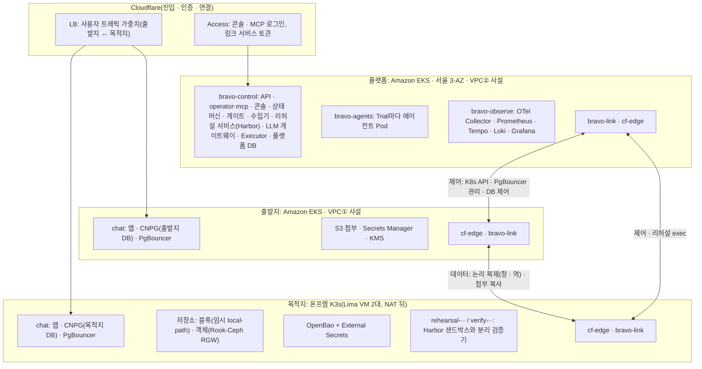

# 클러스터 개요

클러스터 넷이 무엇을 담고 어떻게 이어지는지 한 장에 모읍니다. 기술 선택의 근거는 `docs/spec/TECH-STACK-SPEC.md`, 네트워크는 `02-network.md`, 런타임은 `07-runtime-mesh-observability.md`가 정본입니다. 이 문서는 그 결과를 클러스터 단위로 펼친 지도입니다(2026-11-02 기준, D-21 · D-22 반영).

## 1. 한 장

모든 연결은 안에서 밖으로만 열립니다. 어느 환경에도 인바운드 포트가 없습니다(D-16). GCP 목적지(GKE)는 P2이며 온프렘과 같은 배치에서 저장소만 PD CSI로 바뀝니다.

## 2. 클러스터별 구성

### 2.1 플랫폼: Amazon EKS(우리 제어면)

| 항목 | 구성 |
|---|---|
| 위치 | AWS 서울, VPC②, 사설 서브넷 3개(AZ마다), Regional NAT, 인바운드 0 |
| 제어면 | AWS 관리형(3-AZ). API는 비공개 엔드포인트 |
| 노드 그룹 | `core`(AZ마다 1대 이상) · `agents`(taint `pool=agents:NoSchedule`, 에이전트 Pod 전용) |
| 관리형 애드온 | VPC CNI(네트워크 정책 켬), EBS CSI(gp3, KMS), CoreDNS, kube-proxy, Pod Identity Agent |

| 네임스페이스 | 무엇이 도나 | 메시 |
|---|---|---|
| `bravo-control` | API(레플리카 2), `operator-mcp`(2), 콘솔(2), 상태 머신(2, Lease로 활성 1), 게이트, 수집기, 리허설 서비스(Harbor(에이전트 샌드박스 · 평가 프레임워크, CNCF 레지스트리 Harbor와 다름) 오케스트레이터 + 도구 계층), LLM 게이트웨이(2), Executor(StatefulSet 1), 플랫폼 DB(CNPG 3, AZ마다 1. RDS로 바꿀지는 열림) | 등록. Executor와 플랫폼 DB는 제외 |
| `bravo-agents` | Trial마다 에이전트 Pod(Agent SDK). Trial 토큰 하나만 가짐 | 등록 |
| `bravo-observe` | OTel Collector, Prometheus, Tempo, Loki, Grafana | 제외 |
| `cf-edge` | 콘솔 · MCP 호스트를 내놓는 cloudflared(2) | 등록 |
| `bravo-link` | 상대 환경 서비스를 로컬 이름으로 받는 링크 Pod(2, AZ 분산) | 제외 |
| `istio-system` | istiod, istio-cni, ztunnel(ambient L4) | - |
| 공통 운영 | `kyverno`, `argocd`, `cnpg-system`, `external-secrets` | - |

### 2.2 출발지: Amazon EKS(고객 환경)

| 항목 | 구성 |
|---|---|
| 위치 | AWS 서울, VPC①, 사설 서브넷 2개, Regional NAT, 인바운드 0 |
| 노드 그룹 | `app` 1개 |
| AWS 자원 | S3(첨부), Secrets Manager(DB 비밀번호, 앱이 SDK로 직접 조회 — S2의 재료), KMS |

| 네임스페이스 | 무엇이 도나 |
|---|---|
| `chat` | 채팅 앱, CNPG 출발지 클러스터(발행), PgBouncer(StatefulSet) |
| `cf-edge` | 관리 Tunnel `t1-src-mgmt`, 사용자 진입 Tunnel `t1-src-web` |
| `bravo-link` | 목적지 DB 링크(역방향 복제, 컷오버 뒤 출발지 PgBouncer의 쓰기 경로), 목적지 객체 저장소 링크(첨부 복사) |
| 공통 운영 | `kyverno`, `argocd`, `cnpg-system`, `external-secrets` |

### 2.3 목적지: 온프렘 K3s(고객 환경)

| 항목 | 구성 |
|---|---|
| 위치 | 팀원 Mac의 Lima VM 2대(온프렘 대역), 호텔 NAT 뒤, 인바운드 0 |
| 노드 | server 1대(내장 etcd) + agent 1대. HA는 아님(데모 범위) |
| 네트워크 | flannel VXLAN(UDP 8472, 노드 사이) + K3s 내장 네트워크 정책 |
| 저장소 | 블록은 결정 전(임시로 K3s 기본 local-path, 같은 클래스 이름). 객체는 Rook-Ceph RGW(D-22 결정, 11/3 실측) |

| 네임스페이스 | 무엇이 도나 |
|---|---|
| `chat` | 채팅 앱, CNPG 목적지 클러스터(구독), PgBouncer(StatefulSet) |
| `rook-ceph` | RGW만(첨부 버킷, 버킷 정책). 데모 크기: mon 1 · mgr 1 · OSD 1, 복제 수 1 |
| `openbao`, `external-secrets` | 목적지 비밀(OpenBao를 Vault로 바꿀지는 열림) |
| `cf-edge` | 관리 Tunnel `t1-dst-mgmt`, 사용자 진입 Tunnel `t1-dst-web` |
| `bravo-link` | 출발지 DB 링크(정방향 복제, SHIFT 동안 목적지 PgBouncer의 쓰기 경로) |
| `rehearsal-<plan>-<n>` | Trial마다 생겼다 지워짐. Harbor 샌드박스. Kyverno가 기본 차단 정책을 만듦 |
| `verify-<plan>-<n>` | Trial마다. 분리 검증기와 비공개 테스트 |
| 공통 운영 | `kyverno`, `argocd`, `cnpg-system` |

### 2.4 목적지: GKE(P2, D-01)

온프렘과 같은 랜딩 존입니다(`11-landing-zone.md`). 블록 저장은 PD CSI(`bravo-db`, `bravo-general` 같은 이름), 객체 저장은 Cloud Storage(같은 S3 계약, D-22), 비밀은 온프렘과 같은 금고, 네트워크는 Dataplane V2입니다. EKS를 목적지로 쓸 때도 같은 랜딩 존을 설치합니다(D-23).

## 3. 클러스터 사이 연결

| 흐름 | 시작 → 끝 | 경로 | 신원 |
|---|---|---|---|
| 운영자 · 승인자 접속 | 브라우저 · MCP 클라이언트 → 플랫폼 | Cloudflare Access → 플랫폼 `cf-edge` → `operator-mcp` · 콘솔 · API | Access(OIDC, Managed OAuth) + `memberships` |
| 사용자(심사위원 채팅) | 휴대폰 → 출발지 또는 목적지 앱 | Cloudflare LB(가중치) → 각 환경 `t1-*-web` | 데모는 없음 |
| 수집 · 리허설 · 컷오버 제어 | 플랫폼 → 출발지 · 목적지 | 플랫폼 `bravo-link` → Cloudflare → 상대 `cf-edge` | 링크마다 서비스 토큰 + K8s 서비스 계정 · DB 역할 |
| 정방향 복제 | 목적지 CNPG → 출발지 CNPG | 목적지 `bravo-link` → Cloudflare → 출발지 `cf-edge` | 서비스 토큰 + `replicator`, TLS verify-full |
| 역방향 복제 · 컷오버 뒤 쓰기 | 출발지 → 목적지 | 출발지 `bravo-link` → Cloudflare → 목적지 `cf-edge` | 같음 |
| 첨부 복사 | 출발지 복사 Job → 목적지 객체 저장소 | 출발지 `bravo-link` → 목적지 `cf-edge` | 서비스 토큰 + 첨부 버킷 하나에 묶인 자격 |
| 배포 | 각 클러스터 Argo CD → GitHub 배포 저장소 | 바깥 방향 443 | 읽기 전용 |
| 관측 | 각 서비스 → 플랫폼 OTel Collector | 플랫폼 안 OTLP | 메시 신원(플랫폼) |

## 4. 오늘 파일럿과의 대응

| 파일럿(Compose, 노트북) | 본선 클러스터 |
|---|---|
| `src-db`, `dst-db`(PostgreSQL 16 공식 이미지) | 출발지 · 목적지 `chat`의 CNPG 클러스터 |
| `pgbouncer`(PGDG 빌드) | 각 환경 `chat`의 PgBouncer StatefulSet |
| `executor`, `api`, `operator-mcp`, `console`, `platform-db` | 플랫폼 `bravo-control` |
| `otel-collector`, `prometheus`, `tempo`, `loki`, `grafana` | 플랫폼 `bravo-observe` |
| 컨테이너 네트워크 | Cloudflare 링크(D-16) |
| 공유 볼륨으로 PgBouncer 설정 교체 | `pods/exec`로 활성 파일 교체(02 3절) |

## 5. 아직 정하지 않은 것

- 플랫폼 DB: CNPG 3개 직접 운영 또는 RDS Multi-AZ
- 출발지 DB로 RDS 지원 여부
- 목적지 비밀: OpenBao 또는 Vault
- 플랫폼이 고객 환경을 만드는 실행 경로(IaC 실행 주체와 자격). `TECH-STACK-SPEC.md` 3절 1번
