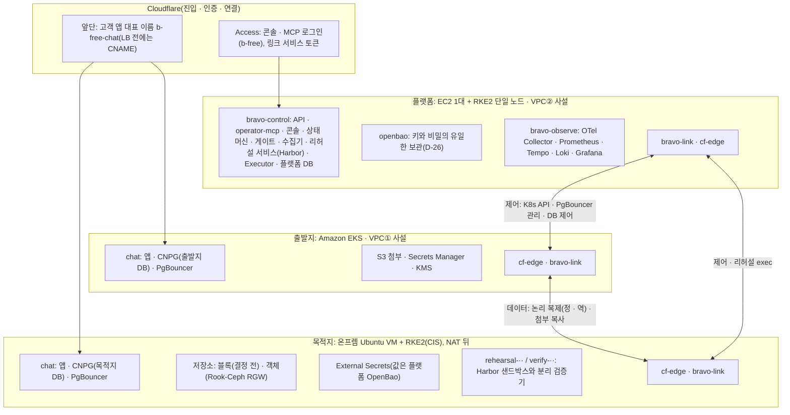

# 클러스터 개요

클러스터 넷이 무엇을 담고 어떻게 이어지는지 한 장에 모읍니다. 기술 선택의 근거는 `docs/spec/TECH-STACK-SPEC.md`, 네트워크는 `02-network.md`, 런타임은 `07-runtime-mesh-observability.md`가 정본입니다. 이 문서는 그 결과를 클러스터 단위로 펼친 지도입니다.

**기준(2026-11-02 21:10 KST 이후).** 팀장이 RKE2를 스펙 r2대로 되돌렸습니다("스펙 그대로 전부", "RKE2 관련만", D-21 부분 철회, ADR 0010). 플랫폼은 EC2 1대 + RKE2 단일 노드, 온프렘 목적지는 Ubuntu VM + RKE2(CIS)입니다. 출발지 EKS, GKE 목적지, Cilium + Hubble, Rook-Ceph RGW(D-22), Cloudflare 링크(D-16), 플랫폼 OpenBao 하나(D-26)는 그대로입니다. 앞 판(플랫폼 EKS, 온프렘 K3s)은 이력이고, 그 판으로 만든 자원은 5절에 있습니다.

## 1. 한 장

모든 연결은 안에서 밖으로만 열립니다. 어느 환경에도 인바운드 포트가 없습니다(D-16). 플랫폼에서 두 환경으로 가는 연결은 D-16 링크(플랫폼 `bravo-link`, Cloudflare, 상대 `cf-edge`)입니다. 출발지 EKS API도 이 링크로 닿고, 공개 엔드포인트에는 운영자 노트북 IP만 남았습니다(`deploy/CLOUD-E2E-CONTRACT.md` 7절, 2026-11-02). GCP 목적지(GKE)는 온프렘과 같은 계약의 랜딩 존입니다(2.4절).

## 2. 클러스터별 구성

### 2.1 플랫폼: EC2 1대 + RKE2 단일 노드(우리 제어면)

| 항목 | 구성 |
|---|---|
| 위치 | AWS 서울, VPC②, 사설 서브넷, 인바운드 0(D-16) |
| 노드 | EC2 1대. RKE2 server 하나(내장 etcd)에 워크로드도 올림. HA 아님(스펙 §7.2, 데모 범위) |
| 설치 | 온프렘과 같은 공통 cloud-init(T2, T7). RKE2 v1.36.5+rke2r1(제안), sha256 고정 |
| 네트워크 | Cilium + Hubble(붙이는 방법은 ADR 0010의 제안) |
| 저장소 | 결정 전(EBS CSI 또는 노드 로컬) |

| 네임스페이스 | 무엇이 도나 | 메시 |
|---|---|---|
| `bravo-control` | API, `operator-mcp`, 콘솔, 상태 머신(Lease로 활성 1), 게이트, 수집기, 리허설 서비스(Harbor(에이전트 샌드박스 · 평가 프레임워크, CNCF 레지스트리 Harbor와 다름) 오케스트레이터 + 도구 계층), LLM 게이트웨이(운영 목표, ADR 0009), Executor(StatefulSet 1), 플랫폼 DB(CNPG). 노드가 하나라 레플리카를 늘려도 노드 장애는 막지 못함 | 제안 D-15(Istio ambient)를 따르면 등록 |
| `bravo-agents` | Trial마다 에이전트 Pod(Agent SDK). Trial 토큰 하나만 가짐 | 같음 |
| `openbao` | 플랫폼 OpenBao(D-26). 고객 클러스터에는 금고가 없음 | 제외 |
| `bravo-observe` | OTel Collector, Prometheus, Tempo, Loki, Grafana | 제외 |
| `cf-edge` | 콘솔 · API · MCP 호스트 `b-free`를 내놓는 cloudflared(터널 `bravo-platform`) | - |
| `bravo-link` | 상대 환경 서비스를 로컬 이름으로 받는 링크 Pod | 제외 |
| 공통 운영 | `kyverno`, `cnpg-system`, `external-secrets`, Argo CD(제안 D-16) | - |

### 2.2 출발지: Amazon EKS(고객 환경)

| 항목 | 구성 |
|---|---|
| 위치 | AWS 서울, VPC①, 사설 서브넷 2개, Regional NAT, 인바운드 0 |
| 클러스터 | EKS `bravo-source` 1.36, 노드 그룹 `app` 1개(t4g.large, arm64) |
| 네트워크 | Cilium 1.20.4(VPC CNI chaining) + Hubble. VPC CNI 정책 에이전트는 끔 |
| AWS 자원 | S3(첨부), Secrets Manager(DB 비밀번호, 앱이 SDK로 직접 조회. S2의 재료), KMS |

| 네임스페이스 | 무엇이 도나 |
|---|---|
| `chat` | 채팅 앱, CNPG 출발지 클러스터(발행), PgBouncer |
| `cf-edge` | 사용자 진입 터널 `bravo-b-free-chat-src`(이름 `b-free-chat-src`) |
| `bravo-link` | 목적지 DB 링크(역방향 복제, 컷오버 뒤 출발지 PgBouncer의 쓰기 경로), 목적지 객체 저장소 링크(첨부 복사). 임시 링크 기간에는 `chat/dst-db-link` |
| 공통 운영 | `cnpg-system`, `external-secrets`. `kyverno`, `argocd`는 계획 |

### 2.3 목적지: 온프렘 Ubuntu VM + RKE2(CIS)(고객 환경)

| 항목 | 구성 |
|---|---|
| 위치 | 온프렘 장비의 Ubuntu VM(데모는 팀원 Mac의 Lima), 호텔 NAT 뒤, 인바운드 0 |
| 클러스터 | RKE2 `profile: cis`(스펙 §7.2, FR-3, T2). VM 수는 T2가 정함 |
| 설치 | 공통 cloud-init. CIS 조건(sysctl, etcd 사용자)을 고정. 조건이 맞지 않으면 RKE2가 시작을 거부함(스펙 §6 S1 예외 4a) |
| 네트워크 | Cilium + Hubble(ADR 0008, 붙이는 방법은 ADR 0010의 제안) |
| 저장소 | 블록은 결정 전. RKE2에는 기본 local-path가 없음. 후보 Rook-Ceph RBD. 객체는 Rook-Ceph RGW(D-22, 11/3 실측) |
| kubectl 컨텍스트 | `bravo-onprem`(K3s 때와 같은 이름, 계약 2절) |

| 네임스페이스 | 무엇이 도나 |
|---|---|
| `chat` | 채팅 앱, CNPG 목적지 클러스터(구독), PgBouncer |
| `rook-ceph` | RGW(첨부 버킷, 버킷 정책). 데모 크기는 실측으로 정함 |
| `external-secrets` | 목적지 비밀. 값은 플랫폼 OpenBao에서만(D-26). 목적지 금고는 두지 않음 |
| `cf-edge` | 사용자 진입 터널 `bravo-b-free-chat-dst`(이름 `b-free-chat-dst`) |
| `bravo-link` | 출발지 DB 링크(정방향 복제, SHIFT 동안 목적지 PgBouncer의 쓰기 경로) |
| `rehearsal-<plan>-<n>` | Trial마다 생겼다 지워짐. Harbor 샌드박스. Kyverno가 기본 차단 정책을 만듦 |
| `verify-<plan>-<n>` | Trial마다. 분리 검증기와 비공개 테스트 |
| 공통 운영 | `cnpg-system`. `kyverno`, `argocd`는 계획 |

### 2.4 목적지: GKE(D-01, D-21의 남은 범위)

온프렘과 같은 계약의 랜딩 존입니다(`11-landing-zone.md`). 블록 저장은 PD CSI(`bravo-db`, `bravo-general` 같은 이름), 객체 저장은 Cloud Storage(같은 S3 계약, D-22), 비밀 값은 플랫폼 OpenBao, 네트워크는 Dataplane V2입니다. 클러스터는 `bravo-target-gcp`(프로젝트 `b-free-target-20261102`)입니다.

## 3. 클러스터 사이 연결

| 흐름 | 시작과 끝 | 경로 | 신원 |
|---|---|---|---|
| 운영자 · 승인자 접속 | 브라우저 · MCP 클라이언트에서 플랫폼 | Cloudflare Access(`b-free`), 플랫폼 `cf-edge`, `operator-mcp` · 콘솔 · API | Access(OIDC, Managed OAuth) + `memberships` |
| 사용자(심사위원 채팅) | 휴대폰에서 출발지 또는 목적지 앱 | 대표 이름 `b-free-chat`(LB 전에는 활성 환경 터널 CNAME), 각 환경 `b-free-chat-src` · `b-free-chat-dst` 터널 | 데모는 없음 |
| 수집 · 리허설 · 컷오버 제어 | 플랫폼에서 출발지 · 목적지 | 플랫폼 `bravo-link`, Cloudflare, 상대 `cf-edge`(2026-11-02 23:3x 사용 중. K8s API는 `src-k8s` · `dst-k8s`) | 링크마다 서비스 토큰 + K8s 서비스 계정 · DB 역할 |
| 정방향 복제 | 목적지 CNPG가 출발지 CNPG를 구독 | 목적지 `bravo-link`, Cloudflare, 출발지 `cf-edge`. 지금: 임시 링크 | 서비스 토큰 + `replicator`, TLS verify-full |
| 역방향 복제 · 컷오버 뒤 쓰기 | 출발지에서 목적지 | 출발지 `bravo-link`, Cloudflare, 목적지 `cf-edge`. 지금: 출발지 `chat/dst-db-link` | 같음 |
| 첨부 복사 | 출발지 복사 Job에서 목적지 객체 저장소 | 출발지 `bravo-link`, 목적지 `cf-edge` | 서비스 토큰 + 첨부 버킷 하나에 묶인 자격 |
| 배포 | 각 클러스터 Argo CD에서 GitHub 배포 저장소 | 바깥 방향 443 | 읽기 전용 |
| 관측 | 각 서비스에서 플랫폼 OTel Collector | 플랫폼 안 OTLP | 서비스 신원 |

## 4. 노트북 파일럿과의 대응(이력)

노트북 Compose 파일럿은 내렸습니다(`deploy/CLOUD-E2E-CONTRACT.md` 6.1). 그 측정은 "파일럿(노트북) 기록"입니다(`docs/evidence/pilot-notebook/`).

| 파일럿(Compose, 노트북) | 클러스터 |
|---|---|
| `src-db`, `dst-db`(PostgreSQL 16 공식 이미지) | 출발지 · 목적지 `chat`의 CNPG 클러스터 |
| `pgbouncer`(PGDG 빌드) | 각 환경 `chat`의 PgBouncer |
| `executor`, `api`, `operator-mcp`, `console`, `platform-db` | 플랫폼 `bravo-control` |
| `otel-collector`, `prometheus`, `tempo`, `loki`, `grafana` | 플랫폼 `bravo-observe` |
| 컨테이너 네트워크 | Cloudflare 링크(D-16). 플랫폼에서 두 환경으로 가는 길은 D-16 링크 |
| 공유 볼륨으로 PgBouncer 설정 교체 | `pods/exec`로 활성 파일 교체(02 3절) |

## 5. 결정 전 판으로 만든 자원(2026-11-02 21:10 기준)

21:10 결정 전에 ADR 0004(플랫폼 EKS, 온프렘 K3s)대로 만든 자원이 떠 있습니다. 정리와 이전은 인프라 갈래가 정합니다. 클라우드 자원 삭제는 사람 승인 뒤에 합니다.

| 자원 | 관측(KST, 읽기 전용) | 새 기준에서 |
|---|---|---|
| EKS `bravo-platform`(노드 4) | 20:56 플랫폼 서비스 · `openbao` · 관측 Running | EC2 1대 + RKE2로 옮김(T7) |
| Lima K3s `bravo-onprem`(v1.36.5+k3s1, 노드 2) | 20:49 앱 · CNPG · PgBouncer · cloudflared Running | Ubuntu VM + RKE2(CIS)로 다시 세움(T2). 컨텍스트 이름은 그대로 |

## 6. 아직 정하지 않은 것

- RKE2에 Cilium을 붙이는 방법(내장 `cni: cilium` 또는 `cni: none` + 랜딩 존 Cilium), 블록 저장 바탕(ADR 0010)
- 플랫폼 DB: 단일 노드의 CNPG 또는 RDS(`TECH-STACK-SPEC.md` 3절 3번)
- 출발지 DB로 RDS 지원 여부
- 금고 제품: OpenBao 또는 Vault
- 플랫폼이 고객 환경을 만드는 실행 경로(IaC 실행 주체와 자격). `TECH-STACK-SPEC.md` 3절 1번
