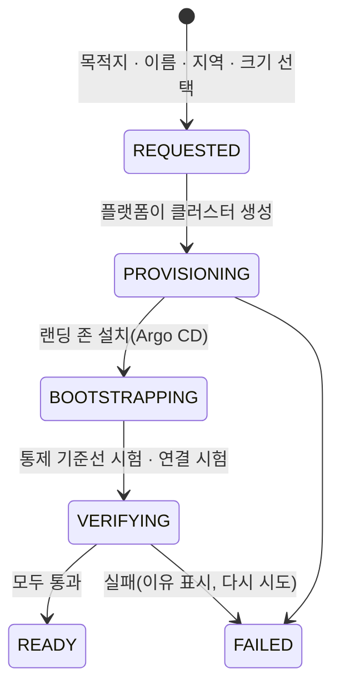

# 어디서나 같은 환경: 랜딩 존

온프렘(K3s), GCP(GKE), AWS(EKS) 어느 곳이든 고객은 같은 경험을 하고, 플랫폼은 같은 구조를 펼칩니다. 그래서 환경 사이 이동은 "같은 모양에서 같은 모양으로" 옮기는 일이 됩니다. 팀장(류지환) 결정(2026-11-02)이며 편차 D-23으로 올립니다. 기술 근거는 `docs/spec/TECH-STACK-SPEC.md`, 클러스터 지도는 `10-cluster-overview.md`입니다.

## 1. 원칙

| 원칙 | 뜻 |
|---|---|
| 같은 경험 | 고객 입력은 "어디로(온프렘 · GCP · AWS) · 이름 · 지역 · 크기"뿐이고, 화면 · MCP · 진행 단계 · 결과물이 클라우드와 상관없이 같습니다 |
| 같은 구조 | 플랫폼이 만드는 모든 고객 클러스터에 같은 묶음(랜딩 존)을 같은 판 · 같은 이름 · 같은 정책으로 설치합니다 |
| 앱은 클라우드를 모른다 | 앱은 표준 인터페이스(PostgreSQL, S3 API, 쿠버네티스 Secret, OTLP)만 씁니다. 클라우드 IAM이나 관리형 서비스를 직접 부르지 않습니다. 그래서 옮길 때 앱 설정이 바뀌지 않습니다 |
| 차이는 얇은 한 층 | 클라우드마다 다른 것은 "공급자 어댑터" 한 층(저장 장치의 바탕, 노드 배치, 플랫폼 구성요소의 클라우드 자격)에만 둡니다 |

## 2. 랜딩 존: 모든 고객 클러스터에 같은 것

| 묶음 | 구성 | 앱이 보는 것 |
|---|---|---|
| 데이터베이스 | CloudNativePG + PgBouncer(StatefulSet). 고객이 원하면 같은 PgBouncer 뒤에 관리형 PostgreSQL(제안 D-24, [12-db-migration-matrix.md](12-db-migration-matrix.md)) | PostgreSQL 16 주소 하나 |
| 객체 저장 | 같은 S3 계약(버킷 · 자격 Secret · 환경 변수 이름이 같음). 엔진은 환경별: 온프렘 Rook-Ceph RGW(11/3 실측), EKS는 S3, GKE는 Cloud Storage(D-22 결정) | S3 API, 같은 행동 시험(OBJ-01–06) |
| 블록 저장 | StorageClass `bravo-db`, `bravo-general` | 같은 클래스 이름 |
| 비밀 | External Secrets만. 값은 플랫폼 OpenBao 한 곳에만 있고, 링크를 거쳐 그 환경 경로만 당겨 옴(D-26). 고객 클러스터에 금고를 두지 않음 | 쿠버네티스 Secret |
| 네트워크 | Cilium + Hubble(흐름 기록), Gateway API(Envoy, Cilium 구현)가 환경 안 진입점 | 같은 정책 · 같은 진입 이름 |
| 정책 | Kyverno(기본 차단 생성, digest 강제), OPA(정책 검사), Pod Security `restricted` | 같은 거부 규칙 |
| 배포 | Argo CD(배포 저장소를 당겨 옴, 배포 거부 창) | 같은 배포 방식 |
| 연결 | `cf-edge`(Cloudflare Tunnel), `bravo-link`(상대 환경 서비스를 로컬 이름으로) | 같은 서비스 이름 |
| 관측 | OTel Collector 에이전트 → 플랫폼 Collector | 같은 지표 · 트레이스 이름 |
| 리허설 | Trial마다 `rehearsal-*` · `verify-*`(Harbor(에이전트 샌드박스 · 평가 프레임워크, CNCF 레지스트리 Harbor와 다름)) | - |

판, 네임스페이스 이름, Helm 값, 정책은 모든 클러스터에서 같습니다. 묶음은 `deploy/landing-zone/`에 base 하나와 공급자 overlay 셋(`k3s`, `eks`, `gke`)으로 둡니다.

## 3. 공급자 어댑터: 클라우드마다 다른 것(이것만)

| 항목 | 온프렘 K3s | GKE | EKS |
|---|---|---|---|
| 클러스터 제어면 | K3s server(내장 etcd) | 관리형 | 관리형 |
| CNI 바탕 | Cilium(VXLAN) | Dataplane V2(Cilium 기반) | Cilium(VPC CNI 체이닝) |
| 블록 저장의 바탕 | 결정 전(임시로 K3s 기본 local-path) | PD CSI | EBS CSI |
| 노드 배치 | VM 2대 | 노드 풀 | 관리형 노드 그룹 |
| 플랫폼 구성요소의 클라우드 자격 | 없음 | Workload Identity | Pod Identity |
| 메타데이터 차단 | 해당 없음 | 메타데이터 서버 보호 | IMDSv2 hop limit 1 |

쿠버네티스 minor는 셋 모두 같게 둡니다(1.35 권고). 세 환경 모두 Cilium이 정책을 집행하고 Hubble이 흐름을 남깁니다. 기본 차단 정책은 Kyverno가 같은 방식으로 만듭니다.

## 4. 환경 만들기: 고객에게 같은 흐름

| 단계 | 온프렘 | GCP · AWS | 고객이 하는 일 |
|---|---|---|---|
| PROVISIONING | 고객 VM에서 등록 명령 한 줄 실행 → 바깥 방향 에이전트가 K3s 설치 | 고객 계정에 위임된 역할(AWS 교차 계정 역할, GCP Workload Identity 연동)로 플랫폼이 IaC 실행 | 온프렘: 명령 한 줄. 클라우드: 위임 한 번 |
| BOOTSTRAPPING | 같은 랜딩 존 | 같은 랜딩 존 | 없음 |
| VERIFYING | 통제 6개 기준선, 링크 시험(N 시험 일부) | 같음 | 없음 |

이 흐름의 실행 주체(테넌트별 IaC 실행기와 상태 파일, 자격 위임 방식)는 아직 설계 중입니다(`TECH-STACK-SPEC.md` 3절 1번). 운영자 MCP와 콘솔의 "환경 만들기"는 이 상태 머신을 그대로 보여 줍니다(`08-operator-mcp.md`).

## 5. 이동: 어느 쪽에서 어느 쪽으로든 같은 엔진

랜딩 존끼리는 양쪽이 같은 모양이므로, 컷오버 엔진(논리 복제 + PgBouncer + 펜싱 + 영수증)과 첨부 복사(RGW에서 RGW로), 비밀 전달(플랫폼 OpenBao에서 환경 경로를 바꿔 내려보냄)이 방향과 상관없이 같습니다.

| 출발지 → 목적지 | 엔진 | 앱 설정 변경 |
|---|---|---|
| 랜딩 존 ↔ 랜딩 존(온프렘 ↔ GKE ↔ EKS) | 같은 엔진, 같은 영수증 | 없음 |
| 클라우드 고유 환경 → 랜딩 존(예: 기존 AWS 앱이 S3 · Secrets Manager · RDS를 직접 씀) | 같은 엔진 + 첫 이전 때만 번역(S3 정책 → RGW 정책, Secrets Manager → 금고, SDK 직접 호출 → Secret 주입) | 첫 이전 한 번(S2 장면) |

첫 이전 뒤에는 앱이 랜딩 존에 올라 있으므로, 그다음 이동(예: 온프렘 → GKE)에는 번역이 필요 없습니다. "한 번 떠나면 어디로든 다시 옮길 수 있다"가 이 설계의 출구전략입니다.

## 6. 이 원칙에서 벗어나 있던 곳과 채운 방법

| # | 벗어난 곳 | 채운 방법 |
|---|---|---|
| 1 | GKE 목적지의 객체 저장소가 "열림"이었고, 클라우드마다 S3 · GCS · 자체 저장소로 갈라질 수 있었음 | 모든 목적지에서 앱이 보는 것은 같은 S3 API와 같은 버킷 정책 시험. 무엇으로 줄지는 멀티 클라우드 객체 저장 · CDN 리서치 뒤 D-22에서 결정 |
| 2 | 비밀 저장이 AWS는 Secrets Manager, GCP는 Secret Manager로 갈라질 수 있었음 | 키 · 비밀은 플랫폼 OpenBao 하나만 보관하고(D-26), 모든 목적지는 External Secrets로 받음. 클라우드 관리형 비밀은 "출발지에서 번역할 대상"으로만 다룸 |
| 3 | 고객 클러스터의 관측 경로가 정의되지 않았음 | 랜딩 존에 OTel Collector 에이전트. 링크로 플랫폼 Collector에 보냄 |
| 4 | 설치 묶음이 환경마다 따로 적혀 있었음(01 · 02 · 09) | `deploy/landing-zone/` base 하나 + overlay 셋으로 통일 |
| 5 | "환경 만들기" 흐름이 클라우드마다 다를 수 있었음 | 4절의 상태 머신 하나. 차이는 PROVISIONING 안의 실행 방식뿐 |
| 6 | 이동이 AWS → 온프렘 한 방향으로만 설계됨 | 5절: 랜딩 존끼리는 어느 방향이든 같은 엔진 |
| 7 | 백업 위치가 정의되지 않았음 | CNPG 백업을 같은 S3 호환 저장소로(같은 설정). 다른 환경으로 복제할지는 열림 |

## 7. 남는 차이(숨기지 않음)

- 노드 OS가 다릅니다(온프렘 Ubuntu, GKE COS, EKS Amazon Linux · Bottlerocket). 커널 차이는 통제 시험 결과로 드러납니다.
- 온프렘 K3s는 server 1대라 HA가 아닙니다(데모 범위).
- 클라우드 목적지에 자체 객체 저장소를 둘지, 관리형을 쓸지는 운영 부담과 같은 구조 사이의 선택이며 D-22에서 정합니다.
- 사용자 진입은 모든 환경에서 Cloudflare를 지납니다(D-16의 남는 위험).

## 8. 오늘 파일럿과의 관계

오늘 21:00 파일럿은 노트북의 Compose로 돌고, 컷오버 엔진이 실제로 동작함을 보입니다. 랜딩 존과 환경 만들기는 11/3부터 온프렘 K3s(Lima)에서 먼저 세우고, EKS · GKE는 같은 묶음을 검증만 합니다(비용 승인 전에는 만들지 않음).
