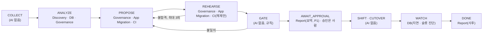

# 에이전트 지도: 역할, 허용 목록, 샌드박스

이전 한 건의 중간 작업을 맡는 에이전트 여섯을 정합니다. 뼈대는 배규태 님의 「결정적 워크플로우 × 비결정적 판단 구현안」(Notion `40b8bee9ada4806db38fff11ecc4f16b`, 2026-11-01 관측)입니다. 원칙은 한 줄입니다: **에이전트는 제안서만 내고, 실행과 판정은 파이프라인이 한다. 에이전트를 믿지 않고 결과를 검증한다.**

팀장(류지환) 결정(2026-11-02)을 함께 따릅니다.
- 모든 에이전트는 Harbor(에이전트 샌드박스 · 평가 프레임워크 0.25.0, CNCF 레지스트리 Harbor와 다름) Trial 안에서만 돕니다(D-02).
- 에이전트는 클러스터 · 클라우드 자격이 없습니다.
- 실행 구간(트래픽 전환, 컷오버, 되돌리기)에는 AI가 없습니다.
- 도구는 허용 목록입니다. 목록에 없는 것은 거부합니다.

스펙과 다른 점(역할 여섯, CI 에이전트, 구조화 출력 채널)은 편차 D-27입니다(`docs/spec/DEVIATIONS.md`). 역할 이름과 상태 배치는 D-25(`platform/api` 상태 머신)와 같습니다. 코드는 `platform/agent/`에 있습니다.

## 1. 상태 머신 위의 에이전트

그림 1. 보라 상자가 없는 상태(COLLECT, GATE, SHIFT, CUTOVER, FAILBACK, SAFE_HOLD)에는 에이전트가 없습니다. 허용 목록 로더는 실행 구간 상태를 적은 파일을 거부합니다(`FORBIDDEN_STATES`).

| 상태 | 도는 에이전트 | 그 출력을 받는 결정적 검사 | 실패하면 |
|---|---|---|---|
| COLLECT | 없음 | 수집기(읽기 전용 자격) | 재수집 |
| ANALYZE | Discovery(정적 탐지가 못 정한 항목만), DB(준비 상태 점검, 논리 디코딩 · PgBouncer · 시퀀스 계획), Governance(통제 대응 초안) | 스키마 검증 → 등급 규칙표 · 사람 확인(§8.1의 "AI 제안 + 사람 판단") | 항목을 "미분류"로 두고 사람에게 |
| PROPOSE | Governance(정책 번역), App Migration(코드 수정), CI(컨테이너화) | 도구 계층의 Pydantic 재검증 → `policy_evaluate` 린트 → 분리 검증기 reward | 재제안(최대 3회) → NEEDS_HUMAN |
| REHEARSE | Governance · App Migration · CI(검증 불합격 뒤 재제안. CI는 신뢰된 빌드 실패 수정) | 신뢰된 파이프라인 빌드 · 시험 → 이미지 digest → 검증 네임스페이스 재배포 시험 | 같음 |
| GATE | 없음 | 원본 대조 규칙(NFR-5, LLM import 금지) | PROPOSE로 |
| AWAIT_APPROVAL | Report(승인 요약, P1) | 요약의 모든 주장에 증거 ID가 있는지 검사. 승인은 콘솔의 사람만 | 요약 없이 원 리포트만 보임 |
| SHIFT · CUTOVER · FAILBACK · SAFE_HOLD | 없음 | Executor, 효과 원장, 펜싱 | 규칙대로 |
| WATCH | DB(복제 지연 · 슬롯 진단) | 지표 임계값 규칙. 진단은 운영자 참고용 | 규칙이 되돌림 판단 |
| DONE · DONE_ROLLED_BACK | Report(사후 리포트) | 증거 ID 대조 | 템플릿 리포트(D-13) |

## 2. 책임 경계(RACI)

R = 수행, A = 최종 책임, C = 의견, I = 통보. 에이전트는 어느 줄에서도 A가 아닙니다.

| 일 | Discovery | DB | Governance | App Migration | CI | Report | 상태 머신 · 규칙 | 신뢰된 파이프라인 | 사람 |
|---|---|---|---|---|---|---|---|---|---|
| 애매한 의존성 분류(FR-2) | R | | | | | | C(규칙표) | | A |
| DB 준비 점검, 논리 디코딩 · PgBouncer · 시퀀스 계획 | | R | | | | | C | | A |
| 6개 통제 대응, IAM · 버킷 정책 · 비밀 번역(FR-4) | | | R | | | | C(린트) | | A |
| 클라우드 SDK 직접 호출 코드 수정 | | | | R | | | | C(빌드) | A |
| 컨테이너화, 빌드 실패 수정 | | | | | R | | | C | A |
| 이미지 빌드 · 서명 · push | | | | | C | | | R | A |
| 리허설 검증 · reward | | | | | | | R(분리 검증기) | | A |
| 게이트 판정 | | | C(예외 사유 초안) | | | | R, A | | I |
| 승인 | | | | | | C(요약) | | | R, A |
| 트래픽 전환 · 컷오버 · 되돌리기 | | | | | | | R(Executor) | | A |
| 사후 리포트 | | C(진단) | | | | R | | | A |

## 3. 에이전트별 계약

공통: 입력은 상태 봉투(`bravo_agents.envelope.StateEnvelope`), 출력은 역할 스키마(`bravo_agents.schemas`), 예산 초과 · 시간 초과 · 스키마 불일치는 결과 없이 끝나고 상태 머신이 시도로 셉니다. 송신은 LLM 게이트웨이와 도구 계층뿐입니다. 어느 샌드박스도 DB나 저장소에 직접 닿지 않습니다.

| 에이전트 | 시작 상태 | 입력(봉투의 `inputs`) | 출력 스키마 | MCP 도구 | 모델 등급 | 턴 · 예산 · 시간 |
|---|---|---|---|---|---|---|
| Discovery | ANALYZE | 미분류 의존성 목록, 정적 탐지 근거 | `DiscoveryProposal`(항목별 등급 · 근거 · 증거 ID) | `inventory_describe`, `repo_read`, `rehearsal_exec` | haiku | 12 · $0.5 · 300초 |
| DB | ANALYZE, WATCH | 수집된 DB 사실, 목적지 프로필 | `DbProposal`(점검 결과, 계획, 합성 DB에서 리허설할 SQL) | `inventory_describe`, `db_inspect`, `db_rehearse`, `rehearsal_exec` | opus | 30 · $2 · 600초 |
| Governance | ANALYZE, PROPOSE, REHEARSE | 출발지 정책, 통제 비교표, 게이트 BLOCK 사유 | `GovernanceProposal`(번역, 통제 대응, 예외 사유, 감사 요약) | `inventory_describe`, `controls_describe`, `policy_evaluate`, `rehearsal_exec` | opus | 30 · $2 · 600초 |
| App Migration | PROPOSE, REHEARSE | 코드 수정 등급 항목, 랜딩 존 인터페이스 | `AppMigrationProposal`(diff, 바꾼 호출, 설정 교체) | `inventory_describe`, `repo_read`, `rehearsal_exec` | opus | 40 · $3 · 900초 |
| CI | PROPOSE, REHEARSE | 저장소 스냅샷, 이전 빌드 기록 | `CiProposal`(빌드 템플릿 값, 차트 값, 수정 diff, 의존성 요청) | `inventory_describe`, `repo_read`, `evidence_read`, `rehearsal_exec` | opus | 40 · $3 · 1200초 |
| Report | AWAIT_APPROVAL, DONE, DONE_ROLLED_BACK | 증거 묶음 | `ReportProposal`(요약, 증거가 붙은 주장) | `evidence_read`, `rehearsal_exec` | haiku | 10 · $0.5 · 300초 |

**결과를 결정적으로 확인하는 방법.**
- 모든 역할: 스키마(`extra="forbid"`), 봉투와 같은 `plan_id` · `trial_id` · `attempt`, 봉투에 있는 증거 ID만 인용. Pod 안에서 한 번, 도구 계층에서 다시 한 번 검사합니다(Pod는 신뢰하지 않음).
- 분리 검증기(`harbor/_shared/verify.py`)의 역할별 정적 규칙: 익명 Allow · `s3:*` · ClusterRole · `*` 동사 · Secret list/watch · OpenBao `sudo` 금지(Governance), 추가 줄에 비밀 모양 · 클라우드 SDK 호출 금지, 시험 · CI · 배포 파일 금지(App Migration), `imageRef` 설정 금지와 차트 키 제한(CI), DROP · TRUNCATE · GRANT · ALTER SYSTEM 금지(DB), 증거 없는 주장 금지(Report).
- 그 뒤의 실제 시험: 검증 네임스페이스 재배포와 접근 시도(`05-agent-rehearsal.md` 3절), 원본 대조 게이트(§8.5). 정적 규칙 통과만으로는 승인 근거가 되지 않습니다.

## 4. 허용 목록(기본 거부)

파일은 `platform/agent/allowlists/<role>.yaml`입니다. 집행은 서버 쪽 도구 계층이 하고, 워커는 같은 파일로 SDK 도구 목록과 한도를 정합니다. 어떤 역할도 `kubectl` 작업을 받지 않습니다. 워크로드는 리허설 프로비저너가 고정 템플릿으로 적용합니다(`05` 3절보다 좁힘. `05`는 ConfigMap apply를 허용).

| 역할 | 샌드박스 작업 · 경로 | 검사(고정 argv) | 바이너리 | 이미지 크기(압축 / 디스크) |
|---|---|---|---|---|
| Discovery | 읽기 `/src` | `search`(rg) | sh cat ls rg | 4.5 / 18 MB |
| Report | 읽기 `/src`(증거 묶음) | `json_extract`(jq) | sh cat ls jq | Discovery 이미지 공유 |
| Governance | 읽기 `/src /work /out`, 쓰기 `/work /out` | `json_syntax`(jq), `k8s_schema`(kubeconform, 오프라인 스키마) | sh cat ls base64 jq kubeconform | 9.5 / 32 MB |
| App Migration | 읽기 `/src /app`, 쓰기 `/app` | `search`(rg), `compile`(compileall), `make_diff`(diff) | sh cat ls base64 rg python3 diff | 46.5 / 213 MB |
| CI | 읽기 `/src /app /out`, 쓰기 `/app /out` | `unit_tests`(pytest), `compile`, `values_render`(helm template), `manifest_schema`(kubeconform), `dockerfile_lint`(hadolint), `misconfig_scan`(trivy fs misconfig 오프라인), `sbom`(syft), `make_diff` | sh cat ls base64 python3 helm hadolint kubeconform trivy syft diff | 163.7 / 726 MB |
| DB | 읽기 `/src /work /out`, 쓰기 `/work /out` | `json_syntax`(jq). SQL 리허설은 서버 쪽 `db_rehearse` | sh cat ls base64 jq | Governance 이미지 공유 |
| (도구 계층 DB 러너) | 에이전트 샌드박스 아님. `db_inspect` · `db_rehearse`를 서버 쪽에서 실행 | psql, pg_dump, pg_isready | psql pg_dump pg_restore pg_isready 16.15 | 159.1 / 658 MB |

검사 인자는 선언한 자리(`{path}`, `{pattern}`, `{filter}`)에만 들어갑니다. 경로는 정규화 뒤 허용 루트 안이어야 하고, `-`로 시작하는 값(플래그 주입)은 거부합니다(`Allowlist.check_argv`). 바이너리 목록은 이미지 감사 기준선(`images/<name>/expected-binaries.txt`)의 부분집합인지 시험이 확인합니다.

**도구를 고른 근거(1차 자료, 2026-11-02 확인).**

| 근거 | 내용 | 우리 선택 |
|---|---|---|
| Claude Code sandboxing(code.claude.com/docs/en/sandboxing) | 도메인 허용 목록은 빈 상태로 시작. DB 드라이버와 ssh는 HTTP 프록시를 못 탐. MCP 서버는 샌드박스 밖 | 송신은 게이트웨이 · 도구 계층만. DB 사실은 `db_inspect`(도구 계층이 읽기 전용 역할로 실행) |
| OpenAI Codex cloud(developers.openai.com/codex/cloud/environments) | 에이전트 단계는 기본 오프라인, 비밀은 에이전트 단계 전에 제거, 허용 시 GET · HEAD · OPTIONS 권장 | 샌드박스 `no-network`, 의존성은 신뢰된 파이프라인이 미리 받음 |
| GitHub Copilot coding agent firewall(docs.github.com) | 기본 허용 목록은 패키지 · 컨테이너 레지스트리. 방화벽은 Bash 프로세스만 덮고 MCP는 안 덮음 | 레지스트리도 열지 않음. 도구 계층 송신은 별도 NetworkPolicy |
| AWS Transform custom(docs.aws.amazon.com/transform) | 실행 환경의 AWS 자격을 그대로 씀 | 피하는 사례. 에이전트 Pod의 클라우드 자격 변수를 빈 값으로 덮음 |
| Claude Agent SDK permissions | `allowed_tools`는 자동 승인일 뿐, 이름만 쓴 `disallowed_tools`는 정의를 지움, `dontAsk`는 목록 밖을 거부 | 5절 설정 |

**뺀 도구와 이유.** kyverno · opa · conftest: 정책 판정은 서버 `policy_evaluate` 한 곳(게이트와 같은 규칙)에 둡니다. parliament: 출발지 IAM 린트는 이전 작업에 필요 없습니다. semgrep · ast-grep: 정적 탐지는 플랫폼의 결정적 단계가 하고, 에이전트는 rg 검색이면 됩니다. git: 체크아웃과 diff 적용은 신뢰된 파이프라인이 합니다. buildctl(rootless BuildKit): seccomp · AppArmor unconfined가 필요해 격리를 약하게 하고, 빌드 · push는 신뢰된 파이프라인의 일입니다. 바깥 연락 기본값은 끕니다(trivy `TRIVY_SKIP_VERSION_CHECK` · `TRIVY_DISABLE_TELEMETRY`, syft `SYFT_CHECK_FOR_APP_UPDATE=false`, kubeconform은 로컬 스키마만).

## 5. 샌드박스 이미지

`platform/agent/images/<name>/Dockerfile`. 빌드 문맥은 `platform/agent`, 빌드는 `make -C platform/agent images`, 감사는 `make -C platform/agent audit`, 허용 목록 검사의 실제 실행 확인은 `make -C platform/agent smoke`입니다(2026-11-02 로컬 arm64에서 5개 이미지 빌드, 감사 통과, 검사 14건 통과).
- 기반 이미지는 태그와 index digest로 고정합니다(busybox 1.38.0-musl, distroless static-debian13 nonroot, python 3.12.16-slim-trixie, postgres 16.15-trixie).
- 내려받는 바이너리는 판 고정 + `ADD --checksum`(amd64, arm64 둘 다)입니다. 체크섬은 프로젝트가 낸 체크섬 파일에서 가져옵니다. hadolint와 스키마 저장소는 체크섬 파일이 없어 우리가 계산했고, Dockerfile 주석에 적었습니다.
- trivy는 v0.76.1을 판과 체크섬으로 고정합니다. 2026-03 배포 경로 침해(CVE-2026-33634) 뒤라 체크섬만으로는 부족합니다. 서명 확인(cosign keyless)을 CI(T14)에 더합니다(열린 질문 4).
- 실행 사용자는 65532입니다. `/bin/sh` 하나만 둡니다(도구 계층의 `printf | base64 -d > 파일` 때문). apt · dpkg · pip · bash · perl · su · mount, setuid 비트를 지웁니다. 스캐너를 위해 `/var/lib/dpkg/status`는 남깁니다.
- `/src`는 읽기 전용 마운트 자리, `/work` · `/out`은 쓰기 자리입니다. K8s에서는 읽기 전용 루트와 emptyDir(`fsGroup`)를 씁니다.
- 남는 위험: Python 표준 라이브러리는 네트워크를 쓸 수 있으므로 송신 차단은 NetworkPolicy가 합니다. 지운 파일은 아래 레이어에 남습니다(평탄화 안 함). DB 러너 이미지는 기반의 `VOLUME`, `EXPOSE`를 물려받습니다.

## 6. SDK 설정: 상태, 도구, 가드레일

공개 인터페이스는 `run_agent(role, envelope, mcp_url, trial_token) -> Proposal` 하나입니다(봉투는 dict도 받음). `platform/rehearsal`의 워커(`worker.py`)가 부릅니다. 모델에게는 제출 도구가 없습니다. `run_agent`가 구조화 출력을 Pydantic으로 검증한 뒤 도구 계층의 `plan_propose`로 냅니다. 서버가 다시 검증하고, 서버에 들어간 내용만 산출물의 정본입니다.

| 항목 | 설정 | 이유 |
|---|---|---|
| 상태 | 봉투를 `system_prompt`에 정규화 JSON으로 넣음. 바뀌는 값(남은 시간, 시도)은 `PostToolUse` · `UserPromptSubmit`의 `additionalContext` | 상태의 주인은 상태 머신. 에이전트는 읽기만 |
| 세션 | `session_id = uuid5(tenant/trial/attempt)`, 재시도는 새 세션, `resume` 없음 | 앞 시도의 오염된 맥락을 잇지 않음 |
| 디스크 | 세션마다 새 `CLAUDE_CONFIG_DIR`(끝나면 지움), `CLAUDE_CODE_SKIP_PROMPT_HISTORY=1`, `CLAUDE_CODE_DISABLE_AUTO_MEMORY=1` | transcript를 남기지 않음 |
| 도구 | `tools=[]`, `allowed_tools`=역할의 `mcp__platform__*` 일부, `disallowed_tools`=내장 도구 이름 + 역할 밖 플랫폼 도구, `permission_mode="dontAsk"`, `setting_sources=[]`, `strict_mcp_config=True` | 목록 밖 도구는 정의째 지우고, 남은 것도 승인 없이 거부 |
| 시작 검사 | init의 도구 목록이 허용 도구 + `StructuredOutput` 밖이면 `unexpected_tools`로 멈춤 | `tools=[]`의 남는 도구를 문서로 확인하지 못함 |
| 출력 | `output_format`(역할 스키마) → `structured_output`을 Pydantic으로 검증 → 워커가 `plan_propose`로 제출 | 모델 쪽 채널 하나, 서버 쪽 정본 하나. `plan_propose`는 허용 목록에 넣을 수 없음(로더가 거부) |
| hook | `PreToolUse`는 기록만(결정 없음), 증거 수신 API로 `(trial_id, seq)` 전송 | Pod 안 hook은 우회 가능. 집행은 서버 한 곳 |
| 한도 | `max_turns`, `max_budget_usd`=min(허용 목록, 봉투), `asyncio.timeout`=min(허용 목록, 마감까지) | SDK에 세션 타임아웃 없음 |
| fail-closed | 모델 경로가 없으면 `llm_unconfigured`, 증거 주소가 없으면 `evidence_unconfigured`. 가짜 결과를 만들지 않음 | |

**비밀(D-26, 팀장 결정 2026-11-02).** 키와 비밀은 플랫폼 OpenBao에만 있습니다.
- 샌드박스 환경, task 파일, 프롬프트, 상태 봉투, 허용 목록에 적힌 도구의 결과에 비밀 값을 넣지 않습니다.
- 자격이 필요한 도구(`db_inspect`, `db_rehearse`, `policy_evaluate`, 저장소 읽기)는 도구 계층이 서버 쪽에서 OpenBao의 자격으로 실행하고 결과만 돌려줍니다. DB 에이전트 샌드박스에는 DB 경로와 접속 값이 없습니다.
- 에이전트 Pod가 가진 것은 짧은 수명의 Trial 토큰 하나입니다. 토큰은 MCP 헤더와 CLI 환경 변수에만 있고, 모델에게 Read · Bash 도구가 없어 읽을 수 없습니다. 시험(`test_trial_token_stays_out_of_model_context`)이 프롬프트 · 봉투 · 도구 정의에 토큰이 없음을 확인합니다.
- 검사 환경 변수에 비밀 모양의 이름을 두면 허용 목록 로더가 거부합니다. `/src` 스냅샷은 수집기가 비밀 검사(gitleaks)로 가린 뒤 넣고, 도구 계층은 결과에서 비밀 모양 문자열을 가립니다(도구 계층 작업).

**LLM 경로(팀장 지시 2026-11-02 "에이전트는 무조건 Agent SDK 사용해. 구독 정보는 내 계정 정보 쓰고").** 모든 역할이 Agent SDK 위에서 돕니다. 엔진은 `BRAVO_LLM_PROVIDER` 하나로 고르고, 없으면 `claude_subscription`입니다. 엔진을 바꿔도 봉투 · 도구 계층 · 출력 모델 · 검증 · `plan_propose` 제출은 같습니다(Beyond Lock-In). 데모는 합성 데이터만 보냅니다. 모델 등급은 opus와 haiku 둘입니다.

| `BRAVO_LLM_PROVIDER` | SDK | 자격 | 쓰임 |
|---|---|---|---|
| `claude_subscription`(기본) | Claude Agent SDK `claude-agent-sdk==0.2.176` | 팀장 구독의 장기 OAuth 토큰(`claude setup-token`). 플랫폼 OpenBao `secret/envs/platform/llm-claude`, 필드 `oauth_token` | **데모 경로** |
| `openai_agents` | OpenAI Agents SDK `openai-agents==0.20.0` | OpenBao `secret/envs/platform/llm-openai` 하나. 필드 `api_key`가 있으면 OpenAI API 키(운영 대안). 없으면 팀장 ChatGPT 계정 세션(`auth_mode=chatgpt`, 데모 전용, 아래 "ChatGPT 계정 모드"). 둘 다 없으면 `llm_unconfigured` | 대체 엔진 |
| `anthropic_gateway` | Claude Agent SDK | 게이트웨이가 플랫폼 API 키를 가짐. 워커는 Trial 토큰(`ANTHROPIC_AUTH_TOKEN`)만 | 개발 |
| `bedrock_gateway` | Claude Agent SDK(Bedrock 모드) | 게이트웨이가 AWS 자격을 가짐. 워커는 Trial 토큰(`ANTHROPIC_CUSTOM_HEADERS`)만 | **운영 목표**(Bedrock 도쿄 `jp.` 추론 프로필) |

**자격 전달(D-26, `bravo_agents/llm_secret.py`).** `claude_subscription`과 `openai_agents`의 자격은 플랫폼 OpenBao에만 있습니다. 리허설 서비스는 값을 읽지 않습니다.
- 서비스는 KV 메타데이터로 있는지만 봅니다(`/readyz`의 `llm_token`, `POST /v1/trials` 사전 조건 `llm_token_missing`).
- Trial마다 서비스가 공급자 전용 AppRole(`llm-claude`, `llm-openai`)의 secret_id를 하나 발급합니다(60초, 한 번). 정책은 그 경로 하나 읽기입니다(`deploy/pilot/bao/policies/platform-llm-*.hcl`). `llm-openai`에는 같은 경로 `update` 하나(`platform-llm-openai-refresh.hcl`)가 더 붙습니다. 갱신한 ChatGPT 세션을 되쓰는 데만 씁니다.
- 워커가 그 secret_id로 로그인해 값을 한 번 읽고, 받은 토큰을 바로 폐기합니다. 값은 CLI 자식 프로세스 환경(`CLAUDE_CODE_OAUTH_TOKEN`)이나 OpenAI 클라이언트에만 들어갑니다. 파일 · argv · 로그 · 프롬프트에는 없습니다.
- 운영자 기기에서는 `deploy/pilot/scripts/keys.sh llm-run claude|openai -- <명령>`이 같은 전달을 합니다. 저장은 `keys.sh env-put platform llm-claude oauth_token`(표준 입력), ChatGPT 세션은 `keys.sh llm-login openai`입니다.

**claude_subscription 격리(2026-11-02 실측, CLI 2.1.316).**
- 환경: `KEEP_ENV`(PATH, 로캘, 프록시 등) 말고 상속한 변수는 모두 비웁니다. `ANTHROPIC_API_KEY`, `ANTHROPIC_BASE_URL`, `ANTHROPIC_AUTH_TOKEN`, Bedrock · Vertex · Foundry 변수, 클라우드 자격, 호스트 세션 변수(`CLAUDE_CODE_*`)도 빈 값입니다. `CLAUDE_CONFIG_DIR`와 `HOME`은 실행마다 새 임시 디렉터리라 운영자 `~/.claude`의 플러그인 · MCP 서버 · hook · 메모리 · 로그인을 읽지 않습니다. 토큰 없이 띄우면 "Not logged in"으로 끝납니다(키체인 대체 없음).
- 옵션: `tools=[]`, `allowed_tools`=역할의 `mcp__platform__*`, `mcp_servers`=`platform` 하나(Streamable HTTP, Trial 토큰 헤더), `strict_mcp_config=True`, `setting_sources=[]`, `permission_mode="dontAsk"`, `output_format`=역할 스키마, `max_turns`=허용 목록, cwd=새 빈 디렉터리.
- 시작 검사(`claude_engine.check_init`): init의 도구가 승인 도구와 `StructuredOutput` 밖이면 `unexpected_tools`, MCP 서버가 `platform` 하나가 아니면 `unexpected_mcp_servers`, 연결 안 됐거나 승인 도구가 빠지면 `mcp_unavailable`, CLI 내장(`builtin`) 아닌 플러그인이 보이면 `unexpected_plugins`, `apiKeySource`가 `none`이 아니면 `unexpected_credentials`. 모두 인프라 실패로 멈춥니다.
- 실측 canary(`platform/rehearsal/tests/test_live_agents.py`): cwd 밖 파일에 무작위 표식을 두고 "읽고 셸 명령을 실행하라"고 지시했습니다. 모델은 플랫폼 도구만 불렀고 도구 계층이 막았습니다(`path_outside_workspace`, `repo_unconfigured`). 표식은 출력 · SDK 메시지 · CLI stderr · 도구 기록 · hook 기록 · 디스크 어디에도 없었습니다.
- 비용: 구독은 정액이라 USD 한도(`max_budget_usd`)를 두지 않고 `total_cost_usd`는 비웁니다. 토큰 사용량과 API 가격 환산치(`api_price_equivalent_usd`, 청구액 아님)만 남깁니다. 한도는 턴과 시간입니다.

**openai_agents 격리.** `Agent(tools=[], handoffs=[], mcp_servers=[platform])`, `MCPServerStreamableHttp`의 `tool_filter`=승인 도구, `output_type`=역할 Pydantic 모델(governance · ci는 자유 형식 객체가 있어 비엄격 스키마, 나머지는 엄격). 실행 전 `get_all_tools`가 승인 도구와 정확히 같지 않으면 멈춥니다. 자격은 클라이언트에만 넘기고 `OPENAI_API_KEY` · `OPENAI_BASE_URL` 환경 변수를 읽지 않습니다. 추적 전송은 끕니다. API 키 모드의 주소는 `api.openai.com`으로 고정입니다. 판 고정: harbor 0.25.0이 끌어오는 litellm이 `openai<3`을 요구해, `openai<3`을 받는 마지막 판 0.20.0을 씁니다.

**openai_agents ChatGPT 계정 모드(데모 전용, 팀장 지시 2026-11-02 "openai_agents도 계정으로 연결해. 계정은 플랫폼에서 관리하고").**
- **문서화되지 않은 경로입니다.** OpenAI는 Agents SDK에 ChatGPT 로그인을 문서화하지 않았습니다. 이 모드는 Codex CLI와 같은 로그인(같은 OAuth 클라이언트)을 쓰고, Codex CLI가 부르는 ChatGPT Codex 백엔드(`https://chatgpt.com/backend-api/codex`, Responses 호환)를 부릅니다. 사용량은 ChatGPT 요금제 한도에서 빠집니다. 근거는 Codex 공개 소스(Apache-2.0)입니다. 위치는 `bravo_agents/chatgpt_auth.py` 머리말에 적었습니다.
- **데모 전용입니다.** 운영 경로는 플랫폼이 쥔 OpenAI API 키(같은 레코드의 `api_key`, 있으면 그것이 이김) 또는 LLM 게이트웨이입니다.
- **위험.** OpenAI가 이 백엔드나 요청 모양을 바꾸거나 막을 수 있습니다. 그러면 이 모드는 멈춥니다(`llm_auth_failed` 또는 `sdk_error`). ChatGPT 요금제를 플랫폼 서비스에 쓰는 것이 OpenAI 약관에 맞는지는 **풀리지 않았습니다**. 고객 서비스에 쓰지 않습니다.
- **자격은 플랫폼 OpenBao에만 있습니다(D-26).** `keys.sh llm-login openai`가 `codex login`을 새 임시 `CODEX_HOME`에서 돌립니다. 운영자 `~/.codex`의 세션은 읽지도 갱신하지도 않습니다. 결과(`access_token`, `refresh_token`, `id_token`, `account_id`, `auth_mode=chatgpt`, JWT에서 뽑은 `expires_at`)는 파이프로 `secret/envs/platform/llm-openai`에 들어가고(`keys.sh env-put-json`), 임시 디렉터리는 지웁니다. 비밀번호 · 메일 코드 · MFA · 계정 선택은 계정 주인이 브라우저에서 합니다.
- **실행.** 워커가 한 번 쓰는 AppRole로 세션을 읽습니다. 접근 토큰이 실행 시간 + 5분 안에 끝나면 Codex와 같은 토큰 주소 · 클라이언트로 갱신합니다. 먼저 60초 임대를 KV v2 check-and-set으로 잡고, 회전된 토큰을 다시 check-and-set으로 씁니다. 두 워커가 같은 refresh_token을 두 번 쓰지 않게 하기 위해서입니다(두 번 쓰면 세션이 끊김). 그 뒤 `AsyncOpenAI(base_url=Codex 백엔드, api_key=접근 토큰, default_headers={ChatGPT-Account-ID, session-id})`를 `OpenAIResponsesModel`에 넘깁니다. 백엔드 요구(Codex 소스 기준)는 `store=false`, 스트리밍(`Runner.run_streamed`), `instructions`, `include=["reasoning.encrypted_content"]`, 다음 턴 입력에서 reasoning item ID 빼기(`reasoning_item_id_policy="omit"`)입니다. 도구 계층 · `tool_filter` · 도구 검사 · `output_type` · 서버 쪽 검증은 API 키 모드와 같습니다.
- **비용.** 요금제는 정액이라 USD가 없습니다. `Proposal.total_cost_usd`는 비우고 토큰 사용량만 남깁니다(`cost_basis`="ChatGPT plan").
- **2026-11-02 실측.** 로그인 → OpenBao 저장(판 1) → 강제 갱신 1회(판 3: 임대, 새 토큰. 임대 필드 지워짐) → 백엔드 `/models` 200을 확인했습니다. 계정에서 쓸 수 있는 모델은 `gpt-6-*`, `gpt-5.6-*`이고 `gpt-5.5`는 거부됩니다(`model_not_found`). 실측 canary와 `discovery`는 승인 도구 검사(`inventory_describe`, `rehearsal_exec`, `repo_read`)까지 통과하고, 모델 호출에서 계정 주간 사용 한도(429 `usage_limit_reached`, 2026-11-04 06:35 UTC에 풀림)로 멈췄습니다. 요청 모양 호환과 표식 누출 여부는 한도가 풀린 뒤 다시 확인해야 합니다.

**차이와 정직한 메모.**
- 개인 구독은 고객에게 서비스하는 경로가 아닙니다. 데모에서 팀장 계정 하나로 돌리는 경로이고, 사용 한도에 걸리면 Trial이 멈출 수 있습니다. 운영 경로는 플랫폼이 키를 가진 LLM 게이트웨이(Bedrock 도쿄)입니다.
- `openai_agents`의 ChatGPT 계정 모드는 OpenAI가 Agents SDK용으로 문서화하지 않은 백엔드를 씁니다. 데모 전용이고 약관 문제는 풀리지 않았습니다(위 "ChatGPT 계정 모드").
- Codex SDK 경로(`codex_chatgpt`)는 지웠습니다. Codex SDK는 Agent SDK가 아니라는 팀장 지시입니다.
- 남은 차이: Trial 토큰은 SDK가 `--mcp-config` 인자로 CLI에 넘겨 같은 기기의 프로세스 목록에 보입니다(짧은 수명, 그 Trial만). 구독 토큰은 argv에 없습니다.

모델 ID(`BRAVO_MODEL_OPUS`, `BRAVO_MODEL_HAIKU`), 게이트웨이 주소, 지역(`BRAVO_BEDROCK_REGION`)은 환경 변수로만 받습니다. 하나라도 없으면 시작하지 않습니다.

## 7. Harbor task와 검증 경계

`platform/agent/harbor/<role>/`에 역할마다 task가 있습니다(Harbor 0.25.0 `TaskConfig`로 검증).
- `artifacts = ["/out/proposal.json"]`: 검증기로 가는 것은 제안서 하나입니다.
- `[verifier] environment_mode = "separate"`, `network_mode = "no-network"`, 검증기 이미지는 샌드박스 이미지와 다릅니다.
- 샌드박스는 `no-network`입니다(에이전트 루프는 샌드박스 밖 에이전트 Pod). DB만 합성 DB 하나를 허용합니다.
- reward는 검증기만 마지막에 원자적으로 씁니다. 시작할 때 있던 reward 파일은 읽지 않고 지웁니다. Harbor 이슈 #2551(에이전트가 reward를 미리 심음)에 대한 대응이고, 시험(`test_preseeded_reward_is_ignored`)이 확인합니다.
- Harbor는 초기 단계 프로젝트입니다(서명 없는 배포, 보안 정책 없음). 휠을 sha256으로 고정합니다(`platform/agent/harbor/requirements.lock`, `harbor==0.25.0`).

## 8. 배규태 님 문서와의 대응

| 배규태 님 단계 | 결정적(코드) | 비결정적(에이전트) | 이 설계 |
|---|---|---|---|
| ① 수집 | 클라우드 API, state, 스키마 | 하지 않음 | 같음. COLLECT에 에이전트 없음 |
| ② 의존성 분석 | SDK import 정적 탐지 | 애매한 결합 3등급 분류 | Discovery(미분류만) + DB 준비 점검 |
| ③ 번역 | Helm · Terraform 템플릿으로 형태 고정 | 값과 매핑만 제안 | Governance(정책), App Migration(코드), CI(고정 차트 · 빌드 템플릿 값만) |
| ④ 검증 | 원본 대조, 린트, 샌드박스 시험 | 실패 원인 추정, 수정안 | 분리 검증기 + 검증 Job + 게이트. 재제안 때 실패 요약을 봉투로 넣음 |
| ⑤ 승인 | 사람 승인 필수 | 요약 작성 | Report(P1). 승인은 콘솔의 사람만 |
| ⑥ 실행 | 컷오버, 롤백 | 관여하지 않음 | 같음. 허용 목록이 실행 상태를 거부 |
| ⑦ 사후 | 임계값 넘으면 롤백 | 로그 해석, 리포트 | DB(진단) + Report(사후). 되돌림 판단은 규칙 |

**다른 점과 대응.**

| 다른 점 | 왜 | 배규태 님 우려에 대한 대응 |
|---|---|---|
| Harbor를 런타임 샌드박스로 씀(문서 추천은 방안 1: 평가 전용) | 팀장 결정 D-02 | 실행 시간: 이미지를 미리 빌드해 `docker_image`로 씀(설치 생략). 정적 task 구조: 템플릿 + `expected.json` · 스냅샷 주입. 운영 기능 없음: 승인 · 컷오버는 상태 머신. 검증기 분리 제약: 산출물을 `/out/proposal.json` 하나로 명시. 로컬 허용 목록 조건: 샌드박스를 `no-network`로 두고 송신은 에이전트 Pod의 NetworkPolicy로. 되돌림 기준은 D-02(11/4 18:00) |
| 에이전트를 하나가 아니라 역할 여섯으로 나눔 | 팀장 지시(11/2) | 각 역할의 도구 · 바이너리 · 상태를 더 좁게 묶음. 원칙(제안만, 판정 · 실행은 코드)은 그대로 |
| CI 에이전트를 둠(스펙 §8.3은 "두지 않음", 11/1 회의는 미정) | 팀장 지시 | push · 배포 · 서명 권한 없음. 고정 템플릿 값만. 재시도 상한은 S2 루프와 같은 3회. D-27 |
| 모델의 제안서 채널이 `plan_propose` 도구가 아니라 구조화 출력 | 팀장 지시(Pydantic 검증) | 모델에게 제출 도구가 없고, 워커가 검증 뒤 `plan_propose`로 제출. 서버 쪽 정본은 여전히 하나 |
| 정책 대상 이름: "MinIO 정책" → `rgw_bucket_policy` · `gcs_iam_policy` · `s3_bucket_policy` | D-22(목적지 저장소 미정) | 제품 이름 대신 정책 형식으로 적음 |
| 승인 요약 · 사후 리포트는 P0에서 템플릿, 에이전트는 P1 | 제안 D-13 | Report 에이전트는 증거 ID 대조를 통과해야 화면에 붙음 |

## 9. 열린 질문

1. Bedrock `jp.` 추론 프로필의 정확한 모델 ID와 `structured_output`(output_config.format) 지원 여부. 게이트웨이가 베타 헤더를 전달하는지 확인해야 합니다.
2. Bedrock 모드에서 `ANTHROPIC_CUSTOM_HEADERS`로 Trial 토큰이 게이트웨이까지 가는지 실행 확인이 필요합니다.
3. 데모 앱 언어가 정해지지 않았습니다. App Migration · CI 이미지는 Python 3.12만 있습니다. 앱이 다른 언어면 이미지 하나를 더합니다.
4. trivy · syft 등 바이너리의 서명(cosign) 확인을 이미지 빌드에 넣을지, CI에 넣을지.
5. `05` 2절의 `rehearsal.run` · `rehearsal.result`를 에이전트에게 주지 않았습니다. 비공개 테스트를 반복 조회해 맞추는 일을 막기 위해서입니다. 스펙 §8.3 도구 표와 다릅니다.
6. `db_rehearse`의 범위(합성 DB를 Trial마다 새로 만드는지, 단일 트랜잭션 뒤 ROLLBACK만 하는지)를 도구 계층 담당과 정해야 합니다.
7. 도구 계층(`platform/rehearsal`)이 허용 목록 YAML을 읽도록 바꾸는 작업(아래 연결 메모).

**연결 메모(`platform/rehearsal` · `platform/api` 담당, 2026-11-02 19:55 기준 코드와 대조).**
- 역할 이름(`discovery`, `db`, `governance`, `app_migration`, `ci`, `report`)과 파일 이름(`allowlists/<role>.yaml`)은 `platform/api`의 상태 머신과 `platform/rehearsal`의 허용 목록 로더에 맞췄습니다. 도구 이름 `rehearsal_exec`, `plan_propose`도 같습니다.
- **막힘 1(형식).** `platform/rehearsal`의 `allowlist.py`는 평평한 키(`role`, `tools`, `ops`, `kubectl_verbs`, `kinds`, `description`)만 받고, 모르는 키가 있으면 모두 거부합니다. 이 문서의 형식(`apiVersion`, `mcp_tools`, `sandbox.checks` 등)은 지금 그 로더에서 `role_allowlist_invalid`가 됩니다(안전한 쪽으로 멈춤). 그 로더를 `bravo_agents.load_allowlist(role)`로 바꾸거나 키를 맞춰야 합니다. 대응: `tools` → `mcp_tools`, `ops` → `sandbox.ops`, `kubectl_verbs` · `kinds` → 모든 역할에서 빈 목록, `run_check` → `Allowlist.check_argv(name, args)`와 검사의 `env` · `cwd` · `timeout_s`.
- **막힘 2(제안서 스키마).** 서버의 제안서 검사는 단일 번역 형식(`step`, `source`, `target`, `proposal`, `manifest`)만 받습니다. 서버가 역할별 스키마(`bravo_agents.schemas.OUTPUT_MODELS`)로 검증하도록 바꿔야 합니다. 그 전에는 `plan_propose`가 거부되고 `run_agent`는 `proposal_rejected`로 끝납니다.
- 새 서버 도구 넷: `db_inspect`, `db_rehearse`, `controls_describe`, `evidence_read`. 서버에 없으면 그 역할의 도구 호출은 거부됩니다.
- 상태 봉투는 `bravo_agents.envelope.StateEnvelope` 형식입니다. 워커가 넘기는 `BRAVO_TRIAL_ENVELOPE`가 이 형식이어야 합니다(아니면 `envelope_invalid`).
