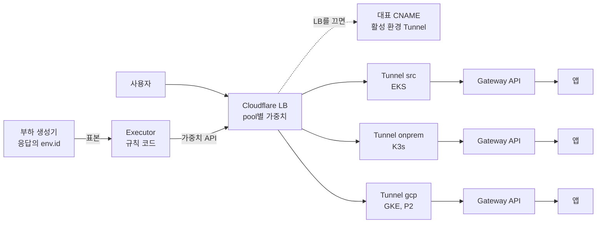

# 환경 사이 트래픽 전환

스펙 FR-8과 T17(10, 50, 100, 0% 전환, 반영 시간, 관측 비율, 기준 초과 시 0% 자동 복귀)을 어느 층에서 할지 정리합니다. 엔터프라이즈와 오픈소스의 방식을 1차 출처로 비교했습니다. 모든 출처는 2026-11-02에 조회했고, 근거 절에 URL을 둡니다. 이 문서는 **제안**입니다. 회의에서 정하기 전에는 Terraform을 바꾸지 않습니다.

## 1. 결론

- 환경 사이 가중치는 사용자 앞단 한 곳에서만 바꿉니다. 그 층은 Cloudflare Load Balancing(이하 LB)입니다. 스펙 §8.7과 같습니다.
- LB의 pool은 환경마다 하나입니다. pool의 끝점은 그 환경의 Tunnel 주소(`<UUID>.cfargotunnel.com`)입니다. 인바운드 포트가 없어도 됩니다.
- 환경 안에서는 Gateway API(Cilium 구현)가 그 환경의 앱으로만 보냅니다. 클러스터를 넘는 메시는 사용자 경로에 쓰지 않습니다.
- 단계 판정과 되돌리기는 Executor의 규칙 코드(`platform/executor/src/bravo_executor/front.py`)가 합니다. LB의 헬스 체크에 맡기지 않습니다.
- 그 코드의 LB 방식은 아직 반영 시간과 관측 비율을 남기지 않습니다. 판정도 두 환경의 표본을 섞습니다. 고칠 안은 4절에 있습니다.
- 대표 이름의 CNAME은 LB를 켠 뒤에도 남깁니다. LB를 끄면 그 CNAME이 응답합니다. 이것이 스펙의 "비상 경로는 DNS 전환"입니다.
- 지금 계정에는 LB 구독이 없습니다. 오늘 밤에 실제로 되는 것은 CNAME 0%와 100% 전환뿐입니다. 10%와 50%는 LB 구독이 있어야 합니다.

## 2. 비교

판정 칸의 뜻: **채택**(우리 설계에 씀), **출구**(같은 계약으로 옮겨 갈 수 있는 대안), **제외**(우리 제약과 부딪침). 우리 제약은 넷입니다. 인바운드 0(D-16), 단일 클라우드 LB를 전역층으로 쓰지 않음, 키는 플랫폼 OpenBao에만(D-26), 세 환경에서 같은 경험(D-23)입니다.

### 2.1 전역층(Edge, DNS)

| 후보 | 가중치 방식 | 인바운드 0, NAT 뒤 온프렘 | 반영과 관측 | 판정 | 출처 |
|---|---|---|---|---|---|
| Cloudflare LB | 프록시 L7. Random steering의 pool 가중치가 pool별 트래픽 비율을 정함 | 맞음. Tunnel을 끝점으로 받음. 끝점 주소는 `<UUID>.cfargotunnel.com`, Host 헤더에 앱 이름 | 클라이언트 DNS 캐시와 무관(프록시 모드, 추정). pool별 요청 수는 GraphQL `selectedPoolName`. LB 분석은 유료 영역 요금제만 | **채택** | C1, C2, C3, C4 |
| Akamai GTM | DNS. Weighted round robin, load feedback 가중 property 유형. liveness 시험 기본 60초 | 데이터센터마다 도달 가능한 응답 주소가 필요(추정) | DNS 캐시에 기댐(추정). 계약 요금 | 출구 | A1 |
| IBM NS1 Connect | DNS filter chain. Up 필터 뒤 Weighted Shuffle | 공개 응답 주소 필요(추정) | DNS 캐시에 기댐(추정) | 출구 | A2 |
| F5 Distributed Cloud | DNS LB의 Ratio-Member 가중치, 헬스 체크 | Customer Edge를 온프렘에 둠. 바깥 방향 연결만으로 되는지는 확인하지 못함 | 벤더 플랫폼 | 출구 | A3 |
| Route 53 가중 레코드 | 0–255 가중치. 비율은 가중치를 합으로 나눈 값. 0이면 보내지 않음 | 응답 주소가 공개돼야 함 | DNS 캐시에 기댐(추정) | 제외(AWS가 전역층이 됨) | A4 |
| Cloud DNS 가중 라운드 로빈 | 0–1000 가중치 | 외부 끝점 헬스 체크는 공개 영역만, 주기 30–300초, CNAME 레코드는 헬스 체크 불가 | Tunnel CNAME을 검사하지 못함 | 제외(GCP가 전역층이 됨) | A5 |

GCP Cloud Load Balancing(하이브리드 NEG)은 이번 조사에서 1차 출처를 확인하지 못했습니다. GCP 전용 전역층이라 같은 이유로 제외합니다.

### 2.2 쿠버네티스 안

| 후보 | 하는 일 | 우리 제약과 맞는가 | 판정 | 출처 |
|---|---|---|---|---|
| k8gb | DNS 기반 GSLB. CoreDNS와 ExternalDNS로 영역을 클러스터에 위임. 2026-08-05 CNCF incubating. 채택 은행 Millennium bcp | 각 클러스터가 위임받은 영역의 권한 DNS가 됨. 인터넷에서 그 DNS에 닿아야 함(추정). 가중 라운드 로빈은 상위 DNS가 순서를 섞어 비율이 맞지 않을 수 있음 | 제외(관찰 대상) | K1, K2 |
| ExternalDNS 가중 레코드 | Route 53용 주석 `set-identifier`, `aws-weight`. 헬스 체크는 만들지 않고 기존 ID만 붙임 | 가중치는 Route 53 기능 | 제외 | K3 |
| Cilium ClusterMesh 전역 서비스 | `service.cilium.io/global`. 선호는 `none`, `local`, `remote` 세 값 | 비율 가중치가 없음. 클러스터 사이 Pod 망 연결 필요 | 제외(사용자 경로) | K4 |
| Istio 다중 클러스터 | east-west 게이트웨이와 원격 API 서버 비밀 | 게이트웨이가 상대 클러스터에서 닿아야 함 | 제외. 플랫폼 안 ambient만(D-15) | K5 |
| Multi-Cluster Services API(KEP-1645) | `ServiceExport`, `ServiceImport`, `clusterset.local` 이름 | 구현 API는 `v1alpha1`. 트래픽 분배 제어는 별도 KEP로 미룸 | 제외 | K6 |
| Linkerd 다중 클러스터 | 서비스 미러링. 게이트웨이 방식과 평면 망 방식 | 게이트웨이가 상대 Pod에서 닿아야 함 | 제외 | K7 |
| Skupper | 사이트 사이 애플리케이션 망. 분산은 anycast(균형, 가장 가까움) | 한쪽 사이트가 link access를 열어야 함. 쿠버네티스 기본은 LoadBalancer | 제외. D-16 링크가 같은 역할 | K8 |
| Submariner | 게이트웨이 사이 터널, UDP 4500. NAT 탐색 UDP 4490 | 적어도 한쪽이 도달 가능해야 함. 인바운드 0과 부딪침 | 제외 | K9 |
| Karmada | 다중 클러스터 배치. MultiClusterService는 MCS API 사용 | 멤버 클러스터 컨테이너 망이 이어져 있어야 함(예: Submariner) | 제외 | K10 |

쿠버네티스 안의 후보는 모두 클러스터 사이 망을 먼저 잇거나, 한쪽에 들어오는 지점을 요구합니다. 인바운드 0과 NAT 뒤 온프렘을 함께 지키는 후보는 Tunnel을 끝점으로 받는 Edge LB뿐입니다(확인한 문서 기준).

### 2.3 단계 판정과 되돌리기

| 도구 또는 원칙 | 판정 방식 | 실패 때 | 우리에게 쓰는 부분 | 출처 |
|---|---|---|---|---|
| Flagger | 주기(기본 60초)마다 지표 검사. `threshold`는 되돌리기 전 허용 실패 수. `stepWeights`로 단계 지정 | 모든 트래픽을 기존 쪽으로 보내고 새 쪽을 0으로 줄임. 되돌리기 시간은 주기 곱하기 threshold | 단계 배열, 주기, 실패 수의 의미 | P1 |
| Argo Rollouts 분석 | AnalysisRun 결과는 Successful, Failed, Inconclusive 셋. `successCondition`, `failureLimit` | 백그라운드 분석이 실패하면 canary 가중치를 0으로. Inconclusive면 멈추고 사람을 기다림 | 결과 세 가지의 구분 | P2 |
| Google SRE Workbook | 같은 시간의 대조군과 비교하고, SLO 같은 절대 기준도 함께 씀. 사용자에게 보이는 지표 몇 개만 씀. 표본이 충분해야 함 | - | 출발지 pool을 대조군으로 씀(제안) | P3 |
| PipeCD(CyberAgent) | Kubernetes, Cloud Run, ECS, Lambda에서 같은 GitOps 방식의 점진 배포. 분석과 자동 되돌리기 | - | 일본 기업이 만든 CNCF Sandbox 사례(2023-05-17 채택) | P4 |

스펙 §8.7대로 Argo Rollouts와 Flagger는 한 클러스터 안의 도구입니다. 그래서 도구는 쓰지 않고, 판정의 의미만 Executor 규칙에 옮깁니다.

### 2.4 채택 사례

| 회사 | 한 일 | 층 | 날짜 | 출처 |
|---|---|---|---|---|
| Mercari | GKE 클러스터 이전. Fastly 앞단은 Fastly 가중 라우팅, 나머지는 Route 53 가중 레코드. 1%에서 시작해 1–2주에 걸쳐 옮김. 옛 클러스터를 약 2주 남김 | Edge, DNS | 2020-06-02 | J1 |
| Mercari | 온프렘 데이터센터의 Nginx LB를 GKE로 옮김. Cloud DNS 가중 라운드 로빈 사용. 단계 예시는 1, 10, 25, 50, 100% | DNS | 2022-12-13 | J2 |
| ZOZO | Akamai Application Load Balancer로 옛 웹 서버와 새 웹 서버를 90%와 10%로 나눔. 오류를 보면 되돌림. 대상은 온프렘 안의 두 묶음 | Edge | 2021-11-18 | J3 |
| ZOZO | Flagger와 Istio로 검색 API canary를 자동화. Datadog p99 1초 기준. 10% 단계에서 자동 되돌리기가 일어나 영향을 줄임 | 클러스터 안 | 2022-10-04 | J4 |
| CyberAgent | PipeCD를 만들어 공개. 여러 실행 환경에 같은 점진 배포와 분석 | 배포 도구 | 2023-05-17(Sandbox) | P4 |
| Millennium bcp(포르투갈 은행) | k8gb 채택, 핵심 금융 앱 99.99% 가동률 | DNS GSLB | 2026-08-05 | K1 |
| LY Corp(LINE) | Verda LBaaS(L4)와 Flava 통합은 공개 글이 있음. 환경 사이 가중 전환 사례는 찾지 못함 | - | **확인 못 함** | J5 |
| 라쿠텐, 소프트뱅크 | 이번 조사에서 공개 1차 출처를 찾지 못함 | - | **확인 못 함** | - |

일본 사례의 공통점은 둘입니다. 환경이나 클러스터를 넘는 이동은 앞단(Fastly, Akamai, Route 53, Cloud DNS)의 가중치로 합니다. 클러스터 안의 버전 교체는 Istio와 Flagger가 합니다. 우리 층 구성과 같습니다.

## 3. 권하는 층 구성



| 층 | 무엇 | 하는 일 | 하지 않는 일 |
|---|---|---|---|
| 전역층 | Cloudflare LB, 환경마다 pool 하나, Random steering | 요청마다 pool을 가중치로 고름. 모니터가 Tunnel 끝점을 검사 | 앱 품질 판정. 공식 문서의 Tunnel 모니터 예시는 `cloudflared` 도달만 확인함 |
| 비상 경로 | 대표 이름의 프록시 CNAME | LB가 꺼지면 응답. LB가 켜져 있으면 LB가 우선 | 부분 가중치 |
| 환경 안 | Gateway API(Cilium), 모든 환경에 같은 매니페스트(D-23) | `cloudflared`에서 받아 그 환경의 앱으로 보냄 | 다른 클러스터로 보냄 |
| 판정 | Executor `front.py`. LLM을 import하지 않음(NFR-5) | 가중치 변경, 단계 판정, 0% 복귀. 빠진 것은 4절 | 사람 승인. 시작은 콘솔에서 사람이 함(D-18) |
| 표본 | 대표 이름 탐침. 앱이 `/api/config`에 `env.id`를 냄. 부하 생성기를 더하는 것은 제안 | 오류율, p95. 표본마다 응답 환경이 있음 | Cloudflare 분석에만 기대기. 영역 요금제가 무료면 LB 분석이 없음 |

## 4. 판정과 되돌리기 고리

**지금 코드(LB 방식).** 이 경로는 LB 구독이 없어 Cloudflare에서 한 번도 돌지 않았습니다(`front.py` 설명). LB 객체가 없으면 시작하지 않습니다. 기본값은 `FrontConfig`의 현재 값입니다.

1. 효과 원장을 거쳐 pool 가중치를 바꿉니다. API로 다시 읽어 같은 값인지 확인합니다.
2. 대표 이름을 0.5초마다 60초 동안 탐침합니다. 약 120 표본입니다.
3. 표본이 30개보다 적으면, 대상을 0%로 돌립니다.
4. 오류율이 1%를 넘거나 p95가 800 ms를 넘으면, 대상을 0%로 돌립니다.
5. 통과하면 다음 단계로 갑니다.
6. 0%로 돌린 뒤 상태는 SHIFT에서 AWAIT_APPROVAL로 갑니다(`03-migration.md` 그림 1).

**T17 완료 기준과의 차이(코드를 읽어 확인했습니다).**

| ID | 차이 | 영향 |
|---|---|---|
| G1 | LB 방식은 반영 시간을 재지 않습니다. 반영 시간은 CNAME 방식에만 있습니다 | T17의 "각 반영 시간 기록"을 채우지 못함 |
| G2 | 관측 비율을 계산하지 않습니다. 표본에 `env.id`는 이미 있습니다 | FR-8의 "실제 비율은 관측값으로 보고"를 채우지 못함 |
| G3 | 판정이 두 환경의 표본을 섞습니다 | 10% 단계에서 목적지 오류율 10%가 전체 약 1%로 묽어짐(추정). 목적지 표본은 약 12개(추정) |

**제안(판정 규칙 변경이므로 사람이 정함, AGENTS.md).**
- 반영 시간: 가중치 변경 요청부터 목적지 `env.id`의 첫 응답까지로 정의합니다. 분배가 확률적이라 "연속 N회" 기준은 쓰지 않습니다.
- 관측 비율: 목적지 `env.id` 응답 수를 전체 표본 수로 나눕니다. 단계 기록에 설정값과 함께 둡니다.
- 판정은 목적지 표본만으로 합니다. 목적지 최소 표본 수를 따로 둡니다.
- 표본원에 부하 생성기를 더합니다. 스펙 5.3의 부하는 초당 200 요청입니다. 10%면 60초에 목적지 표본이 약 1,200개입니다(추정). `03-migration.md`의 "합성 트래픽을 반드시 넣음" 규칙과 같습니다.
- 표본 부족을 실패와 나눕니다. Argo Rollouts의 Inconclusive처럼 창을 한 번 늘리고, 그래도 부족하면 0%로 돌립니다.
- 같은 시간의 출발지 표본과도 비교합니다. Google SRE Workbook의 대조군 원칙입니다. 양쪽이 함께 나빠지면 절대 기준이 잡습니다.

가중치는 새 연결에만 적용됩니다. 열린 WebSocket은 컷오버 때 서버가 코드 1012로 닫습니다(스펙 §8.7). 그래서 관측 비율은 연결이 아니라 요청 단위로 적습니다.

## 5. Beyond Lock-In에 맞는 이유

- 전역층과의 계약은 "환경마다 pool 하나, pool마다 가중치, 판정은 바깥"뿐입니다. Akamai GTM, NS1, F5 XC도 같은 가중치 개념을 냅니다(2.1절). 바꿀 곳은 Executor의 `Cloudflare` 어댑터 한 층입니다.
- 판정과 되돌리기는 우리 코드입니다. 벤더의 자동 판정 기능에 기대지 않습니다. 그래서 전역층을 바꿔도 판정 결과의 의미가 같습니다.
- 이전 대상 클라우드의 LB(Route 53, Cloud DNS)를 전역층으로 쓰면 그 클라우드가 이전을 지휘합니다. 출구 제품과 모순입니다.
- 세 환경의 차이는 Tunnel 하나와 pool 하나뿐입니다. 앱 매니페스트와 Gateway는 같습니다(D-23).
- Cloudflare는 잔존 의존성으로 남습니다(스펙 §8.7). 의존성 지도에 표시하고 발표에서 밝힙니다.

## 6. 오늘 밤과 나중

| 항목 | 오늘 밤(LB 구독 없음) | LB 구독 뒤 |
|---|---|---|
| 0%와 100% 전환 | 대표 CNAME을 대상 Tunnel로 바꿈. 연결 없는 Tunnel이면 거부. 반영 시간은 탐침 5회 연속 기준으로 잼(`front.py` CNAME 방식) | LB 가중치로 함. CNAME은 비상 경로로 남김 |
| 10%와 50% | 하지 않음. 단계 기록에 "미적용, LB 구독 필요"를 남김. 흉내 내지 않음 | 실제로 함. 관측 비율은 G2를 고친 뒤 기록됨 |
| 0% 자동 복귀 | 없음. CNAME 방식은 판정 없이 뒤집기만 함. 되돌리기는 출발지로 다시 뒤집는 호출 | 단계마다 판정, 실패 시 대상 0%(G3 주의) |
| 관측 비율 | 100%와 0%뿐이라 탐침의 `env.id`로 충분 | 탐침과 부하 생성기의 `env.id`. 영역이 유료 요금제면 GraphQL `selectedPoolName`으로 대조 |
| 비상 경로 | CNAME이 곧 주 경로 | LB를 끄면 CNAME이 응답 |
| GKE pool | 없음 | `environments`에 `gcp`를 더함(P2, D-01) |

오늘 밤에 할 일은 둘입니다.
- 부하 생성기가 응답마다 `env.id`, 상태 코드, 지연을 남기는지 확인합니다. LB 유무와 관계없이 판정의 재료입니다(제안 G3).
- 11/3 회의에서 LB 구독(월 $5부터, 끝점 수에 따라 늘 수 있음)을 정합니다. 구독하지 않으면 FR-8의 10%와 50%는 시연하지 못한다고 밝힙니다.

나중에 볼 것입니다.
- 다른 전역층(Akamai GTM, NS1)용 어댑터는 고객 요구가 있을 때 만듭니다.
- k8gb는 인바운드 DNS가 허용되는 고객용 선택지로 관찰합니다.

## 7. Terraform과 설정 변경 계획(적용하지 않음)

다른 에이전트가 `infra/modules/edge/cloudflare`를 지금 쓰고 있습니다. 아래는 계획만 적습니다. 적용은 LB 구독 결정 뒤 인프라 · CI 담당이 합니다.

**E1. 대표 CNAME을 LB와 함께 둠.** (반영 2026-11-02 20:3x, `infra/modules/edge/cloudflare/main.tf`. 지금 설정으로 plan 하면 변경 없음) LB가 같은 이름의 DNS 레코드보다 우선합니다. LB를 끄면 기존 레코드가 응답합니다(C5). 지금은 `lb_enabled = true`면 CNAME을 지웁니다. 그러면 비상 경로가 사라지고, 한 번의 apply 안에서 지우기와 만들기 순서도 보장되지 않습니다.

```hcl
resource "cloudflare_dns_record" "front" {
  count = 1   # 기존: var.lb_enabled ? 0 : 1
  # 나머지 그대로. ignore_changes = [content] 유지
}
```

**E2. fallback pool을 활성 환경으로.** (반영 2026-11-02 20:3x, `fallback_pool`을 `ignore_changes`에 넣음. LB 구독 뒤 plan으로 확인) 지금 식은 `keys(var.environments)[0]`입니다. `keys`는 이름 순으로 정렬하므로 `dst`가 `src`보다 앞섭니다. 모든 pool이 아플 때 목적지로 가게 됩니다. 컷오버 뒤에는 Executor가 바꾸므로 Terraform이 되돌리지 않게 합니다.

```hcl
resource "cloudflare_load_balancer" "app" {
  fallback_pool   = cloudflare_load_balancer_pool.env[var.active_env].id
  session_affinity = "none"   # 요청 단위 분배를 명시
  lifecycle {
    ignore_changes = [random_steering, fallback_pool]
  }
}
```

**E3. 모니터가 앱까지 닿는지 시험.** pool 끝점의 Host 헤더는 환경 이름입니다. 그래서 `/healthz`는 Tunnel과 Gateway를 지나 앱에 닿을 것입니다(추정). 공식 문서의 예시는 `cloudflared` 도달만 확인합니다(C3). 시험 T-E5로 확인합니다. 연속 실패 수를 명시합니다.

```hcl
resource "cloudflare_load_balancer_monitor" "app" {
  consecutive_down = 2
  consecutive_up   = 2
}
```

**E4. 검사 지역.** pool의 `check_regions`를 동북아시아(`NEAS`)로 둡니다. 지역 코드 이름은 provider 문서로 확인합니다. 기본 요금에서 고를 수 있는 지역 수는 확인하지 못했습니다.

**E5. 세 번째 환경.** `environments`에 `gcp`를 더하면 Tunnel, DNS 레코드, pool이 함께 생깁니다. 모듈 코드는 바뀌지 않습니다. 끝점이 셋이 되면 요금이 늘 수 있습니다(확인 필요).

**E6. 값과 비밀.** `infra/envs/edge/terraform.tfvars`의 `lb_enabled`를 구독 뒤에만 `true`로 둡니다. Executor에는 `BRAVO_FRONT_LB_ENABLED=1`을 줍니다. API 토큰은 LB 범위로 제한하고 OpenBao `secret/platform/cloudflare`에만 둡니다(D-26, `02-network.md` F14). 토큰 권한 이름은 발급 화면에서 확인합니다.

**E7. Executor(코드, Terraform 밖).** 4절의 G1, G2, G3을 고칩니다. 판정 규칙을 바꾸는 일이라 사람이 정한 뒤에 합니다(AGENTS.md). 고칠 곳은 `front.py`의 LB 경로와 `judge()`이고, 시험은 `platform/executor/tests/test_front.py`에 더합니다.

**적용 순서(구독 뒤).**
1. LB를 구독합니다. 영역 요금제와 끝점 수에 따른 금액을 기록합니다.
2. E1과 E2를 반영하고 `lb_enabled = true`로 plan합니다. CNAME이 지워지지 않는지 plan에서 확인합니다.
3. apply 뒤, 출발지 100%로 응답하는지 탐침으로 확인합니다.
4. 아래 시험을 돌립니다.

## 8. 시험

| ID | 무엇 | 합격선 |
|---|---|---|
| T-E1 | 10, 50, 100, 0% 단계마다 반영 시간(G1 뒤) | 값을 기록함. 180초 안에 목적지 응답이 보임(`propagation_timeout_s`) |
| T-E2 | 단계마다 관측 비율(G2 뒤) | 값을 기록함. 설정값과 차이를 그대로 보고 |
| T-E3 | 목적지 Gateway가 503을 내게 한 뒤 10% 단계 | 대상이 0%로 돌아감. 상태가 AWAIT_APPROVAL |
| T-E4 | LB를 끔 | 대표 이름이 CNAME 대상 환경으로 응답 |
| T-E5 | 목적지 앱만 멈춤(`cloudflared`는 살아 있음) | 모니터가 pool을 아프다고 표시하는지 기록. 표시하지 않으면 판정은 Executor만 믿음 |

## 9. 확인할 것

- LB 요금의 상세(포함 끝점 수, 모니터 주기, 검사 지역). 공식 가격 페이지는 "Starting at $5/mo"만 보입니다.
- 영역 `mangowhois.ai`의 요금제. LB 분석은 유료 영역 요금제만 됩니다.
- 무료 영역 요금제에서 LB 부가 기능을 살 수 있는지.
- 프록시 모드의 가중치 반영 시간. 공식 수치를 찾지 못해 T-E1로 잽니다.
- GKE Dataplane V2에서 ClusterMesh가 되는지. 지금 설계에는 필요 없습니다.

## 근거

모두 2026-11-02 조회입니다.

- C1. Cloudflare, Steering policies(Random, pool 가중치): https://developers.cloudflare.com/load-balancing/understand-basics/traffic-steering/steering-policies/standard-options/
- C2. Cloudflare, Load balancing analytics(`selectedPoolName`, 유료 요금제만): https://developers.cloudflare.com/load-balancing/reference/load-balancing-analytics/
- C3. Cloudflare, Public load balancers with Tunnel(끝점 주소, Host 헤더, 모니터 한계, 2026-06-23 갱신): https://developers.cloudflare.com/cloudflare-one/networks/connectors/cloudflare-tunnel/routing-to-tunnel/public-load-balancers/
- C4. Cloudflare, Network and CDN 요금("Starting at $5/mo"): https://www.cloudflare.com/plans/network-cdn/
- C5. Cloudflare, DNS records for load balancing(같은 이름이면 LB 우선, LB를 끄면 기존 레코드): https://developers.cloudflare.com/load-balancing/load-balancers/dns-records/
- C6. Cloudflare, Monitors(지역마다 탐침 3개, 전체 지역은 Enterprise): https://developers.cloudflare.com/load-balancing/monitors/
- A1. Akamai, GTM property type descriptions: https://techdocs.akamai.com/gtm/docs/property-type-descriptions
- A2. IBM NS1 Connect, Shuffle filters: https://www.ibm.com/docs/en/SSSYGZ/traffic_steering/shuffle_filters.html
- A3. F5 Distributed Cloud, DNS Load Balancer: https://docs.cloud.f5.com/docs-v2/docs/how-to/app-networking/dns-load-balancer
- A4. AWS, Route 53 weighted routing: https://docs.aws.amazon.com/Route53/latest/DeveloperGuide/routing-policy-weighted.html
- A5. Google Cloud, Cloud DNS routing policies: https://docs.cloud.google.com/dns/docs/routing-policies-overview
- K1. CNCF, k8gb incubating 발표(2026-08-05): https://www.cncf.io/announcements/2026/08/05/k8gb-becomes-a-cncf-incubating-project/
- K2. k8gb 저장소와 가중 라운드 로빈 주의(미리보기 문서): https://github.com/k8gb-io/k8gb , https://deploy-preview-2224--k8gb-preview.netlify.app/wrr_caveats
- K3. ExternalDNS, AWS tutorial: https://kubernetes-sigs.github.io/external-dns/latest/docs/tutorials/aws/
- K4. Cilium, Service Affinity: https://docs.cilium.io/en/stable/network/clustermesh/affinity/
- K5. Istio, Multi-primary on different networks: https://istio.io/latest/docs/setup/install/multicluster/multi-primary_multi-network/
- K6. KEP-1645 Multi-Cluster Services API: https://github.com/kubernetes/enhancements/blob/master/keps/sig-multicluster/1645-multi-cluster-services-api/README.md
- K7. Linkerd, Multi-cluster communication: https://linkerd.io/2-edge/features/multicluster/
- K8. Skupper, Overview와 Link concept: https://skupper.io/docs/overview/index.html , https://skupper.io/docs/refdog/concepts/link.html
- K9. Submariner, NAT traversal: https://submariner.io/operations/nat-traversal/
- K10. Karmada, Multi-cluster Service: https://karmada.io/docs/userguide/service/multi-cluster-service/
- P1. Flagger, Deployment strategies: https://fluxcd.io/flagger/usage/deployment-strategies/
- P2. Argo Rollouts, Analysis: https://argo-rollouts.readthedocs.io/en/stable/features/analysis/
- P3. Google SRE Workbook, Canarying releases: https://sre.google/workbook/canarying-releases/
- P4. CyberAgent, PipeCD CNCF Sandbox 채택: https://www.cyberagent.co.jp/techinfo/news/detail/id=29949 , CNCF landscape 기록 https://github.com/cncf/landscape/pull/3201/files
- J1. Mercari, Mercari Microservices Platform에서의 Kubernetes Cluster 이전(2020-06-02): https://engineering.mercari.com/blog/entry/2020-06-02-090450/
- J2. Mercari, Seamless critical traffic migration with CoreDNS request rewrite(2022-12-13): https://engineering.mercari.com/en/blog/entry/20221213-seamless-critical-traffic-migration-with-coredns-request-rewrite-feature/
- J3. ZOZO, ZOZOTOWN의 Akamai Application Load Balancer 도입(2021-11-18): https://techblog.zozo.com/entry/zozotown-akamai-alb
- J4. ZOZO, Flagger로 점진 배포(2022-10-04): https://techblog.zozo.com/entry/progressive-delivery-by-flagger
- J5. LY Corp, Flava 아키텍처(2026-01): https://techblog.lycorp.co.jp/ja/20260126b , LINE Verda LBaaS: https://engineering.linecorp.com/ja/blog/network-development-in-verda/
- 코드: `platform/executor/src/bravo_executor/front.py`, `infra/modules/edge/cloudflare/main.tf`(2026-11-02 읽음)
