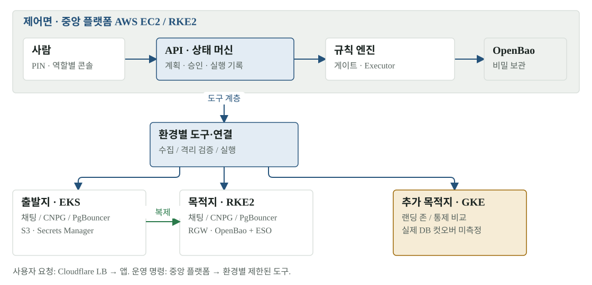

# 01 · 전체 구조 — 플랫폼은 무엇을 옮기고 무엇을 증명하나

현재 구현은 중앙 플랫폼 하나와 고객 환경 셋으로 나뉩니다. 중앙 플랫폼이 서비스의 주체가 되어 데이터를 보관하는 것이 아니라, 고객 환경의 상태를 읽고 이전 계획·검증·승인·실행 기록을 관리합니다. 이 구분을 잡으면 콘솔의 녹색 상태와 실제 이전 완료가 왜 다른지 이해할 수 있습니다.

[확대·조작 가능한 시각화](figures/01-architecture.html)

## 제어면과 데이터 경로

**제어면**은 AWS EC2의 RKE2에 있습니다. API와 상태 머신은 계획·승인·실행을 저장하고, 수집기는 환경의 상태와 의존성을 읽고, 게이트는 통제를 시험합니다. 리허설은 격리된 환경에서 제안을 검증하고 Executor는 정해진 절차를 실행합니다. 콘솔은 이 기록을 사람이 읽고 승인·시작하는 화면입니다.

**고객 데이터 경로**는 Cloudflare LB → 고객 앱 → PgBouncer → 쓰기를 받는 DB입니다. 출발지는 AWS EKS, 목적지는 온프렘 RKE2, 추가 목적지는 GKE입니다. 앱이 어느 환경에 떠 있는지와 쓰기가 어느 DB에 들어가는지는 별도입니다. SHIFT 동안 목적지 앱도 링크를 통해 출발지 DB에 씁니다. 앱 트래픽이 목적지 100%가 되었다고 DB 컷오버가 끝난 것은 아닙니다.

| 구성요소 | 만드는 산출물 | 다음에 읽는 쪽 | 그 산출물이 허용하는 결정 |
|---|---|---|---|
| 수집기 | 인벤토리·환경 스냅숏 | 분석·제안·게이트 | 어떤 의존성을 옮겨야 하는지 판단 |
| 에이전트 | 스키마를 따르는 제안서·diff | 정적 검증·동작 Job | 시험할 후보를 고정 |
| 리허설 | 산출물 digest·판정·원본 기록 | API·게이트·사람 | 실제 반영 후보인지 검토 |
| 게이트 | 통제별 PASS/FAIL/UNKNOWN | 상태 머신·승인자 | 승인 단계로 갈 수 있는지 판단 |
| 승인자 | 대상·diff·digest·만료에 결속한 승인 | API·Executor | 해당 revision의 실행을 허용 |
| Executor | 효과 원장·무결성 영수증 | 상태 머신·운영자 | 다음 단계 또는 SAFE_HOLD 판단 |

## AI에게 맡긴 일과 맡기지 않은 일

에이전트는 코드 수정·정책 번역 같은 후보를 만듭니다. 클러스터 자격을 직접 받아 실행하지 않고 허용된 도구를 통해 격리된 리허설 범위에서 작업합니다. 모델이 낸 설명은 성공 증거가 아닙니다. 플랫폼이 실제 파일과 산출물 digest를 고정하고 검증 Job의 결과를 읽습니다.

게이트·상태 전이·SHIFT·CUTOVER·FAILBACK은 결정적 코드가 수행합니다. 여기서 ‘결정적’은 외부 시스템이 항상 성공한다는 뜻이 아니라, 같은 관측과 규칙에 따라 판정한다는 뜻입니다. 외부 상태를 확인할 수 없으면 성공을 추정하지 않고 보류합니다.

## 현재 확인한 범위

2026-11-03 11:18 KST 콘솔에서 EKS 2/2, 온프렘 RKE2 2/2, GKE 1/1 노드와 중앙 서비스 응답을 확인했습니다. S2와 SHIFT의 부분 실측도 있습니다. 그러나 콘솔 계획·승인 기록은 0건이었고 승인부터 실제 DB 컷오버·복구까지 잇는 전체 E2E는 없습니다.

팀 정본은 SeaweedFS·Tailscale을 사용하지만 개인 구현은 RGW·Cloudflare 연결을 사용합니다. 그림은 개인 구현의 현재 배치이며, 그 차이를 팀 합의로 간주하지 않습니다.

## 읽고 확인할 질문

1. 목적지 앱의 성공 응답은 어느 DB의 commit을 뜻하는가?
2. 콘솔에 보이는 PASS는 어느 실행 ID와 산출물 digest에 결속되는가?
3. 팀 저장소로 가져갈 때 환경 어댑터만 바꾸면 되는가, 데이터 계약도 다른가?

## 원본과 다음 읽기

- [현재 클라우드 실행 계약](../../deploy/CLOUD-E2E-CONTRACT.md)
- [에이전트 지도·허용 목록·샌드박스](../architecture/13-agents.md)
- [이전 프로토콜과 실패 처리](07-cutover.md)
- [팀 계약에 합치는 순서](10-roadmap.md)
