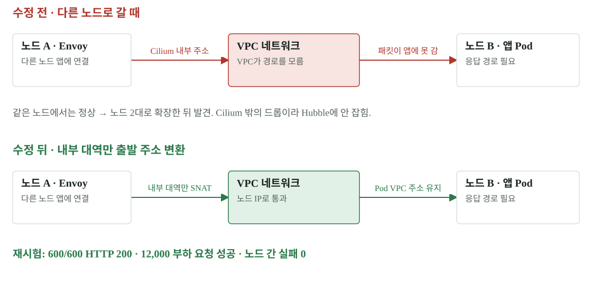

# 02 · 장애 분석 — Source Gateway 503은 왜 노드가 늘자 나타났나

이번 503은 앱 내부 예외가 아니라 다른 노드로 넘어가는 네트워크 경로에서 발생했습니다. 한 노드에서는 정상이었고 두 노드로 확장한 뒤 드러났다는 사실이 문제 범위를 좁혔습니다. 수정 커밋은 `60d8a2d`입니다.

[확대·조작 가능한 시각화](figures/02-gateway.html)

## 증상에서 경로를 좁히기

외부 요청은 Cloudflare와 Gateway Envoy를 거쳐 앱 Pod에 도달합니다. 앱의 `X-Served-By` 헤더가 없는 오류는 앱 이전 구간을 의심하게 하지만, 그것만으로 Envoy와 Cloudflare 중 범인을 확정할 수는 없습니다. 다음으로 같은 노드의 앱과 다른 노드의 앱을 분리해 비교했습니다.

| 관찰 | 알 수 있는 것 | 이것만으로 모르는 것 |
|---|---|---|
| 같은 노드 연결 정상 | 앱과 동일 노드 경로는 동작 | 다른 노드로 가는 경로의 정상 여부 |
| 다른 노드 연결 실패 | 노드 간 전달·출발 주소·정책을 확인해야 함 | 어느 장치가 버리는지 |
| Hubble 드롭 없음 | 관찰된 Cilium 경로에 드롭 기록이 없음 | VPC 등 관찰 범위 밖의 드롭 |
| 앱 식별 헤더 없음 | 앱 응답에 도달하지 못했을 가능성 | 엣지와 Envoy의 책임 구간 |

## 원인과 수정 원리

Envoy가 다른 노드의 앱 Pod로 연결할 때 VPC가 모르는 Cilium 내부 주소를 출발 주소로 썼습니다. VPC가 Cilium 밖에서 패킷을 버리므로 Hubble에도 드롭 기록이 없었습니다. 이 때문에 ‘Cilium 드롭 0’과 ‘요청 실패’가 동시에 성립했습니다.

Cilium 설정 세 줄로 그 내부 대역에서 나가는 연결만 노드 IP로 변환했습니다. Pod의 정상 VPC 주소는 그대로 유지했습니다. 모든 Pod 트래픽을 광범위하게 변환하는 변경이 아니라 Envoy가 사용하는 내부 대역의 경로를 바로잡은 것입니다.

이 수정은 **aws-cni chaining을 사용하는 출발지 EKS**에 해당합니다. 온프렘과 GKE는 네트워크 구성이 달라 같은 설정을 그대로 복사할 근거가 없습니다.

## 검증과 남은 경계

| 시험 | 결과 | 해석 |
|---|---|---|
| 연속 요청 600건 | 모두 HTTP 200 | 수정 경로의 기본 반복 확인 |
| 쓰기 50 + 읽기 150/s, 60초 | 12,000건 성공 | 해당 부하·시간의 단기 안정성 |
| 노드 간 연결 실패 | 0 | 문제를 유발했던 경로 재확인 |
| 운영자 추가 요청 100건 | 모두 HTTP 200 | 추가 수동 확인 |
| 후속 SHIFT | 앱까지 못 온 오류 0 | 실제 전환 probe에서도 효과 확인 |

이 결과는 모든 미래 부하·모든 네트워크 경로의 무결성을 증명하지 않습니다. 특히 앞서 03:54에 수행한 300초 부하의 오류를 소급해 0으로 바꾸지 않습니다. 수정 전후 실행은 각각 보존해야 합니다.

## 다음에 비슷한 장애를 만나면

요청을 받은 지점 → 프록시가 고른 목적지 → 실제 출발 주소 → 다음 네트워크가 그 주소를 아는지 → 앱 도착 여부 순서로 관측을 붙입니다. 로그의 ‘없음’은 관찰 범위와 함께 읽습니다. 확장 전에는 보이지 않던 경로를 노드 수·배치 조건에 포함합니다.

## 원본과 다음 읽기

- [수정 커밋 60d8a2d](https://github.com/mangowhoiscloud/b-free/commit/60d8a2d)
- [Gateway 수정 뒤 SHIFT 원본](../evidence/shift/lb-roundtrip-after-gw-fix-20261103T044632/README.md)
- [수정 전 부하와 WebSocket 한계](06-load.md)
