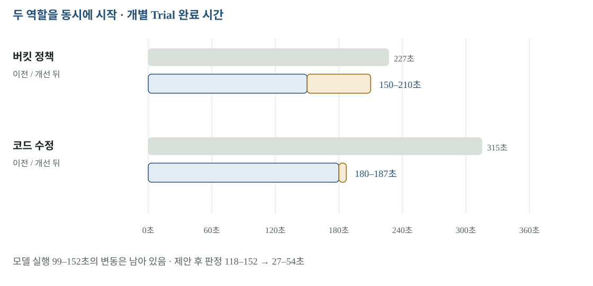

# 03 · S2 — 정책 번역과 코드 수정을 어떻게 검증했나

S2는 에이전트가 제안한 결과를 격리된 환경에서 실제로 시험하는 구간입니다. 버킷 정책과 Secrets Manager → OpenBao 코드 수정이라는 두 작업을 동시에 시작했습니다. 빠르게 제안하는 것보다, 검증한 산출물과 실제로 반영할 산출물을 일치시키는 일이 중요합니다.

[확대·조작 가능한 시각화](figures/03-s2.html)

## 한 Trial의 입력과 출력

수집기는 현재 코드·환경의 스냅숏을 만듭니다. 리허설 서비스가 역할별 Trial을 만들고 에이전트가 정책이나 diff를 제안합니다. 플랫폼은 제안서를 고정하고 정적 규칙과 동작 검증 Job을 수행합니다. 최종 결과는 설명 문장이 아니라 산출물 digest·실행 ID·검사별 관측값으로 남습니다.

**버킷 정책 작업**은 목적지와 같은 조건의 시험 버킷에 정책을 적용하고 게이트 이미지의 OBJ-01–06을 수행합니다. 열린 정책을 일부러 사용한 대조에서 OBJ-01이 FAIL하는지도 확인했습니다. **앱 수정 작업**은 합성 DB와 목적지와 같은 앱 실행 조건에서 ESO가 OpenBao 비밀을 동기화하고, 앱이 준비 상태에 도달하며, 채팅 쓰기·읽기와 권한 거부가 맞는지 시험합니다.

## 개선 전후 시간

| 구간 | 이전 | 이후 | 읽는 방법 |
|---|---:|---:|---|
| governance | 227초 | 150–210초 | 두 역할 중 버킷 정책 Trial |
| app_migration | 315초 | 180–187초 | 비밀 의존성 코드 수정 Trial |
| 제안서 확정 → 판정 | 118–152초 | 27–54초 | 모델 뒤 플랫폼의 대기·검증 구간 |
| 모델 실행 | 실행마다 차이 | 99–152초 | 남은 변동의 큰 부분 |

Pod를 삭제할 때 기본 30초를 기다리던 것을 1초로 줄였고, 제안서가 확정되는 순간 동작 검증 Job을 시작해 정적 검증과 겹쳤습니다. **두 검사 모두 PASS여야 최종 PASS**라는 결합 조건은 유지했습니다. 규칙의 내용이 바뀐 사항은 다음 보고서에서 별도로 검토합니다.

## 측정 중 찾아 고친 두 결함

**가려진 diff.** 도구 출력의 비밀 마스킹이 `password=` 같은 코드 문맥까지 바꿨습니다. 모델이 그 출력을 기반으로 diff를 내면 원래 스냅숏에 적용되지 않을 수 있습니다. 제출 diff를 실제 작업 공간 diff의 마스킹 결과와 대조하고, 일치하면 마스킹되지 않은 실제 diff를 산출물로 받도록 바꿨습니다. 표시용 텍스트와 실행할 원본을 구분한 것입니다.

**ESO 버전.** 목적지 ESO에는 `v1beta1`이 없는데, 이전에는 이미지 롤아웃을 마친 뒤 정책 적용에서 실패했습니다. 목적지 프로필의 API 버전을 검증하고 T31에 서버 측 dry run을 추가해 이미지 반입 전에 거부하도록 했습니다. 실제 반영을 시작하기 전에 환경이 받아들일 문서인지 확인합니다.

## T31과 콘솔까지 어디가 남았나

검증 환경의 T31 반영은 9.6초였습니다. 게이트 재대조 38–63초는 별도 측정이며 각본에서는 승인 뒤 전체 약 50–76초로 잡았습니다. 같은 실제 승인 실행에서 연속 측정한 결과가 아닙니다.

콘솔에서 역할마다 리허설 하나를 시작하도록 구현·테스트했습니다. 실제 측정은 API Pod 또는 미리 보기 Pod 경로이고 계획·승인·상태 전이·SSE의 전체 콘솔 경로는 미실행입니다. 시험 버킷·검증 네임스페이스에 성공한 결과를 실제 고객 목적지에 승인 반영한 것으로 읽으면 안 됩니다.

## 원본과 다음 읽기

- [S2 전체 사슬과 시행착오](../evidence/s2-full/README.md)
- [2차 시간과 T31 기록](../evidence/s2-timing/README.md)
- [판정 규칙 리뷰](04-verifier.md)
- [각본의 시간 예산](08-demo-budget.md)
