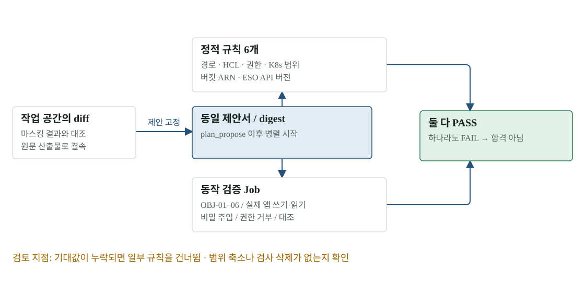

# 04 · 검증기 리뷰 — 무엇이 PASS의 의미를 바꿨나

검증을 빨리 실행하는 변경과 합격 기준을 바꾸는 변경은 별개입니다. 이번 S2에는 둘 다 들어 있습니다. 아래는 이미 바뀐 규칙의 이유와 검토 지점을 정리한 보고서이며, 사람 검토 완료나 팀 승인을 선언하지 않습니다.

[확대·조작 가능한 시각화](figures/04-verifier.html)

## 왜 규칙을 바꿨나

리허설이 PASS했는데 T31이 반영 범위를 거부하거나 실제 목적지 API가 문서를 받지 못하면, PASS가 다음 단계의 준비 상태를 제대로 설명하지 못합니다. 기존 실행에서 이런 불일치가 드러나 목적지 프로필과 T31 범위를 검증기에 함께 넣었습니다.

| 규칙 | 이전의 빈틈 | 변경 | 확인할 반례 |
|---|---|---|---|
| secret_path_outside_profile | 목적지 밖 비밀 경로 제한 없음 | OpenBao·ESO 경로가 프로필 prefix 밖이면 FAIL | 비슷한 이름의 다른 환경·경로 우회 |
| openbao_policy_unreadable | HCL 문자열의 경로를 0개로 보고 통과 | HCL stanza를 읽고 읽지 못하면 FAIL | 지원하지 않는 표현을 조용히 무시하지 않는가 |
| openbao_capabilities_beyond_read | sudo·root만 거부 | read/list 밖이면 FAIL | update/create 같은 쓰기 권한 |
| k8s_name/namespace_out_of_scope | RBAC 일부 위험만 확인 | 대상 이름·앱 namespace로 제한, 예약 prefix 거부 | 다른 앱·클러스터 범위로 확장 |
| bucket_resource_outside_profile | Resource 범위 검사 없음 | 지정 첨부 버킷 ARN과 하위 키만 허용 | 다른 버킷·와일드카드 ARN |
| external_secret_api_version | 목적지 ESO API 버전 대조 없음 | 프로필 버전과 다르면 FAIL | 목적지에 없는 v1beta1 |

기대값 `secret_path_prefix`, `app_namespace`, `bucket`, `eso_api_version`은 플랫폼이 넣습니다. **값이 없으면 해당 규칙을 돌지 않는다는 현재 동작**도 검토 대상입니다. 신뢰할 수 있는 목적지 프로필이 항상 채워지는지, 누락 시 차단해야 하는지 확인해야 합니다. 여기서 판정 코드를 추가 수정하지 않았습니다.

## 정적 검사와 실제 동작 검사의 차이

정적 검사는 ‘허용한 범위의 문서인가’를 묻습니다. 동작 검사는 ‘그 문서를 실제로 적용하면 기대한 성질이 생기는가’를 묻습니다. 버킷 정책 Job은 단순 익명 GET 거부·소유자 GET 허용 두 검사에서 게이트 OBJ-01–06으로 바뀌었습니다.

앱 Job은 Secrets Manager 호출 제거, OpenBao → ESO 동기화, 주입한 비밀로 앱 준비 완료, 채팅 쓰기 commit·읽기, 다른 SA의 Secret 접근 거부를 확인합니다. 고치기 전 코드가 같은 조건에서 실패하는 대조도 포함합니다. 성공만 보는 시험보다 변경이 결과를 만들었다는 근거가 강하지만, 여전히 시험 환경의 범위입니다.

## 산출물과 검증 결과를 묶는 지점

제안서가 고정된 뒤 정적 검증과 동작 Job을 동시에 시작합니다. 두 결과는 같은 제안서를 가리켜야 하며, Job이 사용한 이미지 digest도 Job 기록의 고정값과 비교합니다. diff가 스냅숏에 적용되지 않으면 인프라 오류로 재시도하는 대신 제안서 FAIL로 기록합니다.

T31의 서버 측 dry run은 리허설 PASS를 대신하지 않습니다. 리허설은 격리 시험의 적합성을, dry run은 실제 대상 API가 받을 문서인지, 사람 승인은 그 변경을 지금 반영해도 되는지를 각각 확인합니다.

## 리뷰를 완료했다고 말하려면

1. 각 규칙의 정상·거부·누락 입력을 확인하고 T31 범위와 같은지 대조합니다.
2. 동작 Job이 원래 실패를 실제로 재현하며, 수정 없이도 PASS할 구멍이 없는지 봅니다.
3. 고정 digest·제안서·검증 Job·반영 대상이 끝까지 일치하는지 확인합니다.
4. 판정 기준 변경의 승인과 적용 시점을 팀 기록에 남깁니다.

## 원본과 다음 읽기

- [바뀐 판정 규칙의 전후·오류 코드](../evidence/s2-full/README.md#바뀐-판정-규칙-검토용)
- [현재 검증기](../../platform/agent/harbor/_shared/verify.py)
- [S2 실행 경로](03-s2.md)
