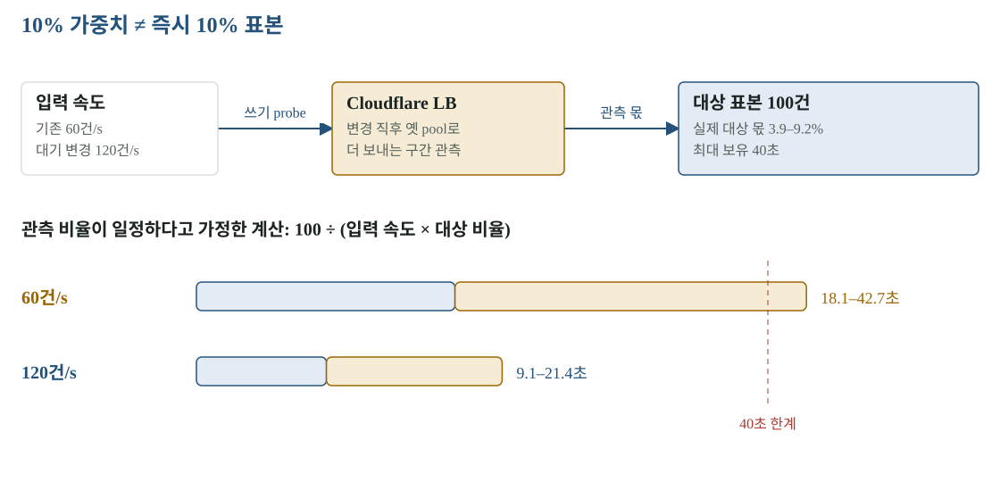

# 05 · SHIFT — 연결 풀 지연과 표본 부족은 다른 문제다

SHIFT는 앞단 트래픽을 10→50→100%로 옮기며 실제 채팅 쓰기를 판정합니다. DB의 쓰기 주체를 바꾸는 CUTOVER와 구분합니다. 이번 기록은 첫 왕복 성공 뒤에도 차가운 연결 풀과 Cloudflare 가중치 전파를 별도로 시험해야 했던 이유를 보여 줍니다.

[확대·조작 가능한 시각화](figures/05-shift.html)

## 첫 왕복에서 확인한 것

| 시각 | 방향 | 결과 | 편도 | 대상 p95 | 오류 |
|---|---|---|---:|---:|---:|
| 04:46 | 출발지 → 목적지 | 10%에서 복귀 | 37.1초 | 2,454.6ms | 0 |
| 04:50 | 출발지 → 목적지 | DONE | 43.9초 | 748–775ms | 0 |
| 04:51 | 목적지 → 출발지 | DONE | 46.8초 | 138–166ms | 0 |

성공한 두 실행은 단계마다 대상 표본 100건 이상이고, 앱 쓰기 카운터와 표본 수가 일치했습니다. Gateway 수정 뒤 앱에 도달하지 못한 오류도 없었습니다. 첫 실행은 오류 0이지만 p95가 기준을 넘어 실패했습니다. 오류율만 보면 놓치는 지연 문제입니다.

## 첫 요청이 연결을 만드는 비용

목적지 앱은 컷오버 전까지 목적지 PgBouncer → 링크 → 출발지 DB에 씁니다. 첫 실행의 PgBouncer는 링크 너머 새 연결 3개를 여느라 쓰기를 기다리게 했습니다. 이미 연결이 열린 뒤 실행하면 같은 문제가 숨을 수 있습니다.

최소 연결 10→20, 유휴 연결 유지, 리셋의 예열, 사전 점검의 연결 수 확인을 넣었습니다. 일부러 PgBouncer를 재시작한 뒤 예열 51초, 정방향 48.3초 DONE을 확인했습니다. 세 단계 오류 0·p95 639–701ms이고 실행 중 새 연결 생성도 없었습니다.

## 예열 뒤 역방향이 실패한 이유

반대 방향은 오류 0·p95 136.7ms인데 대상 표본 90/100으로 복귀했습니다. 10% 가중치를 줘도 실제 대상 몫은 변경 직후 3.9–9.2%였습니다. 옛 pool로 더 보내는 시간이 있어 40초 보유 안에 100건을 모으지 못할 수 있습니다. 100%로 바꾼 별도 실행에서도 25초 동안 75%가 옛 쪽으로 간 기록이 있습니다.

대기를 늘리는 대신 10% 단계 쓰기 속도를 60→120/s로 올리기로 했습니다. 관측 비율이 일정하다는 계산으로 100 ÷ (120 × 0.039~0.092) = 약 9–21초입니다. 이 식은 설계 판단을 돕는 계산이며 실제 재시험 결과나 확률 보장이 아닙니다.

## 현재 상태와 재개 기준

- `48a8537`: 연결 풀 예열은 main에 반영됐고 차가운 시작 정방향을 측정했습니다.
- `dd85cef`: 120/s 변경은 `pending/shift-probe-rate-120`에 보관했습니다. 미배포·왕복 재시험 대기입니다.
- 표본 100건, 오류율 1%, p95 1,500ms 기준은 그대로입니다.
- 합성 probe와 사용자 부하는 더해집니다. 50쓰기/s에 probe 120/s를 더한 경우의 환경별 실제 쓰기량을 다음 시험에 포함해야 합니다.
- S4의 앞단 되돌리기는 이 표본 게이트 없이 LB를 옮깁니다. DB 역복제·대조·쓰기 재개까지 검증한 것은 아닙니다.

다음 시험은 풀을 다시 차갑게 만들기 → 예열 상태 확인 → 양방향 각각 단계별 표본·지연·오류·실제 DB 쓰기 카운터 보존 → 최종 LB readback까지 같은 실행 기록에 담아야 합니다. 과거 ‘출발지 100%’ 기록을 현재 상태로 재사용하지 않습니다.

## 원본과 다음 읽기

- [왕복 실측](../evidence/shift/lb-roundtrip-after-gw-fix-20261103T044632/README.md)
- [차가운 풀·가중치 전파 기록](../evidence/shift/pgbouncer-warm-pool-20261103/README.md)
- [대기 변경 브랜치](https://github.com/mangowhoiscloud/b-free/tree/pending/shift-probe-rate-120)
- [DB 컷오버와 복구](07-cutover.md)
