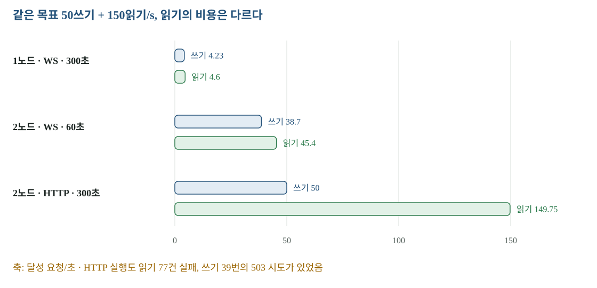

# 06 · 부하 측정 — 성공한 쓰기, 실패한 시도, 읽기 방식을 분리하자

‘50쓰기 + 150읽기/s’만 보면 같은 시험처럼 보이지만, 읽기마다 WebSocket을 새로 연결하는 경우와 HTTP로 같은 행을 읽는 경우는 비용이 다릅니다. 이번 기록은 부하 생성기의 포화와 서버의 포화를 분리하고, 요청 성공과 DB 무결성도 따로 읽어야 함을 보여 줍니다.

[확대·조작 가능한 시각화](figures/06-load.html)

## 측정 방법이 바뀐 과정

처음에는 운영자 Mac에서 부하를 만들었습니다. 당시 Cloudflare 진입점은 LAX, 플랫폼 Job에서는 ICN으로 관찰됐습니다. Mac의 연결 경로가 더 길었고 한 실행에서는 부하 생성기 자체가 평균 5.55코어·이벤트 루프 최대 34.6초 지연으로 포화했습니다. 이런 실행의 지연을 서버 처리 시간이라고 해석하면 안 됩니다.

플랫폼 Job으로 옮긴 뒤에도 초기에 2GiB 한도로 OOMKilled됐습니다. 프로세스별 열린 요청 상한 200, TLS 문맥 재사용, 2코어·3GiB 제한으로 수정했습니다. 이후 부하 생성기 CPU·루프 지연·일정 지연도 함께 기록했습니다.

## 실행별 결과를 같은 축에서 읽기

| 환경·읽기 방식 | 시간 | 쓰기 달성/s | 읽기 달성/s | 핵심 결과 |
|---|---:|---:|---:|---|
| 1노드·WebSocket, 목표 50+150 | 300초 | 4.23 | 4.6 | 노드 CPU 포화·대량 실패 |
| 1노드·WebSocket, 50+20 | 300초 | 50.0 | 20.0 | 오류 0, 쓰기 p95 260.1ms |
| 2노드·HTTP, 목표 50+150 | 300초 | 50.0 | 149.75 | 쓰기 DB 대조 OK, 읽기 실패 일부 |
| 2노드·WebSocket, 목표 50+150 | 60초 | 38.7 | 45.4 | 한 노드에 연결 비용 집중·포화 |

WebSocket 시험은 **읽기마다 새 연결**을 만드는 방식입니다. 오래 유지하는 동시 접속 수의 시험과도 다릅니다. 노드 2대에서 HTTP 목표를 달성했다고 WebSocket 연결 용량을 충족한 것으로 바꾸지 않습니다.

## 300초 HTTP 실행을 정확히 읽으면

| 지표 | 관측값 |
|---|---|
| 쓰기 | 15,000건 모두 확인. 같은 키 재시도 요청 33건, 503 시도 39회 |
| 쓰기 지연 p50 / p95 / p99 | 38.2 / 138.1 / 310.8ms |
| 읽기 | 45,000건 중 44,923건 성공, 77건 실패(503 75·502 2) |
| 읽기 지연 p50 / p95 / p99 | 36.9 / 123.2 / 278.2ms |
| DB 무결성 | 15,000건 정확히 1건씩, 유실·중복·실패·예상 밖 행 0 |
| 부하 생성기 | 약 0.70코어, 루프 지연 최대 145ms, 일정 지연 p99 3.7ms |

‘유실 0’은 최종 DB 대조이고 ‘오류 0’은 요청 시도 또는 최종 응답의 지표입니다. 재시도 덕분에 전자는 0이어도 후자는 0이 아닐 수 있습니다. p95는 분포의 95%가 그 이하라는 뜻이지 최악 지연이 아닙니다. 이 실행의 쓰기 최대는 4,772.1ms였습니다.

## 목적지 경로의 별도 병목

컷오버 전 목적지 쓰기는 링크를 거쳐 출발지 DB로 갑니다. 10쓰기/s, 60초에서는 600건을 확인했지만 쓰기 p50은 약 605ms였습니다. 온프렘 CPU는 약 0.3코어로 여유가 있어 링크와 연결 풀을 확인했습니다. 당시 풀 10개·약 0.6초로 계산한 16건/s는 추정치이며 경계 측정은 아닙니다. 이후 풀 20개 예열 변경이 있으므로 과거 추정을 현재 상한으로 재사용하지 않습니다.

## 다음 시험이 증명해야 할 것

컷오버 없는 정상 부하와 부하 중 전환은 다릅니다. 요구된 읽기 방식·연결 조건을 먼저 고정하고, 사용자 부하와 SHIFT probe를 합친 상태에서 실제 콘솔 승인에 연결된 컷오버 5회를 기록해야 합니다. 쓰기 정지 원값·중앙값·최댓값과 최종 DB 무결성을 함께 남깁니다. 지금 그 5회 증거는 없습니다.

## 원본과 다음 읽기

- [모든 실행·실패·원자료 색인](../evidence/load/README.md)
- [03:54 HTTP 실행](../evidence/load/20261103-035431-job-2nodes-http-50w150r/)
- [04:00 WebSocket 실행](../evidence/load/20261103-040037-job-2nodes-ws-50w150r-60s/)
- [SHIFT 합성 쓰기와 표본 판정](05-shift.md)
