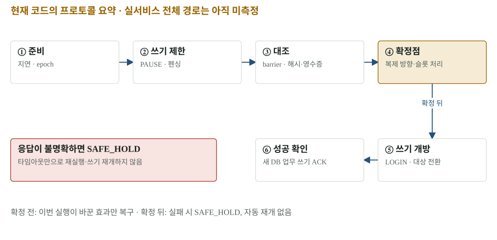

# 07 · 컷오버와 복구 — 쓰기 DB를 하나만 유지하는 절차

트래픽을 목적지 앱으로 보낸 뒤에도 쓰기 DB는 출발지일 수 있습니다. 실제 DB 컷오버는 쓰기를 잠시 제한하고, 마지막 변경의 도착과 무결성을 확인한 뒤 쓰기 주체를 바꾸는 별도의 프로토콜입니다. 이 보고서는 현재 코드와 설계를 설명하며 실서비스 전체 E2E 성공을 주장하지 않습니다.

[확대·조작 가능한 시각화](figures/07-cutover.html)

## 쓰기 소유권과 마지막 데이터

두 DB가 동시에 업무 쓰기를 받으면 나중에 어느 값이 정본인지 결정하기 어렵습니다. 그래서 출발지 쓰기를 막고 기존 세션을 정리한 다음, 제어 역할로 barrier를 commit합니다. 목적지에서 그 barrier를 보았는지와 행 수·PK·내용 해시·시퀀스를 대조합니다. barrier 한 줄만 도착했다고 모든 비교를 생략하지 않습니다.

현재 `cutover.py`는 양쪽 epoch 확인, PgBouncer PAUSE, 쓰기 역할 NOLOGIN·권한 회수·기존 세션 종료, barrier와 비교, 역방향 복제 준비, 확정점, 목적지 쓰기 개방과 pool 전환, 실제 업무 쓰기 ACK를 기록합니다. 타이머는 쓰기 제한 구간에 결속하며 화면 애니메이션이나 전체 SHIFT 시간을 쓰기 정지 시간으로 대체하지 않습니다.

## 효과 원장이 필요한 이유

원격 호출은 ‘실행되지 않음’, ‘실행됨’, ‘실행됐지만 응답을 잃음’이 겉으로 비슷할 수 있습니다. 타임아웃을 실패로 단정하고 같은 명령을 다시 보내면 이중 실행 위험이 있습니다. 효과 원장은 의도와 자원·epoch를 먼저 기록하고, 호출 뒤 실제 상태를 다시 읽어 적용 여부를 판정합니다.

| 상황 | 현재 코드·계약의 처리 | 확인해야 할 증거 |
|---|---|---|
| 확정점 이전 실패 | 이번 실행이 바꾼 효과만 역순 복구, 가능할 때 ABORT_PRE_WRITE | 각 복구 효과의 readback |
| 확정점 뒤 실패 | SAFE_HOLD, 자동 쓰기 재개 없음 | DB·pool·복제의 실제 상태 |
| 응답 유실·미해결 효과 | 재기동 후 관찰 전용, 같은 변경을 무조건 반복하지 않음 | 원장의 효과 상태·자원 관측 |
| 오래된 epoch 명령 | DB의 bravo_fence가 거부 | 펜스 갱신과 트랜잭션 결과 |
| 새 DB 쓰기 성공 | 실제 PgBouncer 경로 ACK와 영수증 확인 | 요청 키·대상·commit·단계 시간 |

설계 문서의 상위 상태 전이와 Executor가 반환하는 현재 결과는 층위가 다릅니다. 문서 그림의 화살표만 보고 실제 코드가 자동 failback을 수행한다고 읽지 않습니다. 현재 코드는 확정점 뒤 실패에서 SAFE_HOLD를 반환하는 경로가 있습니다.

## 되돌리기가 ‘LB 원복’보다 큰 이유

목적지에서 새로 받은 쓰기를 출발지로 되돌리려면 역방향 데이터 도착과 비교가 필요합니다. failback도 쓰기 제한·펜싱·barrier·무결성 대조·pool 전환을 거칩니다. 마지막 단계에서 LB를 출발지로 옮깁니다. 이 마지막 앞단 이동은 SHIFT의 표본 판정 없이 수행되지만, 앞선 DB 복구 절차를 생략하는 뜻은 아닙니다.

현재 코드에는 DB 복구 뒤 마지막 앞단 이동 실패를 별도 단계 실패로 기록하는 동작이 있습니다. 따라서 상태 이름 하나만 보지 말고 단계별 결과와 실제 사용자 진입 경로를 함께 읽어야 합니다.

## 아직 없는 증거와 다음 실험

콘솔에서 운영자가 계획을 만들고 다른 승인자가 승인한 뒤 실제 CUTOVER·FAILBACK을 끝낸 기록은 없습니다. 코드·지역 시험·SHIFT 부분 실측을 이 인수 결과로 대체하지 않습니다. 다음 실행에서는 승인 revision → 실행 ID → 효과 원장 → barrier·해시 → 쓰기 ACK → 영수증 → 콘솔 표시를 같은 사슬로 묶어야 합니다. 이전 리뷰에서 제기한 snapshot/cursor·첨부 동결·배포 잠금 등의 쟁점도 이 문서만으로 해소됐다고 간주하지 않습니다.

## 원본과 다음 읽기

- [현재 cutover.py](../../platform/executor/src/bravo_executor/cutover.py)
- [효과 원장과 E1–E6](../../platform/executor/README.md)
- [설계상 이전 순서](../architecture/03-migration.md)
- [실제 측정을 기다리는 데모 시간](08-demo-budget.md)
