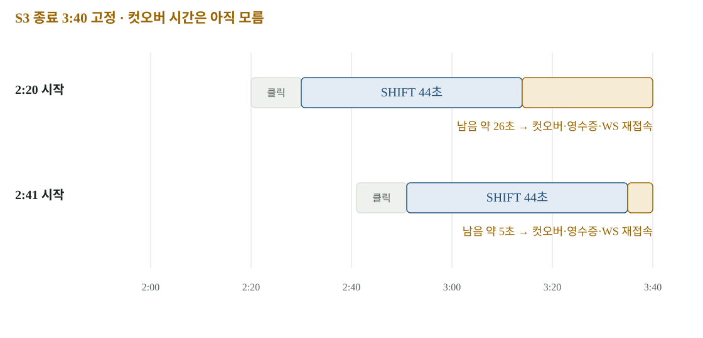

# 08 · 데모 시간 — S3가 80초 안에 들어간다고 말할 수 없는 이유

데모는 각 기능의 평균 시간을 더하는 문제가 아닙니다. 앞 단계의 PASS가 다음 단계의 시작 조건이고, 늦은 실행이 뒤의 시간 예산을 줄입니다. S2 개선과 SHIFT 성공 뒤에도 콘솔 컷오버 시간이 없어서 S3 구간의 성립을 아직 확인하지 못했습니다.

[확대·조작 가능한 시각화](figures/08-demo-budget.html)

## S2를 미리 시작하면 생기는 상태 제약

각본은 S2를 발표 T-4분에 시작하도록 제안했습니다. 하지만 S2 리허설이 시작된 계획은 게이트를 다시 돌릴 수 없는 상태로 넘어갑니다. 같은 계획에서 ‘S2는 미리 실행’과 ‘온프렘 게이트는 무대에서 새로 실행’을 동시에 할 수 없습니다.

그래서 온프렘 쌍 게이트를 T-5분에 실행하고 BLOCK 결과를 실행 시각과 함께 보여 주며, 무대에서는 별도 GKE 계획의 게이트를 실제로 돌리는 순서를 제안했습니다. 사전 기록을 라이브처럼 보여 주는 것이 아니라 실행 시각과 경로를 명시하는 방식입니다. **이 순서는 팀 결정 대기입니다.**

## 게이트의 40초는 여유 시간이 아니다

한 쌍의 게이트는 39–43초, 한 번은 63초까지 걸렸습니다. S1에 배정한 40초에 근접하거나 초과합니다. 정상적으로 빨리 끝난 실행만 기준으로 무대 순서를 고정하면, 다음 승인과 S3 시작이 늦어질 수 있습니다.

S2의 승인 후 반영·재대조도 별도입니다. T31 9.6초와 게이트 재대조 38–63초를 참고해 약 50–76초를 잡았지만, 실제 콘솔 승인부터 연속 측정한 값은 아닙니다. 발표 중 클릭·화면 갱신·설명 시간도 분리해야 합니다.

## S3 두 경우 계산

S3의 각본 구간은 2:20–3:40, 80초입니다. S2 재대조 PASS 예상은 2:15–2:41입니다. 그림은 클릭 약 10초와 SHIFT 44초를 가정합니다.

| 조건 | SHIFT 뒤 시각 | 컷오버·영수증·WS 재접속 예산 |
|---|---|---|
| 2:20 시작 가능 | 약 3:14 | 약 25초(식으로 26초) |
| 2:41에 PASS가 나옴 | 약 3:35 | 약 5초 |

남은 시간을 ‘컷오버에 충분’이라고 말하려면 실제 콘솔 경로의 분포를 알아야 합니다. 지금은 DB 컷오버·영수증·WebSocket 재접속 시간을 같은 실행에서 재지 않았습니다. 미측정 시간을 0초로 채우면 안 됩니다.

## 팀이 정할 것과 먼저 잴 것

1. 운영자 로그인과 계획 준비 뒤 실제 승인→SHIFT→CUTOVER의 시간을 잽니다.
2. 게이트 사전 기록 + GKE 실연 순서의 수용 여부를 정합니다.
3. 늦은 경로를 포함해 S2 시작 시각을 더 앞당길지, S3 구간을 늘릴지 결정합니다.
4. 270초 안과 5분 안의 각본 기준을 혼용하지 않고 팀 발표 형식을 확정합니다.
5. 최종 순서로 전체 리허설 3회 연속을 수행하고 실패·재시도도 보존합니다.

## 원본과 다음 읽기

- [각본](../demo/SCRIPT.md)
- [통합 점검](../demo/INTEGRATION-CHECK.md)
- [각본 변경 7d4be9b](https://github.com/mangowhoiscloud/b-free/commit/7d4be9b)
- [S3 예산 변경 d3549be](https://github.com/mangowhoiscloud/b-free/commit/d3549be)
- [다음 작업과 결정 목록](10-roadmap.md)
