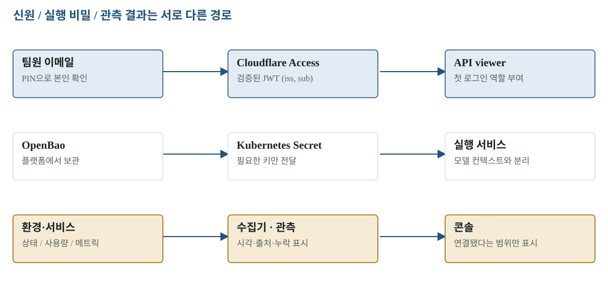

# 09 · 운영과 접근 — 키를 공유하지 않고 팀원이 데모를 보게 하기

이번 공유에서 개인 저장소를 공개하고 클라우드 콘솔은 각자 이메일로 조회하도록 구성했습니다. 저장소 공개, 로그인 허용, API 역할, 실행 비밀, 관측의 완전성은 각각 다른 설정과 증거를 가집니다.

[확대·조작 가능한 시각화](figures/09-operations.html)

## 로그인과 권한은 두 번 확인한다

Cloudflare Access는 이메일 One-time PIN으로 입장을 허용합니다. 그 뒤 API가 검증된 JWT의 `(iss, sub)`를 주체로 삼고 플랫폼 역할을 확인합니다. 이메일은 첫 로그인 역할 부여 목록에만 쓰며, 기존 멤버십을 자동으로 바꾸지 않습니다.

기존 운영자·승인자 두 신원을 유지하고 팀원 네 명을 viewer로 추가했습니다. 실제 이메일 목록을 공개 ConfigMap 대신 OpenBao → Kubernetes Secret으로 옮겼습니다. API와 operator-mcp가 Secret 볼륨을 사용하는 배포로 전환됐고 두 워크로드가 각각 2/2 Ready임을 확인했습니다. 팀원 각자의 PIN 수신·로그인 완료는 아직 사용자 사용 결과가 아닙니다.

**남은 역할 결정:** 기존 운영자·승인자 메일은 한 사람의 두 신원입니다. 코드상 신원 분리는 있지만 서로 다른 두 사람이 승인했다는 뜻은 아닙니다. 실제 데모에서 누가 승인할지는 팀이 정해야 합니다.

## 비밀의 위치와 수명

| 비밀·정보 | 보관·전달 | 공개 자료에 들어가는 것 |
|---|---|---|
| Cloudflare·LLM 실행 자격 | 플랫폼 OpenBao | 경로·필드 설명만 |
| 서비스가 필요한 비밀 | Kubernetes Secret 또는 단기 전달 | 참조 이름·형식 예시 |
| 첫 로그인 역할 목록 | OpenBao access-members → Secret | 예시 reviewer 이메일만 |
| CI 클라우드 인증 | GitHub OIDC | 역할 연결 설정 |
| 저장소 작업 인증 | GITHUB_TOKEN | workflow 권한 선언 |

OpenBao 초기화·봉인 해제·감사 활성화와 root token 폐기를 확인했습니다. 공개 전 Git 전체 이력·현재 압축 파일·Actions 로그를 검사했고 탐지된 테스트 문자열과 임시 DB 암호를 코드와 대조했습니다. 검사 범위는 공유 전 점검 문서에 남겼습니다. 자격 값을 보고서·Slack·GitHub에 적지 않습니다.

LLM 자격이 저장됐어도 공급자 사용 한도와 실행 성공은 별개입니다. 마지막 Opus 작업은 사용 한도에서 멈췄고, 그 뒤의 120/s 변경을 검증 완료로 표시하지 않습니다.

## 콘솔의 초록색이 설명하지 않는 것

11:18 KST 세 고객 환경과 플랫폼 서비스 응답을 확인했지만 계획·승인 기록은 0건이었습니다. 관측 화면은 서비스 상태·일부 메트릭을 보여 주며 로그·트레이스 목록은 아직 미연결이고 외부 Grafana 경로를 사용합니다. 일부 Hubble 메트릭도 누락돼 있습니다.

비용 화면은 연결된 출처에 대한 추정치입니다. GCP 청구 BigQuery, Cloudflare 수집 설정, LLM 사용량 자료, 태그 배분, 일부 구독 가격 등 누락 항목이 있어 최종 청구액이나 전체 비용으로 제시할 수 없습니다. 화면의 숫자는 수집 시각과 제외 항목을 함께 읽어야 합니다.

## 팀원이 확인하는 순서

콘솔 홈 → 클러스터 → 데모 앱 → 관측 → 비용 → 기록 재생을 봅니다. 채팅은 리뷰용 방에 시험 문구를 보내면 됩니다. 이번 점검에서 AWS 연결 상태와 시험 문구의 새로고침 후 재조회까지 확인했습니다. 컷오버 버튼을 눌러 전체 이전을 수행한 검증은 아닙니다.

## 원본과 다음 읽기

- [클라우드 콘솔](https://b-free.mangowhois.ai/)
- [리뷰 채팅방](https://b-free-chat.mangowhois.ai/?room=team-review-20261103)
- [접근·첫 로그인 역할](../../deploy/platform/access/README.md)
- [공유 전 검사 범위](../evidence/publication-20261103/README.md)
