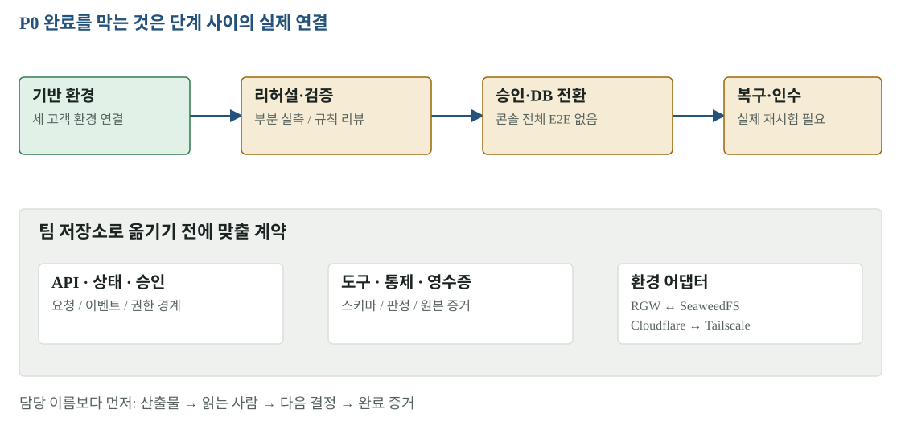

# 10 · 로드맵과 협업 — 다음 결과를 무엇으로 확인할 것인가

개인 구현은 팀이 읽고 검토하고 필요한 부분을 재사용할 수 있는 재료입니다. 기능 파일 수나 개인 작업의 PASS를 팀 정본의 완료로 계산하지 않습니다. 회의록·1급 문서·목표·진행 상황·역할을 기준으로 다음 결정을 정하고, R&R 경계가 걸려도 요청된 결함의 원인과 증거는 연결합니다.

[확대·조작 가능한 시각화](figures/10-roadmap.html)

## 기존 계획 대비 상태

날짜는 개인 계획의 목표 구간이며 완료일이 아닙니다. 세부 담당·기한은 팀의 현재 회의 기록을 따라야 합니다.

| 목표 구간 | 범위 | 확보한 결과 | 다음 완료 증거 |
|---|---|---|---|
| 11/3–4 | 기반·환경·CI | EKS·RKE2·GKE 연결, DB·비밀·이미지·OIDC 가동 | 팀 환경 어댑터와 계약 대조 |
| 11/3–4 | 콘솔·API·상태 | 코드와 조회 화면, 역할별 리허설 시험 | 실제 계획·승인·실행 기록 연결 |
| 11/5 | 보안·S2·T31 | 두 역할 PASS, 검증 환경 반영·시간 실측 | 규칙 검토·예외 결정·승인 후 실제 반영 |
| 11/5 | 전환 | SHIFT 왕복·예열 실측, 컷오버 코드 | 120/s 재시험과 콘솔 DB 컷오버 |
| 11/6 | 복구·품질 | 정상 부하 실측, 복구 코드 | 컷오버 5회·실제 failback·무결성 |
| 11/6–7 | 데모 인수 | 각본·예열·사전 점검·관측·비용 | Exit Drill·전체 리허설 3회·발표 순서 확정 |

## 지금 분리해서 처리할 결정

| 사안 | 필요한 결정·행동 | 읽을 자료 | 완료라고 부를 증거 |
|---|---|---|---|
| 검증기 6개 규칙·Job | 사람 검토와 기준 변경 승인 | 보고서 04·원본 전후표 | 검토 의견·반영 커밋·회귀 결과 |
| SHIFT 120/s | 대기 코드 검토·배포·재시험 | 보고서 05·dd85cef | 차가운 풀 양방향 실행 ID와 단계 표본 |
| 콘솔 컷오버 | 운영자·승인자 지정, 실제 실행 | 보고서 07 | 승인 revision·영수증·쓰기 정지 원값 |
| 게이트 무대 순서 | 온프렘 사전 기록 + GKE 실연 수용 여부 | 보고서 08 | 팀 결정과 갱신된 각본 |
| 부하 조건 | HTTP/WS 조건·probe 합산 명시 | 보고서 06 | 동일 조건의 5회 컷오버 원본 |
| 구현부 이전 | 인터페이스와 필요한 코드 범위 합의 | 보고서 01·팀 정본 | 계약 대조표와 선택한 변경 PR |

이 문서에서는 다른 사람에게 새로운 담당을 임의로 배정하지 않습니다. 산출물을 누가 읽고 어떤 결정을 내려야 하는지 먼저 적고, 담당은 회의 기록과 요청에 맞춰 연결합니다.

## 구현부를 옮기기 전에 맞출 세 계약

**입력과 상태:** 계획 ID·환경 ID·승인 revision·SSE 이벤트·권한 경계가 팀 API와 같은지 봅니다. UI가 비슷해도 상태의 의미가 다르면 붙일 수 없습니다.

**검증과 영수증:** 통제 결과 스키마, UNKNOWN 처리, 산출물 digest, 실행 ID, 유효기간, 무결성 비교 단위가 같은지 봅니다. 리허설 PASS가 실행 승인을 건너뛰게 해서는 안 됩니다.

**환경 어댑터:** 개인 RGW·Cloudflare와 팀 SeaweedFS·Tailscale의 차이를 대조합니다. 버킷 정책·TLS·주소·링크 지연·K8s 권한이 달라지는 곳을 명시합니다. 개인 apps/demo와 팀 demo-chat도 별도 구현입니다.

## 리뷰 요청을 처리하는 기록 단위

요청 → 관련 스펙·회의 결정 → 재현 → 코드/설정 변경 → 시험 → 실제 readback → 남은 제한 순서로 남깁니다. 구현이 끝났어도 라이브 경로를 확인하지 못했다면 그 단계에서 멈춘 상태를 정확히 기록합니다. GitHub에는 변경과 원본 증거, Notion에는 읽을 수 있는 설명과 결정, Slack에는 짧은 상태와 링크를 둡니다.

## 원본과 다음 읽기

- [개인 일정 원문·제안](../plans/2026-11-03-to-07.md)
- [개인 스펙 추적표](../spec/SPEC-TRACE.md)
- [팀 platform 정본](https://github.com/Softbank-Hackathon-Finals/platform)
- [검토·결함 목록](../demo/REVIEW-STATUS.md)
- [보고서 목차](README.md)
