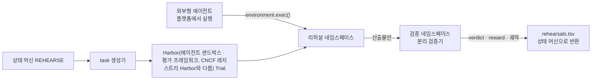

# 00. 전체 흐름과 에이전트 개입 기준

소유 코드: `src/bravo_rehearsal/quadrant.py`, `src/bravo_rehearsal/runner.py`
확인 명령: `make test T=tests/test_quadrant.py`

## 에이전트 개입 기준: 4사분면

11/1 회의는 에이전트 개입을 4사분면으로 정했습니다. 축은 [입력이 결정론적 | 비결정론적] × [출력이 결정론적 | 비결정론적]입니다. 비결정론이 하나라도 끼는 칸에만 에이전트를 넣습니다.

| 칸 | 우리 작업 | 실행 방식 | 합격 판정자 |
|---|---|---|---|
| 결정론 입력 × 결정론 출력 | 게이트, 통제 시험, 컷오버, 롤백 | 코드만. Trial 없음. 이 저장소 범위 밖 | 코드 |
| 결정론 입력 × 비결정론 출력 | 승인자용 요약, 사후 리포트 | `summarize` Trial | 코드가 수치를 대조하고 사람이 판정 |
| 비결정론 입력 × 결정론 출력 | 정책 번역, 코드 수정 | `fix` Trial. 상한 3회 | 분리 검증기 |
| 비결정론 입력 × 비결정론 출력 | 애매한 의존성 분류, 원인 추정 | `analyze` Trial | 코드가 형식을 확인하고 사람이 판정 |

출력 축은 "합격을 코드가 같은 기준으로 판정할 수 있나"로 읽습니다(제안). LLM 출력은 temperature 0에서도 매번 같지 않기 때문입니다. 같아야 하는 것은 출력이 아니라 판정입니다.

사람 개입은 칸과 따로 정합니다. 되돌리기 어렵거나 영향이 큰 실행이면 사람이 승인합니다.

## 동결 지점

AI의 비결정성은 승인 결속 앞에서 끝납니다. 승인 때 계획, diff, 이미지 digest를 묶습니다. 그 뒤로는 코드만 실행합니다.

## 흐름

Trial 하나는 에이전트 호출 하나입니다. 도구 호출마다 Trial을 만들지 않습니다.

근거: `research/agent-design/01-determinism-quadrant.md`, `research/deliverables/2026-11-02-harbor-approach.md`
